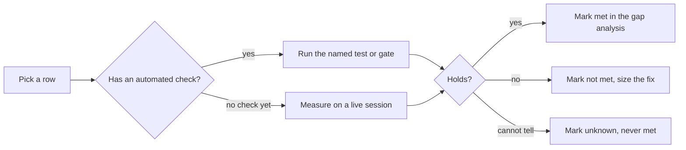

# Harness requirements checklist

This is the list of things every harness Kiro Crew drives must do. Each row was learned from a bug a user hit, mostly on KAS, and names the merged PRs that taught it. Use it when you add a harness, adapt one, or review a harness change: walk the rows for that harness and check each one.

This checklist is a measurement aid, not a gate. The invariants a harness change must keep live in [harness-parity](../system-specs/modules/harness-parity.md) (the `H` labels below), the onboarding steps live in [harness-onboarding](../system-specs/modules/harness-onboarding.md) (the `Stage` labels below), and the CI rule lives in [harness-parity-gate](../ci/harness-parity-gate.md). Where this list and those docs disagree, those docs win. Where each harness stands against each row today is in [harness-gap-analysis](harness-gap-analysis.md).

Every file reference was read at `origin/main` `ae9132cd86a3` (2026-11-13). References name files and symbols; search for the symbol if the code has moved. Paths with no top folder are under `src/kiro_crew/`; `test/` and `scripts/` are at the repository root. Some security items are tracked privately.

## How to use it

Each row has an ID and four columns. **Rule** is what must hold. **Why** names the PRs that taught it. **Edge cases** are the inputs that broke it before. **Verify** names the test or gate that fails when the rule breaks; "no check yet" means nothing fails today, so the row needs a live check.

Names used in the Verify column: **G1** is `test/test_backend_cards_advertised.py` (the advertised-field set gate). **G2** is the capture rule in `scripts/check_harness_parity.py`. **G3** is `test/test_real_adapter_fixture_pins.py`. Set names such as `REPORT_USAGE` are the `ACP_BACKENDS_*` sets in `agent_sdk/`.

## How the list was built

The list started from the harness parity invariants and the capability card. It was then checked against every KAS-related fix PR merged to `main` from 2026-10-23 to 2026-11-13: 299 PRs. Each PR was mapped to the row whose rule names its bug. A PR that no row named became a new row or a new clause on an old one.

## Requirements

### Launch and version check

| ID | Rule | Why | Edge cases | Verify |
|---|---|---|---|---|
| R-LAU-1 | Kiro CLI is the floor; an unknown or unselectable backend degrades with a logged reason and never raises. | H1/H3/H4 (`harness-parity.md`); #20359; #25808, #26393 (Kiro pick runs on KAS, own engine when relay cannot) | LTS floor is KAS; a hand-edited non-string `acp_backend`; a Bot pin refuses instead (H17) | `test_harness_parity.py::test_unselectable_backend_degrades_to_default`, `test_lts_harness_floor.py` |
| R-LAU-2 | Every known harness has a launch golden (argv, labels, env). | Stage 3; H13; #30674 (`--agent-engine v2` pin) | Windows `.cmd` shims (#29116, #32142); `CLAUDE_CODE_EXECUTABLE` must be `claude.exe` (#29920) | `test_acp_launch_goldens.py` |
| R-LAU-3 | The installed release is read and compared with a tested range: below the floor it is refused or warned, above the last tested release one notice names version, range and install command. | #25171 (KAS dropped prompts below kiro-cli 2.33.1); #27998, #27926 (codex, goose ranges); #30683, #30011, #35322; #36125 (kiro-cli 3.1 changed what it loads) | Adapter that reports no version gets no notice; wrapped adapter reports wrong version (open #26459); exact-pin harness must re-read copied lists on bump (copilot); KAS relay route vs pinned bundle | `untested_version_issue` tests; **no check** that every harness has both bounds |
| R-LAU-4 | A harness has an install probe that names the missing part and its command. | Stage 6; #31027, #35357, #22754, #29958, #35262 | Two-part installs (pi, node adapters); bundled binary (#30624); node not needed on the KAS bundle route | `test_agent_backend_editable.py::test_baseline_ships_every_known_backend`, `backend_install` tests |
| R-LAU-5 | Live fixtures are held to the release Crew installs or tests. | #23979 | Two-package harness (pi + pi-acp); KAS engine version vs kiro-cli version | G3 `PINNED_FIXTURE_ADAPTERS`, kiro/KAS floor test |
| R-LAU-6 | Any probe or initialize that dies shows exit status and stderr, not a timeout or a crash of the caller. | #34748, #34001, #30587, #23235, #30533 (task limit), #27562 (hung kiro-cli crashed doctor) | Stdout EOF before handshake; Windows policy block (R-LAU-9); EAGAIN on thread spawn | per-fix tests; **no cross-harness check** |
| R-LAU-7 | Every probe or killed start reaps its whole process tree, and a tree-tracking failure fails the probe, never the gateway. | #35492, #34237, #31831, #31476, #35812, #35992 | Lock file removed before kill (#35812); Windows job objects; nested kiro-cli of a live session must survive (#22356) | per-harness tests; open #35757 (pi, opencode) |
| R-LAU-8 | A host that cannot sandbox a harness says so and refuses. | open #34147 | Codex inside an existing host sandbox (#29127) | **no check yet** |
| R-LAU-9 | A Windows policy block (AppLocker/EDR, winerror 5/1260) is named on every spawn path, not shown as a transport error. | #33227 | Direct client path; retry after the update window first | runtime path only; **no check** for the direct client |
| R-LAU-10 | Where Crew installs, updates, stages or copies a harness binary or engine (KAS engine, bundled kiro-cli, pod/docker/cloud copies), the install is pinned, atomic and cleaned up, and a host that cannot run it is refused before any progress, with one exit code and the cause first. | #26384, #26386, #31069, #34005, #33802, #28962, #26623, #30651, #34004, #34050, #29965, #33713, #31731, #33435, #32551, #29425, #29341, #30611, #28792; #33510 (glibc 2.28 floor) | Interrupted download; leftover staging trees; broken copy crash-loop (move aside once); `--force` on an in-use engine; blank `remove --version`; old glibc; v3 engine refusal is a host verdict; Windows short names in `KIROCREW_KIRO_BIN`; pod copy file cap and exec bit; installer picking `~/.local/bin`; VPC endpoint shadowing the download host; doctor warns, not fails, on an engine the first chat downloads | per-step tests per fix; **no table test** of every install step's failure path |
| R-LAU-11 | Launch and config reads/writes (cli.json overlay, managed MCP launch resolve, registry whoami) are bounded and never run on the event loop. | #23442, #31813, #25569, #29431 | A cli.json lock that makes one attempt on the loop; sibling session waiting | per-fix tests; **no check** (asyncio slow-callback test around session allocate) |
| R-LAU-12 | A rule that holds only on kiro-cli (sign-in prerequisite, kept-prompt contract) is applied by the harness the turn runs on, not by the chat or the default. | #32839, #32470 | Regenerate, edit-resend, rewind, the OpenAI-compatible endpoint; a slot whose turn moved harness | per-fix tests; **no check** across every `reject_if_kiro_unverified` caller |

### Auth and sign-in

| ID | Rule | Why | Edge cases | Verify |
|---|---|---|---|---|
| R-AUTH-1 | Every harness has one `AgentAuthDeclaration`; credential leaves go on the read-gate floor. | Stage 5 | `HOME` override vars re-anchor leaves; `adapter_own_leaves` must be a subset | `test_agent_sdk_host_auth.py` |
| R-AUTH-2 | A signed-out harness shows its own `signed_out_message` and skips retry, keyed on a captured phrase. | #30928, #33629, #31812, #30977 | A blank phrase is refused; phrase must come from a live capture | declared for goose, pi, deepseek, copilot; **no check** that harnesses without a phrase still show the right sentence |
| R-AUTH-3 | Remote MCP sign-in links open, stay open long enough, are withdrawn on timeout, are stored where chats read them, and a refused callback is logged once. | #35649, #34627, #26481, #33737, #30766, #31467, #30823, #27962, #28354, #32212, #34749, #30936 | Per-user vs org sign-in; SSE 405 (open #35802); Crew-held GitHub | per-fix tests |
| R-AUTH-4 | Where Crew runs the sign-in itself, every message names the right command and field, a dropped flag is warned, and sign-out or account change ends every Crew-held token holder. | Many PRs incl. #34026, #33747, #35397, #35890, #35396, #29882, #29361, #32445 | Builder ID vs SSO; relay vs bundle route; token refresh the engine cannot do; IdC profile paging (#29398) | per-fix tests; kiro family only |
| R-AUTH-5 | The Kiro account check is bounded (30 s), runs before each session acquire, and a timeout says "timed out", not "sign in". | #19752, #31449, #34795 | Probe killed by the sandbox; flaky network | per-fix tests |

### Sandbox and credential hiding

| ID | Rule | Why | Edge cases | Verify |
|---|---|---|---|---|
| R-SBX-1 | `is_kiro_cli` (sandbox stand-down) is granted only by positive membership, and a conflict with kiro-cli's own sandbox is named. | H7; #26596 | KAS relay route stands down, bundle route does not | `check_harness_parity.py` `sandbox-delegation` rule |
| R-SBX-2 | The card names every boundary move (stand-down, host credential to child, pod HOME). | `SECURITY_LINES` | Per-route facts cannot show on one card | `test_backend_cards` |
| R-SBX-3 | Native config files the harness reads at start (user and project) are fenced or pinned. | #32471; open #30765 | User and project config scopes | per-fix tests |
| R-SBX-4 | The env scrub keeps what children need: ssh keys, kerberos, launcher PATH, and the OS certificate store. | #34328, #32600, #28565, #33153, #32587; open #33997 | Windows env names are case-insensitive (#33724, #35531) | per-fix tests |

### Approvals and permissions

| ID | Rule | Why | Edge cases | Verify |
|---|---|---|---|---|
| R-APP-1 | Every tool call reaches Crew's PreToolUse gate by a declared and verified routing mechanism, including calls the spec auto-approves. | `Routing` (`agent_sdk/backends_routing.py`) | Calls a spec auto-approves | routing tests |
| R-APP-2 | A spec with `"tools": []` gets no tool at all. | #30093 | `UNASKED_NATIVE_TOOLS` | G2 `HONOR_ZERO_TOOL_BAN` |
| R-APP-3 | A user-input question is answered as a question, never as yes. | KAS question tools | Timeout default must be deny | per-fix tests |
| R-APP-4 | Sub-agent calls are told apart from parent calls before a deny override card. | `*_CHILD_CALLS_MARKED` | Fail-closed list | `test_x_feature_captures.py` |
| R-APP-5 | A call reaches the gate and the hooks under one canonical tool identity, whatever name the harness used (title, `toolId`, alias, remote wrapper, harness-native name). | #24779, #24910; #30086 (claude names) | pi `read`/`find` vs `fs_read`/`glob`; Crew's own read-only MCP tools under Reads mode | `tool_names` / `tool_identity` tests; **no per-harness table test** |

### Spec, hooks and auto-approve

| ID | Rule | Why | Edge cases | Verify |
|---|---|---|---|---|
| R-SPEC-1 | Every spec field is ruled on by the harness's mirror (translated, withheld, no-channel), none is dropped silently, and the ruling is re-made at every claim (chat, cron, channel). | KAS PRs incl. #31002, #34721, #35326; #34736 (stale projection on cron/channel) | KAS projection is not a mirror yet | `test_provider_mirrors.py` |
| R-SPEC-2 | Spec hooks and kiro-cli's user hook files (`~/.kiro/hooks/*.json`) run, by harness or Crew, up to the documented cap (64), on every turn kind, or a notice names what runs nowhere. | #13893, #30134, #31950, #26873, #31241, #33016, #30571 | Cron turns (#33189), channel turns, subagent and task runs, > 4096-char command (#28925) | `spec_hooks_run_nowhere` tests; card `ineffective` |
| R-SPEC-3 | A spec's `allowedTools` / server `autoApprove` either auto-approves or the card lists `auto_approve` as ineffective. | #25106, #25339, #33228, #33544, #29473, #21512 | Globs, `@builtin`, `*`, regex commands | card `mcp.ineffective` |
| R-SPEC-4 | `toolsSettings` allowlists are enforced by Crew's gate or named as applied nowhere. | #30108, #30088, 11 KAS PRs incl. #33045, #34579 | Alias names (#32649); 1024-command cap (#35687) | `CREW_ENFORCES_SPEC_TOOLS_SETTINGS`; notice tests |
| R-SPEC-5 | Built-in tool limits in a spec are applied or named. | Spec built-in tool fields | Read-only spec on a full built-in harness | member `native_tools` tests |
| R-SPEC-6 | Steering files load once, global and project, with `auto` front matter honoured. | #35637, #32179, #35244, #34255, #35736 | Escaped `auto`; Windows `file:///c:/` | `CREW_LOADS_SPEC_STEERING` |
| R-SPEC-7 | A custom agent prompt is sent once and reaches the model; `prompt` and `systemPrompt` are both read, `$VAR` is expanded, and an unreadable file is named. | #31875, #25171, #26382, #25907, #25361 | `file://` with `$HOME` or `..`; shared reader `_load_agent_prompt` (`context_assembly/agent_spec.py`) | KAS tests; **no cross-harness check** |
| R-SPEC-8 | Where Crew reads kiro-cli's matcher grammar, it reads it as kiro-cli does. | 14 PRs, e.g. #28437, #31892, #33478, #35087, #35687 | Pipe or redirect still asks (#28926); brace globs (#32602) | per-fix tests in `platform/allowed_commands.py`, `platform/tool_names.py` |
| R-SPEC-9 | Crew-fired hooks get kiro-cli's stdin keys, `session_id`, `tool_input` shape, length bound and cron coverage. | #28912, #30937, #33173, #28925, #24952, #28923 | > 4096-char commands; cron turns | `agent_sdk/spec_hooks.py` tests |
| R-SPEC-10 | After a Crew-driven compaction, kept agentSpawn hook output is sent again on every harness where Crew fires that hook. | #33212 | A compaction the harness runs on its own | **no cross-harness check** |
| R-SPEC-11 | On KAS, kiro-cli's own user and workspace settings (`chat.defaultModel`, telemetry opt-out, mcp.json settings, `useLegacyMcpJson`) are carried or named, and Crew's workspace writes never land in the global settings. | #30712, #33222, #33026, #34155, #34356, #35788, #33510 | `.kiro/settings` linked to `~/.kiro`; notice shown once per chat | per-fix tests; **no settings-key table** |
| R-SPEC-12 | Every tool a spec names is mounted under the engine's own id, and the sub-agents it may call are registered. | #26435, #28852, #30827, #34877, #33215 | `subagent` alias; session starting in the agent's own mode | per-fix tests; **no name-map test** against captures |
| R-SPEC-13 | Crew never rewrites an agent file it does not own, and an agent that cannot load (same-name conflict, kiro-cli built-in agent, leftover crewmate file) is refused with the reason and the fix. | #25325, #28423, #32090, #33215 | Shared templates kiro-cli loads outside Crew | per-fix tests |

### Skills

| ID | Rule | Why | Edge cases | Verify |
|---|---|---|---|---|
| R-SKL-1 | A session loads the same skills its kiro-cli twin would load, scoped to the agent it runs, tolerant of encodings, with no Crew file left where kiro-cli reads agents. | #25346, #28502, #30064, #30065, #30952, #31576, #31559, #33946, #36125 | UTF-8 BOM; a skill KAS would drop (fixed copy); warm mint must not project; kiro-cli 3.1 loads every `.json` in `~/.kiro/agents` | projection tests; **no KAS-vs-twin parity test** |

### MCP mounting and work tools

| ID | Rule | Why | Edge cases | Verify |
|---|---|---|---|---|
| R-MCP-1 | Crew's own tools reach every session. | Stage 7 | `@kirocrew-core` with nothing defining it | card `crew_tools` |
| R-MCP-2 | Work-ledger and session-control tools mount where the harness takes member chats, and carry the session identity. | #31571, #22611 | Bare vs `mcp_<server>_<tool>` names | card `member_thread_tools`; G2 `MEMBER_DISPATCH` |
| R-MCP-3 | A third-party server's `env`, `headers` and `${VAR}` reach it; secrets never ride a plain-http relay unless the operator opts in. | #30616, #26785, #26786, #30643, #30175, #28615, #34582 | Windows case (#35531); unresolved placeholder named (#31562) | per-fix tests |
| R-MCP-4 | A server or config file that cannot be read or started is pruned or named on every surface (session notice, Connections, doctor), not left to hang the session. | `PRUNE_UNSTARTABLE_MCP`; #32195, #33595, #32527, #24572, #34202, #35540 | UTF-16 mcp.json; slow vs dead server | G2 (goose, deepseek); copilot off the wire |
| R-MCP-5 | An MCP config change reaches a running session, or the session says it needs a restart. (Mute handling moved to R-MCP-13.) | #23622, #29865 | Removing a managed record unmounts it | **no check** that a non-member is told |
| R-MCP-6 | A per-tool deny reaches the tool, or the card says it costs the whole server. | `mcp.per_tool_deny` | Spared control-plane servers (codex) | `backend_mcp_ability` tests |
| R-MCP-7 | An unattended run (cron, webhook) waits for slow MCP servers before its first prompt. | #30898, #30325, #33074 | Harness that never reports MCP readiness | **no check yet** |
| R-MCP-8 | A spec's remote MCP `oauth` block that cannot reach the harness is named in the session notice. | #27712, #28782, #34643, #31671 | Only kiro-cli honours the block | **no check yet** |
| R-MCP-9 | A tool-less helper spawn starts none of the harness's own MCP config. | #30969 | claude user settings, codex config layers | **no check yet** |
| R-MCP-10 | Session start and load mount every declared server, Crew's own first, within one start budget carried across resume, re-attempt a timed-out managed server once, and never restart a shared engine pool through a per-session launch identity. | #26148, #35278, #35123, #34542, #19905, #32602, #33074 | Queued managed server while the host connect queue moves | per-fix tests |
| R-MCP-11 | Under an admin MCP registry, Crew's own servers keep working (marked or opted in), filtered servers are named, and the session starts instead of aborting. | #22375, #29017, #28534, #29419 | Unmarked control plane when no registry applies; crewmate stub retyped `registry` | per-fix tests |
| R-MCP-12 | Tool-search deferral is decided per engine: Crew's tools defer only where the engine supports it, the gate reads the resolved executable, the deferred envelope keeps the tool's purpose, prompt guidance matches the active mode, and budgets use the engine's unit. | #24297, #26403, #29375, #30205, #30540, #29892, #35340 | kiro-cli 3.x single binary; spec with no `tool_search` grant | per-fix tests |
| R-MCP-13 | A server or tool switched off in any config scope (user, project, agent file, gateway) never starts or mounts on any route. | #30874, #30924, #31513, #34061, #36391, #33228 | Project agent switching a user server off | per-fix tests; **no scope × route test** |
| R-MCP-14 | Every MCP tool result shape (`content`, `structuredContent` only, error) reaches the agent as text. | #34979 | Server sending `content: []` after `MCP-Protocol-Version` | `mcp_structured_text` tests on gateway and KAS bridge |

### Steer and cancel

| ID | Rule | Why | Edge cases | Verify |
|---|---|---|---|---|
| R-STR-1 | A steer is advertised only where the verb is measured, and refused at a version floor with a notice. | H6 | Handshake without `_meta.steering.supported` | G2 steer sets; G1 |
| R-STR-2 | A steer is reported consumed only on evidence; otherwise it is queued, never lost. | H6; #32372 | Steer during a tool call or an approval | per-harness tests; claude and goose captures allowlisted |
| R-STR-3 | Cancel ends the tool tree and settles the turn. | #31975, #34763, #32128 | Background shell holds turn (copilot, open #34088) | per-fix tests |

### Side chat

| ID | Rule | Why | Edge cases | Verify |
|---|---|---|---|---|
| R-SIDE-1 | Side Chat runs read-only tools only where a read-only turn is captured; its home ignores native always-allow files. | `SIDE_READONLY` | claude side pins mode | G2 `SIDE_READONLY` |

### Model and effort

| ID | Rule | Why | Edge cases | Verify |
|---|---|---|---|---|
| R-MOD-1 | The picker lists what the session advertises; a stored id from another harness is not sent blind. | #25671, #34090, #34062, #36249, #30890 | Degraded list must not shrink cache; `auto` absent | `ADVERTISED_MODEL_SELECTION` tests |
| R-MOD-2 | Effort goes down one channel per harness, and a refused level is named. | #18630, #21376, #34860 | Default pseudo-model; pair ids (codex) | effort channel disjoint test |
| R-MOD-3 | The model a turn ran on is recorded. | #30003, #29984 | Auto pick | KAS test; advertised-selection path |

### Subagents

| ID | Rule | Why | Edge cases | Verify |
|---|---|---|---|---|
| R-SUB-1 | Continuation is offered only where a closed session can be loaded back. | H6 | KAS delete frees and removes the record | exempt list |
| R-SUB-2 | Native subagents show as their own cards and are recorded at each turn end. | #23094, #22391 | Resume of a claude native child refused (#30085) | per-fix tests |
| R-SUB-3 | A Bot worker gets only its granted tools on the worker kit harness. | #30241, #30131, #31802, #33504 | Harness without kit falls back to KAS (H17) | G2 `MATE_WORKER_*` |

### Session lifecycle

| ID | Rule | Why | Edge cases | Verify |
|---|---|---|---|---|
| R-LIFE-1 | Teardown frees the harness session by a measured verb and removes the launch files Crew wrote for it. | `SESSION_EVICTION`; #28954 | Notification vs request | G2 `SESSION_EVICTION` |
| R-LIFE-2 | Incognito, temporary and released chats leave no native transcript or memory. | #30082, #35260, #31395, #30225 | Harness with its own transcript store | **no cross-harness check** |
| R-LIFE-3 | A load of a gone id is not mistaken for a resume. | #25521 | `session/load` that creates an empty record | `require_replay` on KAS only |
| R-LIFE-4 | Idle sweep and `_bg` reaping never kill a working session. | #28689, #32376, #22356 | Long-parked runtime | per-fix tests |
| R-LIFE-5 | Send session carries the model's context, not only the transcript. | #32509, #34344 | Session files carry secrets | **no check yet** |
| R-LIFE-6 | Session start admission prices a start by its real MCP roster and staggers boot wakes. | #33484 | Unpooled stdio servers copied per session | `start_pricing` tests |
| R-LIFE-7 | A history replay is sent exactly once per resume; a failed streamed turn does not re-arm it. | #32484 | Throttle 5xx after first token | replay-lease tests |

### Compaction and usage

| ID | Rule | Why | Edge cases | Verify |
|---|---|---|---|---|
| R-USE-1 | A turn's usage (tokens or credits) is reported. | #23648, #34521, #32460, #35727, #35894, #26951 | Credits after answer on stop; API-key auth (#25434) | G2 `REPORT_USAGE` |
| R-USE-2 | Manual `/compact` is offered only where it runs; engine-managed compaction is shown, not double-run. | #18921, #29335, #25598, #34462, #24761 | Context recycle instead (deepseek) | G2 `COMPACT`, `HARNESS_MANAGED_COMPACTION` |
| R-USE-3 | A compaction is reported to the transcript, and the reply streamed before a mid-turn compaction stays in it. | `COMPACTION_REPORTED`; #34072 | Unmarked pair (codex) | G2 scoped |
| R-USE-4 | A compaction restart that fails or times out leaves the session on the same agent and mode. | #35428, #33149 | kiro-cli restart failure; KAS timeout | per-fix tests |

### Prompt payload

| ID | Rule | Why | Edge cases | Verify |
|---|---|---|---|---|
| R-PRM-1 | A prompt attachment is inlined once per conversation where the harness keeps it, and history that breaks a provider cap (image > 2000 px with many images) is recovered, not left wedged. | #35698, #22381 | Harness that drops pictures on a silent compaction must re-inline (H6) | `SENT_IMAGE_RECORD` set; per-fix tests |

### Tool rows

| ID | Rule | Why | Edge cases | Verify |
|---|---|---|---|---|
| R-ROW-1 | Tool rows and file-change records read each supported engine version's tool shapes. | #25650, #26589 | kiro-cli v3 `replace` edit and write tools | fixture per engine version |

### Commands

| ID | Rule | Why | Edge cases | Verify |
|---|---|---|---|---|
| R-CMD-1 | The `/` menu lists only commands the session's harness runs, and Crew's harness commands are answered locally or refused, never sent to the model as text. | #25098, #32009, #34696, #30112 | `ACP_BACKEND_PROMPT_HANDLER_COMMANDS` row per harness | `GET /api/slash-commands` tests; **no per-harness table** beyond codex |

### Error surfacing

| ID | Rule | Why | Edge cases | Verify |
|---|---|---|---|---|
| R-ERR-1 | The harness's own error frame is logged even when Crew shows curated wording. | #28513, #30038 | Unattributed terminal error (codex) | per-fix tests |
| R-ERR-2 | Overflow and transient errors are classified (retry vs context overflow). | #28549, #30087, #30901 | goose active-run refusal is busy (#28414) | **no cross-harness table** |
| R-ERR-3 | A worker's failed call to a work tool by name is flagged to its conductor. | #22611 | Each harness's own "tool not available" text | `undelivered_call_watch.py` KAS pattern only |
| R-ERR-4 | "Built-in tools not ready" is said plainly. | #35765 | | per-fix test |
| R-ERR-5 | Liveness keeps a trusted tool identity for Crew's `wait` and samples only the tool's own server for opaque-MCP movement. | #30669, #29972 | copilot owned by open #34092, #34117 | **no check yet** |
