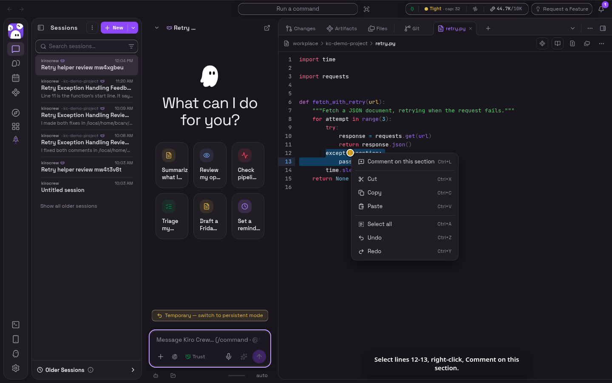
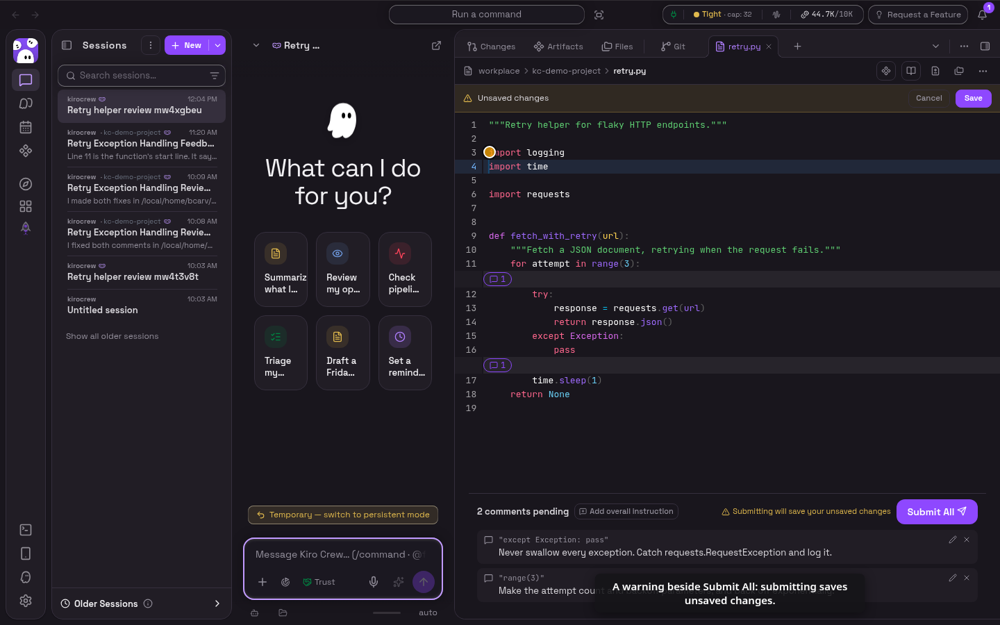
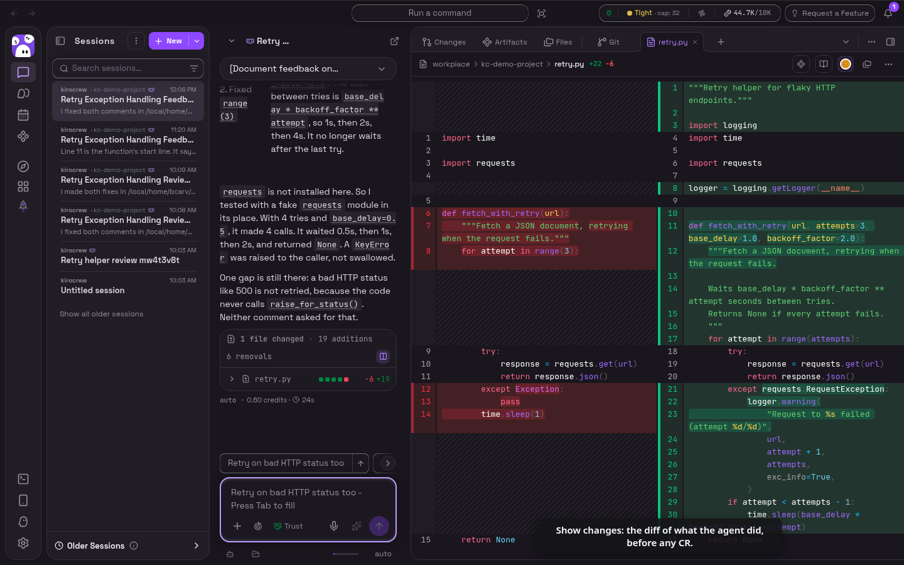

# RFC: Comments on code files from the side panel's editor

**Status:** draft. A reference implementation is on the branch
[`biasedbit:feat/code-file-editor-comments`](https://github.com/biasedbit/KiroCrew/tree/feat/code-file-editor-comments),
described in [Prototype](#prototype). Nothing is on `main`.
**Measured at:** `083e552cf` (main, 2026-11-06). Every symbol cited below was
read at that commit.

## Summary

A code file in the side panel keeps opening in the editor, and the editor
gains a way to leave comments for the agent: right-click for a menu whose first
item is **Comment on this section** (the usual Cut, Copy, Paste, Select all,
Undo and Redo follow), or press **Cmd+L** (Ctrl+L elsewhere), as in Kiro IDE.
The comment covers the selection, or the whole line when nothing is selected.
Each pending comment shows as a chip under its lines and moves with them as the
user keeps typing.

Pending comments join the panel's existing pending list. **Submit All** saves
any unsaved edits first, then sends one `[Document feedback on …]` message,
**the same message markdown files already send**, with each comment naming its
lines. While there are unsaved edits, a warning beside the button says that
submitting will save them. So the line numbers the agent receives are always
the lines of the file on disk. If the file changed on disk after the editor
loaded it, Submit All refuses rather than save over that change.

This is the review loop from
[#18472](https://github.com/kirodotdev/KiroCrew/issues/18472): line-anchored
feedback on code an agent just wrote, before any pull request or CR exists. It
needs no backend change, no new store and no new message type.

*See the demo and screenshots under [Prototype](#prototype).*

## Motivation

### Current state

Markdown files in the side panel already have the whole loop: select text,
comment, see the pending list, Submit All, and the agent applies the comments.
Code blocks inside artifacts have line comments
([#8339](https://github.com/kirodotdev/KiroCrew/issues/8339)). Code files have
neither:

- A code file opens straight in the Pierre editor. The `editing` state
  initializer in `MarkdownPanel` says so: "everything else editable opens
  straight in the Pierre editor — there is no separate read-only source mode
  for code files".
- Both `SelectionToolbar` mounts in `MarkdownPanel` (side panel and full
  screen) are guarded by `!editing`, so the comment composer never mounts over
  a code file.
- `PierreEditorImpl` passes Pierre's `File` no `lineAnnotations` or
  `renderAnnotation`, and exposes no selection on its handle.
- `CodeEditor` has no context menu, so a right-click in the editor shows the
  browser's own menu.
- `useMarkdownPanelDisk` arms the file watch only when not editing
  (`watchArmable` requires `!editing`), so an editor that holds a clean buffer
  does not see an agent's edit to the file until the tab is hidden and shown
  again. A later save writes the stale buffer over that edit.

### The problem

To give line-level feedback on code an agent just wrote, a user either
describes the location in chat ("in the except block around line 12…"), which
loses the anchor and makes the agent search for it, or waits for a pull request
or CR and comments there. The first is lossy, and the second is too late for the
fast generate, review and fix loop the chat is for.

## Goals

1. Comment on a selection of any size in a code file (part of a line, a line,
   several lines) without leaving the editor.
2. Keep editing after commenting: comments follow their lines.
3. The line numbers sent to the agent are the lines of the file on disk.
4. Reuse what exists: the composer, the pending list and Submit All, the
   artifact code-comment chip, the `[Document feedback]` message.
5. Nothing changes for a user who never comments: code files open in the editor
   as today, and the editor's keys are unchanged except Cmd/Ctrl+L.

## Non-goals

- **A read-only review view.** A separate mode to switch into before commenting
  is less ergonomic than commenting where the user already edits; see
  [Alternatives](#alternatives-considered).
- **Threads, replies, or keeping comments after they are sent.** Like markdown
  file comments, these are pending feedback for the agent, not a review record.
- **Comments in the live-diff editor.** It reports side-tagged diff annotations,
  which this design does not place; the diff view keeps its current behaviour.
- **Any agent-side change.** The agent reads the message as it reads markdown
  feedback today.

## Design

### 1. Selection and annotations on the editor

`PierreEditorImpl` forwards three optional props to Pierre's `File`:
`lineAnnotations`, `renderAnnotation`, and `onLineAnnotationsChange`. Pierre's
`Editor` already moves annotations with each edit and reports the moved set in
its `onChange(file, lineAnnotations)` callback; the editor passes that through.
The handle (`PierreEditorHandle`) gains `getSelection` (1-based lines and
columns plus the selected text), `replaceSelection`, `selectAll`, `undo` and
`redo`, all thin wrappers over Pierre's `getState`, `applyEdits`,
`setSelections`, `undo` and `redo`.

### 2. The menu and the shortcut

`CodeEditor` wraps the editor in the dashboard's existing `ContextMenu`
(non-modal, so it does not hold focus or pointer events when it closes). The
first item, shown only when the host takes comments, is **Comment on this
section**, labelled with its shortcut. The edit items act through the handle.
Paste reads the clipboard API and therefore needs the browser's clipboard
permission; the keyboard Paste does not.

The section is the selection when there is one, otherwise the whole line that
was right-clicked (read from Pierre's `data-line` row attribute), falling back
to the caret's line. **Cmd+L** (Ctrl+L off macOS) does the same from the
keyboard, with the selection or the caret's line, and is claimed inside the
editor so it does not reach the browser's address bar. Neither the dashboard nor
Pierre's default keymap binds it today.

Two details matter:

- The Escape that closes the menu is stopped there (`onEscapeKeyDown`), as
  `ui/select.tsx` already does, so it does not also reach the file panel's
  document Escape handler, which would close the file or ask to discard edits.
- Pierre's `File` re-applies its `lineAnnotations` prop on every render. The
  editor's reported positions are therefore kept in a ref updated inside the
  change callback, before React renders, so a render cannot put a chip back on
  the line it just left.

### 3. Comments in the panel

`MarkdownPanel` builds an `editorCommenting` value for a code file whose host
accepts comments (not markdown, not a rich type, not read-only, not the live
diff). Choosing **Comment on this section** stages the section and opens the
existing composer through `SelectionToolbar`'s `externalSelection` channel, the
same path artifact pages use for code. The new comment records `line`,
`column`, `anchor` (the section's text) and, for a multi-line section,
`endLine`, a new optional field on `InlineComment`.

Comments then follow their text (`utils/codeCommentRanges`):

- **Editor edits.** The editor reports each edit as text replacements, with
  offsets into the text before the edit (Pierre's change event). Both ends of
  every section are mapped through them: text typed at either edge stays outside
  the section, text typed inside becomes part of it, and `anchor` is re-read
  from the new text. So a line break typed inside a two-line section keeps its
  start and grows its end, and the stored location always names the stored text.
  A section deleted entirely loses its location.
- **A new version from disk.** A reload that did not come from typing (the
  agent's edit) carries no edit list. Each section is found again by its text,
  at the occurrence nearest its old position. A comment whose text is gone loses
  its line and column and is sent with its quote alone, rather than with a line
  number that now names something else.

The chips follow Pierre's own annotation tracking; once the last comment is
gone the editor gets an empty annotation list (Pierre keeps the previous set if
the prop is `undefined`).

Adding a comment does not save the file.

### 4. Submit All saves first

When the editor has unsaved edits, Submit All first reads the file from disk.
If it differs from the version the editor loaded or last saved (`savedBaseline`),
the agent or someone else changed it meanwhile: Submit All saves nothing, sends
nothing, and shows "The file changed on disk after you started editing. Save or
discard your edits, then submit." The comments and any typed overall instruction
stay. Otherwise it calls the panel's own save and sends only if that succeeded;
a failed save sends nothing and shows the save error as it does today. The save reports success directly, rather than through
the `dirty` state, which trails it by a render. While there are unsaved edits,
the pending list shows a warning beside the button: "Submitting will save your
unsaved changes", in every shipped language.

The panel's file watch also stays armed in the editor while the buffer is clean
(`followDiskWhileEditing`), for code files that take comments, outside the
live-diff editor. `useMarkdownPanelDisk` keeps the watch off while editing so a
live push cannot land under the user's cursor; that concern is about a buffer
with the user's work in it, and the watch here is armed only while the buffer is
clean. A reload then resets the editor's caret and undo history, which a clean
buffer has nothing to lose from. So after the agent edits the file, the editor
shows the agent's version, and the next save cannot write the old text over it.

### 5. The message to the agent

`formatCommentsMessage` gets one branch: a comment with `endLine > line` is
rendered as `(lines A-B, "<section text>")`. A comment on part of one line uses
the existing `(line A, col C, "<text>" in "<context>")` form. The quote goes
through the existing escaping, so newlines in it cannot forge prompt structure,
and, as for every comment, it is cut at 80 characters: the line numbers carry the
location, the quote confirms it.

```
1. (lines 15-16, "except Exception:\n            pass"): "Never swallow every exception. Catch requests.RequestException and log it."
2. (line 11, col 20, "range(3)" in "    for attempt in range(3):"): "Make the attempt count and backoff parameters, and back off exponentially."
```

## Prototype

One commit on
[`biasedbit:feat/code-file-editor-comments`](https://github.com/biasedbit/KiroCrew/tree/feat/code-file-editor-comments),
based on `39717a0ad`. About 590 added
lines of product code across `CodeEditor`, `PierreEditorImpl`,
`MarkdownPanel`, `CommentOverlay`, `useMarkdownPanelDisk`,
`codeCommentRanges` and `commentsMessage.prompt.ts`, plus the new strings in
every catalog.

Checks run on the branch:

- `tsc -p tsconfig.app.json` and eslint on the changed files are clean.
- The existing tests of every changed component pass (214 files, 3,405 tests),
  with 14 new unit tests (the message format; mapping sections through edits at
  their edges, inside them and over them; finding them again after a disk change)
  and `catalogParity.test.ts`.
- `scripts/capture-code-editor-comments-isolated.mjs` mounts the real
  `MarkdownPanel` over a fetch stub (capture page
  `capture/code-editor-comments.tsx`) and checks the menu, the shortcut, comments
  following edits above and inside them, comments found again after a disk
  change, the warning, Submit All refusing over a changed file, and that every
  line number sent names the same text in the saved file (27 checks).
- `scripts/capture-code-editor-comments.mjs` drives the whole dashboard on a Dev
  Fleet pod built from the branch, with a real agent, and records the demo
  below (17 checks, including that the agent's fix is on disk).

The demo: comment through the right-click menu, keep editing, Submit All with
an unsaved edit, and the agent applying the comments.

https://github.com/user-attachments/assets/d3844e59-b46a-4ccb-bb77-62752eb52463

The right-click menu:



Two pending comments with chips in the editor, an unsaved edit, and the warning
beside Submit All:



After the agent's turn, the editor shows its edit and the diff toggle shows the
change against git:



## Migration plan

**Phase 1: comments in the editor (one PR).** The prototype, cleaned up after
review.
Exit criteria:
- Right-clicking in a side-panel code editor whose host takes comments shows
  **Comment on this section** first; Cmd/Ctrl+L does the same.
- A comment on a selection records its lines and text; with no selection it
  covers the right-clicked or caret line.
- Typing above or inside a pending comment keeps its stored location naming its
  text; a reload from disk finds it again by its text or drops its location.
- With unsaved edits the warning shows; Submit All saves, then sends, and every
  sent line number names the same text in the saved file. A failed save, or a
  file changed on disk since it was loaded, sends nothing and keeps the comments.
- The isolated capture's checks pass in CI, and a GUI scenario next to
  `test/gui_user/scenarios/chat-files-side-panel-browse.yaml` covers open,
  comment, Submit All.

**Phase 2 (optional, blocked on Open question 1):** the same disk check for
every save from the editor, not only Submit All's.

## Backward compatibility

- Files open exactly as today. The only new key binding is Cmd/Ctrl+L inside the
  code editor, and the right-click menu replaces the browser's native one there.
- The context menu also appears where `CodeEditor` is used outside the side
  panel (for example workflow source); there it has only the edit actions.
- `InlineComment.endLine` is optional. Stored drafts without it load as before.
- The message format changes only for comments that carry `endLine`.
- Read-only (`wtdiff`) tabs and hosts without `onSubmitComments` get no comment
  item, as they get no comments today.
- The watch armed in a clean editor costs one more open stream only for the
  visible tab, within the per-tab budget `useMarkdownPanelDisk` already keeps.

## Security considerations

No new endpoint, store, permission or network surface. Comments live where
markdown comments live and reach the agent as an ordinary chat message from the
user; the quoted section is text the user chose to send and goes through the
existing escaping. The menu's Paste uses the browser clipboard API and is
subject to the browser's permission prompt.

## Alternatives considered

- **A read-only Review view beside the editor.** Code files keep opening in the
  editor and a toggle shows Pierre's read-only view with GitHub-style line
  comments. It adds a second mode the user has to switch into, and edits made in
  the editor while comments are pending invalidate their lines. Commenting in the editor keeps one surface and lets
  the editor itself move the comments.
- **Open code files in a review view by default.** Changes what every code-file
  open does and adds a click before editing.
- **Save when a comment is added.** It surprises a user who is
  mid-edit, and it does not by itself keep line numbers right if more edits
  follow. Saving on Submit All, with the warning, covers both.
- **Track a comment by its chip alone, shifting both ends by the chip's move.**
  Simpler, but wrong as soon as the user edits inside a multi-line section: a
  line break inside it would move the start too. Mapping both ends through the
  edit keeps the section exact.
- **Only a selection popover (Pierre's `renderSelectionAction`).** A popover on
  every selection gets in the way of ordinary editing; a menu item and a
  shortcut are opt-in.

## Open questions

1. **Saving over an agent edit outside Submit All.** Submit All checks the disk
   before it saves; a plain Save (Cmd+S or the button) still writes the buffer
   over a newer file, as it does today. Should every save from the editor make
   the same check?
2. **Finding a section again by its text.** After a disk change a section is
   matched to the nearest copy of its text. If the agent duplicated that code,
   the nearest copy may not be the one the user meant. Is that good enough, or
   should such a comment be flagged for the user to confirm?
3. **The menu outside the side panel.** Keep the edit-only menu on other
   `CodeEditor` hosts, or show it only where comments are possible?
4. **Discoverability.** Markdown files show a one-time comment hint
   (`CommentHint`). Should code files show one naming the right-click item and
   Cmd/Ctrl+L?
