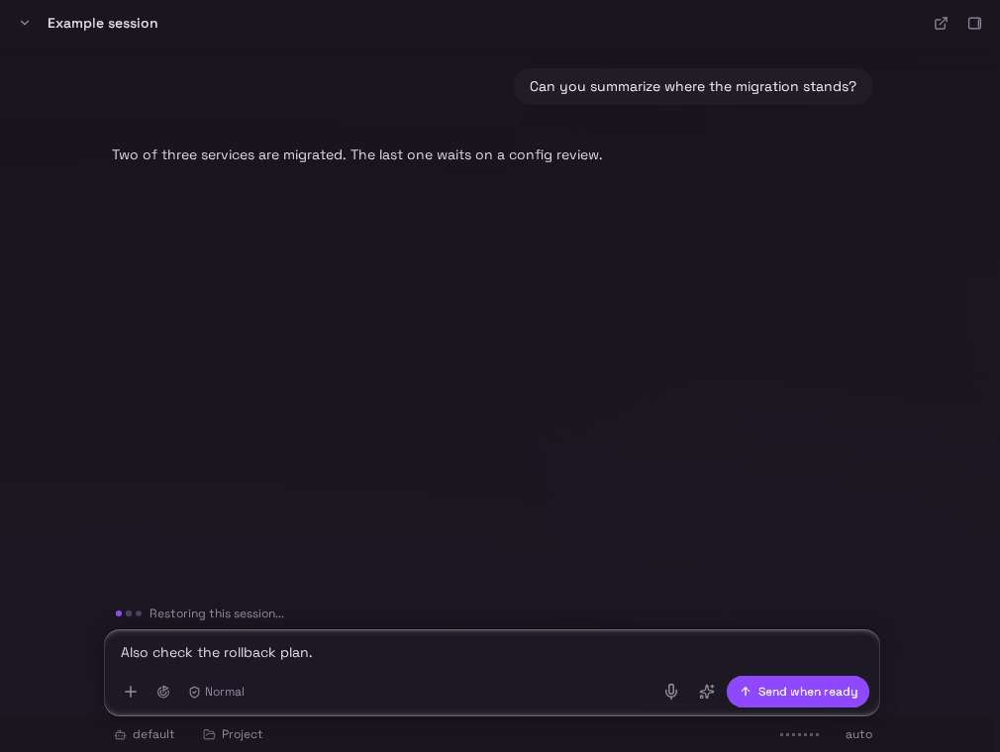
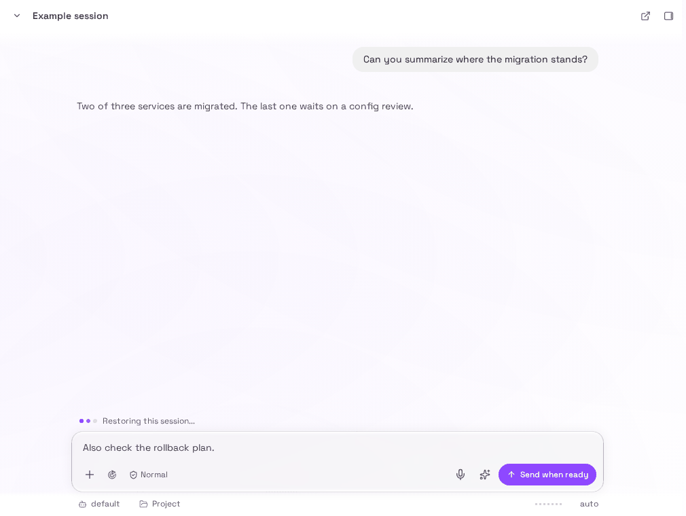
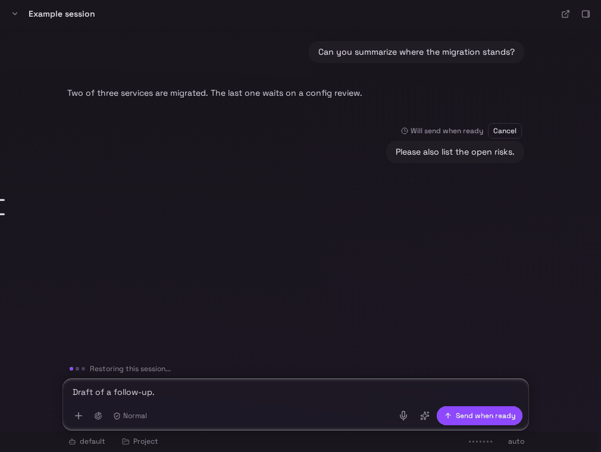
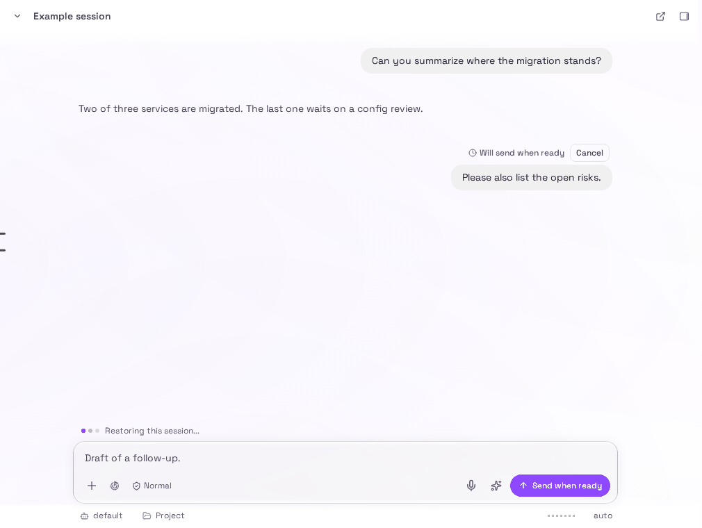
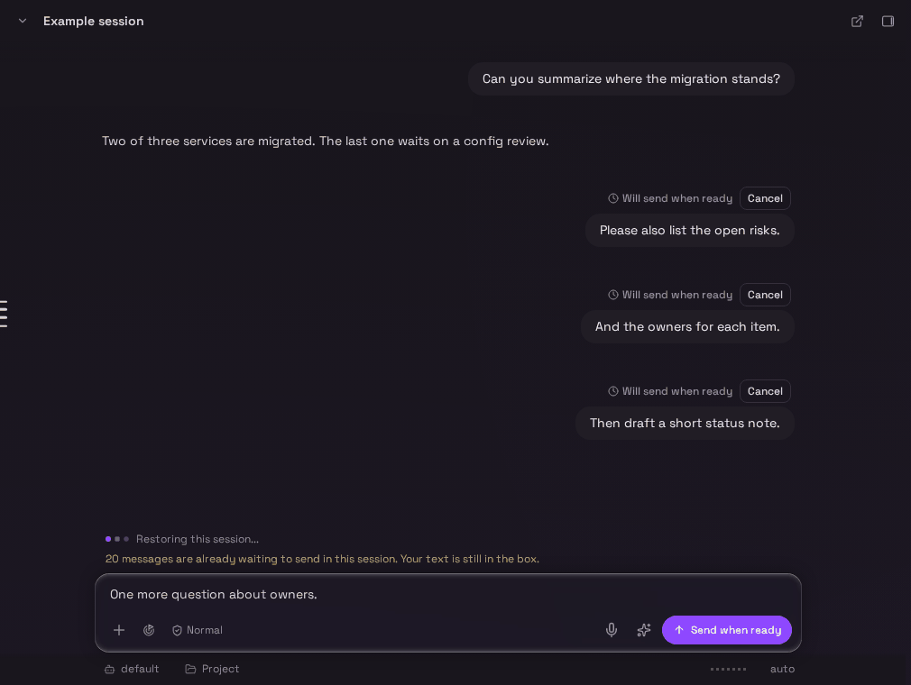
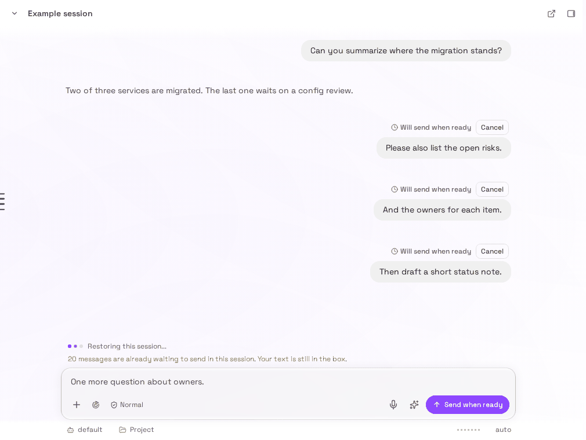
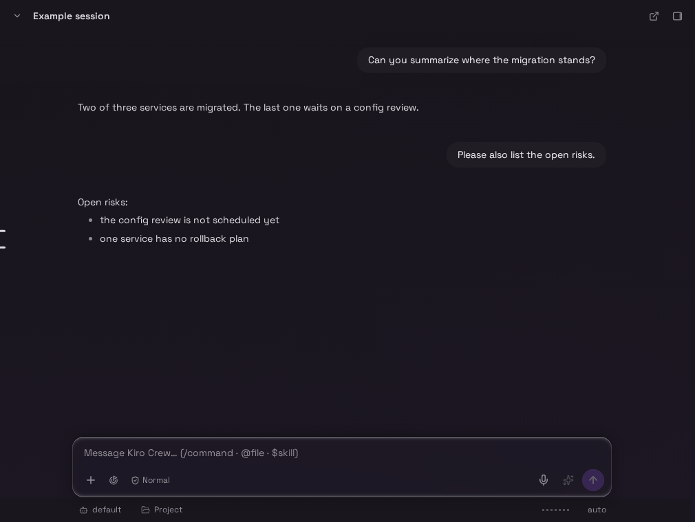
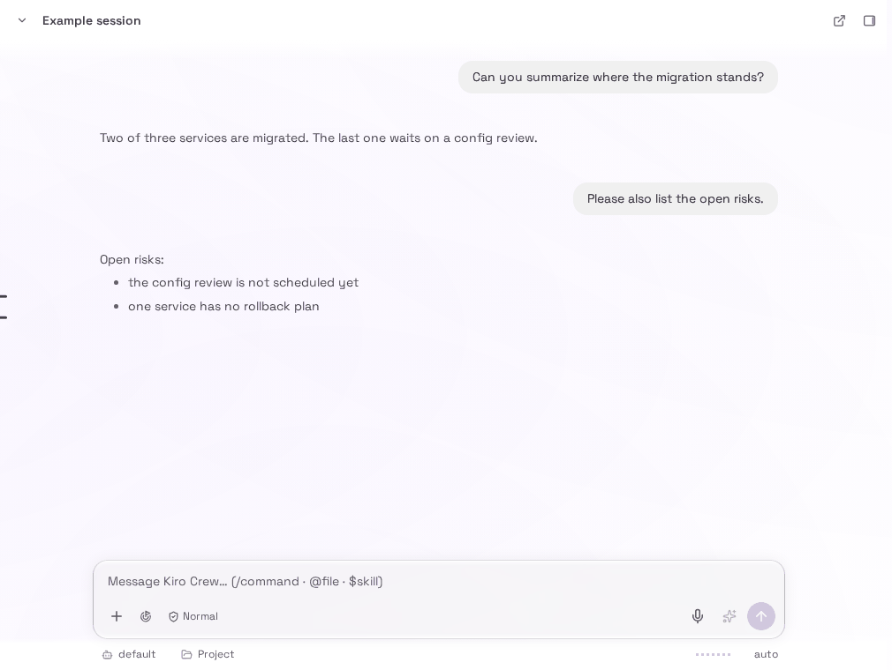

# RFC: Show per-session readiness in the composer, hold a message typed too early and send it exactly once when the session is ready

Status: draft. Acceptance requested from a maintainer of the dashboard chat composer. This is part A of [#35875](https://github.com/kirodotdev/KiroCrew/issues/35875). Part B (a bounded-cost restore path for large sessions) is not covered here. Code references were read on main at `d9839eee5d`, which already contains [#34887](https://github.com/kirodotdev/KiroCrew/pull/34887) (merged as `035aa13ec1`). This document changes no code.

## Summary

After a gateway restart the dashboard accepts typing and Send in every tab while the gateway is still restoring sessions and preparing memory. The result is a message stuck at "Delivery pending", a refusal shown only after the fact, or a turn that fails with a memory error. The composer has no "not ready yet" state, so it looks idle when it cannot accept a message.

This RFC proposes three things, all on top of signals the gateway already has:

1. The gateway tells the dashboard, per session, whether it is `restoring`, `preparing_memory` or `ready`, as a `readiness` field on each slot list entry of the existing `slots` WebSocket frame.
2. While a session is not ready, the composer shows that state with a small animation, and a message typed meanwhile is held in the UI with a "will send when ready" marker that the user can cancel.
3. The held message is sent automatically once the session is ready, under the same client-minted id on every attempt, so a retry after a 409, a late ack or a reconnect never produces a second message.

## Motivation

The measurements and the three failure shapes are in the issue (gateway reports ready 103 s after start on one install with 130 tabs). This document adds what the code does today.

### Current state on main

The signals the gateway already has, and what each means:

| Signal | Where | Means |
|---|---|---|
| `/ready` `startup_complete` | `src/kiro_crew/dashboard/handlers/core.py` (read and written to the payload); set by `state.ready = True` at `src/kiro_crew/dashboard/server_runtime/api_entrypoint.py` | The whole gateway finished its boot wiring. Session restore, open-tab rebuild and memory preparation continue after it (`core.py`, `chat_turn/turn_admission.py`). It is an HTTP probe, per gateway, and is not on the WebSocket. |
| Slot list partial flag | `begin_slot_list_rebuild` at `state_parts/slot_list_hold.py`; `slots_push.py` (`slots_partial`); `slots_frame.py` (`frame["slotsPartial"] = True`); client `website/src/hooks/websocket/slotList.ts`, store `slotsListPartial` at `website/src/store/dashboard/state.ts` | The `slots` list is incomplete because a restart is still restoring sessions. A key missing from a partial list was not deleted. `slotsHeldKeys` names the absent keys still held (`slot_list_held_keys`, `slot_list_hold.py`). Today the client uses the hold to stop destructive drains of state keyed by a missing session, such as its unread entry, its per-slot chat state and its badge contribution (`website/src/utils/slotListHold.ts`). |
| Memory-preparing task | `_memory_preparation_pending` at `chat_turn/queue_drain.py`; `wait_for_memory_preparation` at `memory_startup.py` with a 30 s grace (`MEMORY_ADMISSION_WAIT_SECONDS`, `memory_startup.py`); called at the one turn admission seam, `turn_admission.py` | Shared memory is still being prepared. A turn waits up to 30 s, then raises `MemoryStartupUnavailable` ("The gateway is still starting ... This message did not start an agent.", `memory_startup.py`). This happens inside the turn, after the user row is written, so it is an error row (`turn_failures.py`, `code: memory_unavailable`), not an HTTP refusal. |
| Memory-preparing notice | `GATEWAY_NOTICE_MEMORY_PREPARING` at `gateway_notice.py`; written by `_arm_parked_queue_drain` (`queue_drain.py`) when a queue is parked, once per task per slot | A transcript notice row for a slot whose queued cards are parked. Server-side queued cards are drained when preparation ends (`queue_drain.py`). It is a row in the history, not a state the composer can read, and it only exists for slots that already have a queue. |
| Owed-key set and `session_loading` (merged in #34887) | `restoring_open_slot_keys` and `owed_slot_keys_known` on `DashboardState`; `session_still_loading` in `state_parts/slot_directory.py`; `_loading_refusal` in `chat_api/app_admission.py`, called from `_api_chat_send` and `api_chat_slot_create` (all on main since #34887) | The restore has read its snapshot of open tabs and owes these keys; a send or create naming one before its slot exists is refused with 409 `{"code": "session_loading"}`, so it cannot mint a fresh slot under a saved key and lose the saved agent binding. The owed set is server-side only. It is not sent to the dashboard. |

### The send path today

- `composerSend.ts` mints a `sendId` (`mintSendId`, `website/src/utils/sendDelivery.ts`) and sends `Idempotency-Key: send-<sendId>` with the composer's send (`turnActions.ts` and `NeedsMeHoverCard.tsx` do the same; other send surfaces send no key) (`website/src/pages/chat/page/composerSend.ts`, `sendIdempotencyKey` at `website/src/api/sendRace.ts`, header set in `website/src/api/client/chat.ts`). The id also rides as `meta.sendId`, which the server normalizes (`normalize_send_id`, `chat_delivery.py`; `_send_id_of`, `chat_send.py`) and persists on the user row.
- `sendTurn` (`website/src/chat-core/transport/sendTurn.ts`) returns one of `dispatched`, `queued`, `refused`, `unknown`, `response-late` (10 s deadline, `SEND_ABORT_MS`) or `transport-error`. `composerSend.ts` keeps the optimistic bubble pending on `response-late` and marks it unconfirmed (when it minted one). For a `refused` receipt it already branches on the body: the send-race conflict (`isSendRaceConflict`) and `composer_locked` (`isComposerLocked`) each restore the draft without an error row, and `refusalMessage(body)` switches on `body.code` for the Shared Crew capacity codes. Any other refusal becomes an error row plus a restored draft. It has no branch for `session_loading`, so that 409 would show as a failed send.
- Server side, a send to `POST /api/chat` passes `_settle_send_race` (`chat_send.py`) after the early refusals (including `session_loading` and `composer_locked`) and before any branch queues, steers or starts it. With a client key, `SendRaceRegistry.claim` (`shared_crew/send_race.py`) answers `Replay` for a key this principal already had accepted, and the handler answers the recorded send without accepting a second one (`chat_send.py`). A claim is committed only when the send is accepted; a send answered with a refusal gives the claim back (module docstring of `send_race.py`), so a retry of a refused send is a new claim, not a replay.
- The replay memory is per process and bounded: `HISTORY_PER_SESSION = 64` (`send_race.py`) accepted sends per session, in memory.

So an id and a server-side replay already exist. What is missing is the readiness state, the hold, the automatic resend and one gap in the replay (section 1.4).

## Goals

- The composer never looks idle for a session that cannot yet accept a message, and says why.
- A message typed while the session is not ready is delivered exactly once, without the user pressing Send again.
- A "still loading" or "still preparing" answer is retried by the client within a bound and is not shown as a failed send while it is within that bound.

## Non-goals

- Making large sessions ready faster. That is part B of the issue.
- Changing what the gateway refuses. #34887 keeps owning the 409 `session_loading` refusal and its wait.
- Readiness for apps, linked channels, the OpenAI-compatible endpoint or cron. They are not composers. They keep today's behaviour.
- A gateway-wide "starting" screen for a dashboard that cannot reach the gateway at all (that is the reconnect banner's job).

## 1. Design

### 1.1 Readiness states and which signal drives each

One state per session, computed on the gateway, in this precedence (first match wins):

| State | Driven by | Composer meaning |
|---|---|---|
| `restoring` | the session's key is in the owed set (#34887 `restoring_open_slot_keys`) or is under construction, or it is in `slotsHeldKeys`, or it is absent from a list labelled `slotsPartial` | The slot does not exist yet. A send would be refused with 409 `session_loading`. |
| `preparing_memory` | `_memory_preparation_pending(state)` is true (`queue_drain.py`) and the slot exists | The slot exists but a turn would wait up to 30 s and then fail with `memory_unavailable`. |
| `ready` | neither of the above | Send works as today. |

`startup_complete` does not drive a per-session state. It is a gateway-wide HTTP probe and flips before restore and memory preparation finish, so it cannot say that a given session is ready. It is used for one thing: a dashboard that reconnects while `/ready` still answers 503 can show the gateway-level starting state it already has; nothing new is needed for that.

The memory-preparing notice row is not used as a signal. It exists only for slots with a parked queue and is history, not state. Its text ("Queued messages will run when it is ready") stays as it is.

### 1.2 How the state reaches the composer

Decision: each entry of the `slots` list gets a `readiness` field with the value `restoring`, `preparing_memory` or `ready`. The existing top-level flags stay as they are: `slotsPartial`, `slotsHeldKeys` and `slotsHoldChannels` already say that a restart is still restoring sessions and which keys are held. No new message type is needed.

- The gateway computes the value per entry with the precedence in 1.1: `restoring` for an entry whose key is in the #34887 owed set or still under construction, `preparing_memory` while `_memory_preparation_pending(state)` holds, else `ready`.
- A key that is not in the list yet has no entry. For it the client reads `restoring` from the flags it already stores: the list is partial and lacks the key, or the key is in `slotsHeldKeys`.
- An older gateway sends no `readiness` and the client reads `ready` for every entry, which is today's behaviour. A newer gateway with an older client is unchanged, because unknown entry fields are ignored.
- The gateway must push a `slots` frame when an entry's value changes: when the owed set empties (the `session_restore.py` finally block from #34887 already clears it) and when the memory task finishes (a done-callback beside `queue_drain.py`). Without a push on change, the composer would wait for the next unrelated `slots` frame.

Cost: one short string on each entry of every `slots` frame, on a frame that already carries many fields per entry. Omitting the value when it is `ready` keeps the steady-state frame unchanged.

### 1.3 Composer behaviour while not ready

- A status strip sits directly above the input: "Restoring this session..." for `restoring`, "Preparing memory..." for `preparing_memory`. It carries a small animated indicator (the existing pulse or dots utility), so the input never reads as idle.
- The input stays editable. Typing is not lost and the draft store keeps working. The Send control changes its label to "Send when ready" so pressing it is understood as queueing.
- The strip appears only if the state lasts longer than about 300 ms, so a normal fast tab switch does not flicker.
- Reduced motion: `website/src/index.css` already shortens every animation under `prefers-reduced-motion: reduce`. The strip does not rely on the animation to say anything; the text is the state. Under reduced motion the indicator is static.
- Screen reader: the strip is a `role="status"` region (the pattern used by `ChatPaneNotices.tsx`), so a change of text is announced politely once per state change. The animated indicator is `aria-hidden`. When the session becomes ready the strip announces "Ready" once, and a held message that then sends is announced by the existing delivery copy. The strip does not announce per tick.

Mockups. The images below are renders of the real chat page and composer components, with the not-ready state forced by a throwaway local patch that is not committed (headless Chromium driven by Playwright, fixed viewport, neutral example session). They show the proposed look and wording of sections 1.3 and 1.4; none of this exists on main yet.

`restoring`: the strip sits above the input and Send reads "Send when ready".





`preparing_memory`: same strip, other text.


### 1.4 Queued send: hold, mark, cancel, send once

Hold. A press of Send while the session's state is not `ready` does not call `sendTurn`. It mints the `sendId` once, as the normal path does, creates the optimistic bubble with a "will send when ready" marker, and stores a held-send record `{slot, sendId, wire message, meta}` in the chat slice. The composer clears as it does for a normal send. Held records are in memory only, capped at 20 per session (see Decisions). The text of each held message is also kept in the session's draft record while it is held, so a page reload, which drops the held list, shows a visible warning and leaves the typed text in the composer draft. A press of Send with 20 already held is refused with a visible message, "20 messages are already waiting to send in this session. Your text is still in the box.", under the state strip, and the text stays in the composer.

Cancel. The marker has a Cancel control. Cancel removes the record and the bubble, and restores the text to the composer through the existing `restoreSentTurn` path. A record that has already been transmitted (state `sending`) cannot be cancelled by this control; the marker then reads as a normal pending send and the usual delivery handling applies.

A held message shows a "Will send when ready" marker with a Cancel control, in the same muted weight as the existing delivery-pending line:





The cap refusal (the mockup shows three held messages to stand for the twenty, and the composer keeps its text):





After the session is ready and the held message has been sent, the bubble is an ordinary one and the strip is gone:





Send. When the derived state becomes `ready`, the held records for that session are sent one at a time, in the order typed, each through the normal `sendTurn` path with the saved `sendId`, so `Idempotency-Key: send-<sendId>` is identical on every attempt.

Exactly once. The client rule is: one `sendId` per typed message, reused by every transmission of it, and a record leaves the held list only on a receipt that proves custody (`dispatched` or `queued`) or on a cancel. The server rule is the existing replay:

| Event | What the client does | Why it cannot double |
|---|---|---|
| 409 `session_loading` | Keeps the record held and goes back to waiting for the next readiness frame (section 1.5). | The refusal gives the claim back, so nothing was accepted; the next attempt is a first accept (`send_race.py` claim lifecycle). |
| `response-late` or `transport-error` | Before any resend, checks the transcript for the `sendId` (`selectSendConfirmed`, already used twice in `composerSend.ts`). If absent, resends with the same key. | If the first POST landed, the server answers `Replay` for the same principal and key (`send_race.py`, `chat_send.py`) and accepts nothing; the persisted user row already carries `meta.sendId`. |
| Late ack for a send already resent | The second receipt is a replay; it does not append a row (the receipt must not append a second user row, `sendTurn.ts` contract). | Same replay. |
| Gateway restarts between the first POST and the resend | See the gap below. | See the gap below. |

The gap. The replay memory is in process (`send_race.py`, "Everything is in memory"). If the gateway accepted the first POST and then restarted before the client saw the ack, the resend finds no recorded key and would be accepted as new, giving two user rows. This is the restart window this RFC targets, so it matters, but closing it is out of scope for v1 (see Decisions). In v1 the client-side transcript check in the table above covers the case where the client can see the row; the residual risk is a restart plus a lost ack plus a client that cannot see the row yet. The follow-up is a persisted client message id: the server looks up the persisted user row by `meta.sendId` for a keyed resend that `claim` found no replay for, and answers it as a replay.

The 30 s memory grace is not a refusal at HTTP level. A send that reaches `_run_chat` while memory is preparing is accepted (its user row is written) and the turn then fails with an error row. This RFC avoids that case by holding in the UI while the state is `preparing_memory`. It must not resend such a message, because the user row is already there; the existing Resume or retry on the failed turn remains the path for it. On current main the `memory_unavailable` error row also records the unsent message in the slot's `_unsent_resends` (`_unsent_resend` in `turn_failures.py`), so Resume resends that message instead of asking the agent to finish an earlier request; a person's own dashboard prompt qualifies, and a turn the agent already consumed records nothing.

Busy and not ready. The not-ready state wins: the strip shows it and a press of Send holds the message as above. When the session becomes ready, the held message goes through the normal send path, so the usual busy, queue and steer rules apply at that point.

### 1.5 Automatic retry of a loading refusal

Primary trigger is the readiness transition, not a timer. The client resends when the derived state for the session becomes `ready`, from the `slots` frame.

Fallback, because the frame can lag the server, for a held record whose last answer was 409 `session_loading`: the client does not show an error. It keeps the record held and retries when the next readiness frame arrives, and also on a bounded timer with backoff of 1 s, 2 s, 4 s and then 8 s between attempts. It gives up 60 s after the first transmission attempt. Then it shows the existing send-failed error row and restores the text to the composer, which is today's refusal handling in `composerSend.ts`.

While the derived state is `preparing_memory` the client never sends on a timer. Memory preparation is not an HTTP refusal: a send made then is accepted, its user row is written, and the turn fails later with `memory_unavailable` after the 30 s admission wait, which is the case the hold in 1.4 exists to prevent. A record held for `preparing_memory` is sent only when the derived state changes to `ready`. The hold ends at `ready` or at the user's cancel; there is no 60 s give-up for it. If a turn still fails with `memory_unavailable`, its text is kept by the existing Resume path (the unsent-resend record described in 1.4).

The client reads the refusal by `code === 'session_loading'` and not by status 409 alone, because the same status carries other meanings on this endpoint (`composer_locked` at `chat_send.py`, `send_race` in `_settle_send_race`). Any other 409 follows today's path.

### 1.6 What #34887 already covers and what this adds

| | #34887 | This RFC |
|---|---|---|
| Server refuses a send or create for a tab the restore still owes (409 `session_loading`), so no fresh slot is minted | yes | uses it |
| Owed set known on the server | yes | publishes it to the dashboard as `readiness` |
| Memory-preparing state visible to the composer | no | yes (`readiness` on each entry) |
| Visible state and animation in the composer | no (explicitly left out) | yes |
| Held message, marker, cancel | no | yes |
| Automatic resend and bounded retry of `session_loading` | no | yes |
| Duplicate protection on resend | no | relies on the existing key replay, plus the restart gap in 1.4 |

This RFC does not change #34887's behaviour. #34887 has already landed, so the wire part can be built on main and needs nothing from it beyond the owed set.

## 2. Alternatives considered

| Alternative | Why not |
|---|---|
| Let the server hold the message (queue it server-side while the session is not ready) | A session that is `restoring` has no slot to queue on, and queueing there is what #34887 refuses on purpose. For `preparing_memory` the server already parks queued cards, but only for a slot that already has a queue, and an idle slot's send waits 30 s and fails. A single UI rule for both states is simpler. See Decisions. |
| Disable the Send button while not ready | The user cannot tell why, loses nothing by typing, and the issue asks for a message that goes out by itself. |
| Retry on a timer only | Wakes up late or early and polls a state the gateway can push. The timer stays only as a bounded fallback. |
| Poll `/ready` | `startup_complete` is gateway-wide and flips before the per-session work ends. |
| A new idempotency mechanism | A key and a replay exist already. The only gap is the in-memory limit in 1.4. |

## 3. Migration plan

| Phase | Change | Exit criteria |
|---|---|---|
| 0 | This document merges. #34887 is already on main, so code can follow acceptance. | Maintainer acceptance. |
| 1 | Gateway: `readiness` on each `slots` entry, pushed on change. | A test restores two owed tabs and sees both entries read `restoring`, then `ready` after the restore; a second test sees `preparing_memory` appear and clear with the memory task. |
| 2 | Dashboard: derive the state, draw the strip, `role="status"`, reduced motion. | A component test per state; the strip is absent when ready. |
| 3 | Dashboard: held send, marker, cancel, automatic send on `ready`, bounded retry on `session_loading`. | A test types while `restoring`, flips to `ready`, and sees one POST with the saved key; a test returns 409 `session_loading` twice and then success and sees one accepted message; a test cancels and sees no POST. |
| Follow-up, not v1 | Server: persisted client message id, so a keyed resend after a gateway restart is answered from the persisted user row. | A test accepts a send, simulates a restart of the replay memory, resends with the same key and sees one user row. |

## 4. Test plan

Each phase adds the tests in its exit criteria. The exactly-once rule gets a test at the level where it is decided: a client test that counts POSTs and keys for each row of the table in 1.4, and a server test that two POSTs with one key give one user row. No test needs a large fixture; the fixture size belongs to part B.

## 5. Backward compatibility

The new entry field is additive and optional. An older dashboard ignores them and an older gateway omits them, which reads as `ready`. No stored format changes. The send wire, the key and the receipt classes are unchanged. A held message is lost if the tab is closed or reloaded before it sends, and the page warns and keeps the text in the draft (see Decisions).

## 6. Not verified

- Whether the dashboard's WebSocket is already connected during the first seconds when `/ready` still answers 503. The measurement table in the issue says the socket is listening at 15 s, but whether `slots` frames flow before restore begins was not read.
- The exact size of the owed set on a 130-tab install on the wire. `slotsHeldKeys` has the same shape and is already sent.
- The behaviour of #34887 beyond what was read on main at the head named at the top.

## 7. Decisions

Recorded on 2026-11-12 on the instruction of the project lead for this work.

1. Wire shape: a per-entry `readiness` field on each slot list entry (`restoring`, `preparing_memory`, `ready`), plus the existing top-level flags. Per entry is what the composer needs.
2. The UI holds sends during memory preparation too. It is one more not-ready state, handled by the same rule as `restoring`.
3. At most 20 held messages per session, in memory only and not persisted. A page reload drops them, shows a visible warning, and keeps the typed text in the draft.
4. Closing the server-restart dedupe gap is out of scope for v1. The gap is stated in 1.4; the follow-up is a persisted client message id.
5. Retry backoff of 1, 2, 4, 8 s applies to a held record whose last answer was 409 `session_loading`; give up after 60 s in total, then show a failed send that keeps the text. While memory is preparing the client never sends on a timer: the hold ends when the state changes to `ready` or when the user cancels, and a turn that still fails with `memory_unavailable` keeps its text through the existing Resume path. (This narrows the first wording of this decision, which put memory preparation under the same timer; a timed send then would be accepted and fail after the 30 s wait.)
6. Busy and not ready: the not-ready state wins; the message is held, and when the session is ready the normal busy and queue path applies.

Remaining unknowns, to settle in review or in phase 1:

- Whether a restoring tab that has no entry in the list yet is always covered by `slotsPartial` or `slotsHeldKeys`, as 1.2 assumes.
- Whether the 300 ms delay before the strip appears is right, and whether the "Ready" announcement should be skipped after a wait under a second.

## Appendix: line citations

The prose above names symbols, which survive a refactor. The lines below were read on main at `d9839eee5d` for a reader who wants to jump to them.

```
src/kiro_crew/dashboard/handlers/core.py:484
src/kiro_crew/dashboard/server_runtime/api_entrypoint.py:518
core.py:446
chat_turn/turn_admission.py:329
state_parts/slot_list_hold.py:51
slots_push.py:546
slots_frame.py:481
website/src/hooks/websocket/slotList.ts:147
website/src/store/dashboard/state.ts:173
slot_list_hold.py:75
chat_turn/queue_drain.py:295
memory_startup.py:184
memory_startup.py:24
turn_admission.py:337
memory_startup.py:205
turn_failures.py:743
gateway_notice.py:107
queue_drain.py:340
queue_drain.py:328
website/src/utils/sendDelivery.ts:215
website/src/pages/chat/page/composerSend.ts:825
website/src/api/sendRace.ts:42
website/src/api/client/chat.ts:356
chat_delivery.py:164
chat_send.py:227
website/src/chat-core/transport/sendTurn.ts:233
composerSend.ts:876
composerSend.ts:966
chat_send.py:1038
shared_crew/send_race.py:224
chat_send.py:309
send_race.py:63
queue_drain.py:295
slots_frame.py:481-486
website/src/index.css:113
composerSend.ts:865
send_race.py:224
chat_send.py:240
```

Lines for the #34887 code, now on main at `d9839eee5d`:

```
src/kiro_crew/dashboard/state_parts/slot_directory.py:467
src/kiro_crew/dashboard/chat_api/app_admission.py:415
src/kiro_crew/dashboard/chat_api/chat_send.py:524
src/kiro_crew/dashboard/chat_api/slot_create.py:620
src/kiro_crew/dashboard/chat_persistence_parts/restore_drivers.py:663
src/kiro_crew/dashboard/server_runtime/session_restore.py:125
src/kiro_crew/dashboard/chat_turn/turn_failures.py:661
```
