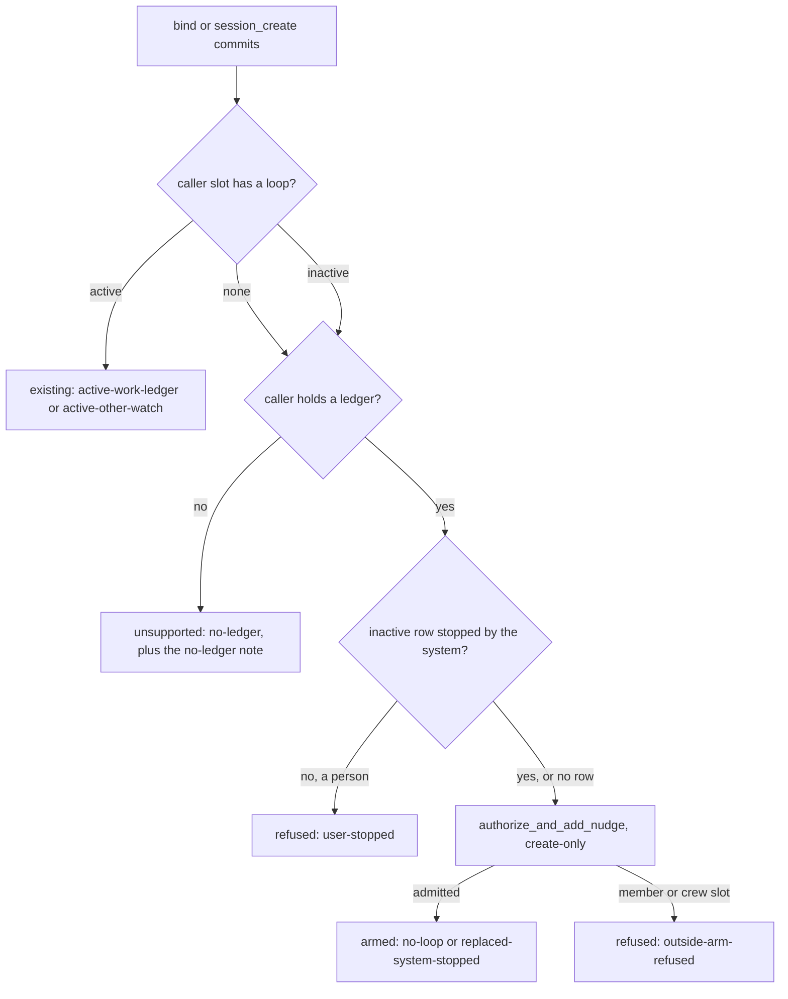

# RFC: Conductor default patrol

- Status: partial. Phase 1 (arm on bind, section 8) is on main from [#17069](https://github.com/kirodotdev/KiroCrew/pull/17069). Phase 2 (section 9: the system-stopped re-arm for any loop, arming on `session_create`, the no-ledger note, the reply reason) is open in [#19742](https://github.com/kirodotdev/KiroCrew/pull/19742). That PR's First Principles lane reads an RFC's status off the base branch, so this revision lands on its own first, as GOVERNANCE.md asks of an RFC, and the implementation rebases onto it. Where the implementation PR also edits this file, this document is the source of truth.
- Decisions: the bind-time arm was decided by the operator who owns the conductor patrol (2026-10-05). The phase 2 decisions in section 9 were made by the same maintainer (2026-10-13) and are recorded here as accepted.
- Amends [rfc-conductor-work-ledger.md](rfc-conductor-work-ledger.md) in one place, named in section 3: arming the `work-ledger` watch is no longer only the conductor's own act.
- Related: [rfc-crew-log-wake.md](rfc-crew-log-wake.md) (how a worker's report wakes the conductor) and the goal-conductor skill's `scripts/patrol_budget.py` (the bounds a patrol must pass).
- Sections 1 to 8 were measured at `a92dde1a6c`. Section 9 was measured at `ac8a96a242`.

## 1. Problem

A conductor hands an item to a worker with `work_ledger_record action=bind`. Its prompt then tells it to arm a loop on its own session with `monitor_start`. Nothing checks that it did.

A conductor that skips the arm ends its turn with workers running and nobody reading their reports. `done`, `blocked` and `question` sit in the ledger until a person notices. On main, `api_work_ledger_record` in `src/kiro_crew/dashboard/handlers/work_ledger.py` writes the binding and returns; it arms nothing. `work_ledger_read` derives `orphaned` and `stale`, and neither says "nobody is patrolling this board".

## 2. Goals and non-goals

Goals:

- A conductor that binds a worker and holds no loop gets a patrol without doing anything.
- The agent's own `monitor_start` stays the primary path, and it always wins over the default.
- When no patrol runs, the conductor's next ledger read says so.

Non-goals:

- Reviving a loop a person stopped.
- Arming on a crew- or member-mode conductor. Section 5 explains why.
- A Crew page badge. The read flag comes first; a badge is a follow-up.
- Changing the goal-conductor skill or the conductor prompt's Patrol section.

## 3. Design

**Arm on bind.** After a bind commits, `conductor_patrol.ensure_patrol` looks up the conductor's slot. If it holds no loop record at all, it arms one through `autonudge_authz.authorize_and_add_nudge`, the chokepoint every arm uses:

| Field | Value |
|---|---|
| `watch` | `work-ledger`, gated |
| interval | 600 s (inside the conductor's 300..900 s band) |
| `max_cycles` | 300 |
| `max_runtime_secs` | 86400 |
| message | fixed gateway text: read the ledger compactly, verify `done` with `accept_eval.py`, answer `question` and `blocked` |

The bounds pass `patrol_budget.py check`. The arm is create-only. A stopped row is left alone, with one exception: the gateway's own default patrol that the system stopped (its budget or cap ran out, the same `_stopped_row_is_replaceable` allowlist a directive re-arm uses) is replaced by a fresh default, because a new bind means new work. A person's stop of the default stays evidence. A refusal is logged at WARNING, and the bind still succeeds. The bind reply carries `patrol: armed | existing | refused | unsupported`, plus a `patrol_note` whenever no `work-ledger` watch is active after the bind, telling the conductor to arm its own `monitor_start` in the same turn. Section 9 widens the stopped-row exception and adds the create route.

**The agent's arm wins.** The default loop is stored with `default_patrol: true`. That tag is the one exception to create-only. ANY create-only arm of a loop that is not itself a default patrol displaces an ACTIVE default patrol instead of answering 409, even while its wake is in flight. That covers the conductor's own `monitor_start`, and equally a person's dashboard create or a channel arm on that slot: each is an explicit choice, and the default is only a fallback. The conductor's own `monitor_start` therefore replaces the default with its own message, exit condition and bounds, and starts its own cycle count. A stopped default patrol keeps the ordinary retained-row rules, so a person's stop of it stays evidence. One default never displaces another.

**The displaced wake.** The mid-wake exception exists because the default patrol's own wake is usually the turn in which the conductor calls `monitor_start`. The guard it bypasses keeps an accepted wake's completion evidence tied to its record. On displacement that completion is **dropped**: the default's record is removed, so when the turn's completion arrives (`record_monitor_turn_completion`) it names a loop id that no longer exists, clears its accepted-turn entry and returns. Nothing is charged to the replacement, nothing re-arms the removed loop, and the replacement starts its own count. Nothing else waits on that completion: the default's only job was to wake the conductor, and the wake it is completing is the one that armed its successor.

**Backstop flag.** `work_ledger_read` marks every open item `unpatrolled: true` while the conductor holds no ACTIVE `work-ledger` watch, compact read included. The flag is keyed on the watch, not on any loop. A slot holds one loop, so a conductor whose loop watches a pull request has nobody reading its ledger, and the flag says so. The dispatch-time arm leaves an ACTIVE loop in place, whatever it watches, because it cannot add a second loop beside the first; in that case the flag is the signal.

This amends [rfc-conductor-work-ledger.md](rfc-conductor-work-ledger.md), which says the ledger gate is "the one a conductor arms". The conductor still arms it; the gateway arms it too, as a fallback, when the conductor has not.

## 4. Risks

- **A default the conductor did not want.** It costs a gated loop that fires only when the ledger moves. The conductor's own `monitor_start` replaces it, and `autonudge_stop` ends it.
- **A conductor that never reads the flag.** The flag only helps on the next turn. The armed default is what covers the silent case; the flag covers the slots it cannot arm.
- **The tag in an agent-writable store.** A forged `default_patrol` only lets the same slot's own create-only arm replace that slot's loop. An agent that can write the store can already rewrite the loop.

## 5. Security

The default arm is an OUTSIDE arm. It passes no `initiator_slot_key`. The bind route knows which session called it, not which turn: a cron injection or a sub-agent sharing the slot sends the same session key as the session's own turn. Only the session-directive consumer can tell them apart. So a crew- or member-mode conductor refuses the default, exactly as it refuses any outside arm, and no self-arm trust record is written. The message is fixed gateway text, never agent input. The authorizer's SEL audit records every arm and refusal. Section 9 keeps every word of this for the create route.

## 6. Alternatives considered

- **Arm at the conductor's turn end instead of at bind.** The turn's provenance is known there, so a member conductor could be self-armed. Rejected for now: it moves the arm into the chat runner's turn-end path, a much wider change, and the replacement rule above already removes the conflict with the agent's own arm.
- **Only flag, never arm.** Leaves the silent case open, which is the failure this RFC exists for.
- **Self-arm member conductors from the bind route.** Rejected (section 5): it would let a cron or sub-agent turn arm a member's thread.
- **Let `monitor_start` answer 409 and tell the conductor to use `monitor_update`.** Rejected: every conductor that follows the skill would hit the 409.

## 7. Open questions

None open.

## 8. Rollout, phase 1: arm on bind (implemented)

One implementation PR, [#17069](https://github.com/kirodotdev/KiroCrew/pull/17069). Exit criteria, each pinned by a test there:

- The first bind on a loop-less conductor arms exactly one `work-ledger` loop with the bounds above, tagged `default_patrol`.
- A second bind, or a stopped retained loop, arms nothing.
- A refused arm logs a WARNING and the bind still commits; a member-mode conductor is refused, gets the `patrol_note`, and no trust record is written.
- A system-stopped default patrol is re-armed on the next bind; a person-stopped one is left alone.
- The conductor's own create-only arm replaces an active default patrol, also mid-wake; it still answers 409 over an ordinary loop.
- The displaced wake's completion is dropped: it charges nothing to the replacement and leaves it active.
- `unpatrolled` is true for an open item whose conductor holds no active `work-ledger` watch, including one whose loop watches something else, and false otherwise.

## 9. Phase 2: every dispatch ends patrolled, or says why not

### 9.1 Problem

Phase 1 leaves three holes. Each lets a dispatch end with nobody reading the workers.

**A finished round leaves the next round unwatched.** A conductor arms its own `monitor_start` loop with `watch="work-ledger"`. When every ledger item goes terminal, the system stops that loop with `stopped_reason=monitor_terminal`. The conductor then binds the next round. `ensure_patrol` re-arms a stopped row only when it is the gateway's own `default_patrol` (the `rearm` test in `ensure_patrol`, `src/kiro_crew/conductor_patrol.py`, at `ac8a96a242`). The conductor's own loop is not, so the bind answers `existing` and arms nothing. The tracking issue is [#19741](https://github.com/kirodotdev/KiroCrew/issues/19741).

**The reply hides it.** `mcp_work` builds the bind reply from the item alone. The route's `patrol` and `patrol_note` never reach the agent, though the tool description promises them. The agent reads `Recorded bind. item=... state=open verdict=(none)` and ends its turn.

**`session_create` is a dispatch with no arm at all.** A session that opens another session with `session_create` hands it work the same way a bind does. `api_session_control_create` in `src/kiro_crew/dashboard/handlers/session_control.py` writes the session and returns. Nothing arms or reports a patrol.

### 9.2 Decisions (accepted)

The maintainer accepted these five decisions on 2026-10-13. An implementation must match them.

1. **Re-arm any loop the system stopped.** On bind, an INACTIVE loop the system stopped counts as no loop, whoever armed it: the default patrol, the conductor's own `monitor_start`, or a person's arm. It is replaced by a fresh default. The test is the same `_stopped_row_is_replaceable` allowlist a directive re-arm uses (in `src/kiro_crew/autonudge_service/model.py`): a terminal subject, a spent budget or cap, an approval stall, a crash retirement. A loop a PERSON stopped stays stopped. The reply says `refused (user-stopped)`. The path cannot revive a stop a directive could not.
2. **`session_create` arms like bind, when the caller holds a ledger.** A non-member caller that holds a work ledger gets the same default `work-ledger` patrol bind arms: same bounds, same message, same chokepoint, same rules for active and stopped rows. Reason: a create is the same dispatch act, reached by another route. A dry run arms nothing.
3. **`session_create` from a caller with no ledger arms nothing.** A `work-ledger` watch would have nothing to read and would fire on its timer for a day. Instead the reply ends with one note: arm a `monitor_start` loop that reads the session you opened, or watches the one pull request you wait on. The note is skipped when the caller already holds an active loop. Cost: one extra instruction per create on a ledger-less caller with no live loop. That is every ordinary agent that opens a session and has no loop yet.
4. **Member and crew slots get no outside arm, on either route.** The bind and create routes see only a session key. A cron injection, an app-driven turn or a sub-agent turn on a member slot sends the same key as the member's own turn. So the routes cannot tell a self-arm from an outside arm, and the authorizer refuses them all (`_EXTERNAL_ARM_REFUSED_MODES` in `src/kiro_crew/autonudge_authz.py`). The reply says `refused (outside-arm-refused)` and carries the note. Self-arm from these routes (option D) is out of scope. Section 9.6 names the seam it would need.
5. **The monitor gate is unchanged.** No authorizer rule, mode set or trust record changes. Loosening the member gate (option C) is rejected.

### 9.3 Design

Both dispatch routes call one function after their write commits. It never raises and never undoes the dispatch.

`ensure_patrol` answers `(outcome, reason)`. The outcome set is the phase 1 set. The reason is new:

| Outcome | Reason | When |
|---|---|---|
| `armed` | `no-loop` | no row; default armed |
| `armed` | `replaced-system-stopped` | system-stopped row replaced |
| `existing` | `active-work-ledger` | active loop reads the ledger |
| `existing` | `active-other-watch` | active loop watches something else |
| `refused` | `user-stopped` | a person stopped the row |
| `refused` | `outside-arm-refused` | member or crew slot |
| `refused` | `session-cannot-host-loop`, `arm-failed` | the authorizer said no for another reason |
| `unsupported` | `no-ledger` | create from a ledger-less caller |
| `unsupported` | `autonudge-disabled`, `session-cannot-host-loop` | no loop service, or no slot |

Both routes return `patrol`, `patrol_reason` and, when the caller is not patrolled afterwards, `patrol_note`. With a ledger, patrolled means an active `work-ledger` watch. Without one, any active loop counts. Both MCP replies end with one line, `patrol=<outcome> (<reason>)`, then the note if any. A reply that lacks `patrol` reads `patrol=unknown` with the arm-yourself note, so a dispatch never looks patrolled when nothing says it is.

The goal-conductor skill's Patrol section gains one short paragraph, "dispatch means monitor". The member operating-mode block gains one clause: the gateway cannot arm a loop on this thread, so arm your own.

### 9.4 What a user sees

- A conductor that finished one round and binds the next gets a fresh patrol. Its workers' reports wake it again. Nobody has to notice first.
- Every bind and create reply ends with `patrol=...`. An agent always knows if something is watching.
- A loop a person stopped stays stopped across every later dispatch. The reply names why.
- An ordinary chat that opens a session with no loop running is told, once per create, to arm one.
- A member or crew thread gets no loop from the gateway. Its reply tells it to arm its own.

### 9.5 How to undo it

- **One loop, now.** `autonudge_stop` or the dashboard stop button on the session. That stop is a person's stop, so later dispatches leave it stopped and answer `refused (user-stopped)`.
- **Use your own loop instead.** Call `monitor_start`. It replaces an active default patrol (section 3).
- **The whole phase.** Revert the phase 2 implementation PR. Bind falls back to phase 1, and `session_create` arms and adds nothing. No stored data needs a migration: the arm writes ordinary loop rows, tagged `default_patrol`, that phase 1 already reads. This document then returns to `status: implemented` with this section marked withdrawn.

### 9.6 Security

Every arm still goes through `autonudge_authz.authorize_and_add_nudge` as an OUTSIDE arm, with no `initiator_slot_key`. Section 5 applies to the create route word for word. The message is fixed gateway text. No agent input reaches the loop. A person's stop is never replaced, because the replaceable test is the directive path's own allowlist, which fails closed on an unknown or empty reason.

Self-arm on a member slot (option D) would need turn-level provenance on these routes. Today only the session-directive path proves a turn is the slot's own: `session_directive.DIRECTIVE_TOOLS` lists the tools it honours, and it honours them only from a call served by `CORE_MCP_SERVER` (both in `src/kiro_crew/session_directive.py`). Adding `work_ledger_record` or `session_create` there is not enough. `mcp_core.derive_directive` (in `src/kiro_crew/mcp_core.py`) derives a directive by re-running the tool, which would replay a bind or a create. A future self-arm would need both: those tools in `DIRECTIVE_TOOLS`, and a derive step that does not re-run a side-effecting call. That is a change to the directive provenance gate and needs its own RFC.

### 9.7 Alternatives considered

- **Re-arm only the default patrol (phase 1 as written).** Rejected: it leaves the next round unwatched after the conductor's own loop finishes, which is the defect.
- **Option C: loosen the member gate so the routes may arm a member slot.** Rejected: a cron, app or sub-agent turn on the slot would then arm the member's thread. That is the hole section 5 closes.
- **Option D: self-arm member slots through the directive path.** Out of scope (section 9.6).
- **Arm a `work-ledger` watch for a ledger-less creator.** Rejected: it reads nothing and burns a day of timer wakes.
- **Say nothing to a ledger-less creator.** Rejected: the opened session's replies go unread with no sign. One instruction per create is the cheaper failure.

### 9.8 Exit criteria

Each is pinned by a test in the phase 2 implementation PR:

- A system-stopped loop the conductor armed itself is replaced on the next bind, and the reply says `armed (replaced-system-stopped)`.
- A person-stopped loop is kept, on bind and on create, and the reply says `refused (user-stopped)`.
- An active loop is left alone on both routes.
- A non-dry-run create from a ledger-holding caller with no loop arms exactly one default patrol with the section 3 bounds. A dry run arms nothing.
- A create from a ledger-less caller arms nothing, keeps any stopped row, and carries the no-ledger note.
- A member or crew caller that holds a ledger is refused on both routes with `outside-arm-refused`; a ledger-less one gets `no-ledger`. Either way no loop row and no trust record is written, and the reply carries the note.
- Both MCP replies end with `patrol=<outcome> (<reason>)`, including `patrol=unknown` when the route sent no outcome.
