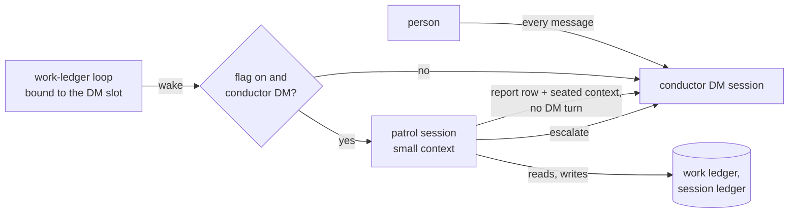

# RFC: Conductor patrol session

- Status: draft. Nothing is built. The user (iamwhatever), the maintainer who
  owns the conductor patrol, chose this option (R10 backlog item B3, option b)
  and set three conditions. Section 2 states them as acceptance criteria, each
  with its proof. The user signs this document as maintainer before any
  implementation pull request. It lands on its own first, because the First
  Principles lane reads an RFC's status off the base branch, and the
  implementation changes where a first-class loop's wake runs by default.
- Tracking issue: [#23621](https://github.com/kirodotdev/KiroCrew/issues/23621).
- Builds on, and changes none of:
  [rfc-conductor-context-cap.md](rfc-conductor-context-cap.md) (the 150K
  trim, [#22718](https://github.com/kirodotdev/KiroCrew/pull/22718), merged),
  [rfc-gated-pr-poll-loops.md](rfc-gated-pr-poll-loops.md)
  ([#22442](https://github.com/kirodotdev/KiroCrew/pull/22442), the judge off
  on gated loops), [#22448](https://github.com/kirodotdev/KiroCrew/pull/22448)
  (the wake judge on the shared background runtime),
  [rfc-conductor-default-patrol.md](rfc-conductor-default-patrol.md) (who
  arms the `work-ledger` watch) and the resume prefetch of
  [#2386](https://github.com/kirodotdev/KiroCrew/pull/2386).
- Does not touch the KAS compaction ruling on
  [#18931](https://github.com/kirodotdev/KiroCrew/issues/18931): the DM keeps
  whatever compaction and cap it has today.
- Overlap checked against open pull requests on 2026-10-24. None touches the
  patrol fire path or the idle sweep. Closest:
  [#22165](https://github.com/kirodotdev/KiroCrew/pull/22165) (legacy-loop PR
  reads, kept stops, declared waits) changes what a loop does while held, not
  where its wake runs; [#22500](https://github.com/kirodotdev/KiroCrew/pull/22500)
  (every sidebar folder is a conductor) is a draft about sidebar conductors,
  not crewmate DMs.
- Code measured at `1270c45f4d`. Usage numbers are from R10 (one operator's
  host, 10-22 16:16Z to 10-23 06:40Z). The replay in section 7 used the
  conductor DM's KAS transcript from 2026-10-18 06:00Z to 2026-10-22 16:28Z.

## 1. Problem

A crewmate conductor patrols its workers with a `work-ledger` watch armed on
its own DM thread. Every wake of that watch runs as a turn in the DM, so every
wake re-sends the whole DM context: the person's own conversation, every
earlier patrol turn and every tool result.

| R10, wake-up turns by opener | Turns/day | Credits/day | Credits/turn |
|---|---:|---:|---:|
| **conductor DM `nudge:patrol`** | **36.7** | **214.5** | **5.85** |
| chat `nudge:prepare-pr` | 55.0 | 207.6 | 3.77 |
| chat `nudge:patrol` / other | 21.7 | 67.7 | 3.13 |
| all wake-ups | 113 | 490 (23% of all credits) | 4.3 |

The conductor DM patrol is the largest single line. R10 section 2.3 found its
cost is almost all model prefill of a ~200K-token DM context. A patrol
decision needs the board, the open questions to the person and the person's
recent rulings. It rarely needs the rest.

The patrol also has a side effect people depend on: 36.7 turns a day keep the
DM's `last_used` fresh, so the 3600-s idle sweep never reaps the DM. Moving
the patrol out removes that keep-alive (section 5).

## 2. The user's three conditions (acceptance criteria)

The user accepted option (b) on these three conditions. Each is an acceptance
criterion of this RFC. "Now" is the proof measured for this document; "exit"
is the proof the implementation must show before the default flips.

| # | Condition | Proof now | Proof at exit |
|---|---|---|---|
| C1 | No regression from missing context: the patrol session takes the same act/no-act decision and the same action the DM would | Offline replay of 40 real patrol wakes from this DM (section 7): worker-facing act/no-act agrees on 37/40, same action classes on 31/40, same classes and items on 30/40. In no wake did the small session close, accept, dispatch or write to GitHub where the DM did not. 2 to 3 misses trace to DM context; section 7.3 adds those to the packet | Same replay on at least 30 new wakes with the final packet, plus a noise-floor run (section 9, phase 2) |
| C2 | The main DM is not reclaimed by the idle timeout while the patrol session runs | The sweep and its exemption hook exist today: `SessionCleanup._expire_idle` and `_idle_exempt_keys` in `src/kiro_crew/session_cleanup.py` (section 5) | Test: a conductor DM idle past `session.timeout_secs` with a routed patrol loop stays live; with the loop stopped it is reaped |
| C3 | If the DM is reclaimed anyway (restart, crash, RSS recycle), reload is fast | The focus prefetch already covers a mounted crewmate thread (section 6). DM send to first visible row today: section 6.2 | Telemetry `kirocrew.chat.first_token.duration{first_turn=true,resumed=true}` p50 on a reaped DM within 5 s of a warm DM send |

## 3. Goals and non-goals

Goals:

- A conductor-template crewmate's patrol wakes run in a small patrol session.
  Per-wake context drops from ~200K to ~30-40K tokens.
- The person keeps one place to talk: the DM. Their messages always go there.
- What the patrol session tells the person lands in the DM without a DM turn.
- Same decisions as today (C1). The DM stays live (C2). A reaped DM reloads
  fast (C3).
- One config flag turns it all off.

Non-goals:

- Other crewmates, normal sidebar chats, workers, and sidebar sessions that
  run the conductor agent. Only a member DM whose agent is the goal
  conductor (`WAKE_RESET_AGENTS` in `src/kiro_crew/autonudge_selfarm.py`:
  `kirocrew-conductor` and its deprecated alias) is in scope.
- Worker-report hidden turns (`[Worker report]`,
  `src/kiro_crew/dashboard/mate_thread_wakes.py`) and goal check-ins. They
  keep running in the DM. A later revision can route them once phase 2 shows
  the packet is enough.
- The wake gate. When a wake fires stays as it is today. R10 B3 option (a)
  (FINDINGS S2) is a separate ruling.
- The DM's own context cap, compaction or `reset_conversation`.
- Channel surfaces (Slack, Discord, Webex). Phase 1 is the dashboard DM.

## 4. Design

### 4.1 Where things go

| Thing | Goes to | Changes? |
|---|---|---|
| The person's messages | DM | no |
| The loop record, its arm, budget, stop button, self-arm record | still bound to the DM slot key | no |
| A wake of that loop | patrol session | **yes** |
| Patrol tool calls (ledger, `session_send`, `gh`) | patrol session | yes |
| What the person must see (a question, a result, a needed action) | DM, as a report row | yes |
| A wake the patrol session cannot decide | DM turn, as today | new path, today's behaviour |

### 4.2 The patrol session

- **Key.** `patrol:<DM slot key>`, outside the `dashboard:member-` namespace
  on purpose. A suffix on the DM's own alias (`dashboard:member-<slug>.patrol`)
  would pass `is_member_session_key`
  (`src/kiro_crew/members_parts/member_sessions.py`) and get every
  member-DM behaviour, yet `slug_from_dm_slot_key`
  (`src/kiro_crew/members_parts/dm_bindings.py`) would read the slug as
  `<slug>.patrol` and resolve it to no crewmate. Instead, one resolver,
  `patrol_dm_slot(key)`, maps the patrol key back to its DM slot key, and the
  member, binding, memory store and grants are all read through that DM slot.
  It is a session, not a dashboard slot: it has no sidebar row and no
  composer, so nobody can send it a message, and no loop can be armed on it.
- **Who it runs as.** The same member, agent, memory store, MCP grants,
  model, effort and approval mode as the DM. Its session context (agent
  prompt, memory, rules, learned corrections) is built by the same turn
  builder as the DM's, so every standing rule the DM sees, it sees.
- **Its own history.** It keeps its own short chat, so it remembers its last
  few wakes. The #22718 trim (`_context_cap_trim` in
  `src/kiro_crew/dashboard/chat_turn/context_cap.py`) applies to it with its
  own marks: trim to the newest turns when it passes 80K tokens. Its credits
  stay near the floor.
- **Lifetime.** Started on the first routed wake. Ordinary idle reap
  between wakes; a conductor patrol interval is 300 to 900 s, so it rarely
  idles that long.
  The transcript is kept and linked from each report row.
- **Turns.** Each wake runs as one gateway-authored turn, through the same
  door as `dispatch_hidden_turn`
  (`src/kiro_crew/dashboard/mate_welcome.py`). The turn is not one the
  person sent, so the operations only a person's turn may run refuse, exactly
  as they refuse in a DM patrol turn today.

### 4.3 Routing a wake

`_fire` and `_fire_monitor` in
`src/kiro_crew/slack/gateway_runtime/nudge_wiring.py` already route a wake by
the loop's binding key. One branch is added before the dashboard path: when
the flag is on and `loop.slot_key` is a conductor-template member DM slot, the
wake is delivered into that DM's patrol session instead of the DM.

The loop record is untouched. It stays bound to the DM slot key, so the
self-arm record, the authorizer, the budget, `default_patrol`, the
`unpatrolled` flag and the stop button all keep working on the key they use
today.

Busy rules:

- **DM mid-turn.** The wake is held, as a wake into a mid-turn slot is held
  today. Two writers on one board at once is the risk this avoids.
- **Patrol mid-turn, the person sends.** The DM turn runs at once; the person
  never waits on a patrol. The DM turn's context carries one line: "a patrol
  turn is running; its report will follow". Open question Q2.

### 4.4 What the patrol session gets on each wake (C1)

| Part | Source | Bound |
|---|---|---|
| Session context: agent prompt, memory, rules, lessons | the normal turn builder, same as the DM | as today |
| The wake text, with the session ledger (goal, phase, next, tried) and patrol budget | today's wake text, unchanged | as today |
| The work ledger | the agent's own `work_ledger_read`, which the wake text already tells it to call first | as today |
| **DM digest**, gateway-built from the DM's chat history | see below | ~6K tokens |
| Its own last wakes | its own chat | 80K trim |

The DM digest holds:

1. The last 6 messages the person sent in the DM, each up to 700 characters,
   each with the first 600 characters of the conductor's reply to it.
2. The conductor's newest DM reply in full, up to 2,000 characters, when it
   asked the person something (an `[OPTIONS:]` line, or a question) and no
   person message came after it. This is the open question to the person.
3. Every patrol report row posted since the person's last message, so the
   patrol session knows what it already said.
4. The open items whose last report is `blocked` or `question` with
   `reason=needs_human` or `approval`, by id and title only. The details come
   from the ledger read.

The digest is data, framed like a worker report: fenced, labelled as the DM's
content, never as instructions. It is built from rows the DM model already
had in its own context, so it reveals nothing new to the member.

### 4.5 Escalating to the DM

The patrol session hands a wake to the DM in three cases:

- **It says so.** A new `kirocrew-core` tool, `patrol_escalate(reason)`, is
  admitted only in a patrol session. The gateway then runs the same wake as a
  DM turn, today's path, with the patrol turn's reason seated as context.
- **The patrol turn fails.** A timeout, a backend error or a crash
  escalates once. The wake is never dropped.
- **The patrol session cannot start.** The wake goes to the DM, as today.

Asking the person is not an escalation. The patrol session posts the question
as a report row (section 4.6). The person answers in the DM, and the DM turn
sees the question as seated context and as a visible row. In the replay the
small session asked the person in 10 of 40 wakes and escalated in 1.

### 4.6 Posting to the person without a DM turn

When a patrol turn ends with text the person must see, the gateway writes it
into the DM:

1. **A visible row.** `append_and_surface(state, dm_slot, "assistant", text,
   meta={"kind": "patrol_report", "patrol_turn": <id>})`
   (`src/kiro_crew/dashboard/state_parts/transcript_rows.py`). It renders
   as the conductor speaking, with its `[OPTIONS:]` chips, and carries a link
   to the patrol transcript. The text passes the same redaction as any
   gateway-written row.
2. **Seated context for the DM's next turn.** The same text, as one
   pending-context entry (`append_pending_context`,
   `src/kiro_crew/dashboard/state_parts/slot_turns.py`), the seam `/note`
   uses (`POST /api/chat/slots/{slot}/note`). The DM model reads it on the
   person's next message, with no turn spent now. A seat refused for space is
   logged; the visible row still lands.
3. **The crewmate notification**, through `post_member_message`
   (`src/kiro_crew/dashboard/member_message_notes.py`), so a person on
   another page sees it as they see a DM reply today.

A quiet wake (nothing for the person) posts nothing. `is_member_message` and
`is_speech_row` must treat a `patrol_report` row as speech; phase 1 pins that
with a test.

**Tool approvals.** A patrol turn can hit an approval prompt. The DM transcript
in the replay window held 453 of them. The prompt must reach the person where
they are: phase 1 surfaces the patrol session's pending approvals on the DM
slot's approval card, under the DM's approval mode. Open question Q1.

### 4.7 Which mates

Only a member DM slot (`member-<slug>`, V1 or V2 store-suffixed) whose
crewmate's agent is in `WAKE_RESET_AGENTS`. Every other slot routes as today.
On the measured host that is one DM.

## 5. Keeping the DM live (C2)

Today the sweep is `SessionCleanup._expire_idle`
(`src/kiro_crew/session_cleanup.py`). A session is idle when
`now - last_used > session.timeout_secs` (3600 s), unless its key is in
`_idle_exempt_keys()`, which reads `session.idle_exempt_keys` at
every sweep. That config list exists today for "a chat that automation wakes
hours apart", capped at 10 keys.

Proposal: `_idle_exempt_keys()` returns the config list **plus** the DM
session keys whose slot holds an ACTIVE loop routed to a patrol session. The
set is computed, never written into the person's config, so it takes none of
the 10 config seats. The exemption ends when the loop stops: a DM with
nothing patrolling idles out exactly as it does today.

Why this is safe:

- **It keeps today's footprint.** Today the patrol's own turns keep the DM
  warm, so the DM already never reaches the sweep while patrol runs. The
  exemption keeps the DM where it is; it adds nothing.
- **The new cost is the patrol session.** One more live session per patrolling
  conductor DM, ~600 MB RSS per live KAS session while it runs. On the measured host there is one
  conductor DM, so ~0.6 GB of the 24 GB free at measurement time.
- **Every other guard still applies.** The orphan axis (the slot closes), the
  RSS recycle (`session.watchdog_rss_max_mb`), the identity sweep on a Kiro
  sign-out and a gateway restart all still end it. Only the idle clock skips
  it.
- **The count stays small.** Only conductor-template crewmate DMs with an
  active routed loop qualify, at most one per conductor crewmate.

## 6. Reloading a reaped DM (C3)

### 6.1 The prefetch already covers the DM

The resume prefetch of #2386 runs on a `slot_focused` frame:
`_handle_slot_focused` in `src/kiro_crew/dashboard/ws.py` calls
`schedule_eager_spawn(state, slot, allow_resume=True)` for a slot whose
session is persisted but not live. The frontend sends that frame for a mounted
crewmate thread as well as for a chat tab:
`focusedSlotForCurrentSurface` returns `getMountedMemberThreadSlot() ||
chat.activeSlot` (`website/src/hooks/websocket/attention.ts`). So opening
the crewmate's DM on the Members page already starts `spawn + session/load`
while the person reads. DIAGNOSIS D1 ("the DM has no pre-warm") predates this
and is out of date.

This RFC reuses that path and adds nothing to it. One gap remains: a patrol
report landing in a reaped DM starts nothing. It should not: the person may
never open the DM, and the prefetch runs when they do.

### 6.2 What a reload costs today

Measured from the DM's dashboard chat history
(`~/.kiro/crew/sessions/dashboard_member-kirocrew-conductor.jsonl`): the time
from a person's send to the first tool or reply row, bucketed by how long the
DM sat idle before the send. "Reaped" means idle past the 3600-s timeout. A
row is written when its segment starts, so this includes the model's thinking
before the first tool call. It is an upper bound on first token.

| Window | Warm (< 5 min) | Cold cache (5-60 min) | Reaped (> 60 min) |
|---|---|---|---|
| 10-16 to 10-22 (before the #22718 trim) | p50 15.9 s (n 55) | p50 45.4 s (n 27) | p50 75.6 s (n 13) |
| since 10-22 17:00Z (trim on) | p50 9.8 s (n 13) | p50 3.8 s (n 4) | 9.4 s (n 1) |

R10's telemetry bench (n 1-2) split a resumed first turn into 7.88 s of
startup (`session/load` 5.13 s) and 14.6 s to first token, against 2.6 s
warm. The trim cut the context the reload replays; the prefetch hides the
startup when the person opens the DM first. Exit (C3) uses telemetry, because
the history proxy has too few reaped sends since the trim.

## 7. The replay (C1)

### 7.1 Method

Read-only. Nothing was sent to a worker or written to a ledger.

1. Split the DM's KAS transcript
   (`~/.kiro/sessions/<store>/sess_d218a596-.../messages.jsonl`, 150 turns,
   2026-10-18 to 2026-10-22) into turns. 100 of them were patrol wakes (the
   request starts `[work-ledger wake]` or `[auto-nudge`).
2. For each wake, built the packet of section 4.4 from that moment's data: the
   wake text, the first `work_ledger_read` result the real turn got, up to 8
   other read results it got (worker transcripts, `gh` output), the last 6
   person messages with reply heads, and the open question.
3. Took a seeded random sample of 40 (seed 7).
4. Ran each as one fresh sub-agent on `claude-opus-5.5`, with no memory, no
   lessons and no project injected, reading only the conductor's session-start
   context (agent prompt and session context, 86K characters) and its own
   packet. It answered with a decision: a list of action types and targets.
5. Scored that against the real turn's write calls. Bookkeeping that follows
   from a class (`monitor_update`, `session_close` after a close,
   `session_ledger_record`) is ignored. `ledger_decide` and `session_send` to
   a worker are one class, "message", because both instruct the worker.

Cost: 109.4 credits for the 40 runs, 2.74 credits each, ~77K tokens of context
each.

### 7.2 Result

| Measure | Agree |
|---|---:|
| Worker-facing act/no-act | **37/40** (92.5%) |
| Act/no-act, counting a question to the person as an act | 40/40 |
| Same action classes | 31/40 (77.5%) |
| Same classes and same items | 30/40 (75%) |
| A close, accept, dispatch or GitHub write the DM did not make | **0/40** |
| Escalated to the DM | 1/40 |

Every miss is an omission or an extra nudge. None is a write the DM would not
have made.

| Wake | DM did | Small session did | Why it differs | Cause |
|---|---|---|---|---|
| 16 | close, dispatch next fix, message | close | The session ledger's `next` said "after R3+R4 accepted"; R3 was open. The DM dispatched early | DM acted ahead of its own written plan |
| 22 | nudge one worker, rule "stop waiting for the person's re-run" to another | nudge one worker | The ruling rested on how long the person had not acted | **DM context** |
| 138 | message worker, ask the person | ask the person | It could not tell whether its 16:55Z question had reached the DM | **DM context** |
| 70 | relay news, close an issue on GitHub | relay to another worker | It lacked who merged #22088; the real turn read that from GitHub later | reads |
| 18 | close a verified item, nudge | nudge it to report done | Same reads, more cautious | judgment |
| 44 | accept a verified PR, nudge | nudge | Same reads, more cautious | judgment |
| 29 | close | close, two extra nudges | Same reads, more active | judgment |
| 120 | tell two workers gh is down, ask the person | ask the person | Same reads; skipped the heads-up | judgment |
| 137 | tell the worker the question went up, ask the person | ask the person | Same reads; skipped the hold note | judgment |
| 141 | close, stop, close a GitHub issue | close, stop | Skipped the issue close | judgment |

Per-wake rows are in appendix A.

### 7.3 What the misses change in the design

- **Wake 138** is why the digest carries the newest conductor DM reply in full
  when it asked the person something, and every patrol report since the
  person's last message (section 4.4, items 2 and 3). The replay packet had
  only reply heads.
- **Wake 22** is why the digest says, per open question, when it was asked.
  The person's silence since then is then a fact in the packet.
- **Wake 16** needs no change: the small session followed the written plan.
  The goal-conductor skill already asks the conductor to keep `next` current.
- **The six judgment misses** had the same reads. Without a noise floor, some
  of them are the model's own variance, which the DM shows too. Phase 2 runs
  the noise floor before anyone reads them as a context effect.

### 7.4 Limits

- The packet held the reads the real turn chose. A patrol session makes its
  own reads; it could choose fewer.
- The replay is one decision step, not a full turn with tool rounds.
- The session-start context is from 10-18. Rules learned later were missing,
  which biases the small session toward misses, not away from them.
- One DM, one operator, n = 40.

## 8. Cost model

| | Before (R10 now) | After (estimate) |
|---|---:|---:|
| Conductor DM patrol wakes/day | 36.7 | 36.7 (the gate is unchanged) |
| Context per wake | ~200K | ~30-40K |
| Credits per wake | 5.85 | ~1.5 |
| Escalated wakes (2.5% in the replay) | - | 0.9/day × 5.85 |
| **Credits/day** | **214.5** | **~60** |
| Saving | | **~155/day, ~7% of all credits** |
| RSS | DM live | DM live + one patrol session, ~0.6 GB |

The 1.5 credits per wake scales R10's 5.85 by context size, as R10 B3 did.
The replay's one-step calls at ~77K context cost 2.74 each, but they carried
the whole 86K-character session-start text uncached. Phase 2 measures the real
number with R10's `m11_turn_openers.py`, on equal windows before and after.

The DM also saves the patrol rows it no longer accumulates. Its context grows
only with the person's own conversation and the report rows, so the #22718
trim fires less often.

## 9. Migration plan

**Phase 1: build it behind the flag, default off.** One implementation PR.

- Config `session.conductor_patrol_session`, bool, default `false`. Read on
  each wake, so a change needs no restart.
- The routing branch (4.3), the patrol session (4.2), the DM digest (4.4),
  `patrol_escalate` and the failure escalation (4.5), the report row, seated
  context and notification (4.6), the approval surface (4.6), the computed
  idle exemption (5).

Exit criteria, each pinned by a test:

- Flag off: a conductor DM wake runs in the DM, byte for byte today's path.
- Flag on: a conductor DM wake runs in the patrol session; the DM slot gets no
  turn. A non-conductor crewmate DM and a sidebar conductor chat still run in
  their own slot.
- The loop record keeps the DM slot key; stopping it from the DM stops the
  patrol.
- A patrol reply with text writes one `patrol_report` row and one seated
  context entry in the DM, and publishes one crewmate note. A quiet wake
  writes none.
- `patrol_escalate` and a failed patrol turn each run the wake as a DM turn,
  once.
- A patrol approval prompt shows on the DM's approval card.
- A person's message during a patrol turn starts a DM turn at once.
- A conductor DM idle past the timeout with an active routed loop stays live;
  with the loop stopped it is reaped. The RSS recycle and the orphan axis still
  reap it.
- The digest holds at most 6 person messages and fits its bound; a
  `patrol_report` row counts as speech.
- `patrol_dm_slot` resolves a V1 and a V2 patrol key to its DM slot, and the
  patrol turn's member identity, memory store and MCP grants equal the DM's.
  `is_member_session_key` is false for a patrol key.

**Phase 2: observe for 7 days on the operator's host, flag on.**

- Credits/day and turns/day by opener, before vs after (`m11_turn_openers.py`).
  Target: conductor patrol under 80 credits/day.
- Escalations per day and their reasons. Target: under 10% of wakes.
- The replay again: at least 30 wakes from the patrol session's own window,
  each re-run against a full-DM-context control on the same packet date, and
  each small-session decision run twice for a noise floor. Target: worker-facing
  act/no-act agreement at or above the noise floor, and no close, accept,
  dispatch or GitHub write the DM would not make.
- Every wrong wake the person reports, in the DM or on the tracking issue.
- C3: `kirocrew.chat.first_token.duration{first_turn=true,resumed=true}` on
  the DM, with `telemetry.enabled` on for the window.

**Phase 3: default on for conductor-template crewmates.** Only after phase 2
meets every target and the user rules on it. This document then moves to
`implemented`.

## 10. Rollback

- **Now, one host:** `kirocrew config set session.conductor_patrol_session false`.
  The next wake runs in the DM. The DM's idle exemption ends at the next sweep.
  The patrol session idles out on its own. Nothing to migrate: report rows stay
  in the DM history as ordinary rows.
- **The whole feature:** revert the phase 1 PR. Loop records never changed
  shape, so no stored data needs a migration.

## 11. Security

- **No new arm, no new authority.** The loop stays bound to the DM slot and is
  authorized exactly as today (`autonudge_authz.authorize_and_add_nudge`, the
  member self-arm record). The patrol session is not a slot, so no person,
  cron, app or sub-agent can arm a loop on it or send it a message.
- **Same identity, same grants.** It runs as the member, with the DM's MCP
  grants and approval mode. A patrol wake already runs with exactly these
  today, in the DM.
- **The digest reveals nothing new.** Every line comes from the member's own
  DM, which the DM model already reads. It is fenced as data.
- **Report rows are model output written by the gateway.** They pass the same
  redaction (`redact_credentials`, `redact_exfiltration_urls`) as other
  gateway-written rows and the same speech filter as a DM reply.
- **`patrol_escalate` is admitted only from a patrol session.** From any
  other session it refuses. It can only move a wake to the DM, which is where
  the wake would have run anyway.
- **The idle exemption is computed.** It never writes the person's config and
  ends with the loop.

## 12. Alternatives considered

- **(a) FINDINGS S2, "pending progress is not news".** Cuts the number of
  wakes, not the cost of each. Separate ruling; it composes with this one.
- **A low context cap on the DM itself.** Extends #22718 down to ~40K on the
  DM. Rejected: the DM holds the person's own conversation, so a low cap there
  takes context from the person, the one reader this RFC protects.
- **Reset the DM on every wake.** Same objection, harder.
- **A fresh sub-agent per wake.** No memory of the last wake, and a process
  start (~4.3 s) on every wake.
- **Run the patrol on the shared `_bg` runtime with a small model.** The
  `_bg` runtime suits tasks like the wake judge (#22448). A patrol turn writes
  to the board and messages workers with the conductor's own judgment, so it
  needs the conductor's model and grants.
- **Keep the DM live with a timer instead of the exemption.** A timer turn
  costs credits; the exemption costs nothing.

## 13. Open questions

- **Q1. Approvals.** Surface patrol approvals on the DM's card (proposed), or
  run the patrol session at the DM's approval mode with prompts refused and
  escalated? Proposed: surface on the DM card. A refused approval would turn
  most wakes that need `gh` into escalations.
- **Q2. A person's message during a patrol turn.** Run the DM turn at once with
  a "patrol running" line (proposed), or hold the DM turn until the patrol turn
  ends (at most a minute or two, but the person waits)? The proposal accepts a
  small chance of two writers on one item in the same minute.
- **Q3. Default.** Default off through phase 2 (proposed), then a separate
  ruling to turn it on.

## Appendix A: per-wake replay rows

Classes: close = accept, verdict or close; message = `session_send` or
`ledger_decide` to a worker; github = a GitHub write; stop = loop stop;
escalate = hand to the DM. A question to the person is not listed.

| Wake | DM did | Small session did | Classes |
|---:|---|---|---|
| 15 | none | none | same |
| 16 | close, dispatch, message | close | differs |
| 17 | message | message | same |
| 18 | close, message | message | differs |
| 19 | none | none | same |
| 20 | close, message | close, message | same |
| 22 | message | message | same (items differ) |
| 23 | close | close | same |
| 26 | close, message | close, message | same |
| 28 | message | message | same |
| 29 | close | close, message | differs |
| 30 | message | message | same |
| 41 | message | message | same |
| 42 | message | message | same |
| 44 | close, message | message | differs |
| 49 | message | message | same |
| 51 | close, message | close, message | same |
| 53 | message | message | same |
| 55 | message | message | same |
| 57 | close, message | close, message | same |
| 60 | message | message | same |
| 64 | message | message | same |
| 66 | message | message | same |
| 67 | message | escalate, message | same |
| 68 | message | message | same |
| 70 | github, message | message | differs |
| 96 | message | message | same |
| 100 | close, message | close, message | same |
| 102 | message | message | same |
| 104 | message | message | same |
| 107 | none | none | same |
| 108 | message | message | same |
| 110 | close, message | close, message | same |
| 120 | message | none | differs |
| 122 | none | none | same |
| 126 | none | none | same |
| 129 | message | message | same |
| 137 | message | none | differs |
| 138 | message | none | differs |
| 141 | close, github, stop | close, stop | differs |
