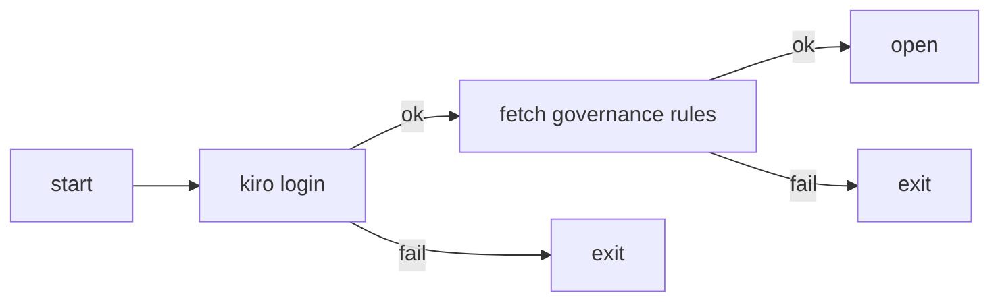

# RFC: Crew Enterprise Edition

- Status: accepted. The owner approved this design on 2026-10-23; D1, D2 and D3 in section 5 are owner decisions. This document landed first so the implementation pull requests that follow have a design for the First Principles and Design lanes to check against: the enterprise edition changes defaults (every governable feature off) and adds a startup gate.
- Tracking issue: [#23206](https://github.com/kirodotdev/KiroCrew/issues/23206)
- Related: [rfc-central-governance-ceiling](rfc-central-governance-ceiling.md) (the policy ceiling this edition fetches and enforces), [platform-context](../system-specs/modules/platform-context.md) (the existing edition seam), [governance](../system-specs/modules/governance.md) (the evaluator and catalog this edition tightens)

## Summary

Kiro Crew gains an enterprise edition built from the same codebase. The build picks the edition (`make desktop EDITION=enterprise`, default `oss`) and writes it into the package as a constant. At run time the enterprise edition will not open until the user has a kiro login and Crew has fetched the organisation's governance rules; either failing makes Crew exit. Every action is then checked against those rules, and every governable feature is off by default or keeps only a minimal set until a rule turns it on. The `oss` edition is unchanged.

## Motivation

Measured at `5c32cf32b`.

An organisation that wants to run Crew today can install a governance ceiling ([rfc-central-governance-ceiling](rfc-central-governance-ceiling.md), `src/kiro_crew/platform/policy_distribution.py`), but three things keep that from being a managed product:

1. **Nothing requires a login or a policy before Crew opens.** Crew starts and serves its dashboard whether or not a kiro login or a governance ceiling exists. The login check in `src/kiro_crew/kiro_prerequisite_status.py` reports status; it does not gate startup.
2. **An unnamed control is allowed.** `_query_level` in `src/kiro_crew/platform/governance_parts/evaluator.py` returns `_PERMIT_NOT_GOVERNED` when the policy carries no control for a scope, so a policy that forgets a control leaves that feature fully on. That is the right default for a standalone install and the wrong one for a managed install.
3. **Many local shims have no governance key.** Of the 66 controls an organisation expects to govern (the appendix), several have only an on/off switch and many have no key in `src/kiro_crew/platform/governance_parts/catalog.py` or `carriers.py` at all, so no rule can reach them.

## Goals

1. Crew requires a kiro login before it starts. No login, no Crew: it exits.
2. Most local shims are turned off. Governance controls the real behaviour.
3. No new repository: one codebase builds both editions.

## Non-goals

- Changing the `oss` edition's behaviour or defaults.
- Defining the governance service's API (see Open questions).
- Adding governance keys for every control in this document. Controls without a key are hardcoded to their enterprise default until that key lands in its own pull request.

## Design

### 1. Edition is a build-time constant

The build picks the edition: `make desktop EDITION=enterprise`. The build writes the edition into the package as `src/kiro_crew/edition.py` (default `oss`), then packages and signs the app.

At run time, code reads only that built-in `EDITION` value. It never reads a config file or an environment variable for this, so neither a user nor an agent can switch an installed app's edition.

This is a different axis from the existing [platform-context](../system-specs/modules/platform-context.md) seam, which composes edition adapters into the core at run time. `EDITION` decides whether the enterprise gate and defaults apply; the seam still decides which adapters are composed.

### 2. Enterprise gate: login and governance are one gate

The identity from login is the key that fetches the rules.

| When | What the gate does |
|---|---|
| Start | Login and fetch rules. If either fails, exit |
| Every action | Check the rules, then allow or deny |
| Login expires | Close the gate and log in again |
| Rules change | Re-fetch on the policy's `crew_policy_refresh_seconds` |

Any failed step denies (fail-closed). While the gate is closed, gateway middleware denies every API except login.

### 3. Every governable feature off by default

In the enterprise edition, every governable feature is off by default, or keeps only a minimal set. A feature turns on only when a governance rule turns it on. The appendix lists all 66 controls with each one's default.

| Class | Count | Enterprise behaviour |
|---|---|---|
| Green | 33 | Off by default; governance turns it on |
| Yellow | 20 | Off by default. Until the Crew work lands, minimal set only |
| Red | 13 | Governance cannot control it; hardcoded to the minimal set |
| Local floor | 2 | Always on; see below |

For controls that already have a key, "off by default" comes from one change: in the enterprise edition `_query_level` denies a control the policy does not name, where today it permits; the built-in baseline policy keeps each minimal set (D3). For controls with no key yet, the enterprise edition reads `EDITION` at the feature's entry and turns it off.

The local floor is Crew's own protection, not a governance rule:

- Credential file protection: the agent cannot read or write files such as `~/.aws` and `~/.ssh`.
- No self-disable: the agent cannot turn the protections above off.

### 4. Tamper resistance

- The edition is set at build time, not read from config.
- The install directory is on the write-protected list, so the agent cannot change it.
- The app is signed. A changed package breaks the signature.

The browser (wheel) build can carry the same `EDITION` stamp, but its tamper resistance is weaker: a wheel has no signature, and it installs into a user-writable `site-packages`, so a user can edit `edition.py` in place. The signed desktop app is the edition this design defends.

### 5. Decisions

The repository owner decided these three rules on 2026-10-23. They hold in an enterprise build only; the `oss` edition is unchanged.

**D1. One enterprise fact.** The build-time `EDITION` is the only source for "is this enterprise". In an enterprise build, `resolve_profile` in `src/kiro_crew/platform/profile.py` returns the enterprise profile and ignores the `KIROCREW_PROFILE` environment variable, the SSO-marker probe and the installed `kirocrew.plugins` entry points, all of which it reads today. `PlatformContext.is_enterprise` stays the one property callers read. Consequence: an enterprise build with no companion installed fails closed at boot (the `PlatformCompositionError` path in `src/kiro_crew/platform/discovery.py`), and that is intended; `KIROCREW_PROFILE=standalone` no longer escapes it.

**D2. Locked policy source.** In an enterprise build, the governance policy URL is a build-time constant. The `POLICY_URL_ENV` environment variable (`KIROCREW_POLICY_URL`, defined in `src/kiro_crew/platform/policy_distribution_source.py`) and local config cannot change it. The address is public, so it lives in the repository. Until the real endpoint is chosen it is the placeholder `https://governance.example.invalid/crew/policy`, on a reserved domain that never resolves; it is replaced before the enable step (Migration plan phase 2). Testing against a different address needs its own build; local environment cannot do it.

**D3. No local loosening.** Remote rules are the only thing that can turn a control on. A control the remote policy does not name is locked to its minimal set, or off when it has no minimal set. Local config, environment variables, profiles and dashboard settings cannot widen any control in an enterprise build; they may only narrow it further. A built-in baseline policy holds each control's minimal set (the appendix "Minimal set" column), and enterprise `_query_level` denies anything outside it. This closes the earlier open question on how deny-unnamed keeps each minimal set.

| Source | Can widen | Can narrow |
|---|---|---|
| Remote policy | yes | yes |
| Built-in baseline | minimal set only | — |
| Local config | no | yes |
| Environment variables | no | yes |
| Profiles | no | yes |
| Dashboard settings | no | yes |

### 6. Changes

| Where | What changes |
|---|---|
| `src/kiro_crew/edition.py` | New `EDITION` constant, written by the build |
| Startup entry point | Enterprise edition passes the enterprise gate first |
| Gateway middleware | While the gate is closed, deny every API except login |
| `src/kiro_crew/kiro_prerequisite_status.py` | Reuse the existing login check |
| Governance client (new) | Fetch, cache and query rules from the organisation's governance service |
| `src/kiro_crew/platform/profile.py` | `resolve_profile`: enterprise build returns the enterprise profile from `EDITION` alone (D1) |
| `src/kiro_crew/platform/policy_distribution_source.py` | Enterprise build uses the build-time policy URL; `POLICY_URL_ENV` and config are ignored (D2) |
| Built-in baseline policy (new) | Grants each control's minimal set beneath the remote policy (D3) |
| `src/kiro_crew/platform/governance_parts/evaluator.py` | `_query_level`: a control the policy layer does not name is allowed today. Enterprise edition denies anything outside the remote policy and the baseline (D3) |
| Local config, env, profile and dashboard settings readers | Enterprise build lets them narrow a control, never widen it (D3) |
| Features Crew has no key for yet | Enterprise edition reads `EDITION` at the feature entry and turns it off |
| `Makefile` | Add the `EDITION=enterprise` build |

## Migration plan

Each phase is one pull request and changes nothing in the `oss` edition.

1. **Edition stamp.** Add `edition.py`, the `EDITION=enterprise` build, the build-time policy URL placeholder and the `resolve_profile` change (D1, D2). Exit: an `oss` build and an enterprise build differ only in `edition.py`; a test asserts that no config key or environment variable changes `EDITION`; in an enterprise build `KIROCREW_PROFILE=standalone` still resolves the enterprise profile, boot with no companion raises `PlatformCompositionError`, and setting `KIROCREW_POLICY_URL` does not change the policy URL.
2. **Enterprise gate.** Login check, governance fetch, middleware deny, expiry and refresh. The placeholder URL is replaced with the real endpoint before this phase enables the gate. Exit: with no login, or with the governance fetch failing, an enterprise build exits; while the gate is closed every API except login is denied. Blocked on the Open question.
3. **Deny unnamed controls, no local loosening.** Enterprise `_query_level` denies anything outside the remote policy and the built-in baseline policy (D3). Exit: an empty remote policy leaves each `yes` control at its appendix minimal set; a local config, environment, profile or dashboard setting that would widen a control has no effect, and one that narrows it does.
4. **Hardcoded defaults for controls with no key.** Exit: each `no` and Red control behaves as its appendix row in an enterprise build.

## Backward compatibility

The `oss` edition is the default and reads the same constant, so every existing build and install behaves as today. The enterprise edition is new and has no installed base.

## Security considerations

The gate is fail-closed: a failed login, fetch or refresh denies. The edition, the profile and the policy URL cannot be changed by config or environment (D1, D2), no local source can widen a control (D3), and the desktop app's install directory is write-protected and signed. The wheel build's weaker tamper resistance is recorded in Design section 4. The local floor (credential files, no self-disable) stays on whatever the policy says.

## Alternatives considered

- **A separate enterprise repository or fork.** Rejected: Goal 3, and two codebases drift.
- **Edition from config or an environment variable.** Rejected: a user or agent could flip it.
- **Policy URL overridable by `KIROCREW_POLICY_URL` for testing.** Rejected (D2): a local override could point the build at a permissive policy. A test address gets its own build.

## Open questions

1. **The governance service API is not decided.** Endpoint, authentication (how the login identity is presented) and response format are TBD. The design names it only as the organisation's governance service, and the build carries the placeholder URL from D2 until the endpoint is chosen.

How deny-unnamed keeps each control's minimal set was open in the first draft; D3 decides it with the built-in baseline policy.

## Appendix: control defaults

"In Crew": `yes` = the key already exists in `src/kiro_crew/platform/governance_parts/catalog.py` or `carriers.py`. `partial` = the on/off switch exists, the list does not. `no` = must be added.

`yes` controls become off by default through the `_query_level` change. `no` controls are not reachable by governance today; the enterprise edition hardcodes them to the "Enterprise default" column for now.

"Minimal set": what stays when no rule turns the control on. `—` means fully off.

### Green (33)

| Control | Policy term | Crew key | In Crew | Enterprise default | Minimal set |
|---|---|---|---|---|---|
| Chat services | `messaging_channel` | `channels` | yes | off | — |
| Agent-initiated messages | `messaging` | `capabilities.messaging` | yes | off | — |
| Agent harness | `harness_use` | `agent_backend` | yes | off | `kiro` |
| Approval modes | `permission_mode` | `approval_modes` | yes | off | `normal` |
| MCP servers | `mcp` | `mcp` | yes | off | `@kirocrew-core` |
| Theme persona | `theme_persona` | `capabilities.theme_persona` | yes | off | — |
| Theme install | `theme_install` | `capabilities.theme_install` | yes | off | — |
| Publish destinations | `artifact_publish` | `capabilities.publish` | yes | off | `default` |
| Deploy regions | `cloud_deploy` | `publish.regions` | no | off | — |
| Browser | `browser_use` | `capabilities.browse` | yes | off | — |
| Phone pairing | `mobile_connect` | `capabilities.mobile_connect` | yes | off | — |
| Tailscale access | `remote_connect` | `capabilities.tailnet_origin` | yes | off | — |
| Allowed tailnets | `crew_remote_tailnets` | `tailnet_origin.tailnets` | no | off | — |
| Durable memory writes | `memory_writes` | `capabilities.memory_writes` | yes | off | — |
| Scheduled jobs | `cron` | `capabilities.cron` | yes | off | — |
| Crew apps | `app_use` | `apps` | yes | off | — |
| App versions | `crew_app_versions` | `app_versions` | no | off | — |
| Sub-agents | `subagent` | `capabilities.spawn` | yes | off | — |
| Script hooks | `script_hook_execute` | `capabilities.script_hooks` | yes | off | — |
| Hook trigger events | `crew_script_hook_events` | `script_hooks.events` | no | off | — |
| Optional telemetry | `telemetry_export` | `capabilities.telemetry` | partial | off | — |
| Diagnostic telemetry target | `crew_telemetry_otlp_endpoint` | `telemetry.otlp_hosts` | no | off | — |
| Feature content download | `feature_content_download` | `capabilities.feature_videos_download` | partial | off | — |
| Feature content hosts | `crew_feature_content_hosts` | `feature_videos_download.hosts` | no | off | — |
| Share to sites | `social_share` | `capabilities.social_share` | partial | off | — |
| Decision providers | `decision_provider_use` | `capabilities.decisions` | partial | off | — |
| Decision models | `decision_model_use` | `decisions.models` | no | off | — |
| Decision kinds | `decision_point_use` | `decisions.points` | no | off | — |
| Incoming webhooks | `webhook_use` | `webhooks` | no | off | — |
| App developer mode | `developer_mode` | `app_dev_mode` | no | off | — |
| Update source | `crew_update_source` | `updates.source` | yes | official source only | official source |
| Minimum version | `crew_update_min_version` | `updates.min_version` | yes | not set | — |
| Update channel | `crew_update_channel` | `updates.channel` | no | stable | stable |

### Yellow (20)

| Control | Policy term | Crew key | In Crew | Enterprise default | Minimal set |
|---|---|---|---|---|---|
| Tools | `tool` | `tools` | yes | off | read-only tools |
| Shell commands | `shell` | `commands` | yes | off | — |
| File read / write | `fs_read` / `fs_write` | `filesystem.read` / `write` | yes | off | read: inside the workspace. write: — |
| Reachable hosts | `web_fetch` | `network.egress` | yes | off | — |
| Extension install | `extension_install` | `capability_install` | no | off | — |
| Extension sources | `crew_extension_registry_hosts` / `_local_sources` | `external_access.registry_hosts` | no | off | — |
| Extension publishers | `crew_extension_publishers` | `capability_install.publishers` | no | off | — |
| Extension uninstall | `extension_uninstall` | `capability_install` | no | off | — |
| Plugin sync | `plugin_sync` | `capability_install` | no | off | — |
| Auto-approval duration | `crew_auto_approval_max_seconds` | `yolo_max_seconds` | no | off | — |
| Slack organisations | `messaging_posture` | `channels.posture` | yes | off | — |
| Slack channels | `crew_slack_allowed_urls` | `channels.posture.slack.allowed_channel_ids` | no | off | — |
| Decision endpoints | `crew_decision_endpoints` | `decisions.endpoints` | no | off | — |
| Publish audiences | `crew_publish_audiences` | `publish.audience` | no | off | — |
| Deploy accounts | `crew_deploy_accounts` | `publish.accounts` | no | off | — |
| Dashboard origins | `crew_remote_origins` | `dashboard_origins` | no | off | this machine only |
| Bind address and tunnel | `remote_connect` | `bind_address` | no | off | `127.0.0.1` only |
| Desktop control | `computer_use` | `computer_use` | no | off | — |
| Policy cache and refresh | `crew_policy_max_age_seconds` / `_refresh_seconds` | `distribution` | yes | Crew's current defaults | Crew's current defaults |
| When rules cannot be fetched | `crew_policy_fallback` | — | no | not used; deny | — |

### Red (13)

Governance cannot control these. The enterprise edition hardcodes them as below.

| Control | Policy term | Enterprise behaviour |
|---|---|---|
| Hooks by name | `script_hook_execute` | Follows `script_hooks`; all off by default |
| Webhooks by source | `webhook_use` | Follows `webhooks`; all off by default |
| Signed extensions only | `crew_extension_require_signatures` | Follows install; all off by default |
| Extension versions | `crew_extension_versions` | Follows install; all off by default |
| Workload identity | `workload_identity_use` | `capabilities.agentcore` off |
| Identity settings | `crew_identity_*` | Same; off |
| Session runtimes | `session_environment_use` | Crew has no such feature; not handled |
| KAS spend cap | `crew_kas_budget` | Crew cannot enforce it; not handled |
| Minimum sandbox level | — | Crew's current sandbox default |
| Boot requirements | — | Crew does not read them; not handled |
| Content sent to external decisions | `crew_decision_external_content` | Follows `decisions`; off by default |
| Image share and copy | `social_share` | Crew cannot stop it; not handled |
| Managed update commands | `crew_update_commands` / `crew_update_provider` | Always off |
