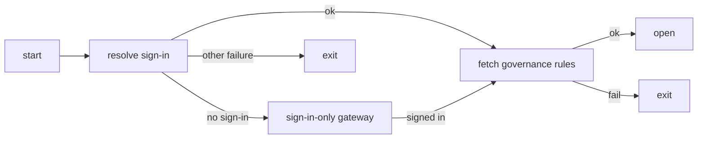

# RFC: Crew LTS Edition

- Status: accepted. The owner approved this design on 2026-10-23; D1 to D12 in section 5 are owner decisions (D4 and D5 added 2026-10-29, D3 amended and D6 added 2026-11-02, D7, D8 and D9 added and D3 amended again 2026-11-05, D10 and D11 added 2026-11-07, D12 added 2026-11-09). This document landed first so the implementation pull requests that follow have a design for the First Principles and Design lanes to check against: the LTS edition changes defaults (most governable features off) and adds a startup gate.
- Tracking issue: [#23206](https://github.com/kirodotdev/KiroCrew/issues/23206)
- Related: [rfc-central-governance-ceiling](rfc-central-governance-ceiling.md) (the policy ceiling this edition fetches and enforces), [platform-context](../system-specs/modules/platform-context.md) (the existing edition seam), [governance](../system-specs/modules/governance.md) (the evaluator and catalog this edition tightens)

## Summary

Kiro Crew gains an LTS edition built from the same codebase. The build picks the edition (`make desktop EDITION=lts`, default `oss`) and writes it into the package as a constant. At run time the LTS edition will not open until the user has a kiro login and Crew has fetched the organisation's governance rules. With no login it opens only a sign-in screen; any other failure makes Crew exit (amended 2026-10-29). Every action is then checked against those rules. Most governable features are off by default or keep only a minimal set until a rule turns them on; eight keep Crew's normal default until a rule turns them off (D3, amended 2026-11-02). The `oss` edition is unchanged.

## Motivation

Measured at `5c32cf32b`.

An organisation that wants to run Crew today can install a governance ceiling ([rfc-central-governance-ceiling](rfc-central-governance-ceiling.md), `src/kiro_crew/platform/policy_distribution.py`), but three things keep that from being a managed product:

1. **Nothing requires a login or a policy before Crew opens.** Crew starts and serves its dashboard whether or not a kiro login or a governance ceiling exists. The login check in `src/kiro_crew/kiro_prerequisite_status.py` reports status; it does not gate startup.
2. **An unnamed control is allowed.** `_query_level` in `src/kiro_crew/platform/governance_parts/evaluator.py` returns `_PERMIT_NOT_GOVERNED` when the policy carries no control for a scope, so a policy that forgets a control leaves that feature fully on. That is the right default for a standalone install and the wrong one for a managed install.
3. **Many local shims have no governance key.** Of the 66 controls an organisation expects to govern (the appendix), several have only an on/off switch and many have no key in `src/kiro_crew/platform/governance_parts/catalog.py` or `carriers.py` at all, so no rule can reach them.

## Goals

1. Crew requires a kiro login before it opens the dashboard (amended 2026-10-29, D4 and D5). With no login it opens only a sign-in screen; every other startup failure makes it exit.
2. Governance controls the real behaviour. Most local shims are turned off; twelve shims keep Crew's normal default, and governance can still turn each off (D3, amended 2026-11-02 and 2026-11-05).
3. No new repository: one codebase builds both editions.

## Non-goals

- Changing the `oss` edition's behaviour or defaults.
- Defining the governance service's API (see Open questions).
- Adding governance keys for every control in this document. Controls without a key are hardcoded to their LTS default until that key lands in its own pull request.

## Design

### 1. Edition is a build-time constant

The build picks the edition: `make desktop EDITION=lts`. The build writes the edition into the package as `src/kiro_crew/edition.py` (default `oss`), then packages and signs the app.

At run time, code reads only that built-in `EDITION` value. It never reads a config file or an environment variable for this, so neither a user nor an agent can switch an installed app's edition.

This is a different axis from the existing [platform-context](../system-specs/modules/platform-context.md) seam, which composes edition adapters into the core at run time. `EDITION` decides whether the LTS gate and defaults apply; the seam still decides which adapters are composed.

### 2. LTS gate: login and governance are one gate

The identity from login is the key that fetches the rules. One sign-in resolver (D4) gives that identity to the login check, the rules fetch and the account lock.

| When | What the gate does |
|---|---|
| Start | Resolve the sign-in, then fetch rules. No sign-in: open the sign-in-only gateway (D5). Any other failure: exit |
| Every action | Check the rules, then allow or deny |
| Login expires | Close the gate and log in again |
| Rules change | Re-fetch on the policy's `crew_policy_refresh_seconds` |

Any failed step denies (fail-closed). While the gate is closed, gateway middleware denies every route outside the sign-in allow-list: sign-in, health and static routes (D5).

### 3. Most governable features off by default

In the LTS edition, most governable features are off by default, or keep only a minimal set. Such a feature turns on only when a governance rule turns it on. Eight controls are open instead (amended 2026-11-02, D3): MCP servers, file read, file write, shell commands, tools, sub-agents, scheduled jobs and Crew apps. Each keeps Crew's normal default until a governance rule turns it off. The owner's reason: the organisation's governance (KGL, and KAS for MCP servers) is where these are meant to be controlled, so Crew does not add its own default-off on top. Four more are open since 2026-11-05 (D3): durable memory writes, the theme persona, milestones and local decision models. They carry no real risk: each works on this machine only. The appendix lists all 66 controls with each one's default.

| Class | Count | LTS behaviour |
|---|---|---|
| Green | 37 | Off by default; governance turns it on. MCP servers, scheduled jobs, Crew apps, sub-agents, durable memory writes, the theme persona, shell commands and file read / write keep Crew's default; governance turns them off. The minimum sandbox level keeps Crew's sandbox default; governance can only make it stricter (D7) |
| Yellow | 17 | Off by default. Until the Crew work lands, minimal set only. Tools keep Crew's default; governance turns them off |
| Red | 12 | Governance cannot control it; hardcoded to the minimal set |
| Local floor | 2 | Always on; see below |

For controls that already have a key, "off by default" comes from one change: in the LTS edition `_query_level` denies a control the policy does not name, where today it permits; the built-in baseline policy keeps each minimal set, and leaves the open controls at Crew's own default (D3). For controls with no key yet, the LTS edition reads `EDITION` at the feature's entry and turns it off.

The open controls do not skip Crew's approval prompt; they get the same approval behaviour as in the `oss` edition. Under the default `normal` mode, every file write and every shell command that is not read-only asks the user first, unless a grant the user or operator made already covers it (for example a trusted pattern, an operator grant or an agent spec allow-list); read-only shell commands that do not run git, and read-only built-in tools, run without asking. `yolo` stays off. A user may still pick `trust` or `trust_reads` unless the remote policy's `permission_mode` rule leaves them out (D9). Under `trust`, open commands and writes run without a prompt. `trust_reads` still asks for writes and for commands that are not read-only. A policy that names `commands` or `filesystem.write` still limits what runs in every mode.

The local floor is Crew's own protection, not a governance rule:

- Credential file protection: the agent cannot read or write files such as `~/.aws` and `~/.ssh`.
- No self-disable: the agent cannot turn the protections above off.

### 4. Tamper resistance

- The edition is set at build time, not read from config.
- The install directory is on the write-protected list, so the agent cannot change it.
- The app is signed. A changed package breaks the signature.

The browser (wheel) build can carry the same `EDITION` stamp, but its tamper resistance is weaker: a wheel has no signature, and it installs into a user-writable `site-packages`, so a user can edit `edition.py` in place. The signed desktop app is the edition this design defends.

### 5. Decisions

The repository owner decided D1 to D3 on 2026-10-23. They hold in an LTS build only; the `oss` edition is unchanged.

**D1. One LTS fact.** The build-time `EDITION` is the only source for "is this LTS". In an LTS build, `resolve_profile` in `src/kiro_crew/platform/profile.py` returns the enterprise profile and ignores the `KIROCREW_PROFILE` environment variable, the SSO-marker probe and the installed `kirocrew.plugins` entry points, all of which it reads today. `PlatformContext.is_enterprise` stays the one property callers read. Consequence (amended 2026-10-28, see the decision log below): an LTS build with no companion installed boots on the core defaults under the enterprise profile, so every LTS gate (login, governance fetch, deny-unnamed, edition locks) stays on. An installed companion that is broken, rejected at admission, ambiguous or contract-mismatched still fails closed (the `PlatformCompositionError` path in `src/kiro_crew/platform/discovery.py` and `src/kiro_crew/platform/bootstrap.py`). No environment variable or config changes the profile or the edition; `KIROCREW_PROFILE=standalone` still does not escape it.

**D2. Locked policy source.** In an LTS build, the governance policy URL is a build-time constant. The `POLICY_URL_ENV` environment variable (`KIROCREW_POLICY_URL`, defined in `src/kiro_crew/platform/policy_distribution_source.py`) and local config cannot change it. The address is public, so it lives in the repository. Until the real endpoint is chosen it is the placeholder `https://governance.example.invalid/crew/policy`, on a reserved domain that never resolves; it is replaced before the enable step (Migration plan phase 2). Testing against a different address needs its own build; local environment cannot do it.

**D3. No local loosening.** Remote rules are the only thing that can turn a control on. A control the remote policy does not name is locked to its minimal set, or off when it has no minimal set. Local config, environment variables, profiles and dashboard settings cannot widen any control in an LTS build; they may only narrow it further. A built-in baseline policy holds each control's minimal set (the appendix "Minimal set" column), and LTS `_query_level` denies anything outside it. This closes the earlier open question on how deny-unnamed keeps each minimal set.

Open controls (amended 2026-11-02): `mcp`, `filesystem.read`, `filesystem.write`, `commands`, `tools`, `capabilities.spawn`, `capabilities.cron` and `apps` are not gated by the baseline. When the remote policy does not name one of them, it keeps Crew's own default (the appendix shows "Crew default"). A remote policy that names one still wins, so governance can narrow or turn it off. The baseline lists each open control with its reason, beside the minimal sets. The approval mode default stays `normal` and the local floor stays on, so open commands and writes get the approval behaviour section 3 describes, and in every mode they cannot reach credential files. `trust` and `trust_reads` stay selectable unless a `permission_mode` rule leaves them out (D9). For an open control the remote policy does not name, local config and settings work as in the `oss` edition; for every other control they may still only narrow.

Open controls (amended 2026-11-05): `capabilities.memory_writes`, `capabilities.theme_persona`, `capabilities.milestones` and `capabilities.decisions_local` join them. Open means the feature may be used; it does not switch anything on. User settings keep their `oss` defaults, and a local decision model still needs `capabilities.decisions`, which stays off. A remote policy that names one still wins: the enterprise-management rules reach the first two through their policy terms (`memory_writes`, `theme_persona`); the last two have no policy term yet, so a local policy or profile turns them off. `capabilities.app_dev_mode` and `app_versions` stay off. Milestones sit behind the Explore Feature Preview, which D12 turns off, so an LTS build does not reach them (amended 2026-11-09).

| Source | Can widen | Can narrow |
|---|---|---|
| Remote policy | yes | yes |
| Built-in baseline | minimal set only; Crew's own default for the open controls | — |
| Local config | no | yes |
| Environment variables | no | yes |
| Profiles | no | yes |
| Dashboard settings | no | yes |

The owner added D4 and D5 on 2026-10-29, after the LTS smoke test (see the decision log below).

**D4. One sign-in.** In an LTS build, one resolver answers "who is signed in". The login check at start, the rules fetch and the account lock (the profile pin from [#24661](https://github.com/kirodotdev/KiroCrew/pull/24661)) all read it, so they can never name different accounts. It accepts two sign-ins, in this order:

| Order | Sign-in | Written by |
|---|---|---|
| 1 | Crew's own vault | `kirocrew kas login`, or the dashboard's Sign in |
| 2 | kiro-cli's own sign-in | `kiro-cli login` |

The vault is preferred because kiro-cli will be removed later; kiro-cli's sign-in is accepted until then. The source is picked by presence (amended 2026-10-30): when the vault holds an entry, the vault is the only source, and a lapsed vault entry is not signed in rather than a reason to read kiro-cli; when it holds none, kiro-cli's sign-in is the only source. Crew does not renew kiro-cli's token, so an expired one is not signed in. Step 2 reads kiro-cli's own credential store, the one the KAS relay already uses when the vault holds no identity; it is not the `kiro-cli whoami` probe. When both hold a sign-in with different profile ARNs, Crew refuses and names both accounts. When neither holds one, the message names both ways to sign in (`kirocrew kas login` and `kiro-cli login`).

The `oss` edition reads the same resolver with the same order (amended 2026-10-30): when the vault holds an entry, the vault is the only source, and a lapsed or unreadable entry is not signed in (the message names `kirocrew kas login --provider idc`, and says that removing the Crew sign-in with `kirocrew kas logout` hands over to kiro-cli's); when it holds none, kiro-cli's sign-in is used. The two are never mixed. Two differences from the LTS build: two stored sign-ins on different accounts use the vault and log one warning naming both, instead of refusing; and a sign-in with no profile (a Builder ID) is accepted. The KAS spawn, `kirocrew doctor` and the Settings sign-in status in `oss` all read this pick.

Each refusal names one real cause, from this list: both sign-ins disagree, governance service unreachable, rules that cannot be applied, account not eligible for enterprise management, or account changed while running. The account lock pins the first sign-in the resolver returns, at start or after a sign-in in the sign-in-only gateway (D5), and compares every later answer with that pin.

**D5. Signed-out start opens a sign-in screen.** When the resolver finds no sign-in at start, an LTS build does not exit. It opens a sign-in-only gateway bound to `127.0.0.1`. That gateway keeps the dashboard's token auth, serves an allow-list of sign-in, health and static routes, refuses every other route, and shows a sign-in screen on web and desktop naming both ways to sign in. After the user signs in, the resolver runs again with D4's rules, then the rules fetch runs. A refusal from either still exits with its named cause. A failure from D4's cause list at start exits as before and never opens this gateway.

The owner added D6 on 2026-11-02 (see the decision log below).

**D6. KAS is the LTS harness.** In an LTS build, the agent harness minimal set is KAS (policy id `kas`), and KAS is the harness no policy can remove (the `agent_backend` floor). The Kiro CLI harness (policy id `kiro`) is off unless a remote rule names it; a remote rule can add any other harness as before, and local settings can only narrow. KAS has two routes, and kiro-cli is kept only as the first: kiro-cli's ACP relay (`build_kas_argv` in `src/kiro_crew/acp/kas_transport.py`), or Crew's own engine bundle (`src/kiro_crew/acp/kas_bundle.py`), used when `agent.kas_bundle` is on, or automatically when kiro-cli is missing or signed out (the route rules in `src/kiro_crew/acp/kas_route.py`). Crew checks the route KAS would take. When it is proven unable to start (on the relay, a kiro-cli too old to serve `--agent-engine v3`; on the bundle, an engine that is neither installed nor installable on this machine), the start exits with a message naming the fix, which names the other route when that one can help. It never falls back to the Kiro CLI harness. The harness-parity review rule (`AUTOSDE.yaml`) records this as an exception to H1/H3. The `oss` edition is unchanged: its floor stays the Kiro CLI harness.

The owner added D7 on 2026-11-05 (see the decision log below).

**D7. The sandbox level can only be tightened.** In an LTS build, Crew reads the setting `crew_sandbox_min_level` from the configuration entries of the governance reply (`body.configuration`), beside the policy. When the reply carries `manifest.hash`, Crew checks each entry's shape and the same hash covers the configuration entries and the policy, so a badly shaped entry refuses the whole reply. With no hash, Crew does not check entry shapes, as before D7, so an entry Crew does not read never refuses a reply; it reads `crew_sandbox_min_level` leniently, and a badly shaped entry for it sets no floor (amended 2026-11-05). The levels, loosest to strictest, are `off`, `standard`, `cc` and `strict`. The effective level is the stricter of the local level and the policy level, so the policy can only tighten and never loosen. Only `cc` and `strict` set Crew's existing sandbox floor, `sandbox.min_level`. A policy `off` or `standard` sets no floor, the same as when the reply does not carry the setting: Crew's own default (`auto`) already resolves to `standard`, and an LTS build already reads a local `off` as that default, so neither value has any effect and no policy can make an LTS build run unsandboxed. This matters because the sandbox enforcer treats any floor as a governed host (it turns off the first-party no-backend carve-out, and a floor of `standard` or above overrides the unsandboxed-exec allowance); a floor that adds nothing must not do that. A value that is not one of the four levels is not a level the organisation picked, so it sets no floor, the same as no entry, and logs a warning: Crew adds no strictness of its own (amended 2026-11-05). The setting is kept with the cached policy document, so an `UNCHANGED` reply, a refresh and a cache-only child keep it. Local config can still pick a stricter level (D3). The `oss` edition is unchanged.

**D8. Crew reads the policy terms that already exist.** In an LTS build, Crew reads these existing policy-language terms from the governance reply, with no change to the language: `shell` (to `commands`), `fs_read` and `fs_write` (to `filesystem.read` and `filesystem.write`), `network_egress` (to `network.egress`), `mcp` (to `mcp`), `subagent` with its agent names (to `capabilities.spawn` and its `agents` list), beside `messaging_channel`, `messaging`, `cron` and `permission_mode`, which it already reads. It also reads the on/off terms `tailnet_origin`, `browser_use` and `theme_install` (to `capabilities.tailnet_origin`, `capabilities.browse` and `capabilities.theme_install`). A rule on `builtin` or `filesystem` reaches the terms beneath it. A deny on `all` reaches every term above; an allow on `all` reaches only the built-in tools and `mcp`, the stricter reading. A term that any rule names is governed as the language reads it: what no `allow` grants is denied. A term no rule names keeps the D3 default. Tighten-only stays the rule against Crew's own protections: no rule can widen past the local floor (`~/.aws`, `~/.ssh`, no self-disable), which Crew checks before any rule. Each value is converted to the form Crew's matcher reads. A value Crew cannot match exactly is dropped from what a rule allows and widened in what a rule denies; a denied value Crew cannot widen safely refuses the whole reply, as an untranslatable rule does today. A file path is read only in canonical form: absolute (`/`, `~` or `~/...`), one `/` between segments, no trailing `/`, no `.` or `..` segment, and no `\`, drive letter, `~user`, bracket class, `$` or extended glob. Any other path refuses a deny and is dropped from an allow. The term `skill` is not read: Crew has no control that gates loading a skill by name. Slack channel ids are not read: the language's `channelId` names a chat service, not a channel. The `oss` edition is unchanged.

The owner added D9 on 2026-11-05 (see the decision log below).

**D9. A policy can deny `trust` and `trust_reads`.** The `permission_mode` term (Crew scope `approval_modes`) governs `trust` and `trust_reads` as well as `yolo`. `normal` is the only mode a rule cannot remove (the catalog floor), so the translator adds back `normal` alone. A rule such as `match: ["normal", "trust_reads"]` therefore turns `trust` off. A denied mode is refused where it is set: the dashboard mode API and the approval card's Trust buttons, a crewmate's Profile write, a cron's session-mode call and its `auto` job mode, a spawn's `approval_mode: auto`, and the Trust buttons on Slack, Telegram and the other chat services (a press there approves the one tool). It is also refused where a grant is honoured, so a grant made before the policy landed stops working: the slot's trust flags, the session's stored `approval_policy` of `auto` (still honoured while a session-wide YOLO grant is live), the messaging Trust set and a channel's trust. A mode id Crew does not know is refused. Only the installed policy's rule narrows `trust` and `trust_reads`; a governance profile does not, and one that denies either is refused at load, as before. The verdict is read from that rule in memory, once per policy install. While a new policy is being installed, or the rule cannot be read, both modes are denied if the installed policy has a rule that refuses one of them; with no such rule they stay allowed. The picker hides each denied mode (`disabled_approval_modes`). With no `permission_mode` rule, all three stay allowed, as before. `agent.approval_mode` (the chat-service dispatcher's own `auto`) is a separate setting, governed by the `approval_mode` scope, and does not change. The `oss` edition is unchanged.

**D10. The edition is named LTS.** The edition is the LTS (Long Term Support) edition, formerly called the enterprise edition. The build value is `EDITION=lts` and `edition.is_lts()` reads it. `EDITION=enterprise` is not an alias: it fails like any other unknown edition. Names that belong to the Kiro service keep "enterprise": enterprise management and its API (`GetEffectiveEnterpriseManagementResourceWithToken`, `kirocps://enterprise-management`), the platform profile `enterprise` that the companion package composes (`KIROCREW_PROFILE`, `PlatformContext.is_enterprise`), and the organisation governance ceiling that both editions honour. The `oss` edition is unchanged.

The owner added D11 on 2026-11-07 (see the decision log below).

**D11. The edition updates only from its own `lts` channel.** The edition's builds are published on a release channel of their own, `lts`. An LTS build follows `lts` and nothing else: on the desktop, through the CLI and wheel update path, and through the dashboard's channel switch. No local setting and no policy can move it. The policy `updates.channel` pin is still read and validated, but in an LTS build it does not change the channel. `lts` is not a channel an `oss` build can pick or a policy can pin: the release channels stay `stable`, `insider` and `nightly` for `oss`, so an `oss` install never reads the edition's feed, and an LTS install never reads `oss`'s. The release pipeline publishes `lts` in a separate change; until then an LTS build has no update lane, and its updates stay off rather than falling back to `stable`. The `oss` edition is unchanged.

The owner added D12 on 2026-11-09 (see the decision log below).

**D12. No Feature Previews and no Debug tools.** An LTS build ships no Feature Preview. Every `dashboard.feature_previews.<name>` switch reads off, whatever config, the CLI, an older build or the browser holds: the gateway's readers take the switches through `edition_locks.feature_previews`, the config write (`PATCH /api/config/kirocrew`) refuses a preview path with `locked_by_policy`, and a change card does not offer one. The dashboard reads every `mc-preview-*` flag as off and refuses to set one, so a key changed in Settings > Developer > Storage or in the browser's devtools turns nothing on; it learns the lock from the config schema (`GET /api/config/schema`), which marks every preview path `lockedByPolicy`. Settings > Developer > Feature Previews keeps its page and its other cards (Automatic cards, Shared Crew, remote dispatch, the KAS engine, Decisions, Crewmates, default MCP sets and the desktop Gateway switch), but draws no preview card and no "See what it looks like" intro, and Settings search offers no preview card. Milestones sit behind the Explore preview, so an LTS build does not reach them either; that is intended, because the feature is not finished. Settings > Developer > Debug tools is hidden too: its page leaves the rail, an old `/developer?tab=debug-tools` link lands on the Developer tab's first page, and its one tool, the scroll inspector, reads off. Debug tools has no gateway route and no config path, so this is a dashboard check only; the dashboard learns it from `locked_controls` on the config read, a field only an LTS build sends. The other Developer pages (Logs, System, Telemetry, Storage, Memory, Config and Archive) stay. This is not the "App developer mode" row (`capabilities.app_dev_mode`), which stays off as before. The `oss` edition is unchanged.

**Decision log.**

- 2026-10-28: the owner amended D1's consequence. Why it changes: (1) on 2026-10-23 D1 made a missing companion fail closed because the governance fetch was then planned to live in a companion package; (2) on 2026-10-27 the owner moved the control-plane policy fetch into this repository, reusing the existing control-plane client, and it merged as [#24661](https://github.com/kirodotdev/KiroCrew/pull/24661); (3) every LTS gate (the login gate, the policy fetch that exits on failure, deny-unnamed, local-only-stricter and the edition locks) now lives in the core behind the build-time `EDITION`, so a companion supplies nothing the LTS edition needs and the D1 refusal only stops LTS builds from starting. New consequence: an LTS build with no companion boots on the core defaults with every LTS gate on. What does not change: a host with a companion installed takes the same path as before; a broken, rejected, ambiguous or contract-mismatched companion still fails closed with `PlatformCompositionError`; no environment variable or config changes the profile or the edition; the `oss` edition is unchanged.
- 2026-10-29: the owner added D4 and D5. Why it changes: the LTS smoke test found that (1) the login check at start read only kiro-cli's sign-in (`kiro-cli whoami`) while the rules fetch read only Crew's vault, so a user signed in through kiro-cli was refused and the two checks could name different accounts; (2) the rules were fetched before the login check ran; (3) a signed-out user got a generic message and no way to sign in, and the desktop app had no sign-in path at all. New consequence: the login check, the rules fetch and the account lock read one resolver, vault first because kiro-cli will be removed later (D4); a signed-out LTS start shows a sign-in screen on `127.0.0.1` instead of exiting (D5). What does not change: D1 to D3; every other startup failure exits; the gate stays fail-closed; the `oss` edition is unchanged.
- 2026-10-30: the owner amended D4. Why it changes: in review of the code PR (#26100), the gate, the rules fetch and the account lock each picked the sign-in source on their own, by liveness, so a lapsed vault entry next to a live kiro-cli sign-in could make the fetch use one account while the lock saw another, refusing every start. New consequence: one selection, by presence, read by every check: a vault entry means the vault only, and a lapsed one is not signed in; no vault entry means kiro-cli's sign-in only. Crew does not renew kiro-cli's token at boot (follow-up #26183). What does not change: the vault is preferred; two stored sign-ins on different accounts are refused naming both; D5; the `oss` edition is unchanged. Delivery: the vault sign-in lands first (#26100); the kiro-cli fallback lands in its own change, written so the `oss` edition can reuse the same resolver.
- 2026-10-30: the owner extended D4's sign-in order to the `oss` edition. Why it changes: users moving from older Kiro Crew, which needed kiro-cli, must keep working on their kiro-cli sign-in without a new Crew sign-in (a migration path); and `oss` picked its KAS sign-in with its own rule, which quietly fell back from a lapsed or unreadable vault entry to kiro-cli's account, so the two sign-ins could mix. New consequence: `oss` reads D4's resolver: a vault entry means the vault only, and a lapsed or unreadable one is not signed in; no vault entry means kiro-cli's sign-in; two accounts use the vault with one warning. The old silent fallback from a lapsed vault entry to kiro-cli is removed on purpose. What does not change: the LTS rules in D4, including the refusal of two accounts; D5; the kiro-cli bundle route, which has no kiro-cli and stays Crew-owned. Delivery: #26841 (issue #26829).
- 2026-11-02: the owner amended D3 to open eight controls. Why it changes: review of the design (nine comments on the enterprise design doc) asked not to turn off features the organisation's governance (KGL, and KAS for MCP servers) is meant to control; turning them off by default left an LTS build without them until an organisation wrote a rule turning each one on. New consequence: `mcp`, `filesystem.read`, `filesystem.write`, `commands`, `tools`, `capabilities.spawn`, `capabilities.cron` and `apps` keep Crew's own default when the remote policy does not name them, and a policy that names one still wins. What does not change: the approval mode default stays `normal`, so under it every write and every command that is not read-only asks unless a grant covers it (`trust` and `trust_reads` stay selectable and are not yet governable, as before); the local floor (`~/.aws`, `~/.ssh`, no self-disable) stays on; `app_versions`, extension install, `yolo` (approval modes keep `normal`, `trust`, `trust_reads`), chat services (`channels`) and the Slack posture stay off; every other control keeps its minimal set; the `oss` edition is unchanged. Delivery: one code pull request after this amendment merges (issue #28751).

- 2026-11-02: the owner added D6. Why it changes: (1) on a real LTS desktop build with no policy reply, Settings > Agent Harness left only Kiro CLI, because the appendix "Agent harness" minimal set was `kiro` and the `agent_backend` floor is the Kiro CLI harness; (2) KAS is the forward harness and kiro-cli is being retired, so the one harness an LTS build keeps must be KAS. New consequence: in an LTS build the minimal set and the floor are KAS; the Kiro CLI harness needs a remote rule; a KAS proven unable to start on its route exits naming the fix instead of falling back. What does not change: kiro-cli stays usable as KAS's relay, beside the engine bundle route; a remote rule can still widen the set; D1 to D5, including D3 as amended the same day (D6 changes only the `agent_backend` row's minimal set, which D3's amendment did not open); the `oss` edition, whose floor stays the Kiro CLI harness. Delivery: the code change follows this record in its own pull request.
- 2026-11-05: the owner added D7. Why it changes: the governance reply carries settings (`body.configuration`) as well as the policy, and Crew read the settings only to check the reply's hash, so a published `crew_sandbox_min_level` had no effect; the appendix kept "Minimum sandbox level" in Red, with no policy term. New consequence: "Minimum sandbox level" moves from Red to Green with the policy term `crew_sandbox_min_level`; the effective level is the stricter of the local and the policy level; the policy can only tighten; only `cc` and `strict` set the floor, and `off` or `standard` set none, the same as a missing setting, which keeps Crew's sandbox default; a value that is not a known level sets no floor and logs a warning; entry shapes are checked only when the reply declares a hash. What does not change: no policy can loosen the sandbox or turn it off; D1 to D6; the local floor; the `oss` edition. Delivery: the code change follows this record in its own pull request.
- 2026-11-05: the maintainer amended D7 in [review 5792566657](https://github.com/kirodotdev/KiroCrew/pull/30635#pullrequestreview-5792566657) on the code pull request. Why it changes: Crew does not add security strictness on its own, and two parts of D7 went past what the organisation chose: (1) an unknown value applied `strict`, a level the organisation did not pick; (2) entry shapes were checked on every reply, so a hash-less reply with an unrelated badly shaped entry could stop an organisation that set no floor from starting. New consequence: an unknown or badly shaped `crew_sandbox_min_level` sets no floor and logs a warning; entry shapes are checked only when the reply declares a hash, as before D7. What does not change: `cc` and `strict` set the floor; `off`, `standard` and no entry set none; a stricter local level wins; the hash still covers every entry when declared; the `oss` edition.
- 2026-11-05: the owner amended D3 to open four more controls. Why it changes: these controls carry no real risk, and keeping them off left an LTS build without core features (durable memory) until an organisation wrote a rule for each. Memory writes stay on this machine; the theme persona changes tone only; milestones are local UI only; a local decision model stays inert while `capabilities.decisions` is off. New consequence: `capabilities.memory_writes`, `capabilities.theme_persona`, `capabilities.milestones` and `capabilities.decisions_local` keep Crew's own default when the remote policy does not name them, and a policy that names one still wins. Open means permitted, not switched on: preview flags and user settings keep their `oss` defaults. What does not change: `capabilities.app_dev_mode` and `app_versions` stay off; `apps` stays open as amended on 2026-11-02; `capabilities.decisions` stays off; every other control keeps its minimal set; the `oss` edition is unchanged. Delivery: this amendment and its code change land in one pull request.
- 2026-11-05: the owner added D8. Why it changes: the language already has terms for shell commands, file read and write, reachable hosts, MCP servers and sub-agents, and Crew read none of them, so an organisation's rules for them had no effect on Crew; three on/off terms (`tailnet_origin`, `browser_use`, `theme_install`) are being added to the language for Crew. New consequence: "Shell commands", "File read / write" and "Reachable hosts" move from Yellow to Green, with the terms `shell`, `fs_read` / `fs_write` and `network_egress`; Crew reads those and `mcp` and `subagent`, and the three on/off terms. What does not change: D3's defaults when no rule names a term; the local floor; Slack channel ids and project skills stay as they are; the `oss` edition. Delivery: one pull request with this record and the code (issue #30821).
- 2026-11-05: the owner added D9. Why it changes: an owner's `permission_mode` rule allowing only `normal` and `trust_reads` still left Trust in the picker and working, because the catalog kept `trust` and `trust_reads` in the `approval_modes` floor and the translator added them back to every rule; the earlier wording said a policy could not deny them yet. New consequence: a rule can deny either mode, every place that sets or honours a session's Trust checks it, and the picker hides the denied mode. What does not change: `normal` is the floor, a missing rule keeps all three modes, `yolo` stays off by default, and the `oss` edition is unchanged. Delivery: one pull request with this amendment and the code.
- 2026-11-07: the owner added D10. Why it changes: the edition is offered as Long Term Support, and "enterprise" already names the Kiro service's enterprise management, which this edition reads. New consequence: the edition, its build value, modules, wire codes and docs say LTS; the old build value `enterprise` fails with the generic unknown-edition error, which lists `oss` and `lts`; there is no special message and no alias. What does not change: behaviour, the server names above, and the `oss` edition. Delivery: one pull request with this amendment and the code.
- 2026-11-07: the owner added D11. Why it changes: the release pipeline is to build, sign and ship the edition next to `oss` from the normal release flow. On `stable` the edition's update files would overwrite `oss`'s, or an LTS install would update to `oss` bytes. New consequence: the edition follows only the `lts` channel, which `oss` never offers or reads; a policy `updates.channel` pin no longer moves an LTS build (it could pin `insider`, `stable` or `nightly` before). What does not change: the `oss` channels and the policy pin for `oss`; D1 to D9. Delivery: this record and the client change land in one pull request; the release legs that publish `lts` follow in their own.
- 2026-11-09: the owner added D12. Why it changes: LTS means long-term stable, so experimental features stay out of it. A Feature Preview is a surface that ships before it is finished, and Debug tools are overlays for the people building Crew; neither belongs in an LTS build. Hiding the switches alone was not enough, because a flag can still be set in the browser or in config. New consequence: every Feature Preview reads off in an LTS build, on the gateway and in the dashboard, and writes to one are refused; milestones, behind the Explore preview, are out of reach, which the owner accepted because the feature is not finished; the Debug tools page is hidden and its scroll inspector reads off. This replaces the 2026-11-05 note that milestones need only the Feature Preview opt-in. What does not change: the Developer tab and its other pages, Storage included; the non-preview cards on the Feature Previews page; the stored switch values, which an `oss` build reads as before; `capabilities.milestones` stays an open control; the `oss` edition is unchanged. Delivery: one pull request with this amendment and the code.

### 6. Changes

| Where | What changes |
|---|---|
| `src/kiro_crew/edition.py` | New `EDITION` constant, written by the build |
| Startup entry point | LTS edition passes the LTS gate first |
| Gateway middleware | While the gate is closed, deny every route outside the sign-in allow-list (D5) |
| Sign-in resolver (new) | Vault first, then kiro-cli's own sign-in; read by the login check, the rules fetch and the account lock (D4). Replaces `kiro-cli whoami` (`src/kiro_crew/kiro_prerequisite_status.py`) as the LTS login check |
| Sign-in-only gateway (new) | Signed-out start serves only sign-in, health and static routes on `127.0.0.1` (D5) |
| Sign-in screen, web and desktop (new) | Shown by the sign-in-only gateway; names both ways to sign in (D5) |
| Governance client (new) | Fetch, cache and query rules from the organisation's governance service |
| `src/kiro_crew/platform/profile.py` | `resolve_profile`: LTS build returns the enterprise profile from `EDITION` alone (D1) |
| `src/kiro_crew/platform/policy_distribution_source.py` | LTS build uses the build-time policy URL; `POLICY_URL_ENV` and config are ignored (D2) |
| Built-in baseline policy (new) | Grants each control's minimal set beneath the remote policy, and lists the open controls that keep Crew's default (D3) |
| `src/kiro_crew/platform/governance_parts/evaluator.py` | `_query_level`: a control the policy layer does not name is allowed today. LTS edition denies anything outside the remote policy and the baseline (D3) |
| Local config, env, profile and dashboard settings readers | LTS build lets them narrow a control, never widen it (D3) |
| `agent_backend` floor and baseline | LTS build keeps KAS as the harness no policy can remove and the baseline minimal set; a KAS proven unable to start on its route exits naming the fix (D6). `oss` keeps the Kiro CLI floor |
| `src/kiro_crew/platform/enterprise_policy_fetch.py`, `src/kiro_crew/platform/enterprise_policy_translate.py` | LTS build passes the reply's configuration entries to the translator, which turns `crew_sandbox_min_level` `cc` or `strict` into `sandbox.min_level`, tighten-only, kept with the cached document; an unknown value sets none and warns; entry shapes are checked only with a declared hash (D7, amended in [review 5792566657](https://github.com/kirodotdev/KiroCrew/pull/30635#pullrequestreview-5792566657)) |
| `src/kiro_crew/platform/enterprise_policy_translate.py` | Reads the existing terms `shell`, `fs_read`, `fs_write`, `network_egress`, `mcp` and `subagent`, and the on/off `tailnet_origin`, `browser_use` and `theme_install`; a meta-capability rule reaches the terms beneath it, read the stricter way for `all` (D8) |
| Update channel readers (`src/kiro_crew/platform/update_layout.py`, `governance_parts/tiers.py`, `website/electron/runtime/update/policy-channel.js`) | LTS build follows only `lts`; a policy pin does not move it; `oss` cannot pick or pin `lts` (D11) |
| Features Crew has no key for yet | LTS edition reads `EDITION` at the feature entry and turns it off |
| `src/kiro_crew/edition_locks.py`, the preview readers, the config read and write, `website/src/utils/editionLocks.ts`, `previewFlags.ts`, Settings > Developer | Every Feature Preview reads off and cannot be set; the preview cards and Debug tools are hidden (D12) |
| `Makefile` | Add the `EDITION=lts` build |

## Migration plan

Each phase is one pull request and changes nothing in the `oss` edition.

1. **Edition stamp.** Add `edition.py`, the `EDITION=lts` build, the build-time policy URL placeholder and the `resolve_profile` change (D1, D2). Exit: an `oss` build and an LTS build differ only in `edition.py`; a test asserts that no config key or environment variable changes `EDITION`; in an LTS build `KIROCREW_PROFILE=standalone` still resolves the enterprise profile, boot with no companion composes the core defaults under the enterprise profile while boot with a broken or mismatched companion raises `PlatformCompositionError` (amended 2026-10-28), and setting `KIROCREW_POLICY_URL` does not change the policy URL.
2. **LTS gate.** Login check, governance fetch, middleware deny, expiry and refresh. The placeholder URL is replaced with the real endpoint before this phase enables the gate. Exit: with no sign-in, an LTS build opens only the sign-in-only gateway (D5), and after sign-in it fetches the rules; with the governance fetch failing, or any other startup failure, it exits; the login check, the rules fetch and the account lock read the one sign-in resolver (D4); while the gate is closed every route outside the sign-in allow-list is refused; tests cover the disagreement refusal, the sign-in screen naming both commands, each refusal naming its cause, and a route outside the allow-list being refused (amended 2026-10-29). Blocked on the Open question.
3. **Deny unnamed controls, no local loosening.** LTS `_query_level` denies anything outside the remote policy and the built-in baseline policy (D3). Exit: an empty remote policy leaves each `yes` control at its appendix minimal set, and each open control at Crew's default (amended 2026-11-02); a local config, environment, profile or dashboard setting that would widen a control has no effect, and one that narrows it does.
4. **Hardcoded defaults for controls with no key.** Exit: each `no` and Red control behaves as its appendix row in an LTS build.

## Backward compatibility

The `oss` edition is the default and reads the same constant, so every existing build and install behaves as today. The LTS edition is new and has no installed base.

## Security considerations

The gate is fail-closed: a missing sign-in opens only the sign-in-only gateway (D5); any other failed login, fetch or refresh denies. The sign-in-only gateway (D5) binds only `127.0.0.1` and serves only its allow-list, so a signed-out start exposes no other route. Two sign-ins that name different accounts refuse the start rather than picking one (D4). The edition, the profile and the policy URL cannot be changed by config or environment (D1, D2), no local source can widen a control (D3), and the desktop app's install directory is write-protected and signed. The wheel build's weaker tamper resistance is recorded in Design section 4. The local floor (credential files, no self-disable) stays on whatever the policy says.

## Alternatives considered

- **A separate LTS repository or fork.** Rejected: Goal 3, and two codebases drift.
- **Edition from config or an environment variable.** Rejected: a user or agent could flip it.
- **Policy URL overridable by `KIROCREW_POLICY_URL` for testing.** Rejected (D2): a local override could point the build at a permissive policy. A test address gets its own build.

## Open questions

1. **The governance service API is not decided.** Endpoint, authentication (how the login identity is presented) and response format are TBD. The design names it only as the organisation's governance service, and the build carries the placeholder URL from D2 until the endpoint is chosen.

2. **A sign-in lost while Crew runs.** The table in Design section 2 says the gate closes and the user logs in again. Whether that reuses the sign-in-only gateway's screen is not decided (added 2026-10-29). Signing back in as a different account is refused by the account lock (D4).

How deny-unnamed keeps each control's minimal set was open in the first draft; D3 decides it with the built-in baseline policy.

## Appendix: control defaults

"In Crew": `yes` = the key already exists in `src/kiro_crew/platform/governance_parts/catalog.py` or `carriers.py`. `partial` = the on/off switch exists, the list does not. `no` = must be added.

`yes` controls become off by default through the `_query_level` change, except the open controls marked "Crew default". `no` controls are not reachable by governance today; the LTS edition hardcodes them to the "LTS default" column for now.

"Minimal set": what stays when no rule turns the control on. `—` means fully off.

"Crew default" (amended 2026-11-02, D3): an open control. When no rule names it, it keeps Crew's normal default, as in the `oss` edition; a rule can narrow it or turn it off. The local floor still applies, and so does the approval prompt under the default `normal` mode (`trust` and `trust_reads` stay selectable unless a `permission_mode` rule leaves them out; see D9).

Two open controls have no row of their own (amended 2026-11-05): `capabilities.milestones` (local UI only; it sits behind the Explore Feature Preview, which D12 turns off in an LTS build) and `capabilities.decisions_local` (a local model; it stays inert while `capabilities.decisions`, the "Decision providers" row, is off). Both keep Crew's default.

### Green (37)

| Control | Policy term | Crew key | In Crew | LTS default | Minimal set |
|---|---|---|---|---|---|
| Chat services | `messaging_channel` | `channels` | yes | off (kept off 2026-11-02: sends data off the machine; waits for its KGL control) | — |
| Agent-initiated messages | `messaging` | `capabilities.messaging` | yes | off | — |
| Agent harness | `harness_use` | `agent_backend` | yes | off | `kas` (D6) |
| Approval modes | `permission_mode` | `approval_modes` | yes | `yolo` off | `normal`, `trust`, `trust_reads` (a rule may narrow to `normal`, D9) |
| MCP servers | `mcp` | `mcp` | yes | Crew default | Crew default |
| Theme persona | `theme_persona` | `capabilities.theme_persona` | yes | Crew default (opened 2026-11-05: tone only, local) | Crew default |
| Theme install | `theme_install` | `capabilities.theme_install` | yes | off | — |
| Publish destinations | `artifact_publish` | `capabilities.publish` | yes | off | `default` |
| Deploy regions | `cloud_deploy` | `publish.regions` | no | off | — |
| Browser | `browser_use` | `capabilities.browse` | yes | off | — |
| Phone pairing | `mobile_connect` | `capabilities.mobile_connect` | yes | off | — |
| Tailscale access | `tailnet_origin` | `capabilities.tailnet_origin` | yes | off | — |
| Allowed tailnets | `crew_remote_tailnets` | `tailnet_origin.tailnets` | no | off | — |
| Durable memory writes | `memory_writes` | `capabilities.memory_writes` | yes | Crew default (opened 2026-11-05: local data, never leaves the machine) | Crew default |
| Scheduled jobs | `cron` | `capabilities.cron` | yes | Crew default | Crew default |
| Crew apps | `app_use` | `apps` | yes | Crew default | Crew default |
| App versions | `crew_app_versions` | `app_versions` | no | off (kept off 2026-11-02) | — |
| Sub-agents | `subagent` | `capabilities.spawn` | yes | Crew default | Crew default |
| Script hooks | `script_hook_execute` | `capabilities.script_hooks` | yes | off | — |
| Hook trigger events | `crew_script_hook_events` | `script_hooks.events` | no | off | — |
| Optional telemetry | `telemetry_export` | `capabilities.telemetry` | partial | off | — |
| Diagnostic telemetry target | `crew_telemetry_otlp_endpoint` | `telemetry.otlp_hosts` | no | off | — |
| Feature content download | `feature_content_download` | `capabilities.feature_videos_download` | partial | off | — |
| Feature content hosts | `crew_feature_content_hosts` | `feature_videos_download.hosts` | no | off | — |
| Share to sites | `social_share` | `capabilities.social_share` | partial | off | — |
| Decision providers | `decision_provider_use` | `capabilities.decisions` | partial | off | — |
| Decision models | `decision_model_use` | `decisions.models` | no | off | — |
| Decision kinds | `decision_point_use` | `decisions.points` | no | off | — |
| Incoming webhooks | `webhook_use` | `webhooks` | no | off | — |
| App developer mode | `developer_mode` | `app_dev_mode` | no | off (kept off 2026-11-05) | — |
| Update source | `crew_update_source` | `updates.source` | yes | official source only | official source |
| Minimum version | `crew_update_min_version` | `updates.min_version` | yes | not set | — |
| Update channel | `crew_update_channel` | `updates.channel` | no | `lts`, fixed (D11) | `lts` |
| Minimum sandbox level | `crew_sandbox_min_level` (configuration entry) | `sandbox.min_level` | yes | Crew's sandbox default; a policy can only make it stricter (D7) | Crew's sandbox default |
| Shell commands | `shell` | `commands` | yes | Crew default; under `normal` a command that is not read-only asks unless a grant covers it (section 3) | Crew default |
| File read / write | `fs_read` / `fs_write` | `filesystem.read` / `write` | yes | Crew default; under `normal` each write asks unless a grant covers it (section 3); local floor stays (D8) | Crew default |
| Reachable hosts | `network_egress` | `network.egress` | yes | off | — |

### Yellow (17)

| Control | Policy term | Crew key | In Crew | LTS default | Minimal set |
|---|---|---|---|---|---|
| Tools | `tool` | `tools` | yes | Crew default | Crew default |
| Extension install | `extension_install` | `capability_install` | no | off | — |
| Extension sources | `crew_extension_registry_hosts` / `_local_sources` | `external_access.registry_hosts` | no | off | — |
| Extension publishers | `crew_extension_publishers` | `capability_install.publishers` | no | off | — |
| Extension uninstall | `extension_uninstall` | `capability_install` | no | off | — |
| Plugin sync | `plugin_sync` | `capability_install` | no | off | — |
| Auto-approval duration | `crew_auto_approval_max_seconds` | `yolo_max_seconds` | no | off | — |
| Slack organisations | `messaging_posture` | `channels.posture` | yes | off | — |
| Slack channels | `crew_slack_allowed_urls` | `channels.posture.slack.allowed_channel_ids` | no | off | — |
| Decision endpoints | `crew_decision_endpoints` | `decisions.endpoints` | no | off | — |
| Publish audiences | `crew_publish_audiences` | `publish.audience` | no | off | — |
| Deploy accounts | `crew_deploy_accounts` | `publish.accounts` | no | off | — |
| Dashboard origins | `crew_remote_origins` | `dashboard_origins` | no | off | this machine only |
| Bind address and tunnel | `remote_connect` | `bind_address` | no | off | `127.0.0.1` only |
| Desktop control | `computer_use` | `computer_use` | no | off | — |
| Policy cache and refresh | `crew_policy_max_age_seconds` / `_refresh_seconds` | `distribution` | yes | Crew's current defaults | Crew's current defaults |
| When rules cannot be fetched | `crew_policy_fallback` | — | no | not used; deny | — |

### Red (12)

Governance cannot control these. The LTS edition hardcodes them as below.

| Control | Policy term | LTS behaviour |
|---|---|---|
| Hooks by name | `script_hook_execute` | Follows `script_hooks`; all off by default |
| Webhooks by source | `webhook_use` | Follows `webhooks`; all off by default |
| Signed extensions only | `crew_extension_require_signatures` | Follows install; all off by default |
| Extension versions | `crew_extension_versions` | Follows install; all off by default |
| Workload identity | `workload_identity_use` | `capabilities.agentcore` off |
| Identity settings | `crew_identity_*` | Same; off |
| Session runtimes | `session_environment_use` | Crew has no such feature; not handled |
| KAS spend cap | `crew_kas_budget` | Crew cannot enforce it; not handled |
| Boot requirements | — | Crew does not read them; not handled |
| Content sent to external decisions | `crew_decision_external_content` | Follows `decisions`; off by default |
| Image share and copy | `social_share` | Crew cannot stop it; not handled |
| Managed update commands | `crew_update_commands` / `crew_update_provider` | Always off |
