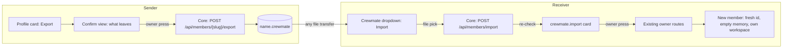
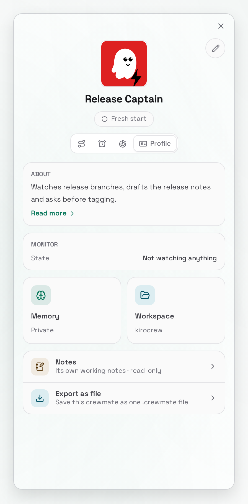
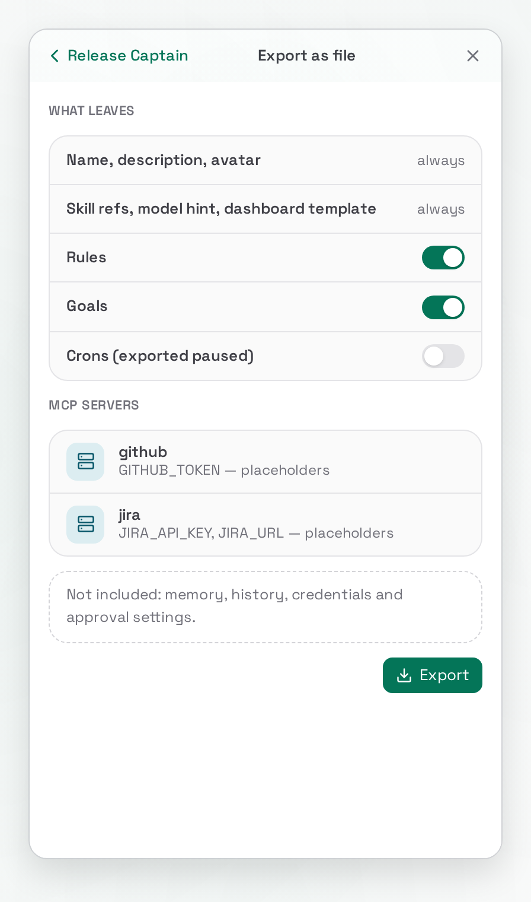
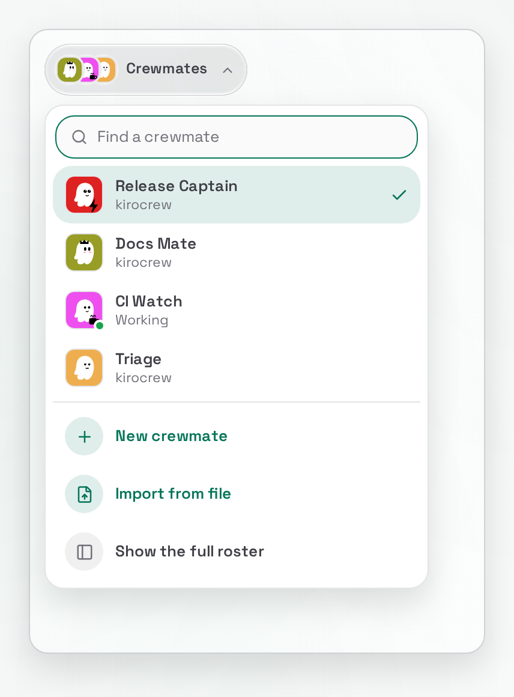
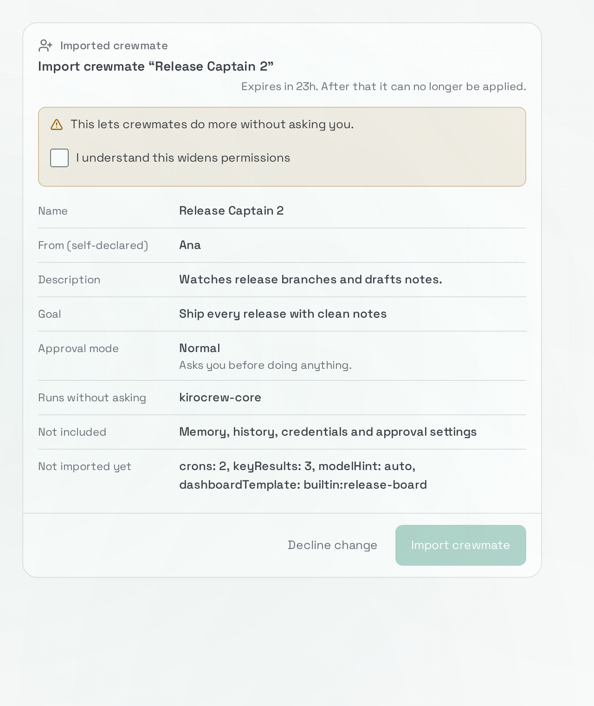
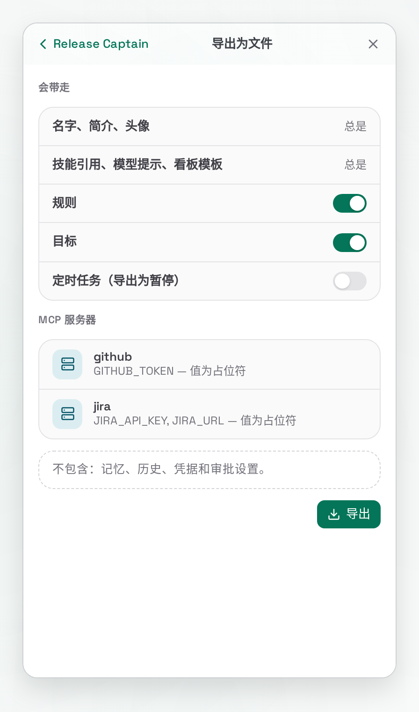

# RFC: Share one crewmate — a `.crewmate` bundle with Export and Import in the owner's crewmate UI

- Status: accepted. [#21508](https://github.com/kirodotdev/KiroCrew/pull/21508) was merged on 2026-10-17 by the maintainer iamwhatever, who records the acceptance here. Partly built: [#21721](https://github.com/kirodotdev/KiroCrew/pull/21721) shipped the bundle reader (`crewmate_import_params` in `crewmate_bundle.py`), the `crewmate.import` card kind (`KIND_CREWMATE_IMPORT` in `change_card_catalog_kinds.py`) and an app path (`ctx.crewmate` in `apps/crewmate_sdk.py`) held off by `PREVIEW_ENABLED = False`. No export route and no owner Import entry exist. Every "exists" claim cites a symbol verified against `origin/main` at `b835fe9ca7`.
- Author: gjjnn
- Amended 2026-10-18 on the product owner's ruling, and accepted with the 2026-10-22 amendment below by the maintainer iamwhatever in [this comment](https://github.com/kirodotdev/KiroCrew/pull/21746#issuecomment-6329962507): there is no Crewmate Share app. Export is a button on the crewmate's profile card and Import is an item in the crewmate dropdown, both core owner UI. The `propose_crewmate` App SDK capability, its two permissions and the `app:` card slot are dropped (§5.5). The bundle format and every security rule are unchanged.
- Amended 2026-10-22 on review ([#21746](https://github.com/kirodotdev/KiroCrew/pull/21746)): an imported crewmate must not arrive hollow. Crons travel by default, each `script` cron with its script file. Skills the sender wrote travel as files. Lessons may travel only as a skill the owner reads and edits. A `user:` dashboard id stays home. Every added file is shown in full on the `crewmate.import` card, the way rules already are.
- Amended 2026-10-23 on the owner's ruling (pending the owner's acceptance of this text): a card cannot hold the files a bundle carries, so raising an import card keeps one owner-only staged copy of the checked file on the local backend, and one new owner route writes the carried files on the press (§5.4, "The staged copy"). Bundled skills land in `.kiro/skills/<name>/` of the member's workspace, the tree its sessions read.
- Builds on: [rfc-mate-owned-agent-config.md](rfc-mate-owned-agent-config.md) (draft). Its per-mate file `~/.kiro/mates/agents/<id>.json` is the agent part of the bundle below. That RFC lists "a shared/importable crewmate-definition format" as a non-goal (§4); this RFC is that separate effort.
- Follows: [TENETS.md](../../TENETS.md) tenet 8, "Everything is an app"; §5.6 says why these two entries sit in core.

## 1. Summary

A person can hand one crewmate to another person as one file, `<name>.crewmate`. The receiver opens it, sees exactly what the crewmate would do on their machine, and presses one button to create it.

Both ends are owner UI in core. **Export** is a button on the crewmate's profile card: it opens a confirm view that lists what leaves, and on the owner's press core builds the redacted bundle and the browser downloads it. **Import** is an item in the crewmate dropdown: the owner picks a file, core re-checks it and raises one `crewmate.import` change card, and only the owner's press on that card creates the crewmate.

A bundle carries what the crewmate is and does: name, description, avatar, rules, goals, crons with their scripts, skills (a reference for an app skill, the files for one the sender wrote), a model hint and a built-in dashboard template id. It never carries what is private to one machine or one person: credentials, memory rows, session history, approval mode and tool grants. Lessons leave only as a skill whose exact text the owner read and edited. Every carried file is shown in full on the import card. Crons land paused. Import pins the safest approval mode and mints a fresh member with its own memory store and workspace.

## 2. Motivation

### Current state

- **There is no one-crewmate export.** `GET /api/portability/export` (`create_export_zip` in `portability_stream.py`, route in `dashboard/routes/taskrunner.py`) writes the whole install. Its Merge import installs `config.json` only when absent (`_merge_settings` in `portability.py`), so it cannot add one crewmate to a running install.
- **Template bundling exists inside that zip and is the closest reusable piece.** `placeholder_mcp_values` (`portability_templates.py`) replaces every MCP `env`, `headers` and `oauth.clientSecret` value with a placeholder and keeps the keys. `_install_agent_templates` (`portability_templates.py`) writes each template with `O_EXCL` and runs `sanitize_agent_config_governance` (`portability_templates.py`) so `allowedTools` and `autoApprove` are cut to this host's ceiling.
- **Creating a crewmate and reading its template are owner-only.** `POST /api/agents` runs `_require_owner(request, "agent.create")` (`_api_kirocrew_agents_create` in `dashboard/agent_admin/crew_records.py`). The template read `GET /api/agents/detail/{name}` is also owner-only (`api_agent_detail` in `dashboard/agent_admin/agent_detail.py`).
- **An owner-press path for creating a crewmate already exists.** The change-card kind `crewmate.create` (`KIND_CREWMATE_CREATE` in `change_card_catalog_kinds.py`) builds a plan against the owner routes `POST /api/agents` and `PUT /api/members/{slug}/goals/long-term` (`build_preview` in `change_card_catalog_plans.py`). `change_card_middleware` refuses an app token, an internal-secret caller or an agent on those routes (`dashboard/handlers/change_cards.py` module docstring; route set `HOOKED_ROUTES`, `change_card_catalog.py`).
- **Import is half-built and export is not built.** `crewmate_import_params` (`crewmate_bundle.py`) reads a parsed bundle into `crewmate.import` params and still refuses rules, MCP servers and skills. Its only caller is `ctx.crewmate` (`apps/crewmate_sdk.py`), held off by `PREVIEW_ENABLED = False`, which §5.5 drops. No route exports a crewmate, and no owner UI imports one.
- **What a whole-install import already learned about crons and skills.** A `script` cron names `~/.kiro/crew/crons/<file>.py:function`, and "the export never carries the `crons/` directory, so the name resolves against whatever the target already has there" (`_sanitize_imported_crons` in `portability_vetting.py`). A skill the sender wrote lives under `~/.kiro/crew/skills/<name>/` (`skills_dir` in `skills_discovery.py`) or the member's own workspace (`member_workspace.py`); no store can supply it on another machine.

### Problems

1. A person who built a good crewmate cannot give it to a teammate without hand-copying a record and a template.
2. The whole-install zip is the wrong size: it carries every crewmate, memory and secret placeholders for all of them.
3. Widening `POST /api/agents` to anyone but the owner would hand that caller the power to install tool grants and MCP commands that later sessions execute (the reason `_require_owner` exists, `dashboard/handlers/agents.py`).

## 3. Goals

- One crewmate leaves as one file and arrives as one new crewmate.
- The receiver sees every part of the incoming crewmate before anything is written.
- Only the owner's press creates the crewmate. No app, agent or file can create one.
- The crewmate arrives whole: its schedule and the skills its sender wrote come with it, so the receiver rebuilds nothing by hand.
- Nothing private to the sender travels: no credential value, no memory row, no transcript, no approval mode, no tool grant. A lesson leaves only as skill text the owner read and edited.
- The incoming crewmate starts in `normal` approval mode and gains trust only through the owner's later change cards.
- Both entries sit where the owner already manages a crewmate: the profile card and the crewmate dropdown.
- The design works the same on Linux, macOS and Windows.

## 4. Non-goals

- **A sharing service.** No upload, link, registry or sync. The file moves however people move files.
- **Signing or verified senders.** The sender label in a bundle is self-declared and the card says so. Signed bundles are a later RFC if the registry gains signatures ([rfc-appstore-official-registry.md](rfc-appstore-official-registry.md)).
- **Live updates.** An imported crewmate is a copy. It has no link back to the sender's crewmate, matching the "stamp, not a parent" rule of the mate-owned config RFC.
- **Team bundles.** One crewmate per file. Several crewmates are several files.
- **Moving a crewmate between two installs of the same person.** The whole-install export covers that, memory included.
- **An app-facing share capability.** §5.5 records why it is dropped and when it may come back.

## 5. Design

### 5.1 The parts



| Part | Lives in | Job |
|---|---|---|
| Export button and confirm view | profile card, core SPA | list what leaves; download the file on the owner's press |
| `POST /api/members/{slug}/export` | core, owner-only | build the redacted bundle |
| Import item | crewmate dropdown, core SPA | pick a file; show the card |
| `POST /api/members/import` | core, owner-only | vet the file; keep the owner-only staged copy; raise one `crewmate.import` card |
| `GET /api/members/import/{sha256}/files` | core, owner-only | show each carried file of a live import card in full |
| `POST` / `DELETE /api/members/{slug}/import-files` | core, owner-only, card steps only | write the carried files on the press; take them back on undo |
| Owner card `crewmate.import` | change-card catalog, core | show every part; apply through existing owner routes |

The file is untrusted. Core re-checks everything in it, exactly as it re-checks what an agent hands a change card.

### 5.2 The `.crewmate` file

A `.crewmate` file is a zip. Its top-level entries are fixed by name. Two folders are allowed, each exactly one level deep: `skills/<name>/<file>` and `crons/<file>.py`. No other path has a `/`.

| Entry | Required | Holds |
|---|---|---|
| `crewmate.json` | yes | the manifest below |
| `agent.json` | yes | the mate-owned file shape: `mcpServers` and `skills` load-bearing, other fields at defaults |
| `avatar.png` / `avatar.jpg` / `avatar.webp` | no | one uploaded picture |
| `rules.json` | no | the crewmate's permanent rules, as text |
| `goals.json` | no | long-term goal and key results |
| `crons.json` | no | check-in cron definitions |
| `skills/<name>/SKILL.md` and files beside it | no | one skill the sender wrote, or the lessons skill (§5.3) |
| `crons/<file>.py` | no | the script one `script` cron in `crons.json` names |

`crewmate.json`:

```json
{
  "format": "kirocrew.crewmate",
  "formatVersion": 1,
  "name": "Release Captain",
  "description": "Watches release branches and drafts notes.",
  "avatarTraits": { "...": "ghost traits as on the crew record" },
  "modelHint": "auto",
  "reasoningEffortHint": "medium",
  "dashboardTemplate": "builtin:release-board",
  "skills": [
    { "name": "release-notes", "source": "app:release-tools" },
    { "name": "branch-triage", "source": "bundled" }
  ],
  "sender": { "label": "Ana (self-declared)" },
  "exportedAt": "2026-10-17T06:00:00Z"
}
```

Rules on the file:

- Every JSON entry is UTF-8. Every key set is exact: an unknown key refuses the bundle.
- `formatVersion` is an integer. A reader accepts only versions it knows. A newer version refuses with "this file needs a newer Kiro Crew". Any added field bumps the version, so a reader never guesses at a field it does not know.
- `agent.json` holds no `prompt` or `tools` content beyond defaults, because the worker base is source-defined (mate-owned config RFC §5.1).
- Every MCP `env`, `headers` and `oauth.clientSecret` value in `agent.json` is the placeholder `placeholder_mcp_values` writes (`portability_templates.py`). Keys stay so the card can list what the receiver fills in.
- `agent.json` carries no `allowedTools`, `autoApprove` or `permissions` grant. Export drops them; import refuses a bundle that carries one.
- Each `skills` item has a `source`. An `app:` source is a reference: the card says "installed" or links to the app in the store. The source `bundled` means the skill's files are in `skills/<name>/`, and it must have a `SKILL.md` there. A `skills/` folder with no `bundled` item, or a `bundled` item with no folder, refuses the bundle.
- Every `crons/<file>.py` entry is named by exactly one `script` cron in `crons.json`, and every `script` cron names an entry in the file. A mismatch refuses the bundle.
- `<name>` and `<file>` match `^[A-Za-z0-9][A-Za-z0-9_.-]{0,63}$`: no `..`, no slash, no drive letter.
- `modelHint` is a hint. The card shows it; a model this host lacks falls back to the host default and the card says so.
- `dashboardTemplate` is a `builtin:` template id only. A `user:` id names a template folder on the sender's host (`RENDERABLE_SOURCES` in `dashboard_templates/instance.py`), so it would dangle on the receiver's; export drops it and import refuses it. A bundle carries no page HTML, because a page from a sender is unrenderable by rule.
- Size caps: 8 MiB for the whole file, 512 KiB for the avatar, 64 KiB for each JSON entry, 256 KiB for each skill or script file, 1 MiB for each skill folder, 64 entries. The zip is vetted with `zip_vet.vet_zip_inventory` (`zip_vet.py`) before any entry is read.
- `formatVersion` stays `1`: no writer of version 1 has shipped, so no file in the wild lacks these entries. Phase 1 widens `crewmate_bundle.py` to read them.

What a bundle never carries:

| Left out | Why |
|---|---|
| `.env`, `.local_secret`, keys, any `EXPORT_EXCLUDE` name (`portability_archive.py`) | credentials |
| MCP secret values | credentials; placeholders only |
| memory DB, lesson rows, briefing | memory is identity: a store is owned by one `member_id` and `memory_stores.py` fails closed on a mismatch. Rows are also opaque to the card; the lessons skill is text the owner reads |
| transcripts, activity log, DM bindings | private history and runtime state |
| `approval_mode`, `allowedTools`, `autoApprove` | trust is the receiver's to grant |
| `member_id`, `memory_store`, `workspace`, crew key | minted fresh on import |
| custom dashboard HTML, `user:` template ids | unrenderable from a sender; a `user:` id names a folder only the sender has |

### 5.3 Export

The profile card's Profile tab gains one row, **Export as file**, under Notes. It pushes a confirm view over the card, the same push the card already uses for About and Notes (`CrewProfilePanel.tsx`). The view lists exactly what leaves:

| Leaves | Shown as |
|---|---|
| name, description, avatar | always |
| rules, goals | a toggle each, on |
| crons | a toggle, on; each `script` cron with its script, shown in full |
| app skill references, model hint | always |
| skills the sender wrote | each skill, on, with every file shown in full |
| lessons | a toggle, off; on, it drafts a lessons skill (below) |
| dashboard | the `builtin:` id, or "Dashboard: not included (custom template)" |
| MCP servers | each server with the keys whose values become placeholders |

Under the list sits one line: "Not included: memory, history, credentials and approval settings."

**Lessons as a skill.** Memory rows never leave. Turning the lessons toggle on asks the crewmate, in one turn, to distill its lessons into one `SKILL.md`. The draft opens in an editor inside the view. Only the text left in that editor travels, as `skills/<slug>-lessons/SKILL.md` with source `bundled`. Export itself never reads the memory store, and the draft is never saved on the server.

**What export skips, and says so.** A `script` cron whose file is gone from `~/.kiro/crew/crons/` is left out and listed "not included (script missing)". A skill folder over the §5.2 caps, or holding a file the credential checks below refuse, is left out and listed with the reason.

The press sends the toggles and the edited lessons text to `POST /api/members/{slug}/export`, which runs `_require_owner(request, "crewmate.export")`. Core builds the bundle from the crew record, the mate-owned file, the member rules and goals records, the cron store, the skill folders and the avatar. On the way out it runs `placeholder_mcp_values`, strips every grant field, drops a `user:` dashboard id and never opens an `EXPORT_EXCLUDE` name. Every skill and script file passes the same credential and control-character checks `crewmate.create` runs on text (`_validate_crewmate_create` in `guide_catalog.py`). It answers with the zip bytes and `Content-Disposition: attachment; filename="<name>.crewmate"`; the browser saves the file. Core writes nothing on disk, so the export needs no change card and has nothing to undo.

### 5.4 Import

The crewmate dropdown (`CrewmateSwitcher.tsx`) gains one footer item, **Import from file**, under "New crewmate". It opens the system file picker filtered to `.crewmate`. The browser posts the file to `POST /api/members/import`, which runs `_require_owner(request, "crewmate.import")`, vets the zip, re-runs every check in §5.2 and raises one `crewmate.import` card. A file that fails a check raises no card; the dropdown shows the refusal. The SPA then opens the card in a dialog with the shared card component.

The card shows:

| Row | Content |
|---|---|
| Name | the name, and the free name it lands as if taken |
| From | sender label, marked "self-declared" |
| Description | full text |
| Model | hint, and what this host runs |
| MCP servers | each server, its command or URL, and each placeholder the owner must fill |
| Skills | each app reference, "installed" or "missing"; each bundled skill with every file in full |
| Rules | every rule, full text |
| Goals | goal and key results |
| Crons | each schedule, "imported paused"; each script in full |
| Dashboard | the `builtin:` template, or the default |
| Approval | `normal`: asks before every tool |
| Not included | memory, history, credentials, approval settings |

Risk is computed from the diff, as for every card. An MCP server with a local `command`, a cron script and a bundled skill with any file besides `SKILL.md` are each `code_exec`, because each runs on the receiver's machine.

The press applies an ordered plan through existing owner routes, the same way `crewmate.create` does (`build_preview` in `change_card_catalog_plans.py`):

1. `POST /api/agents` creates the record with `approval_mode: "normal"` in the same write. The create path mints a fresh `member_id` (`memory_stores._allocate_member_id`), an empty memory store and its own workspace. The mode rides on the create because an unset mode resolves to `trust` (`MEMBER_APPROVAL_MODE_UNSET_EFFECTIVE` in `config/sections_agent_fields.py`), and `_api_kirocrew_agents_create` takes no `approval_mode`. Phase 1 adds that one optional create field, validated against `MEMBER_APPROVAL_MODES`. No imported crewmate exists for any moment in `trust`.
2. The mate-owned file `~/.kiro/mates/agents/<id>.json` receives the bundle's `mcpServers` and `skills` through the in-place edit path of the mate-owned config RFC (§5.4 there). `sanitize_agent_config_governance` runs on the way to disk.
3. Rules and goals are written through their own owner routes when present (`PUT /api/members/{slug}/rules`, `PUT /api/members/{slug}/goals/long-term`). The carried files are written by one owner route, `POST /api/members/{slug}/import-files` (amendment of 2026-10-23, below). It answers only an admitted card step, re-reads the staged copy the card names, refuses on a sha256 mismatch, and re-runs every §5.2 check. Bundled skills land in the new member's own workspace, under `.kiro/skills/<name>/`, the tree that member's sessions read (`project_skill_tree_present` in `skills_discovery.py`), never in the shared `~/.kiro/crew/skills/`. A skill folder already there refuses the step. So the skills reach only this crewmate and cannot replace a skill the receiver already has. That tree loads only once the owner trusts the folder, as for any workspace skill. The picture is committed through the same avatar helpers the profile editor uses.
4. Cron scripts are written into the new member's own folder, `~/.kiro/crew/crons/imported/<member_id>/`, with `O_EXCL`, never into the shared `crons/` folder. The cron launcher puts a script's own folder on `sys.path` (`cron_script.py`), so a carried `sqlite3.py` in the shared folder would run inside any other job there that imports `sqlite3`; in its own folder only this member's scripts can reach it. A name already taken in that folder gets the first free name (`<file>-2.py`), and the cron is rewritten to point at it, so an import never runs or overwrites a script the receiver had. A `script` cron is created by the same route as its script, bound to the new member and paused in its one write; a message cron is created through `POST /api/crons`, which gains an `enabled: false` create field so it too is paused in its one write. A `command` cron is refused.
5. The record is stamped with provenance: `imported: {format_version, sender_label, sha256, imported_at}`. Provenance rides on the crew record, not the spec, because kiro-cli refuses an agent spec with an unknown field.

Name collisions: the card proposes the first free name (`Release Captain 2`) and the owner can edit it before the press. The crew key comes from `crew_id_for_display_name` in `members.py`, which slugs the name and adds `-2`, `-3` past any taken key, so two crewmates never share one folder on a case-insensitive file system.

Placeholders stay placeholders. A server whose secret is a placeholder is installed disabled, and the crewmate's page links to the existing secret flow. The card never asks for a secret value.

If a later step fails, the card lands `partial` and its undo removes what earlier steps wrote (the `partial --undo--> undone` path in `dashboard/change_cards.py`). The card offers that undo at once, so a half-built crewmate does not stay behind unnoticed.

**Where the card lives.** `ChangeCardStore.propose` takes a keyword-only `slot_key` (`dashboard/change_cards.py`). An import card uses the reserved key `owner:crewmate-import`, which no chat slot key can take, with an empty `session_key`. The dialog reads it through the existing owner-only `GET /api/cards/pending?slot=` (`api_cards_pending` in `dashboard/handlers/change_cards.py`), so a card left pending reopens from the same Import item. The press is the owner's own browser request, which `change_card_middleware` admits as it admits a press in a chat. The live-card cap (`MAX_LIVE_CARDS_PER_SLOT`) and the 24-hour expiry (`CARD_TTL_SECONDS`) apply unchanged. `_slot_is_open` never reads the key closed, so expiry is what retires a card nobody pressed. The kind is refused from every agent caller, and `list_kinds` leaves it out.

**The staged copy (amendment of 2026-10-23, pending the owner's acceptance).** A card record holds at most 64 KiB (`CARD_RECORD_MAX` in `dashboard/change_cards_records.py`), and its params at most 32 KiB, so a card cannot hold the files a bundle carries. Raising an import card therefore writes one thing besides the card: when the file passes every check and carries a skill folder, a cron script or a picture, the local backend keeps the checked bytes as `<data home>/run/crewmate-imports/<sha256>.crewmate` (`crewmate_stage.py`). The folder is `0700` and the file `0600`, under the `run/` subtree agent file tools are fenced from, and the name is the content's own digest, so nothing the bundle says becomes a path. It stays on the owner's machine. The copy is untrusted data: it is only ever re-read by the bundle reader, never executed or imported as code. The card holds the sha256 and each carried file's name, size and digest; it shows each file in full by reading the copy through the owner-only `GET /api/members/import/{sha256}/files`, which re-checks it. The press writes the files through `POST /api/members/{slug}/import-files` (step 3 above), and that step's undo, `DELETE /api/members/{slug}/import-files`, removes exactly what it wrote and refuses if one of those files changed since. The copy is deleted when the card is applied, cancelled, dismissed or expires, and the first card read after a start deletes any copy no live card names. A file that carries none of those files keeps no copy.

### 5.5 What becomes of `ctx.crewmate` and `proposeCrewmate`

Dropped. This RFC adds no App SDK capability and no manifest permission. The reasons:

1. No app needs it. The only planned caller was the Crewmate Share app, which the ruling removes.
2. Every app-specific piece existed only to serve that caller: the two permissions, the `app:` slot prefix, the housekeep rule for a disabled app, and a new Pending changes view, because an app token can neither list nor press a card. Core owner UI needs none of them.
3. The import card and the bundle checks stay in core, so a later app can reuse them unchanged. If one asks (a template gallery, an onboarding app), a separate RFC adds a generic App SDK capability that raises the same `crewmate.import` card.

[#21721](https://github.com/kirodotdev/KiroCrew/pull/21721) keeps the card kind, `crewmate_bundle.py` and the `approval_mode` create field, and drops `ctx.crewmate`, `permissions.proposeCrewmate` and the `app:` slot.

### 5.6 Why this is core owner UI (tenet 8)

Tenet 8 keeps "the trust boundary" in core and moves "anything that renders or interprets" into apps. These two entries are the trust boundary:

- Export reads a crewmate's template, rules and MCP layout, which only the owner may read (`api_agent_detail` is owner-only). The redaction that keeps secrets home must run where the secrets are.
- Import turns an untrusted file into a crew record with tool access. Creating one is owner-only (`_require_owner` on `POST /api/agents`), and the consent press is the approvals surface, which tenet 8 names as core.
- Neither adds a new page. Each is one control on a core surface the owner already uses for this crewmate, so there is no surface an app could replace a whole surface at a time.
- The app route needed more core, not less: two permissions, a reserved slot and a new owner-only listing view (§5.5).

### 5.7 Dependency on the mate-owned config RFC

`agent.json` and plan step 2 use the per-mate file of [rfc-mate-owned-agent-config.md](rfc-mate-owned-agent-config.md). Plan step 2 waits on that one: until its per-mate file, or the template fallback below, is built, import refuses a bundle whose `agent.json` carries any `mcpServers` or `skills` entry, so a crewmate imported before then has neither. Bundled skill files and cron scripts do not wait on it: they land in the member's workspace and the cron folder (plan steps 3 and 4), which exist once the create step runs. If that RFC is rejected, the fallback is the existing template path: `agent.json` is written as a crew-named template with `O_EXCL` and `sanitize_agent_config_governance`, exactly as `_install_agent_templates` in `portability_templates.py` writes a bundled template, and the new record's `kiro_agent` names it. The bundle format does not change under the fallback, because `agent.json` is already the custom-agent schema.

### 5.8 Screens

Mock screens, built from the real SPA components with the new controls added on a scratch branch. The import card is #21721's card as rendered there.











## 6. Migration plan

Each phase is one PR.

### Phase 0 — this RFC

Exit criteria:
- This document merges as `draft`, then moves to `accepted` on the owner's decision.

### Phase 1 — Import

Plan step 2 is blocked on the mate-owned config RFC step 3 (the per-mate file and its in-place edit path). Until it lands, Phase 1 ships without step 2 and refuses a bundle carrying `mcpServers` or `skills` (§5.7).

Exit criteria:
- The crewmate dropdown shows Import from file; picking a valid file raises one pending `crewmate.import` card and writes nothing else but the owner-only staged copy of §5.4 (only when the file carries skill files, cron scripts or a picture).
- `POST /api/members/import` answers 403 to an app token, an internal-secret caller and an agent.
- A press on the card creates exactly one member with a fresh `member_id`, an empty memory store, its own workspace and `approval_mode: "normal"`.
- `POST /api/agents` accepts `approval_mode` and writes it in the create; a test that fails every step after the create finds the member in `normal`, never `trust`.
- A bundle with `allowedTools`, `autoApprove`, a non-placeholder MCP secret, page HTML or an unknown key is refused before a card exists.
- Until plan step 2 can write the agent part (§5.7), a bundle with any `mcpServers` or `skills` entry is refused before a card exists.
- A direct call from an app token to any plan route answers 403.
- A failed later step leaves the card `partial` with a working undo.
- Crons land paused. A cron script lands with `O_EXCL` under a free name and never replaces a receiver file.
- A bundled skill lands in the new member's workspace, never in `~/.kiro/crew/skills/`, and the card shows each of its files in full.
- The staged copy is `0600` in a `0700` folder, named by its sha256; a copy changed after the card refuses the file step; it is gone once the card is applied, cancelled or expired, and the first card read after a start removes any copy no live card names.
- A bundle with a `user:` dashboard id, a path deeper than one folder, a `script` cron without its file, or a script file no cron names is refused before a card exists.
- An import card is stored with `slot_key` `owner:crewmate-import`; a chat slot key with that prefix is refused, and no agent caller can raise the kind.
- The import card expires after `CARD_TTL_SECONDS` and stops at `MAX_LIVE_CARDS_PER_SLOT`.

### Phase 2 — Export

Exit criteria:
- The profile card shows Export as file; its confirm view lists every part that leaves and the "not included" line, with crons on and lessons off by default.
- A `user:` dashboard id is not in the file, and the view says "Dashboard: not included (custom template)".
- A `script` cron's file is in the bundle; a missing file leaves that cron out and the view says so.
- With lessons on, the file holds only the text left in the editor, and no memory row.
- The downloaded file holds no `EXPORT_EXCLUDE` name, no MCP secret value and no grant field.
- `POST /api/members/{slug}/export` answers 403 to an app token, an internal-secret caller and an agent.
- Nothing is written on the server.

### Phase 3 — Round trip

Blocked on: plan step 2 (mate-owned config RFC step 3, or the §5.7 template fallback), because the round trip carries MCP server keys.

Exit criteria:
- Export of a crewmate and import of the file on a second install yield a crewmate with the same name, description, avatar, rules, goals, crons and their scripts, bundled skills and MCP server keys, and none of the sender's memory or approval settings.
- The round trip passes on Linux, macOS and Windows.

## 7. Backward compatibility

Compatible. Every part is added: two owner-only routes, a new card kind and two controls. No existing route, card kind or file format changes, and no App Kit contract changes.

## 8. Security considerations

- **The owner's press is the only gate.** The file and any agent can only propose. The press applies through owner routes that `change_card_middleware` already guards. This keeps the trust boundary in core, where tenet 8 puts it.
- **Both new routes are owner-only.** Export and import run `_require_owner`, so no app token, internal-secret caller or agent can read a bundle out or raise an import card.
- **The bundle is untrusted, agent-writable data.** "Agent specs are agent-writable" (`docs/system-specs/modules/security.md`) holds for a received spec too. Core re-runs `sanitize_agent_config_governance` (`portability_templates.py`) on the merged result, so a bundle cannot lift a crewmate above this host's ceiling.
- **No grant travels.** `approval_mode`, `allowedTools` and `autoApprove` are dropped on export and refused on import. The member starts pinned to `normal`, because an unset mode resolves to `trust`. More trust comes only from the owner's later `crewmate.update` or `crewmate.capabilities` card.
- **No secret travels.** Export runs in core, applies `placeholder_mcp_values` (`portability_templates.py`), and never reads an `EXPORT_EXCLUDE` file (`portability_archive.py`). Import refuses a non-placeholder secret value, so a crafted file cannot plant a credential the receiver did not type.
- **MCP commands run code.** A local `command` server is shown in full and marks the card `code_exec`. It installs disabled while any placeholder is unfilled.
- **Memory rows are never shared.** A fresh store per import keeps the `owner_member_id == member_id` rule in `memory_stores.py` intact. The lessons skill is text the owner read and edited before it left, and lands as a skill, not as rows.
- **Crons run unattended.** They land paused after the `_sanitize_imported_crons` rules (`portability_vetting.py`) and run only after the owner switches each one on. Each script is shown in full and marks the card `code_exec`, and lands under a free name, so an import cannot point a cron at a file the receiver already had.
- **Bundled skills are code and prompt.** Every file is shown in full on the card. A skill with any file besides `SKILL.md` marks the card `code_exec`. It lands in the new member's own workspace, so it reaches no other crewmate.
- **Pages from a sender never render.** Only `builtin:` template ids travel; a `user:` id names a folder on the sender's host (`RENDERABLE_SOURCES` in `dashboard_templates/instance.py`).
- **The staged copy is untrusted data on the owner's own machine.** The local backend keeps it owner-only under the agent-fenced `run/` subtree, names it by its digest, re-checks it on every read and never executes or imports it. Only an admitted card step reaches the route that writes from it.
- **Zip safety.** `zip_vet.vet_zip_inventory` (`zip_vet.py`) runs before any read. Only `skills/<name>/<file>` and `crons/<file>.py` may hold a `/`, and each name matches the §5.2 pattern, so no entry names a path outside the bundle. Caps in §5.2 bound memory use.
- **The sender label is not proof.** The card prints "self-declared" beside it.
- **Prompt injection through rules or description.** Rules and description are text the crewmate reads every turn. The card shows them in full so the owner reads what the crewmate will read. Text fields run the same credential and control-character checks `crewmate.create` runs (`_validate_crewmate_create` in `guide_catalog.py`).

## 9. Platforms

| Concern | Linux | macOS | Windows |
|---|---|---|---|
| File read | core, Python `zipfile` | same | same |
| File save | the browser's download | same | same |
| Name case | case-sensitive | case-insensitive by default | case-insensitive |
| Collision rule | slug derivation; distinct keys | same | same |
| Text encoding | UTF-8 pinned | UTF-8 pinned | UTF-8 pinned, never the codepage |
| Line endings | JSON ignores them | same | same |

Every file write names its encoding, because a Windows codepage read of UTF-8 corrupts non-ASCII names (the reason `_sanitize_imported_crons` pins UTF-8).

## 10. Alternatives considered

| Option | Verdict | Why |
|---|---|---|
| A Crewmate Share app over a `propose_crewmate` App SDK capability | superseded by owner ruling, 2026-10-18 | owner UI is already owner-authenticated, so no app permission, `app:` card slot or Pending changes view is needed (§5.5, §5.6) |
| Let apps call `POST /api/agents` | rejected | gives every app the power to install tool grants and MCP commands |
| A crewmate as a regular App Kit app with a first-run hook | rejected | only authors can make one; no one-click share |
| Reuse the whole-install zip with a crew filter | rejected | Merge only installs `config.json` if absent (`_merge_settings` in `portability.py`); wrong unit |
| Make export a change card too | rejected | export writes nothing on this host; a confirm view is the consent, and there is nothing to undo |
| Carry memory by default | rejected | memory is identity and private |
| Carry selected lessons as memory rows | rejected | rows are opaque to the card; a skill is text the owner reads in full |
| Skill references only | rejected | a skill the sender wrote has no store to come from, so "missing" would be forever |
| Ship crons off by default | rejected | a crewmate's schedule is part of what it does; landing paused is the safety, not leaving it out |

## 11. Open questions

1. **Memory opt-in.** Resolved 2026-10-22: lessons travel only as an owner-edited skill (§5.3), never as rows.
2. **Skills bundled or referenced.** Resolved 2026-10-22: `app:` skills travel as references; every other skill travels as files, shown in full on the card (§5.2).
3. **Provenance display.** Should the crewmate page show "From <sender>"? Default answer: yes, from the stamp in §5.4 step 5.
