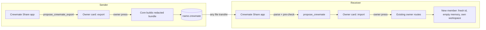

# RFC: Share one crewmate — a `.crewmate` bundle app and the `propose_crewmate` owner card

- Status: draft. A proposal, not a description of what the code does. Every "exists" claim cites a symbol verified against `origin/main` at `8892889b91`.
- Author: gjjnn
- Builds on: [rfc-mate-owned-agent-config.md](rfc-mate-owned-agent-config.md) (draft). Its per-mate file `~/.kiro/mates/agents/<id>.json` is the agent part of the bundle below. That RFC lists "a shared/importable crewmate-definition format" as a non-goal (§4); this RFC is that separate effort.
- Follows: [TENETS.md](../../TENETS.md) tenet 8, "Everything is an app", and [rfc-everything-is-an-app.md](rfc-everything-is-an-app.md).

## 1. Summary

A person can hand one crewmate to another person as one file, `<name>.crewmate`. The receiver opens it, sees exactly what the crewmate would do on their machine, and presses one button to create it.

The feature is an App Kit app, **Crewmate Share**. The app owns the file format, the export screen and the import screen. Core gains one generic App SDK capability, `propose_crewmate`, with an import call and an export call under two permissions. It lets any app that declares it raise a change card for the owner. The card lists every part of the proposed crewmate. Only the owner's press on that card creates the crewmate. The app never creates a crewmate itself.

A bundle carries the crewmate's shape: name, description, avatar, rules, skill references, a model hint, goals and a dashboard template id. It never carries what is private to one machine or one person: credentials, memory, lessons, session history, approval mode and tool grants. Crons travel only paused. Import pins the safest approval mode and mints a fresh member with its own memory store and workspace.

## 2. Motivation

### Current state

- **There is no one-crewmate export.** `GET /api/portability/export` (`create_export_zip` in `portability.py`, route in `dashboard/routes/taskrunner.py`) writes the whole install. Its Merge import installs `config.json` only when absent (`_merge_settings` in `portability.py`), so it cannot add one crewmate to a running install.
- **Template bundling exists inside that zip and is the closest reusable piece.** `placeholder_mcp_values` (`portability.py`) replaces every MCP `env`, `headers` and `oauth.clientSecret` value with a placeholder and keeps the keys. `_install_agent_templates` (`portability.py`) writes each template with `O_EXCL` and runs `sanitize_agent_config_governance` (`portability.py`) so `allowedTools` and `autoApprove` are cut to this host's ceiling.
- **Apps cannot create a crewmate.** `POST /api/agents` runs `_require_owner(request, "agent.create")` (`_api_kirocrew_agents_create` in `dashboard/agent_admin/crew_records.py`). The template read `GET /api/agents/detail/{name}` is also owner-only (`api_agent_detail` in `dashboard/agent_admin/agent_detail.py`). An App Kit manifest can register namespaced agent templates, skills and crons (`docs/app-kit/manifest-reference.md`, `_register_agents` in `apps/bridges.py`), never a crew record.
- **An owner-press path for creating a crewmate already exists for agents.** The change-card kind `crewmate.create` (`KIND_CREWMATE_CREATE` in `change_card_catalog.py`) builds a plan against the owner routes `POST /api/agents` and `PUT /api/members/{slug}/goals/long-term` (`build_preview` in `change_card_catalog.py`). `change_card_middleware` refuses an app token, an internal-secret caller or an agent on those routes (`dashboard/handlers/change_cards.py` module docstring; route set `HOOKED_ROUTES`, `change_card_catalog.py`). The guide action `crewmate.create` (`guide_catalog.py`) follows the same rule: "The crewmate is created only by the human's own click on the existing owner-only `POST /api/agents`."
- **No MCP tool or App SDK call exports or imports a crewmate.**

### Problems

1. A person who built a good crewmate cannot give it to a teammate without hand-copying a record and a template.
2. The whole-install zip is the wrong size: it carries every crewmate, memory and secret placeholders for all of them.
3. An app that wanted to offer sharing has no sanctioned way to create the result. Widening `POST /api/agents` to app tokens would hand every app the power to install tool grants and MCP commands that later sessions execute (the reason `_require_owner` exists, `dashboard/handlers/agents.py`).

## 3. Goals

- One crewmate leaves as one file and arrives as one new crewmate.
- The receiver sees every part of the incoming crewmate before anything is written.
- Only the owner's press creates the crewmate. No app, agent or file can create one.
- Nothing private to the sender travels by default: no credential value, no memory, no lesson, no transcript, no approval mode, no tool grant.
- The incoming crewmate starts in `normal` approval mode and gains trust only through the owner's later change cards.
- Core gains one generic capability any app can use, not a sharing feature.
- The design works the same on Linux, macOS and Windows.

## 4. Non-goals

- **A sharing service.** No upload, link, registry or sync. The file moves however people move files.
- **Signing or verified senders.** The sender label in a bundle is self-declared and the card says so. Signed bundles are a later RFC if the registry gains signatures ([rfc-appstore-official-registry.md](rfc-appstore-official-registry.md)).
- **Live updates.** An imported crewmate is a copy. It has no link back to the sender's crewmate, matching the "stamp, not a parent" rule of the mate-owned config RFC.
- **Team bundles.** One crewmate per file. Several crewmates are several files.
- **Moving a crewmate between two installs of the same person.** The whole-install export covers that, memory included.

## 5. Design

### 5.1 The parts



| Part | Lives in | Job |
|---|---|---|
| Crewmate Share app | an App Kit app | export screen, import screen, file read and write, format version |
| `propose_crewmate` | App SDK, core | raise an owner change card for one incoming crewmate |
| Owner card `crewmate.import` | change-card catalog, core | show every part; apply through existing owner routes |
| Re-vetting | core | re-run every governance filter on the card's parameters |

The app is untrusted. Core re-checks everything the app hands it, exactly as it re-checks what an agent hands a change card.

### 5.2 The `.crewmate` file

A `.crewmate` file is a zip. Its entries are flat (no directories) and fixed by name:

| Entry | Required | Holds |
|---|---|---|
| `crewmate.json` | yes | the manifest below |
| `agent.json` | yes | the mate-owned file shape: `mcpServers` and `skills` load-bearing, other fields at defaults |
| `avatar.png` / `avatar.jpg` / `avatar.webp` | no | one uploaded picture |
| `rules.json` | no | the crewmate's permanent rules, as text |
| `goals.json` | no | long-term goal and key results |
| `crons.json` | no | check-in cron definitions |

`crewmate.json`:

```json
{
  "format": "kirocrew.crewmate",
  "formatVersion": 1,
  "name": "Release Captain",
  "description": "Watches release branches and drafts notes.",
  "avatarTraits": { "...": "ghost traits as on the crew record" },
  "modelHint": "auto",
  "reasoningEffortHint": "medium",
  "dashboardTemplate": "builtin:release-board",
  "skills": [{ "name": "release-notes", "source": "app:release-tools" }],
  "sender": { "label": "Ana (self-declared)" },
  "exportedAt": "2026-10-17T06:00:00Z"
}
```

Rules on the file:

- Every JSON entry is UTF-8. Every key set is exact: an unknown key refuses the bundle.
- `formatVersion` is an integer. A reader accepts only versions it knows. A newer version refuses with "this file needs a newer Kiro Crew". Any added field bumps the version, so a reader never guesses at a field it does not know.
- `agent.json` holds no `prompt` or `tools` content beyond defaults, because the worker base is source-defined (mate-owned config RFC §5.1).
- Every MCP `env`, `headers` and `oauth.clientSecret` value in `agent.json` is the placeholder `placeholder_mcp_values` writes (`portability.py`). Keys stay so the card can list what the receiver fills in.
- `agent.json` carries no `allowedTools`, `autoApprove` or `permissions` grant. Export drops them; import refuses a bundle that carries one.
- `skills` are references by name and source. A bundle carries no skill code (open question 2).
- `modelHint` is a hint. The card shows it; a model this host lacks falls back to the host default and the card says so.
- `dashboardTemplate` is a `builtin:` or `user:` template id only. A bundle carries no page HTML, because a page from a sender is unrenderable by rule (`RENDERABLE_SOURCES` in `dashboard_templates/instance.py`).
- Size caps: 2 MiB for the whole file, 512 KiB for the avatar, 64 KiB for each JSON entry, 16 entries. The zip is vetted with `zip_vet.vet_zip_inventory` (`zip_vet.py`) before any entry is read.

What a bundle never carries:

| Left out | Why |
|---|---|
| `.env`, `.local_secret`, keys, any `EXPORT_EXCLUDE` name (`portability.py`) | credentials |
| MCP secret values | credentials; placeholders only |
| memory DB, lessons, briefing | memory is identity: a store is owned by one `member_id` and `memory_stores.py` fails closed on a mismatch |
| transcripts, activity log, DM bindings | private history and runtime state |
| `approval_mode`, `allowedTools`, `autoApprove` | trust is the receiver's to grant |
| `member_id`, `memory_store`, `workspace`, crew key | minted fresh on import |
| custom dashboard HTML | unrenderable from a sender |

### 5.3 Export

Export reads a crewmate's template, which apps cannot read (`api_agent_detail` is owner-only). So export is also an owner press. The same capability exposes an export call under its own permission, `proposeCrewmateExport` (§5.5): the app asks `propose_crewmate_export(crew)`, core shows the owner a card listing what will leave, and on the press core builds the redacted bundle content and hands it to the app as JSON plus avatar bytes. The app writes the file and offers it for download.

Core does the redaction, never the app. Core builds the bundle from the crew record, the mate-owned file, the member rules and goals records, and the avatar, and runs `placeholder_mcp_values` and the grant strip on the way out. An app never sees a secret value.

The export card lists: the name, each MCP server with the placeholder keys it hides, each skill reference, whether rules, goals, crons and an avatar are included (each a toggle the owner sets, off for crons by default), and one line: "Memory, history, credentials and approval settings are not included."

### 5.4 Import

The app reads the file, checks the version and caps, and calls `propose_crewmate(bundle)` with the parsed content. Core re-runs every check in §5.2 on what it receives, then raises one `crewmate.import` card.

The card shows:

| Row | Content |
|---|---|
| Name | the name, and the free name it lands as if taken |
| From | sender label, marked "self-declared" |
| Description | full text |
| Model | hint, and what this host runs |
| MCP servers | each server, its command or URL, and each placeholder the owner must fill |
| Skills | each reference, "installed" or "missing" |
| Rules | every rule, full text |
| Goals | goal and key results |
| Crons | each schedule, "imported paused" |
| Approval | `normal`: asks before every tool |
| Not included | memory, history, credentials, approval settings |

Risk is computed from the diff, as for every card. An MCP server with a local `command` is `code_exec`, because it runs on the receiver's machine.

The press applies an ordered plan through existing owner routes, the same way `crewmate.create` does (`build_preview` in `change_card_catalog.py`):

1. `POST /api/agents` creates the record with `approval_mode: "normal"` in the same write. The create path mints a fresh `member_id` (`memory_stores._allocate_member_id`), an empty memory store and its own workspace. The mode rides on the create because an unset mode resolves to `trust` (`MEMBER_APPROVAL_MODE_UNSET_EFFECTIVE` in `config/sections_agent_fields.py`), and `_api_kirocrew_agents_create` takes no `approval_mode`. Phase 1 adds that one optional create field, validated against `MEMBER_APPROVAL_MODES`. No imported crewmate exists for any moment in `trust`.
2. The mate-owned file `~/.kiro/mates/agents/<id>.json` receives the bundle's `mcpServers` and `skills` through the in-place edit path of the mate-owned config RFC (§5.4 there). `sanitize_agent_config_governance` runs on the way to disk.
3. Rules, goals and the avatar are written through their own owner routes when present.
4. Crons are written paused, after the same vetting `_sanitize_imported_crons` applies (`portability.py`).
5. The record is stamped with provenance: `imported: {format_version, sender_label, sha256, imported_at}`. Provenance rides on the crew record, not the spec, because kiro-cli refuses an agent spec with an unknown field.

Name collisions: the card proposes the first free name (`Release Captain 2`) and the owner can edit it before the press. The crew key comes from `crew_id_for_display_name` in `members.py`, which slugs the name and adds `-2`, `-3` past any taken key, so two crewmates never share one folder on a case-insensitive file system.

Placeholders stay placeholders. A server whose secret is a placeholder is installed disabled, and the crewmate's page links to the existing secret flow. The card never asks for a secret value.

If a later step fails, the card lands `partial` and its undo removes what earlier steps wrote (the `partial --undo--> undone` path in `dashboard/change_cards.py`). The card offers that undo at once, so a half-built crewmate does not stay behind unnoticed.

### 5.5 The App SDK capability

Manifest:

```json
{ "permissions": { "proposeCrewmate": true, "proposeCrewmateExport": true } }
```

`proposeCrewmate` grants the import card. `proposeCrewmateExport` grants the export card. They are separate so an import-only app, such as a template gallery, never gains the power to read a crewmate's rules, goals and MCP layout.

Backend context, present only when the manifest declares it, like `ctx.spawn` (`permissions.spawn` parsed in `apps/manifest.py`, passed by `build_app_context` in `apps/context.py`):

```python
card = await ctx.crewmate.propose(bundle)            # import card
card = await ctx.crewmate.propose_export("release")  # export card; needs proposeCrewmateExport
status = await ctx.crewmate.status(card.id)          # pending | applied | declined | expired
```

Rules:

- `propose` returns a card id. It never returns a crew key until the card is `applied`, and then only the key.
- `propose_export` returns bundle content only after the owner's press, and only to the app that asked.
- An app's live cards are capped by the store's existing per-slot cap (`MAX_LIVE_CARDS_PER_SLOT` in `dashboard/change_cards.py`), counted on the app's key (§5.6).
- A pending card expires after 24 hours, like every card (`CARD_TTL_SECONDS` in `dashboard/change_cards.py`).
- The capability creates nothing and reads nothing by itself. Every effect runs through an existing owner route on the owner's press, and `change_card_middleware` refuses an app token on those routes.
- Adding either permission in an app update disables the app until the owner enables it again, the rule `sessionApproval` follows (`docs/app-kit/manifest-reference.md`, Permissions).

The capability is generic. Any app can use it: a team template gallery, an onboarding app, or a store listing that offers a ready crewmate.

### 5.6 Where the card shows

A change card belongs to a chat slot: `ChangeCardStore.propose` takes a keyword-only `slot_key` (`dashboard/change_cards.py`). An app card keeps that one identity model. Its `slot_key` is `app:<name>`, a reserved prefix no chat slot key can take, and its `session_key` is empty. The store rules map as follows; two rows need new code, marked **new**:

| Store rule | For an app card |
|---|---|
| live-card cap (`MAX_LIVE_CARDS_PER_SLOT`) | counted on `app:<name>`, so per app |
| expiry (`expires_at`, `CARD_TTL_SECONDS`) | unchanged; keyed by time, not slot |
| `retire_closed_slots` | **new**: `_slot_is_open` in `dashboard/handlers/change_cards.py` retires a key only on positive closure evidence, so an `app:` key never reads closed. Phase 1 passes "app disabled or uninstalled" to `housekeep` as new closure evidence for `app:<name>` |
| `partial → undo` | unchanged; addressed by card id through the owner-only browser half |
| listing | **new**: see below |

No new field is added to the card record.

**Where the owner presses.** The dashboard asks for cards one chat slot at a time (`cardsApi.pending` in `website/src/api/cards.ts` sends `?slot=`), and `api_cards_pending` is owner-only, so an app panel with an app token can neither list nor press a card. Phase 1 adds one owner-authenticated surface: a **Pending changes** view in the dashboard, outside any chat slot, that lists every card whose `slot_key` starts with `app:` (`pending` filtered by that prefix) and renders each with the shared card component. The press there is the owner's own browser request, so `change_card_middleware` admits it exactly as it admits a press in a chat. The app's panel shows only the card id and its status from `ctx.crewmate.status`, with a link that opens the Pending changes view on that card. The app never renders or presses the card itself.

### 5.7 Dependency on the mate-owned config RFC

`agent.json` and plan step 2 use the per-mate file of [rfc-mate-owned-agent-config.md](rfc-mate-owned-agent-config.md). This RFC moves to `accepted` only after that one does. If that RFC is rejected, the fallback is the existing template path: `agent.json` is written as a crew-named template with `O_EXCL` and `sanitize_agent_config_governance`, exactly as `_install_agent_templates` in `portability.py` writes a bundled template, and the new record's `kiro_agent` names it. The bundle format does not change under the fallback, because `agent.json` is already the custom-agent schema.

## 6. Migration plan

Each phase is one PR.

### Phase 0 — this RFC

Exit criteria:
- This document merges as `draft`, then moves to `accepted` on the owner's decision.

### Phase 1 — `propose_crewmate` and the `crewmate.import` card in core

Blocked on: the mate-owned config RFC step 3 (the per-mate file and its in-place edit path), because plan step 2 writes that file. Accepting that RFC is a precondition for accepting this one (§5.7).

Exit criteria:
- An app without `permissions.proposeCrewmate` has no `ctx.crewmate`.
- `ctx.crewmate.propose` with a valid bundle raises one pending card and writes nothing.
- A press on the card creates exactly one member with a fresh `member_id`, an empty memory store, its own workspace and `approval_mode: "normal"`.
- `POST /api/agents` accepts `approval_mode` and writes it in the create; a test that fails every step after the create finds the member in `normal`, never `trust`.
- A bundle with `allowedTools`, `autoApprove`, a non-placeholder MCP secret, page HTML or an unknown key is refused before a card exists.
- A direct call from an app token to any plan route answers 403.
- A failed later step leaves the card `partial` with a working undo.
- Crons land paused.
- An app card is stored with `slot_key` `app:<name>`; a chat slot key with that prefix is refused.
- An app card is listed in the dashboard's Pending changes view and is confirmed there by the owner's press; an app-token request to list or press it answers 403.
- An app card expires after `CARD_TTL_SECONDS`, and its `partial` undo works from the Pending changes view.
- Disabling or uninstalling an app cancels its pending cards through `housekeep`; a test disables the app and finds each card `cancelled`.
- An app's live cards stop at `MAX_LIVE_CARDS_PER_SLOT`.
- `docs/app-kit/manifest-reference.md` and `docs/app-kit/api-reference.md` document the permissions and the calls in the same PR.

### Phase 2 — `propose_export`

Exit criteria:
- The export card lists every part that leaves and the "not included" line.
- The returned content holds no `EXPORT_EXCLUDE` name, no MCP secret value and no grant field.
- An app gets no content before the owner's press.
- An app without `proposeCrewmateExport` has no `ctx.crewmate.propose_export`.

### Phase 3 — the Crewmate Share app

Exit criteria:
- Export of a crewmate and import of the file on a second install yield a crewmate with the same name, description, avatar, rules, goals and MCP server keys, and none of the sender's memory or approval settings.
- The round trip passes on Linux, macOS and Windows.
- The app ships with zero core changes beyond Phases 1 and 2.

## 7. Backward compatibility

Compatible. Every part is added: a new manifest permission, a new card kind and a new app. No existing route, card kind or file format changes. An app that does not declare `proposeCrewmate` sees nothing new.

## 8. Security considerations

- **The owner's press is the only gate.** The app, the file and any agent can only propose. The press applies through owner routes that `change_card_middleware` already guards. This keeps the trust boundary in core, where tenet 8 puts it.
- **The bundle is untrusted, agent-writable data.** "Agent specs are agent-writable" (`docs/system-specs/modules/security.md`) holds for a received spec too. Core re-runs `sanitize_agent_config_governance` (`portability.py`) on the merged result, so a bundle cannot lift a crewmate above this host's ceiling.
- **No grant travels.** `approval_mode`, `allowedTools` and `autoApprove` are dropped on export and refused on import. The member starts pinned to `normal`, because an unset mode resolves to `trust`. More trust comes only from the owner's later `crewmate.update` or `crewmate.capabilities` card.
- **No secret travels.** Export runs in core, applies `placeholder_mcp_values` (`portability.py`), and never reads an `EXPORT_EXCLUDE` file (`portability.py`). Import refuses a non-placeholder secret value, so a crafted file cannot plant a credential the receiver did not type.
- **MCP commands run code.** A local `command` server is shown in full and marks the card `code_exec`. It installs disabled while any placeholder is unfilled.
- **Memory is never shared by default.** A fresh store per import keeps the `owner_member_id == member_id` rule in `memory_stores.py` intact.
- **Crons run unattended.** They land paused after the `_sanitize_imported_crons` rules (`portability.py`) and run only after the owner switches each one on.
- **Pages from a sender never render.** Only `builtin:` and `user:` template ids travel (`RENDERABLE_SOURCES` in `dashboard_templates/instance.py`).
- **Zip safety.** `zip_vet.vet_zip_inventory` (`zip_vet.py`) runs before any read. Flat entry names only, so no entry names a path. Caps in §5.2 bound memory use.
- **The sender label is not proof.** The card prints "self-declared" beside it.
- **Prompt injection through rules or description.** Rules and description are text the crewmate reads every turn. The card shows them in full so the owner reads what the crewmate will read. Text fields run the same credential and control-character checks `crewmate.create` runs (`_validate_crewmate_create` in `guide_catalog.py`).

## 9. Platforms

| Concern | Linux | macOS | Windows |
|---|---|---|---|
| File read | app backend, Python `zipfile` | same | same |
| File mode | `0o600` | `0o600` | mode ignored; file sits under the user profile |
| Name case | case-sensitive | case-insensitive by default | case-insensitive |
| Collision rule | slug derivation; distinct keys | same | same |
| Text encoding | UTF-8 pinned | UTF-8 pinned | UTF-8 pinned, never the codepage |
| Line endings | JSON ignores them | same | same |

Every file write names its encoding, because a Windows codepage read of UTF-8 corrupts non-ASCII names (the reason `_sanitize_imported_crons` pins UTF-8).

## 10. Alternatives considered

| Option | Verdict | Why |
|---|---|---|
| Core `.crewmate` export/import routes | rejected | a whole feature in core breaks tenet 8; the app route needs only one generic capability |
| Let apps call `POST /api/agents` | rejected | gives every app the power to install tool grants and MCP commands |
| A crewmate as a regular App Kit app with a first-run hook | rejected as primary | only authors can make one; no one-click share; still needs this capability |
| Reuse the whole-install zip with a crew filter | rejected | Merge only installs `config.json` if absent (`_merge_settings` in `portability.py`); wrong unit |
| Carry memory by default | rejected | memory is identity and private |

## 11. Open questions

1. **Memory opt-in.** Should export offer an owner toggle to include selected lessons as plain text, imported into the fresh store as owner-written rows? Default answer: no in Phases 1–3; revisit with real demand.
2. **Skills bundled or referenced.** References keep code out of the file but leave "missing" skills. Bundling needs the same vetting an app install runs. Default answer: references only; a missing skill links to its app in the store.
3. **Provenance display.** Should the crewmate page show "From <sender>"? Default answer: yes, from the stamp in §5.4 step 5.
