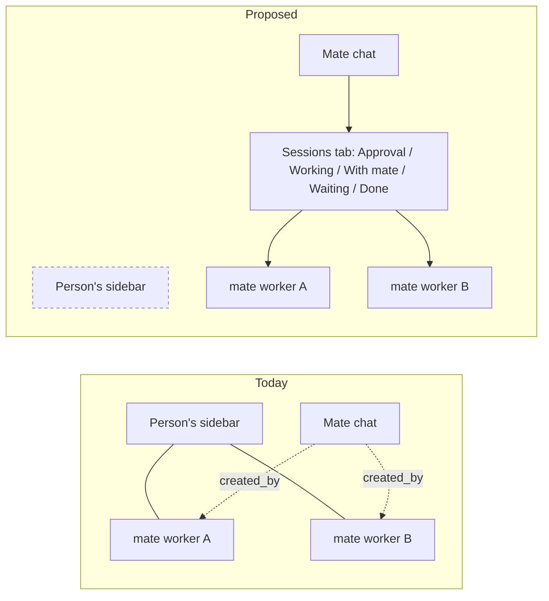
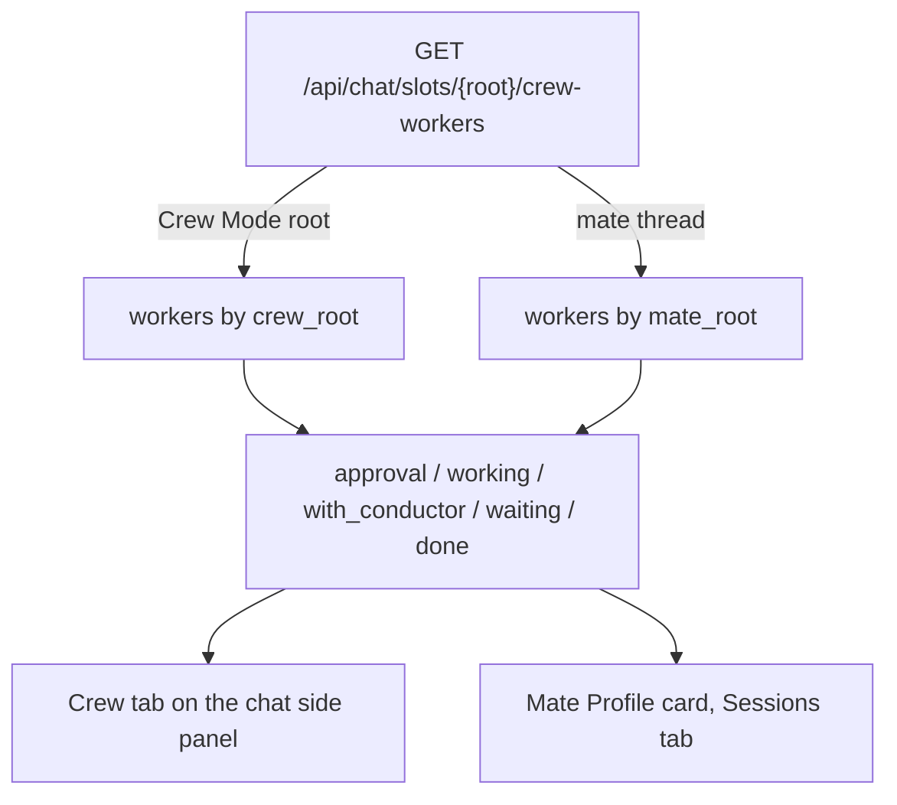
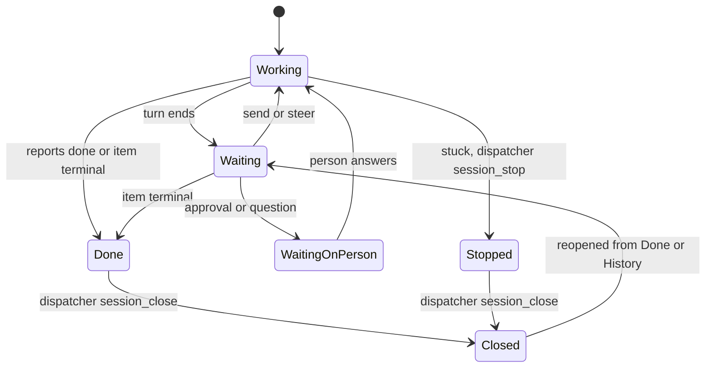
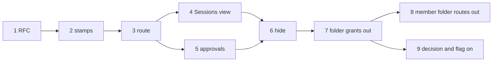

# RFC: A crewmate's sessions live under the crewmate

**Status:** draft. Nothing built; this document changes no code. Acceptance is the product owner's call, recorded by moving `status` to `accepted`. Every "exists today" claim below was verified at main `19c481f1ad` (2026-10-31); citations name files and symbols at that commit.

This RFC amends one clause of an owner decision: [2026-10-17-crewmate-chat-hands-off-to-worker-sessions.md](../decisions/2026-10-17-crewmate-chat-hands-off-to-worker-sessions.md) (Ray Xu, @buluoray), which says a crewmate's worker sessions appear in the sidebar. The rest of that decision stands. It builds on [rfc-mate-owned-agent-config.md](rfc-mate-owned-agent-config.md) (`accepted`), which makes a crewmate's chat a dispatch-only conductor whose work runs on worker sessions.

## Summary

- A crewmate (mate) thread becomes a root of its own kind, stamped `mate_root`, separate from Crew Mode's `crew_root`.
- Sessions a mate opens leave the person's sidebar. They show in the mate's Sessions tab, in the same grouped status view the Crew panel uses for Crew Mode workers.
- Worker approvals and unread reach the mate chat, so hiding a worker never hides a question from the person.
- The AI cleans up. A dispatcher (a conductor or a mate) closes the sessions it dispatched once they have no new work. The person never has to close them by hand.
- Dispatchers then no longer need folder tools. Their folder grants, folder guidance and `chat_folder_file_self` are removed, and a mate tree's `folder=` is dropped the way a Crew Mode tree's already is. The person's folders stay.
- All of it ships behind a new preview flag, default off.

## Motivation

### Crew Mode already does this for conductors

Crew Mode keeps a conductor's workers out of the person's lists and shows them under their root. The chain:

| Step | What | Where |
|---|---|---|
| Root test | A slot with no creator, Persistent memory, and `runs_crew_mode(...)` true. `runs_crew_mode` is false for a member thread, so a mate thread is never a root | `src/kiro_crew/crew_mode.py` (`runs_crew_mode`, `_row_is_root`) |
| Stamps | `crew_mode_root` on a root, `crew_root` on each descendant, `crew_dispatched_by` (`DISPATCHER_FIELD`) for the direct creator | `src/kiro_crew/crew_mode.py` (`ROOT_FIELD`, `WORKER_FIELD`, `DISPATCHER_FIELD`) |
| Walk | `stamp_rows` walks creators up to a root, past closed creators through the session tree | `src/kiro_crew/crew_mode.py` (`stamp_rows`), called from `src/kiro_crew/dashboard/state_parts/slots_frame.py` |
| Server list | `list_view` drops `crew_root` rows from a person's read | `src/kiro_crew/crew_mode.py` (`list_view`) |
| Client list | `crewModeView` drops a row whose `crew_root` is a row of the same list; `autoOpenRows` never auto-opens one; gated by `PREVIEW_CREW_MODE` | `website/src/lib/crewMode.ts` (`crewModeView`, `autoOpenRows`, `crewModeEnabled`) |
| Status view | `GET /api/chat/slots/{slot}/crew-workers` returns live and closed workers in groups `approval`, `working`, `with_conductor`, `waiting`, `done`; owner only; 404 `not_crew_mode_root` for any other slot | `src/kiro_crew/dashboard/handlers/crew_workers.py` (`_gate`, `_closed_workers`, `api_crew_workers`); route in `src/kiro_crew/dashboard/server_runtime/mcp_routes.py` |
| Client groups | Same five groups, Done folded by default | `website/src/lib/crewWorkers.ts` (`CrewWorkerGroup`, `CREW_GROUP_ORDER`), `website/src/pages/chat/command-center/CrewWorkerList.tsx` |
| Approvals | Worker approvals show as cards on the root's pane | `website/src/components/crew/CrewApprovalCards.tsx` |
| Counts and badges | Person-facing counts skip hidden crew members; a crew member's pending permission prompt also badges its live root | `website/src/store/dashboard/unread.ts` (`crewMemberKeys`), `website/src/hooks/websocket/chatStream.ts` (`crewWorkerRoot`) |

The person likes this view. The 2026-10-27 decision records it: crew members "are kept out of the person's own session lists" ([2026-10-27-crew-mode-is-a-composer-switch-to-the-conductor-template.md](../decisions/2026-10-27-crew-mode-is-a-composer-switch-to-the-conductor-template.md)).

### A mate's sessions land in the sidebar

| Part | Today | Where |
|---|---|---|
| Mate thread | A DM slot with `mode == "member"` (`DM_SLOT_MODE`), listed on the Mates page, not the chat page | `src/kiro_crew/members_parts/member_space.py` (`DM_SLOT_MODE`); `website/src/pages/chat-sidebar/conductor.ts` |
| Lineage | Each child carries `created_by = <mate thread key>` | read by `src/kiro_crew/crew_mode.py` (`_creator_of`) |
| Ownership fence | A mate may act only on sessions it created, or, for run verbs such as `stop` and `close`, sessions it manages after a handoff | `src/kiro_crew/dashboard/session_control_parts/caller_access.py` (`member_owns_slot`), `src/kiro_crew/dashboard/session_control_parts/target_authorization.py` (`authorize_target`) |
| Sidebar | Children are ordinary sidebar rows, grouped under "From Mates" when the person groups by kind | `website/src/pages/chat-sidebar/kindSections.tsx` (`SESSION_KIND_ORDER`) |
| Sessions tab | The mate Profile card lists live slots whose `created_by` is the mate thread. Direct children only, live only, one status dot each. No groups, no closed rows, no grandchildren | `website/src/pages/members/MembersPageSidePanel.tsx` (`drivingSessions`), `website/src/pages/members/MembersPageProfile.tsx` |
| Recorded design | Mate workers "appear in the sidebar"; "delegated work stays visible as the worker sessions themselves in the sidebar" | `docs/decisions/2026-10-17-crewmate-chat-hands-off-to-worker-sessions.md`, Decision section |

The gap: a mate's workers carry `created_by` but no root stamp. Nothing hides them, and no grouped view reads them. A busy mate fills the person's sidebar with sessions the person did not open and does not need to watch.

## Goals

1. A mate's sessions, at any depth, stay out of the person's sidebar, Recents and grid.
2. The mate's Sessions tab shows them in the Crew panel's grouped status view, closed ones included.
3. No approval or unread from a hidden worker is lost.
4. Finished sessions are closed by the AI that dispatched them, for conductors and mates alike. The person does not have to find and close them.
5. Dispatchers stop using folders.

## Non-goals

- No change to Crew Mode's own rules or to any `crew_root` consumer.
- No change to the person's own folders, the folder backend, or the sidebar folder UI.
- No "close all finished" button or route. Cleanup is the AI's job (see Cleanup).
- No App SDK reads of the mate tree. That is [rfc-crewmate-session-tree.md](rfc-crewmate-session-tree.md) (`draft`), which this RFC does not need.

## Design

### 1. Server stamps: a root of its own kind

| Field | On | Value |
|---|---|---|
| `mate_root` (new) | each descendant of a mate thread | the mate thread key |
| `mate_dispatched_by` (new) | same rows | the direct creator |
| `crew_root`, `crew_mode_root`, `crew_dispatched_by` | unchanged | Crew Mode only |

- Root test: a live or known-closed slot whose `mode` is `DM_SLOT_MODE`. A mate thread has no creator, so it is always a root.
- A mate can also run from an ordinary `chat-*` slot bound to its own store (`_member_caller` in `caller_access.py`). That slot is not a mate root, and sessions it dispatches stay in the sidebar. Covering it is out of scope here.
- The same walk as `stamp_rows`, in the same pass, stopping at the nearest root of either kind. A conductor a mate opened is a mate descendant, and so are its workers.
- Later, behind the preview flag (PR 6), `list_view` also drops `mate_root` rows from a person's read, as it does `crew_root` rows. Agents still see everything. Until then the stamps change no list.
- `live_stamps` (`src/kiro_crew/crew_mode.py`) restates the two new fields on `slot_patch` frames.

Why a separate field: every `crew_root` consumer would otherwise start firing on mate workers. Backend consumers include tool approval routing, agent switch, Crew Mode migration, crew filing, caller scope, folder runs, warm task briefs and Crew Mode metrics; the frontend has about twenty `crewRootOf` call sites. Each one that should also apply to mates is opted in on purpose, in its own PR.

### 2. Client: out of the sidebar

- New `mateRootOf(row)` beside `crewRootOf` in `website/src/lib/crewMode.ts`.
- `crewModeView` also drops a row whose `mate_root` is a live mate thread in the full slot store. The Crew Mode test ("root is a row of this list") cannot work here, because a mate thread is never in the chat page's list.
- `crewModeView` returns early when Crew Mode is off. The mate drop sits before that return, behind its own flag, so the Crew Mode branch itself does not change.
- `autoOpenRows` skips mate workers.
- A hidden worker still opens from the Sessions tab, a link in the mate chat, History or search. The page shows a breadcrumb back to the mate, reusing `website/src/components/crew/CrewWorkerBreadcrumb.tsx`.
- With the flag off nothing changes, and "From Mates" keeps working.

### 3. Status view: reuse the Crew panel

- `api_crew_workers` accepts a mate thread key as `{slot}`. `_root_row` and the known-roots check gain the mate case. `_closed_workers` already walks the session tree from any root key. `_crew_ledger_items` reads the root's own work ledger, which is the mate's, since a mate runs the conductor. The timeline (`api_crew_timeline`), steer and approve routes gain the same case. The owner gate is unchanged.
- The mate Profile card's Sessions tab renders the grouped list the Crew panel renders, rooted at the mate thread. The `with_conductor` group reads "With <mate name>" there.
- The 2026-10-08 decision that the Profile card opens on Sessions stays true.

### 4. Approvals and unread reach the mate chat

A hidden worker still needs the person for tool approvals and question cards. `CrewApprovalCards`, filtered by `mate_root`, shows in the mate chat on the Mates page. A worker's open question card shows there too; this is new, since Crew Mode does not route question cards to the root today (its worker refusal in `src/kiro_crew/dashboard/handlers/ask_question.py` is inert while `APPROVAL_ROUTING_LIVE` is `False`). A pending prompt badges the mate's row on the Mates roster, the way `crewWorkerRoot` badges a Crew Mode root, and counts skip hidden mate workers, the way `crewMemberKeys` does. This lands before hiding is turned on, or an approval could sit unseen.

### 5. Cleanup: the AI closes its own sessions

This is the part that matters most to the person: **the person does not close sessions by hand.** The dispatcher that opened a session closes it.

| Rule | Detail |
|---|---|
| Who closes | The dispatcher: a conductor or a mate |
| What it closes | Only sessions it dispatched (rule in the dispatcher's guidance; see Security for what the server enforces) |
| When | The session's work item is terminal (accepted, rejected or abandoned). A `done` report alone is not enough: the item may still fail verification and need the worker again |
| Stuck | A session that does not answer is stopped (`session_stop`), then closed |
| Never | A session waiting on a person: a pending tool approval, an open question card, or a last report of `blocked` or `question` with reason `approval` or `needs_human` (guidance; no server check) |
| Never | A session it did not dispatch |
| Effect | `session_close` archives the conversation. It stays reopenable from Done and from History. Nothing is deleted |

What exists:

- `session_close` archives and is reopenable (`_run_session_close` in `src/kiro_crew/mcp_dashboard_session_runs.py`).
- The goal-conductor skill already tells a conductor to close a child once its item is terminal (`src/kiro_crew/builtin_skills/goal-conductor/SKILL.md`), and the conductor prompt names the verb (`src/kiro_crew/agent_parts/spec_prompts.py`).
- Closed workers are already listed under Done and can be reopened (`_closed_workers`).

What is missing today: `session_close` is not in `_MEMBER_DASHBOARD_GRANTS` (`src/kiro_crew/agent_parts/spec_grants.py`), so an unattended mate stalls on an approval prompt or leaves sessions open, and the mate has no written close rule. A sibling PR adds the mate `session_close` grant and the close rule now. It is bounded by the same fence as `session_stop`: for `close` and `stop`, `authorize_target` admits a mate only on a session it manages, which is a session it created unless a handoff moved it (`_outside_reach`, `HANDOFF_WIDENED_OPERATIONS` in `caller_access.py`). This RFC does not depend on that PR's number.

There is no "close all finished" button and no close-finished route. The person can still close any one session the ordinary way, but nothing in this design asks them to.

One limit stays: a conductor holds neither `session_close` nor `session_stop` as an auto-approved grant (`_CONDUCTOR_DASHBOARD_GRANTS`), so each conductor close still raises an approval prompt the person answers. The person no longer has to find and close the session, but does press approve. Open question 4 asks whether to change that.

### 6. Consequence: dispatchers lose folder tools

Once conductor workers and mate workers both live under their root, no dispatcher needs folders. Three paths file a session today: the `chat_folder_*` tools; `folder=` on `session_create`, which creates a missing folder on its own (`_resolve_folder_for_new_session` in `src/kiro_crew/mcp_dashboard_session_runs.py`); and, for a mate, automatic filing into the mate's home folder (`mate_home_filing` in `src/kiro_crew/dashboard/mate_folders.py`, called from `src/kiro_crew/dashboard/session_control_parts/session_create.py`). In each case a named folder can also give the child its project directory, and that part stays.

| Thing | Disposition |
|---|---|
| `chat_folder_file_self` (`src/kiro_crew/mcp_dashboard.py`, `_run_chat_folder_file_self` in `src/kiro_crew/mcp_dashboard_folder_runs.py`) | remove. Only conductor specs auto-grant it and only conductor guidance uses it, but any agent could call it under an approval; removal takes self-filing away from ordinary agents too, and the person files such a chat by hand |
| Folder entries in `_CONDUCTOR_DASHBOARD_GRANTS` and the pipeline and security conductor sets in `spec_grants.py`; `src/kiro_crew/agent_materialization/conductor_agents.py` | remove; mates inherit the conductor set, so theirs go too |
| `folder=` from a caller in a turned-on Crew Mode tree | already dropped, with an answer that says so, while the folder still supplies the project directory (`slot_in_turned_on_tree` in `src/kiro_crew/crew_mode.py`, `src/kiro_crew/dashboard/session_control_parts/crew_filing.py`). A conductor root without the Crew Mode stamp, or a worker of a closed root, keeps its folders |
| Filing for a caller in a mate tree, with the preview flag on | dropped the same way: no `folder=` filing and no mate-home filing, project directory kept. A mate's `session_create(folder=...)` still succeeds, unfiled |
| Member admission to the folder routes (`_member_admitted_to_chat_folder_tag_route` in `src/kiro_crew/dashboard/handlers/_shared_route_guards.py`) | remove the folder part only; the tag, pin, column and session-list admissions it also grants stay |
| Folder steps in conductor prompts and the goal, security and pipeline conductor skills | remove; `session_create` without `folder` |
| Other `chat_folder_*` tools, and `folder=` for callers outside both trees | keep; an ordinary agent can still be asked to file chats |
| The person's folders, `src/kiro_crew/dashboard/chat_folders.py` and its routes, the sidebar folder UI | keep |
| Mate home folders that already exist | unchanged: mate-owned and locked, released to the person when the mate is deleted, as today |

[rfc-conductor-folder-scope.md](rfc-conductor-folder-scope.md) (`draft`) bounds where an agent on the person's store may create sessions and folders; crew members were never in its scope. This RFC does not supersede it. After PR 7 its remaining population is ordinary agent tabs, and a conductor outside a Crew Mode tree that still passes `folder=`. That document is not edited here.

## Migration plan

Each PR is under about 600 lines and ships on its own. Old plan items for a close-finished route and a cleanup UI are dropped, because cleanup is AI-driven.

| # | PR | Exit criteria | Depends on |
|---|---|---|---|
| 1 | This RFC | Merged, then accepted by the owner | — |
| 2 | Server stamps: `mate_root`, `mate_dispatched_by` in `stamp_rows` and `live_stamps`; frames carry them. Inert: no list and no client reads them | A mate's child and grandchild carry `mate_root`; no row gains `crew_root`; every list returns the same rows as before | 1 accepted |
| 3 | Route: `/crew-workers`, timeline, steer and approve accept a mate root | The route returns a mate's live and closed workers in the five groups; a non-owner gets the same refusal as for a Crew Mode root | 2 |
| 4 | Sessions view: the mate Profile card renders the grouped list | Closed and grandchild workers show; Done is folded | 3 |
| 5 | Approvals, questions and unread reach the mate chat and the Mates roster | A hidden worker's pending approval and open question card show in the mate chat and can be answered there | 3 |
| 6 | Hide behind the new preview flag: `list_view`, `crewModeView`, `autoOpenRows`, breadcrumb | Flag on: mate workers are absent from the sidebar, Recents, grid and a person's `GET /api/chat/slots`. Flag off: no change | 4, 5 |
| 7 | Folder grants out: dispatcher folder grants and guidance, `chat_folder_file_self`, the mate-tree filing drop, specs and tests | No conductor or member agent spec carries a `chat_folder_*` grant; with the flag on, a mate-tree `session_create` is filed nowhere and keeps its project directory; ordinary agents keep the other folder tools | 6 shipped |
| 8 | Member folder routes out | A member caller is refused on folder routes and still admitted to the tag, pin, column and session-list routes | 7 |
| 9 | Decision entry superseding the 2026-10-17 sidebar clause; flag default on (owner call) | Decision merged; flag default matches the owner's call | 6, 7 |

The mate `session_close` grant and close rule are not in this list; the sibling PR ships them independently.

## Backward compatibility

- With the flag off, every list, the sidebar and "From Mates" behave as today.
- New fields are additive. A client that does not know `mate_root` ignores it.
- With the flag off, a mate still files its workers into its home folder, as today.
- Closed sessions stay in History. Turning the flag off brings every live mate worker back to the sidebar.
- Removing folder grants from dispatchers leaves existing folders and their contents untouched.

## Security considerations

- The status view and its steer and approve routes keep the existing owner-only `_gate`. A mate root adds no new caller.
- A mate's `session_close` is confined by `authorize_target` to sessions it manages: ones it created, unless a handoff moved them. With `agent.session_manager_chain` on, a manager's manager reaches them too.
- A conductor is fenced the same way when it was itself created by an agent (every sub-conductor, and a conductor a mate opened) or when `agent.session_control` is off (`_caller_is_ownership_fenced` in `caller_access.py`). A conductor in the person's own tab with `agent.session_control` on is not fenced; there, `session_close` is not auto-approved, so each close passes the person's approval prompt. The "only what it dispatched" rule is guidance for that conductor, backed by the prompt.
- Hiding must never hide an approval. PR 5 lands before PR 6 for that reason.
- Removing folder grants only narrows what dispatchers can do.

## Alternatives considered

- **Reuse `crew_root` for mates.** Rejected: every Crew Mode consumer would fire on mate workers at once, including approval routing and migration.
- **Keep mate workers in the sidebar, grouped under "From Mates".** That is today. It still fills the person's sidebar and gives no status groups.
- **A "close all finished" button and route.** Dropped. It puts cleanup on the person, which is the thing this RFC removes.
- **Auto-close on idle time.** Rejected: a session waiting on a person can look idle. The dispatcher knows the item state; a timer does not.

## Open questions for the owner

1. **Flag.** A new preview flag for mate workers, or ride the existing Crew Mode flag (`PREVIEW_CREW_MODE`, default off)? A new flag lets mates ship without Crew Mode.
2. **Where the status view lives.** Only the mate Profile card's Sessions tab, or also a right-side panel next to the mate chat, like the Crew tab?
3. **Who decides mate worker approvals.** The person in the mate chat (proposed), or the mate itself, as the Crew Mode approval-routing plan does (`APPROVAL_ROUTING_LIVE` in `src/kiro_crew/crew_mode.py`, still `False`)? Letting the mate decide takes the person out of the approval loop for sessions they no longer see, so it needs its own security review.
4. **Conductor closes.** Keep the approval prompt on each conductor `session_close` (today), or auto-approve it for conductors that are ownership-fenced, as the sibling PR does for mates?
