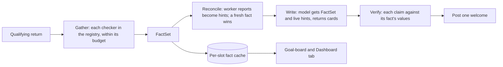

# RFC: Return-triggered warm task brief — replace the immediate warm resume

- Status: `partial`: the decision shipped in [#20422](https://github.com/kirodotdev/KiroCrew/pull/20422). The amendments dated 2026-10-15 through 2026-10-26 below shipped after it ([#21750](https://github.com/kirodotdev/KiroCrew/pull/21750), [#22828](https://github.com/kirodotdev/KiroCrew/pull/22828), [#22839](https://github.com/kirodotdev/KiroCrew/pull/22839), [#23847](https://github.com/kirodotdev/KiroCrew/pull/23847), [#24512](https://github.com/kirodotdev/KiroCrew/pull/24512), [#24307](https://github.com/kirodotdev/KiroCrew/pull/24307)), the 2026-10-29 Crew Mode scope amendment shipped in [#25881](https://github.com/kirodotdev/KiroCrew/pull/25881), and the first 2026-10-31 UX amendment (the fixed progress orb) shipped in [#26500](https://github.com/kirodotdev/KiroCrew/pull/26500). Of the 2026-10-31 redesign amendment (section 3.9), [#26652](https://github.com/kirodotdev/KiroCrew/pull/26652) shipped the sectioned input, the owner's-language rule, the conductor prompt for any ledger-owning thread, the goal-scoped count, the quiet one-line return and the single message that replaces a preparing indicator; the live checks, gateway-built links and copied option buttons of section 3.9.3 are not built. Also not built: the 2026-10-28 writer amendment (section 3.8), since no `dashboard.warm_brief_wake` setting exists under `src/`, the 2026-11-01 trigger amendment, whose implementation [#26938](https://github.com/kirodotdev/KiroCrew/pull/26938) is still open, and the 2026-11-01 GitHub-read amendment, whose implementation [#26666](https://github.com/kirodotdev/KiroCrew/pull/26666) is still open. The 2026-11-02 visual amendment (section 5.1) is not built either (implementation [#27899](https://github.com/kirodotdev/KiroCrew/pull/27899), open): on `main` at `764aade2c` the card still draws the fixed orb (`website/src/components/chat/WarmBriefOrb.tsx`) and the prompt still asks for words only. The 2026-11-05 warm welcome v3 amendment (section 3.10) is not built. Maintainer `iamwhatever` [accepted the direction and explicit-signal false-negative tradeoff](https://github.com/kirodotdev/KiroCrew/pull/20157#issuecomment-6167061835) on 2026-10-14: cold welcome stays unchanged; the user must leave, stay away for at least 30 minutes, and return; the return shows deterministic status before one model call; stale or cancelled work clears that status without publishing its result.
- UX amendment, 2026-10-15: the deterministic preparation and generated summary render as two ordinary crewmate messages, not a card, widget, status banner, or special result row. The second message has **Problem**, **Current status**, and **Suggested actions**. This supersedes the transient-status, unattributed-notice, and silent-invalid-output clauses below.
- UX amendment, 2026-10-16: the first message is a fixed warm opener in first person ("Welcome back, let me catch you up on where we are."), in the script of the user's request; the second is one first-person prose message from the model saying what was asked, where it stands, and one to three suggestions, with no **Problem**/**Current status**/**Suggested actions** headings or lists. This supersedes the three-part shape and gateway-supplied quote of the 2026-10-15 amendment and section 3.5; trigger rules are unchanged.
- Trigger amendment, 2026-10-18: the shipped trigger never fired for the owner. Since #20422 merged, no transcript holds a single claim row. The owner's real return left the crewmate thread for another chat, hid the page there, and opened the crewmate later; section 3.2 counts none of that as away. The amended rules: (1) leaving a thread for another thread starts its away episode, like a hidden page; (2) an episode ends only when an owner frame names that thread again, so frames for other threads, windows, or devices no longer wipe it; (3) a return while the thread runs a turn waits for that turn to end, up to 30 minutes, while the owner stays on the thread, instead of being skipped; (4) a prepared result goes stale only on a new user turn, a new away episode, a reset or replaced slot, or a finished task. Patrol turns, `[work-ledger wake]` rows, and worker reports still change the dedup fingerprint, but they no longer drop a prepared result. A turn running at publication defers the result until it ends. (5) Only a live row the person typed cancels a brief in preparation. Assistant rows, automation rows such as a wake, and turn admission do not. The expected rate is one brief per qualifying return. Patrol cadence adds none; it only makes nearly every such return eligible. The ceiling is 48 per thread per day. The owner's conductor thread on 2026-10-17 had about four returns after 30 minutes or more away, so about four background calls a day. The 30-minute minimum, durable claim, fingerprint dedup, one model call per claim, and the explicit-hidden-signal false negatives are unchanged. This supersedes the "Switch chats", "Hide on X, return on Y", and "worker/task change" rows below.
- Trigger amendment, 2026-10-22: away is time off screen, not a lost leave signal. The 2026-10-18 rules still missed every return after a dropped hide frame or a gateway restart, because the away episode lived only in memory. The amended rules: (1) the gateway keeps, in memory, when each thread was last on screen in any owner view: stamped by an owner frame naming it, an owner frame leaving it, and the close of an owner socket that showed it; (2) an owner frame naming thread X is a return only when no owner view already shows X, so watching a thread, a re-sent frame, and a second window are never returns; (3) away time runs from the latest of that last-on-screen time, the owner's last genuine message, and the last brief claim, the two durable times read from the transcript with naive rows from older builds read as local time; (4) when the process has no on-screen record of X (after a restart, or after the bounded record evicts it), only the durable times count; (5) the frame a socket sends on first connect or reconnect carries `announce: true`, and an announce for a thread with no on-screen record marks it seen now and never briefs, so the reconnect wave after a restart cannot fire a burst; an announce after a recorded absence (a page reloaded after a real leave) still qualifies. A restart while away followed by the tab turning visible is a non-announce frame and briefs from the durable times. Accepted false negatives: a brand-new tab opened after a restart, and a reconnect after sleep, give no brief. The 30-minute minimum, durable claim, fingerprint dedup, one model call per claim, deferral, and stale rules are unchanged. This supersedes the in-memory away episode in sections 3.2 and 3.3 and the "Gateway restarts during away period" row.
- UX amendment, 2026-10-24: the owner found the four-field card too thin to act on. The brief now reads like a manager's report to the owner who hired them: a status and headline first, then what needs the owner, then how far it is from the goal, then what they asked for. Progress (`accepted of total` work items) is counted by the gateway from the ledger, never by the model. The model may add up to two sections of its own for anything else the owner must decide. Section 5.1 holds the shape. Trigger, preparation, spend, staleness and reader-filter rules are unchanged.
- Leave amendment, 2026-10-26: the owner left the thread a few seconds after the opener appeared and came back to the opener alone; the card never arrived. Leaving is a pause, not a cancel. Once the opener is posted, hiding the tab or switching to another chat no longer drops the brief: the result is ordinary history and lands while the owner is away, and a turn running at publication still defers it. Only a typed row, a reset, a close or a replaced slot cancels a brief past the opener, and a new user turn still makes its result stale. Leaving before the opener still drops the attempt, as before. A return while the brief is in flight starts no second one, so the owner sees exactly one card. This supersedes "leaves" in the section 3.4 stale-result table, the foreground recheck before publication in section 3.7, and "a second leave" in the race tests.
- UX amendment, 2026-10-26: the report read too stiff. The prompt now names the facts the owner must come away with (what needs them and what it unblocks, the ask, distance to the goal, what is next) and lets the model choose tone and layout in a free-form `body`, plus an optional `widget` drawn in the chat widget sandbox. Section 5.1 holds the shape.
- Writer amendment, 2026-10-28: the brief read only the ledger snapshot, so it reported a merged or conflicting pull request as still open. On a qualifying return the gateway now wakes the crewmate for one read-only, background-priority turn. The crewmate checks the live state of its open tasks with its own tools, updates its records and Dashboard fields, and writes the brief itself. The one-call brief stays as the fallback. Trigger, opener, progress counting, staleness and reader-filter rules are unchanged. Section 3.8 holds the design.
- Scope amendment, 2026-10-29 (owner decision, implemented in [#25881](https://github.com/kirodotdev/KiroCrew/pull/25881), issue [#25838](https://github.com/kirodotdev/KiroCrew/issues/25838)): a Crew Mode chat gets the same brief. A Crew Mode root (a root dashboard chat running a conductor, `crew_mode.slot_is_crew_mode_root`) is eligible beside a crewmate thread; its workers and every other chat are not. One trigger rule is stricter: a Crew Mode chat can stay visible in a split-view pane while another pane holds focus, so its away episode starts only when the page sends an explicit hide (`slot_focused` with `slot: null, hidden: true`, which the client sends when the slot it last announced is a Crew Mode chat on a chat route, as it does for a mounted crewmate thread). The hide marks that one owner view, and only while no other owner view shows the chat; that view's next frame spends the mark, so the return must name the chat the hide left; a reveal re-announces the focused split-view pane rather than the active chat for that reason. A pane or sidebar switch, a socket loss and a gateway restart never start one, so the durable-time fallback after a restart does not apply to Crew Mode. Away time, claim, fingerprint, one call per claim, opener, progress count, staleness and cancellation rules are unchanged. Spend is the crewmate's: at most one tool-free background call per qualifying return, under the same durable claim and the 48-per-thread daily ceiling. The only other difference is the prompt: it names the writer as the conductor and asks it to say which work items finished, which wait on the owner, and which are still running. The open-task check already reads the conductor goal, the work items and the running workers. Crewmates get no first-open brief, so neither does Crew Mode.
- Trigger amendment, 2026-11-01 (owner ruling; implementation [#26938](https://github.com/kirodotdev/KiroCrew/pull/26938)): "warm welcome should consider clicking to another chat in the sidebar. Switching focus means attention left, so the user needs this info to catch up." A Crew Mode root now follows the crewmate's leave rule. A switch to another chat, from the sidebar or to another split-view pane, starts its away episode, as a page hide does; so do a socket close and, after a restart, the durable times, exactly as for a crewmate thread. The explicit-hide gate of the 2026-10-29 Scope amendment and its per-view hide mark go away; the client keeps sending the `hidden: true` bit, and the warm brief does not read it. The 30-minute minimum, the `announce` rule that keeps the reconnect wave quiet, a second window still showing the chat, the durable claim, the fingerprint dedup and every other rule of the Scope amendment are unchanged. This supersedes the stricter-trigger sentences of the 2026-10-29 Scope amendment.
- UX amendment, 2026-10-31 (owner decision; implementation [#26500](https://github.com/kirodotdev/KiroCrew/pull/26500), issue [#26494](https://github.com/kirodotdev/KiroCrew/issues/26494)): the model-drawn `widget` drew its own progress ring against the prompt, cut long lines off at 320 px, and looked different on every return. The model now writes words only; it is not asked for a `widget`, and one it sends is ignored. The gateway lists what waits on the owner itself, from the ledger the snapshot already reads, and a fixed card component draws progress and that list as one picture. The owner chose this "glowing orb" direction from three mockups. Section 5.1 holds the shape. Trigger, preparation, spend, staleness, progress counting and reader-filter rules are unchanged; a stored brief keeps drawing its old `widget`. This supersedes the `widget` of the second 2026-10-26 UX amendment and of section 3.8. Superseded in turn by the 2026-11-02 visual amendment below: the orb and its count label go away.
- Redesign amendment, 2026-10-31 (owner decision; issue [#25306](https://github.com/kirodotdev/KiroCrew/issues/25306)): a study of every real brief the owner received found most of them stated stale or false facts and none carried the owner's pending choices. The brief is rebuilt around two rules: verify before stating, and make every ask usable from the message alone. It is one message, replaced in place from a "preparing" indicator; a quiet return is one line; only goal-scoped numbers are shown; scope stays crewmate threads and Crew Mode roots. The trigger is unchanged. Section 3.9 holds the design and lists what it supersedes.
- GitHub-read amendment, 2026-11-01 (owner decision in the conductor chat: "改设计稿，允许回来时查 GitHub", "amend the design; allow reading GitHub on return"; implementation [#26666](https://github.com/kirodotdev/KiroCrew/pull/26666), issue [#25306](https://github.com/kirodotdev/KiroCrew/issues/25306)): on a qualifying return the gateway itself reads, read-only, the pull requests the brief's open asks name, at most five, each good read cached 15 minutes, and states their state with its read time; a failed or rate-limited read never blocks the brief and shows "not checked since HH:MM". This supersedes the owner's earlier rejection of a gateway-side GitHub read ([#25307](https://github.com/kirodotdev/KiroCrew/pull/25307), closed 2026-10-28), the "gateway does not read GitHub itself" rule of section 3.9.1, the "no remote read" clause of section 3.9.8 and that rejected alternative in section 3.9. It applies the owner's 2026-10-31 rule 1 (verify before stating) to pull requests while the section 3.8 wake is not on `main`. Section 3.9.1 holds the rules. The trigger, claim, spend and every other section 3.9 rule are unchanged.
- Visual amendment, 2026-11-02 (owner decision; issue [#27820](https://github.com/kirodotdev/KiroCrew/issues/27820)): the owner wrote on 2026-11-02: "This 'ball' like stuff is so bad/ugly, I think we shall remove it. '3 of 5 done' seems not useful as well. I want AI has the flexibility to generate the attractive image/diagram or live widget to get the warm welcome message more useful, without limiting it." The fixed progress orb and its "N of M done" label leave the warm brief, in crewmate (Mate) threads and Crew Mode roots alike. The model may put its own picture in the brief's markdown `body` when it helps the owner act: a mermaid diagram, a table, or a live `<mcwidget>`, chosen per brief, with no fixed template. A picture is optional, and a quiet return stays one line with none. Verified facts, usable asks and the waiting cards are unchanged. A second owner decision the same day: "I want the full power 'live widget' available if possible. Basically, it shall have strong ability to explain the situation properly." So a widget keeps page scripts and clicks and draws through the same `MarkdownRenderer` and `WidgetFrame` as a chat reply, under a `welcome` frame profile that drops the chat profile's CDN script origins, link bridge and composer pre-fill (implementation [#27899](https://github.com/kirodotdev/KiroCrew/pull/27899)). The chat profile and sandbox are not widened; the ways out that remain are named in section 5.1. Section 5.1 holds the shape. This supersedes the orb amendment of 2026-10-31, the orb wording of sections 3.9.2 and 3.9.5, and the "words only" prompt rule.
- Buttons amendment, 2026-11-02 (issue [#27967](https://github.com/kirodotdev/KiroCrew/issues/27967)): the "Working buttons" bullet of section 3.9.3 ships; "Resolved asks lose their buttons" does not yet. The brief row itself carries the copied line, so the chip bar and `has_options` still read the newest reply only, as [docs/decisions/2026-09-13-options-are-read-from-the-newest-reply-only.md](../decisions/2026-09-13-options-are-read-from-the-newest-reply-only.md) requires; the waiting-item reader (`member_waiting`) keeps the ask as its text under a brief that carries copied choices, and a brief with none retires the ask. The source pick is conservative: the newest assistant reply or note row with a marker, past brief rows, system notices, tool rows and say-nothing replies; a user, queued or Stop row, a newer reply with no marker, or a newer single-select `[OPTION:]` note copies nothing (unlike the chip bar, a failed turn is not crossed, so that rare case shows no buttons rather than stale ones). The copied line keeps every source label, in order. Dropping an option already done needs a structured link from each option to its work item (for example a typed field on the reply row, written when the reply is), not a text marker found by pattern matching; until that exists, no option is dropped.
- Checked-facts amendment, 2026-11-04 (owner-approved warm-welcome plan, relayed by the conductor: "before the welcome mentions a PR, its state is read live", "any body line that mentions a PR, task, file, deploy or ticket must cite a checked fact", "No re-send when nothing changed"; implementation [#29679](https://github.com/kirodotdev/KiroCrew/pull/29679)): the live read widens from the open asks' pull requests to every open work item's ledger PR (still at most five, still never a bare `#N`); what the gateway read becomes numbered checked facts that body lines must cite, and uncited lines are deleted; the card lists the facts; and a return whose facts did not change since the last delivered brief, in a thread that said nothing since, sends nothing. The welcome stays report-only. Section 3.9.1 holds the rules. This supersedes the "only pull requests the brief's open asks name" clause of section 3.9.1 and narrows "a quiet return is one line" to a return with nothing waiting.
- Wake amendment, 2026-11-05 (owner decision in the conductor chat, 2026-11-05: "选 2：回到 3.8，唤醒能写能关", "option 2: back to 3.8; the wake can write and close"; tool-call ids as the only evidence for file, deploy and ticket facts): the section 3.8 wake keeps its writes. It may record what it checked in the work-ledger items its conductor owns and in its Dashboard fields, and may close an item only after `accept_eval.py` returns `pass` on that item's bar. It returns the one-call JSON as its last answer with proven `checks`, each backed by the ids of the tool calls that showed it. It ships in two steps: step 1 ([#30527](https://github.com/kirodotdev/KiroCrew/pull/30527)) is the read-only turn with proven checks; step 2, a follow-up code PR, adds the writes and the gated close. Section 3.8.1 holds the rules; where it differs, it supersedes section 3.8 and that section's open question 3, and it settles open question 2 as section 3.8 proposed.
- Warm welcome v3 amendment, 2026-11-05 (owner decision: all eight recommendations of the warm-welcome v3 design report accepted, relayed by the conductor; one implementation PR): a 16:47Z welcome contradicted its own checked fact and drew the same asks four times. The gateway now gathers every fact from one source registry before writing, worker reports become hints that a newer differing fact supersedes, the model writes one card per pull request or task whose state tags are the gateway's, and each claim is checked against its cited fact's values by exact lookup. Each card shows only its own item's options, taken from goal-board `asks` (the one source keyed by item on `main`), never the free `[OPTIONS:]` line; the chip bar with the copied marker stays the click path, and card buttons that replace it ship in a follow-up PR. What a section 3.8.1 wake writes into its items is read back as task facts. A worker chat's running, idle, interrupted or closed state and a pending approval become facts. A stat-only file checker covers files when no section 3.8.1 wake ran; wake checks, when present, are one more source. Goal-board and the Dashboard tab read the same cached facts and never call GitHub on page load. One language per welcome. The `welcome` widget profile and every other security limit are unchanged. Section 3.10 holds the design and lists what it supersedes.
- Audited on `fed53fcd3b90` (`main`, 2026-11-01).
- This amends only the **warm** branch of [rfc-crewmate-greeting.md](rfc-crewmate-greeting.md) and [rfc-crewmate-greeting-as-message.md](rfc-crewmate-greeting-as-message.md). Their cold-welcome decision remains fully in force.

## 1. Problem

The current warm resume appears as soon as a crewmate chat with an open task is opened. It is assembled from fixed client copy and work-ledger counts. It does not begin with the request that caused the work, and it can appear while a newer answer is about to land.

The useful moment is a real return: the user left Kiro Crew, stayed away long enough to lose task context, and came back. Only that return should spend a model call and welcome the user with the original request, current task truth, and the next move.

## 2. Current behavior, verified

When `useMateGreeting` opens a confirmed idle crewmate thread, it immediately reads `GET /api/crew-board`. An open work-ledger item produces `MateResumeCard`, rendered through `ChatPane.crewmateGreeting` as a host-drawn message after the transcript. It uses no model call and writes no transcript row. The same hook takes a separate cold branch only when no goal is in flight.

Kiro Crew already has an owner-gated foreground lifecycle. `attachFocusRelay` sends `slot_focused` over the existing authenticated WebSocket; first connect and reconnect re-announce it through `reconnectCatchUp`; a hidden tab sends `slot: null`; and the server stores one foreground slot per owner connection through `slot_retention.note_foreground`. The Crewmates page separately uses `document.hidden`, `document.hasFocus()`, `window` focus/blur, and `viewedThread` to register a member thread only while it is on screen. `slot_read` is not presence: `_handle_slot_read` is a pure unread-badge relay and stores no read state.

The current foreground seam does not yet express the full return contract. It re-announces `chat.activeSlot`, while a member thread lives in `viewedThread`; it sends blur for a hidden document but not every focus loss or page leave; and it stores no away start. The implementation extends this existing owner presence seam. It does not infer presence from message age, `slot_read`, a client clock, or an ambient “active” flag.

Before this RFC changed anything, focused tests passed on the audited base: 62 backend tests in `test_agent_welcome_message.py` plus `test_mate_welcome.py`, and 45 frontend tests in `mateGreeting.test.ts`, `useFirstGreeting.test.tsx`, and `ChatPane.scrollChrome.test.tsx`. Existing `MembersPage` and WebSocket tests also pin visible/focused `viewedThread` registration, hidden-tab retirement, first-connect focus, and reconnect focus re-announcement.

## 3. Decision

### 3.1 Warm only

Replace only the immediate warm resume. A crewmate chat with an active task no longer draws fixed task status merely because the thread opened.

> 2026-10-24: the cold Recap is removed; the warm task brief is the only return greeting.

Every cold-welcome path remains exactly as it is on the audited base:

- `useMateGreeting` still takes the cold branch only when no work-ledger goal is in flight.
- `COLD_AFTER_MS` remains six hours.
- `GET /api/members/{slug}/recap`, `MateWelcomeCard`, its copy, hide action, once-per-idle-stretch rule, failure notice, and user-visible placement remain unchanged.
- `useFirstGreeting`, `POST /api/members/{slug}/greet`, `dashboard.mate_welcome`, the `first_greeting` create flag, and Mate's first model welcome remain unchanged.
- Agent-spec `welcomeMessage` reading, dashboard display, KAS projection, bundled values, and agent-switch behavior remain unchanged.

This RFC does not remove a welcome from a new or cold chat. It changes only the active-task warm resume.

### 3.2 Exact trigger: leave, 30 minutes away, return

A delayed warm task brief is eligible only when all conditions hold in order:

1. The gateway receives `{type: "slot_focused", slot: null, hidden: true}` from the last owner connection whose foreground row names thread X.
2. Thread X stays in that in-memory away episode for at least 30 continuous minutes.
3. The first later owner `slot_focused` frame names thread X; a frame naming anything else ends the episode without a call.
4. On that return, thread X has an open task and a durable original user request.
5. No earlier warm-brief attempt claimed the same durable task fingerprint.

The **return frame** is the trigger. Thirty minutes passing is not a trigger. No periodic timer runs.

| State | Status or model call |
|---|---|
| Page remains visible for 30 minutes or longer | None |
| Page remains visible but window loses focus | None |
| Page remains hidden for 30 minutes or longer | None until a real return |
| User returns before 30 minutes | None |
| Focus event repeats while already foreground | None |
| Another tab already shows the thread | None |
| Switch chats and stay 30 minutes or longer | None |
| Open a non-chat route for 30 minutes or longer | None |
| Leave the New crewmate card open for 30 minutes or longer | None |
| Focus a split-view placeholder pane | None |
| Hide on thread X, return on Y, then open X later | None |
| User returns after 30 minutes, fingerprint already claimed | None |
| First eligible return, or return after task-state change | One claimed warm-brief attempt |

Thirty minutes is the accepted minimum. The implementation names it once as `WARM_TASK_BRIEF_AWAY_SECS = 30 * 60`. It is an away-duration check on a return edge, never a wake timer or repeat cadence.

### 3.3 Trusted presence and multiple tabs

The client extends the existing `slot_focused` frame with one optional reason bit, `hidden: true`. It is valid only with `slot: null`, and only the existing `visibilitychange` hidden branch sends it. The flag says why presence cleared; it supplies no time or duration.

- On a chat route, the presence sender continues to report `chat.activeSlot`.
- On the Crewmates route, a separate mounted-thread presence value reports the confirmed member thread while the document is visible, regardless of window focus. The existing focus-aware `viewedThread` value remains unchanged and serves unread badges only.
- First connect and reconnect use that mounted-thread value on the Crewmates route and `chat.activeSlot` elsewhere, but send no focus frame while `document.hidden` is true. The later `visibilitychange` return sends the real return frame.
- Window focus may re-announce the same slot. Window blur sends nothing. Chat switches, member-thread switches, non-chat routes, the New crewmate card, split-view placeholder focus, page teardown, and socket cleanup keep their existing `slot_focused` behavior but never add `hidden: true`.
- Frames keep the existing WebSocket origin, owner, and app-token checks. The server accepts no client-supplied time or duration.

`document.hidden` is also the sole desktop authority; no native Electron IPC is added. The dashboard's `WebContentsView` leaves `backgroundThrottling` at its default `true`. Electron's [Page Visibility contract](https://www.electronjs.org/docs/latest/api/browser-window#page-visibility) says minimized or explicitly hidden windows report hidden on every platform, and fully occluded windows report hidden on macOS. Therefore macOS minimize, hide-to-tray, and full occlusion can arm; Windows and Linux minimize or `win.hide()` can arm; partial occlusion, side-by-side windows, and unfocused documents that remain visible do not. If a compositor does not report hidden, no brief appears—the accepted explicit-signal false negative.

The implementation pins that controllable premise with an Electron source test that the dashboard view never sets `backgroundThrottling: false`. Release smoke checks minimize and hide-to-tray on macOS, Windows, and Linux; it records platform variance but does not add a second presence authority.

The server updates the existing per-connection foreground registry for every owner `slot_focused` frame. It starts thread X's away episode only when a `hidden: true` null arrives from the last owner connection whose existing row names X. Other nulls, slot replacements, and socket-finally cleanup may clear or replace registry rows for their existing jobs, but they never arm a warm brief.

The gateway stores X's away start and episode generation in memory. The first later owner focus frame ends that episode. It is a return only when it names X; a frame naming Y or null drops X's episode without a call. Return-time gates then require 30 minutes, an open task, a real original request, and a task fingerprint not already claimed. This placement lets a task begin or worker progress land while the user is away.

A normal tab close first fires `visibilitychange` to hidden and sends the hidden-leave while the socket is open. That send remains best-effort. If it is lost, or a crash, power loss, sleep, socket loss, or gateway restart erases the in-memory episode, that return can miss a warm brief. Maintainer `iamwhatever` explicitly accepted those false negatives rather than adding socket-gap inference. The ordinary chat and unchanged cold welcome remain available.

Only the qualifying task fingerprint claim is durable before the visible attempt. Claim-before-preparation prevents duplicate spend across repeated focus, simultaneous tabs, reload, or restart after a return was admitted. Away detection remains in the existing in-memory foreground registry.

### 3.4 Preparation before the model

On an eligible return, the gateway re-reads the durable task snapshot and atomically claims the away episode plus task fingerprint. Only a current, unclaimed snapshot proceeds.

The gateway then posts this deterministic ordinary crewmate message before starting the model call: **“Preparing your current-task summary. You can wait here.”** Producing this message uses no model and no token. It is an `assistant` transcript row tagged `warm_task_brief_preparing`; no new route, listener, status channel, card, widget, or special renderer is added.

The preparing message has one lifecycle:

| Event after preparation | Visible result |
|---|---|
| Model result stays current | A second ordinary crewmate message posts the warm task brief |
| User sends, resets, closes, or replaces the chat | Stale result is discarded; posted messages stay |
| User leaves after the opener is posted | Result still posts as ordinary history |
| Worker/task state changes, a new assistant answer arrives, or the task completes/cancels | Stale result is discarded; posted messages stay |
| Model fails, times out, or returns invalid data | A second ordinary crewmate message says “I couldn't prepare the current-task summary.” |

Preparation, result, and failure rows are ordinary crewmate messages. Once posted they stay as ordinary history and follow the normal transcript save path; nothing retracts or rewrites them. A stale result is never posted, so a stale attempt leaves only the preparing message. The fixed preparing and failure lines and the three section headings are English, like other gateway-authored lines; the model writes the current status and suggested actions in the language the user writes in.

There is deliberately no `MateResumeCard` fallback; maintainer `iamwhatever` accepted silence when the explicit leave signal is lost, and cold welcome remains available under its unchanged rules.

### 3.5 Durable input and output

The model prompt snapshot is built on the gateway from existing durable local state:

1. **Original request:** the first genuine user request for the active task, quoted verbatim when it fits the existing transcript-summary user-text bound, otherwise faithfully quoted with an explicit truncation mark. The model never chooses a different origin.
2. **Current task:** the session ledger's `goal`, `phase`, `next`, recent event tail, and artifacts when present; the work ledger's item title, state, worker status, last truthful worker summary, decision, verdict, and artifacts when present; and bounded recent user/assistant transcript turns for context.
3. **Suggested actions:** one to three actions inferred from that snapshot.

Missing state stays missing. The prompt forbids invented work, progress, percentages, dates, deadlines, elapsed-time claims, and ETAs. Worker transcript text is not read; only the report the worker deliberately wrote to the shared work ledger is eligible.

The model returns a small structured result. The gateway validates it, supplies the exact source quote itself, caps the current-state facts and suggestions, and applies existing display redaction. The visible second message has exactly three parts: **Problem**, which holds the exact original-request quote; **Current status**; and **Suggested actions**. Suggested actions contain one to three self-contained actions for the user. Empty or malformed output produces the ordinary failure message from section 3.4.

Suggested actions are guidance for the user, not reply choices or hidden commands for the crewmate. If the user wants the crewmate to act, their next message states that action in their own words. The generated brief stays out of model replay even when the reply refers to it: admitting model-written suggestions as new model evidence would let generated claims become task truth and recursively ground later work.

A successful brief is a durable `assistant` transcript row tagged `warm_task_brief_result`, rendered through the ordinary crewmate-message path and attributed to the selected crewmate. Role `assistant` is required by that ordinary path: a distinct role would need the card-like or special result renderer this amendment removes. Preparation, result, failure, and claim rows are excluded from task fingerprints, session summaries, model replay and recall, history consolidation, compaction evidence, auto-nudge evidence, metadata-stripping recent projections, and session transfer, so generated speech cannot become new task truth or feed another model call. Every transcript-to-model or metadata-dropping reader applies the shared `is_warm_task_brief_message` predicate from `warm_task_brief_contract.py` before it removes `meta`; focused tests feed generated rows through replay, recent projection, transfer, consolidation, compaction, and nudge readers and fail if any one admits them. Existing redaction runs before persistence. The durable claim and row fingerprint prevent reload from regenerating or duplicating it.

### 3.6 One bounded model call

Since the section 3.8 amendment this one-call brief is the fallback: a qualifying return first wakes the crewmate, and this call runs only in the cases 3.8 lists.

The warm task brief uses `llm_helpers.run_bg_oneliner` with the governed background model, a bounded prompt, a bounded output, a timeout, and no tools. This is the existing model path: no new provider, endpoint, listener, bind, ingress rule, credential path, or third-party data send is added.

Each completed or failed attempt is charged to the owning session as `warm_task_brief` background work, using the existing input-token, output-token, credit, and duration accounting. The Usage view and crew log therefore show the spend.

The old warm resume used no tokens. The replacement can spend one background model call on one eligible return for each materially changed task snapshot. It spends nothing while visible, while hidden, on a short return, on repeated focus, when another tab remains foreground, for cold welcome, for unchanged state, for terminal work, or for a duplicate claim.

### 3.7 Deduplication, cancellation, and stale results

A canonical task fingerprint covers the original-request identity, the latest genuine user or assistant task row, session-ledger revision, and work-ledger report revision. It contains hashes and sequence values, not copied user text. Preparation, result, and failure rows are explicitly excluded, so publishing a brief cannot make its own task look changed.

Before posting the preparing message or calling the model, the gateway atomically claims the task fingerprint in the transcript and consumes the in-memory away episode. Claim-before-message means repeated focus, two returning tabs, reconnect replay, or gateway restart cannot show two attempts or spend twice on the same task snapshot. A crash after the claim may lose that brief, but cannot loop and spend again while nothing changed.

A later hidden-leave → 30 minutes away → return cycle is eligible only when its task fingerprint differs from the last claimed attempt. No previous claim makes the first eligible return valid. A new user message or worker event can change the fingerprint, but does not itself trigger a call; the next qualifying return does.

The gateway rechecks the foreground episode, slot identity, task fingerprint, and terminal state before preparation and before the model call, and everything but the foreground episode before publication: once the opener is posted, leaving does not drop the result. Any mismatch discards the result; messages already posted stay. Once model acquisition starts, cancellation lets the governed call finish and publication suppression discards any stale output afterward.

### 3.8 Writer amendment, 2026-10-28: the crewmate writes the brief

**Why.** The one-call brief summarizes what the ledger last said. The ledger only changes when a worker or the crewmate writes to it, so the brief can say a pull request is waiting for review after it merged, or is green after it went conflicting. A gateway-side fix that read live pull-request state before the call ([#25307](https://github.com/kirodotdev/KiroCrew/pull/25307)) was closed by the owner in favor of this design: it covered one task kind, and the gateway would have had to learn every other kind (files, deployments, tickets) itself. The crewmate already has the tools for every task it owns. Issue [#25306](https://github.com/kirodotdev/KiroCrew/issues/25306) tracks the stale report. The GitHub-read amendment of 2026-11-01 (section 3.9.1) supersedes the rejection of a gateway-side pull-request read: the gateway now reads the pull requests the brief names on return, and the wake, when it ships, still covers every other task kind.

**Decision.** On a qualifying return the gateway no longer starts with `run_bg_oneliner`. It wakes the crewmate that owns the thread for one turn. In that turn the crewmate:

1. Checks the live state of each open task with its own tools, by what the task's acceptance points at: a pull request's state and checks, a file, a deployment, a ticket. Nothing in the wake is specific to GitHub.
2. Records what it found in its work ledger and its Dashboard fields (allowed writes below).
3. Publishes the brief through one structured publish call carrying the section 5.1 fields (`status`, `headline`, `needs_you`, `body`; since the 2026-11-02 amendment `body` is markdown and may hold a picture).

The gateway validates, redacts, defangs and caps the published fields exactly as it does for the one-call result. It posts the row tagged `warm_task_brief_result` under the existing claim. A wake that ends without a valid publish call counts as a failed wake (fallback below).

**Trigger.** Unchanged: sections 3.2 and 3.3 as amended on 2026-10-18 and 2026-10-22. The same durable claim, fingerprint dedup, and fixed opener come first. The opener is posted before the wake starts and costs no model call.

| State at return | What runs |
|---|---|
| Qualifying return, crewmate idle, under caps, host not under pressure | Wake turn |
| Crewmate already has a turn running | No wake. The existing deferral waits for that turn; then the one-call brief runs on the ledger that turn left |
| Daily wake cap reached | One-call brief |
| Host resource posture is `critical` | One-call brief |
| Wake fails, times out, or ends without a valid publish | One-call brief |
| Wake setting turned off | One-call brief |

**What the wake may do.** The wake turn reads and reports. It is a background-priority turn: it never preempts a turn the person starts, and a typed row from the person cancels it like any brief in preparation (2026-10-26 leave amendment).

| Allowed | Refused |
|---|---|
| Read tools: files, `gh pr view`, check runs, deploy and ticket status | New dispatch: spawning sub-agents, sending to other sessions, ledger `create` or `bind` |
| Ledger `verdict` with the acceptance evaluator's answer | Ledger `decide` (it instructs workers) |
| Ledger `close` with `accepted`, only after the evaluator returned `pass` in this turn | `close` with `rejected` or `abandoned` |
| Dashboard field writes | Pushes, merges, comments, or any other write to a remote system |
| The one brief publish call | Deletes, resets, or any other destructive action |

The gateway enforces this list for the wake turn, not the prompt. A refused tool fails at once instead of raising an approval card, because the person has just returned and a card on top of the brief is noise. The turn also has a tool-call budget, `WARM_TASK_BRIEF_WAKE_MAX_TOOL_CALLS = 15`; past it every call but the publish is refused.

**Progress stays gateway-counted.** After the wake turn ends, the gateway reads the ledger and computes `progress` (`accepted` of `total` work items for the current goal) itself, so a `close` the wake just wrote counts. A number in the published fields is ignored, as in section 5.1. The crewmate cannot invent progress; it can only move it by a ledger write the evaluator backed. Since the 2026-11-02 amendment (section 5.1) the card draws no count; the brief stores no count, the gateway's count reaches the model only as the `goal_progress` fact, every `#N`, SHA and HH:MM the wake publishes, in words or a picture, passes the section 3.9.6 check, and the prompt rules of 3.9.5 govern other numbers.

**Spend.** This is the main cost of the change. A one-call brief is one small tool-less model call. A wake is one full agent turn: the crewmate's startup context plus every tool call and result. One return can cost tens of times what a one-call brief costs. Caps:

- At most one wake per qualifying return (the existing claim already enforces this).
- `WARM_TASK_BRIEF_WAKE_MAX_PER_THREAD_PER_DAY = 6`. Past it the thread uses the one-call brief until the next local day.
- `WARM_TASK_BRIEF_WAKE_MAX_PER_OWNER_PER_DAY = 20`, across every crewmate thread.
- The 15-tool-call budget above.

The existing ceiling of 48 briefs per thread per day still bounds the total. The owner's conductor thread had about four qualifying returns on 2026-10-17, inside the per-thread cap. Each wake is charged to the owning session as `warm_task_brief_wake` background work through the existing token, credit and duration accounting, so the Usage view and crew log show it apart from `warm_task_brief`. A fallback after a failed wake charges both.

**Timeout and fallback.** `WARM_TASK_BRIEF_WAKE_TIMEOUT_SECS = 180`. At the deadline the gateway cancels the wake turn and runs the one-call brief with its existing `WARM_TASK_BRIEF_TIMEOUT_SECS = 60`. Ledger and Dashboard writes the wake made before the deadline stay: each was a checked fact. The fallback reads the snapshot again, so it sees them. The same fallback runs when the wake cannot start, errors, ends without a valid publish, or the host posture is `critical` at return. The person never returns to the opener alone, short of the one-call fallback failing too, which posts the existing failure line.

**Latency and UI.** A wake can take tens of seconds, and the worst case is about four minutes (180 s wake plus 60 s fallback). The UI change stays small. The existing opener is the placeholder: it already says the crewmate is catching the person up. The brief card lands below it when ready, through the ordinary row path. The wake turn's own steps draw collapsed, like any background turn's, so the chat does not fill with tool calls. No spinner, progress bar or new status channel is added.

**Records.** The wake prompt row, the turn's steps, and the published brief carry the warm-brief tag, so the section 3.5 reader filters keep generated speech out of replay, fingerprints, summaries and recall. The ledger and Dashboard writes are ordinary records: they change the fingerprint like any other write, which is correct, since they are new facts.

**Setting and undo.** One setting, `dashboard.warm_brief_wake`, default on. Off restores the one-call brief with no migration, because the published row has the same tag and shape. The two-release rollback in section 9 is unchanged for removing the brief as a whole.

**Validation (focused tests only).**

- A qualifying return with an idle crewmate posts the opener, then starts exactly one wake turn and no `run_bg_oneliner` call.
- A return while a turn runs starts no wake; the one-call brief runs after that turn ends.
- Each fallback cause (cap, `critical` posture, error, 180 s timeout, no publish, setting off) runs the one-call brief exactly once and posts exactly one card.
- Every refused tool in the table fails without an approval prompt; an allowed read runs; `close accepted` without an in-turn `pass` is refused.
- A published `progress` number is ignored; the gateway's `meta` count matches the ledger after the wake's writes.
- A typed row cancels the wake and posts no stale card.
- Wake spend is recorded under `warm_task_brief_wake`.

**Open questions.**

1. **Running turn at return.** This design reads "that turn reports instead" as: no wake, and the one-call brief runs after that turn ends on the ledger it left. The other reading is no brief at all, with the running turn's answer as the report. The owner should confirm.
2. **`close accepted` in a wake.** Letting the wake close an item it verified keeps progress true when the person returns. Leaving it out keeps the wake strictly reporting, but the brief can then call a met item open. This design allows it, behind the evaluator's `pass`.
3. **Context size.** A wake could load a trimmed context (no memory or lesson replay) to cut spend. That may also cut the judgment the brief needs. This design keeps the crewmate's normal context and relies on the caps.
4. **Cap values.** 6 per thread and 20 per owner per day are first guesses from one owner's use. They should be read again after a week of `warm_task_brief_wake` spend.

**Risks.**

- **Spend.** A crewmate with many threads and frequent returns can reach the owner cap daily. The cap turns the overflow into one-call briefs, not silence.
- **A read that writes.** Some "read" commands have side effects (a CLI that refreshes a cache or a login). The refused list stops remote writes; local side effects of allowed reads are the same as in any normal turn.
- **Wrong verdict.** A wake could close an item on a misread. The evaluator `pass` gate bounds this to the evaluator's own error rate, the same bar a normal turn uses.
- **Slower brief.** Most returns now wait longer for the card. The opener keeps that wait explained.

### 3.8.1 Wake amendment, 2026-11-05: proven checks, then gated writes

**Why.** On 2026-11-05 the owner chose to keep section 3.8's design (conductor chat: "选 2：回到 3.8，唤醒能写能关", "option 2: back to 3.8; the wake can write and close"). What the wake checked should outlive the turn, so it is written where the next brief reads it, and a met item should not be called open. The welcome must still state only what it checked, so a file, deployment or ticket line needs evidence the gateway itself can look up, as a pull-request or task line already has (section 3.9.1, "Cite or go").

**Rules.** These replace the matching parts of section 3.8; everything else there stands.

1. **Writes, and a gated close.** The wake may record what it checked in the work-ledger items its conductor owns and in its Dashboard fields. It may close an item (`close` with `accepted`) only after `accept_eval.py` returned `pass` on that item's own acceptance bar in this turn, never on its own reading or a worker's claim. Every other row of section 3.8's "Refused" column stays refused. Open question 2 is settled as section 3.8 proposed. Progress stays counted by the gateway from the ledger alone.
2. **Its own session.** The wake runs in a fresh `thread:<slot>:warm-wake` session (a dashboard surface, like a reply thread) of the thread's crewmate, through `DashboardState.run_background_turn`, and the session is destroyed after. Its prompt is the one-call prompt (the same snapshot) with the tool ban replaced, not the crewmate's thread history; open question 3 is settled as the trimmed context. Its steps are not drawn in the chat.
3. **No publish tool.** The wake's last answer is the one-call JSON. A turn whose answer does not parse into a brief counts as a failed wake.
4. **Checks backed by tool-call ids.** The answer may add `checks`, at most 8, each `{id: c1..c8, kind: file | deploy | ticket, label, result, tool_calls}`, where `tool_calls` names the turn's own calls by order (`t1`, `t2`, ...). The gateway keeps a check only when every call it names completed in this turn, gives it the next fact id `fN`, and stores the named calls' tool-call ids as its `evidence`; no tool output is stored. A `file`, `deploy` or `ticket` line stays only when it cites a kept check of its kind; this replaces section 3.9.1's "the kind is not `file`, `deploy` or `ticket`". The section 3.9.6 checks read the checks' words like every other posted string.
5. **Caps.** `WARM_TASK_BRIEF_WAKE_TIMEOUT_SECS = 180`, `WARM_TASK_BRIEF_WAKE_MAX_TOOL_CALLS = 15` and `WARM_TASK_BRIEF_WAKE_MAX_PER_THREAD_PER_DAY = 6` stand. The count is kept in memory, so a gateway restart starts it again. The owner-wide cap of 20, the `dashboard.warm_brief_wake` setting, the `critical`-posture fallback and the separate `warm_task_brief_wake` spend label are not part of step 1.
6. **Fallback, no retry.** The one-call brief runs instead, once, when the wake cannot start (cap, a harness with no read-only mode, or a crewmate pinned or routed to another harness than the one the wake session starts on), fails, times out, or gives no brief. A typed row from the owner, a reset or a close stops the wake and cancels the brief, as during the one-call brief: no one-call result could post after it, so none is made. Nothing is retried, and a regeneration after a changed snapshot (section 3.7) never wakes again.
7. **Two steps.** Step 1 of 2 ([#30527](https://github.com/kirodotdev/KiroCrew/pull/30527)) ships rules 2 to 6 as a read-only turn: it runs under the Reads approval mode's classifier with reject as the fallback (`ToolApprovalPolicy.READ_ONLY`), under the same read-only agent spec a thread reply uses, so a call the classifier cannot prove read-only fails at once, with no approval card, and the turn writes nothing. Step 2 of 2, a follow-up code PR, adds rule 1: the ledger and Dashboard writes and the gated close, each logged as a wake event.

**Known limit.** A line typed `none` that names a task or file is still not caught (section 3.9.1); a pull request in one still fails the `#N` check.

**Risks.**

- **Outside text.** The wake reads text it does not control (pull-request titles and bodies, ticket text, files), so an instruction hidden there could push a wrong write. Three limits bound it: writes reach only the work-ledger items its conductor owns; a close needs an `accept_eval.py` `pass` on the item's own bar; every write is logged as a wake event.

### 3.9 Redesign amendment, 2026-10-31: verify, then ask

**Why.** The owner reported that the brief does not let them act: too much data, too little that is true and usable. A study of the owner's real briefs backs this up. Code read on `main` at `29785b6c6`; `wtb` below is `src/kiro_crew/dashboard/warm_task_brief.py`.

| Finding | Count |
|---|---|
| Real briefs found (all in one conductor crewmate thread, 2026-10-21 to 2026-10-30) | 20 results, 2 openers with no result |
| Briefs stating at least one stale or false fact (a merged PR "to merge", an RFC "to approve" that had shipped, "8 PRs merged" when none had) | 17 of 20 |
| Owner's next message asked for the real status, the missing options, or corrected the brief | 17 of 22 |
| Briefs carrying any option from the `[OPTIONS: ...]` choices pending just before the owner left | 0 of 19 |
| Briefs giving a reason and a recommendation for each ask | 0 |
| Briefs mostly in English while the owner writes Chinese | 17 of 20 |
| Briefs showing a whole-board count such as "142 of 170 done" | 12 |
| Crew Mode root briefs | 0 (the Crew Mode path merged 2026-10-30; no data yet) |

The causes, in order of weight:

1. **The model never sees the chat.** `_build_prompt` serializes the snapshot with `transcript` as the last key and cuts the JSON at 40,000 characters (`wtb:936-947`). The snapshot holds every work item on the board, terminal ones too, in file-name (random id) order. On the studied thread the items alone were 63k to 85k characters, so the transcript was always cut away and the model saw a random slice of old items, cut mid-JSON. This is why briefs on 10-30 asked the owner to merge PRs finished on 10-10, and why they were in English: the language rule reads the transcript (`wtb:231`).
2. **Even a visible transcript loses the asks.** Assistant rows keep only 400 head and 400 tail characters (`session_summary.extract_turns`), and the bounded render keeps the first three user turns, so an old goal returns and the table of asks in the middle of the conductor's last message is dropped.
3. **No fact carries a read time.** Worker summaries and statuses are from when they were written; nothing says when each was true, and nothing checks them on return. The section 3.8 wake was accepted to fix this but is not on `main` (no `dashboard.warm_brief_wake` setting exists at `29785b6c6`).
4. **Nothing carries the pending choices.** The prompt asks for a catch-up, not decisions; `needs_you` allows three items of 120 characters, links are forbidden, and `_defang_markers` turns `[OPTIONS` into `(OPTIONS` (`wtb:1010`). Worse, the follow-up chip bar reads the newest assistant row (`website/src/app-sdk/protocol/options.ts`), so the brief, posted below the conductor's question, hides the buttons the owner left behind.
5. **The conductor gets the crewmate prompt.** The conductor role hint is chosen by `slot.mode != DM_SLOT_MODE` (`wtb:1294`), so a conductor crewmate's own thread, which owns the work ledger, never gets it.
6. **A count that misleads.** With `goal_version == 0` progress counts every item on the board (`_goal_progress`), so the number never tracks today's work.
7. **An orphan opener.** The fixed opener posts before the model call (`wtb:1277-1283`); when the result is dropped as stale, the opener stays alone (2 of 22).

The trigger was not a cause: in this data no brief fired on a reconnect or a short pause.

**Decision.** The owner decided seven points. They are binding and written here as the design.

1. **Verify, do not trust.** The brief knows which facts can change while the owner is away and checks their current state before stating them. Every stated fact carries its source and read time. A fact that could not be checked is shown as "not checked since HH:MM", never asserted.
2. **Asks must be usable.** The owner can act from the message alone. Each ask says what, why only the owner can do it, every option with its consequence, which option is recommended and why, and a link. Pending choices render as real, working option buttons.
3. **Quiet return.** When nothing changed and nothing waits on the owner, the brief is one line.
4. **One message.** No separate fixed opener that can be left alone.
5. **Trigger stays on return.** The section 3.2 rule as amended (explicit leave, 30 minutes away, explicit return) is unchanged. The brief is not prepared at leave time: frequent tab switches would fire it too often, and a short absence needs no reminder. While it is prepared, the owner sees that a catch-up is coming, and the final message replaces that indicator in place.
6. **Only useful data.** A number appears only when it is scoped to the current goal and helps a decision.
7. **Scope.** Crewmate (Mate) threads and Crew Mode roots only, as `is_brief_thread` already says (`wtb:381`). "Ultra Mode" is the Settings label of the Crew Mode feature preview (`developer.ultra-mode`, label key `crew_mode`); it is the same mode, not a second one, so it needs no separate rule. Plain chats and worker chats never get a brief.

#### 3.9.1 Volatile facts and how each is checked

A fact is **volatile** when it can change without a row in this thread. The gateway tags each input fact with `source` and `read_at`. A volatile fact is stated as current only when its `read_at` is after the away anchor (section 3.2, as amended on 2026-10-22). Otherwise the brief shows its last value as "not checked since HH:MM", with HH:MM its `read_at` in the owner's local time.

| Fact | Volatile | Checked by | When it cannot be checked |
|---|---|---|---|
| Work item state, status, reason, decision, verdict | yes | gateway, reads the ledger at assembly | n/a (local read) |
| Worker session running, idle, closed, waiting on an approval | yes | gateway, reads the session registry at assembly | n/a (local read) |
| Pull request state, checks, review, mergeability | yes | gateway, reads GitHub during preparation on the return (rules below); the section 3.8 wake turn too, when it ships | "not checked since" its last good read, or "never" |
| Deployment, ticket, any other remote state named by an acceptance | yes | the section 3.8 wake turn | same |
| Goal, original request, the conductor's last message | no | gateway, from the transcript and ledger | n/a |

**The gateway reads pull requests on return** (GitHub-read amendment, 2026-11-01, owner decision; supersedes the earlier rejection in #25307, where the owner closed a gateway-side read in favor of the wake). Rules, as #26666 implements them:

- **When.** Only while preparing a brief on a qualifying return: after the durable claim and before the model call, inside each of the at most two attempts (`WARM_TASK_BRIEF_ATTEMPTS`). The trigger is unchanged (section 3.2 as amended: at least 30 minutes away, then a return). A tab or chat switch, a short return, an unchanged fingerprint and a quiet return decided locally read nothing. There is no polling.
- **Which.** (Widened by the 2026-11-04 checked-facts amendment below.) Only pull requests the brief's open asks name, with their repository taken from ledger data or a full URL: each open `question` or `blocked` item's own PR (its `pr`, or its acceptance's `pr`, in its acceptance's `repo`), then each `https://github.com/<owner>/<repo>/pull/<n>` URL in the source ask and those items' text. A bare `#N` is never resolved to a repository, so it is never read. At most five per brief (`MAX_LIVE_PRS`).
- **Rate.** Each good read is cached in the gateway process for 15 minutes (`LIVE_PR_TTL_SECS`), shared by every thread, so the same pull request is read at most once per 15 minutes; within that window only failed reads are retried. This sits under the one-brief-per-qualifying-return rule and the 48-per-thread daily ceiling.
- **How.** Read-only, through the structured monitor's existing GitHub probe (`GitHubPullRequestProvider`) with the owner's existing `gh` credential. No new credential, route, listener or service, and no remote write.
- **Failure.** A read never blocks or fails the brief. A failed, timed-out or rate-limited read gives `checked: false` with `not_checked_since` (its last good read, or `never`), and the brief says "not checked since HH:MM". A check read that did not finish says `"checks": "not fully read"`.
- **Use.** Each entry reaches the model as `live_prs`, with `source` and `read_at`. A live state is not listed under "Since you left", because the read cannot tell when a pull request merged. The prompt allows a merged, green, approved or conflicting state only from `live_prs` or a newer change. The section 3.9.6 check drops a result that names a pull request the input never named.

On the one-call path every other remote fact is still shown with its last read time. The prompt names the `read_at` fields and forbids stating a volatile fact without one.

**Checked facts** (checked-facts amendment, 2026-11-04; this applies the owner's 2026-10-31 rule 1, "verify before stating", to the body line by line). Rules:

- **Read before named.** "Which" above widens from the open asks to every open work item: the asks' ledger PRs and full URLs first, then each other open item's ledger PR, still at most five, still never a bare `#N`. Every other rule of the live read is unchanged.
- **Ids.** The prompt's `checked_facts` lists what the gateway itself read for this brief, numbered `f1`, `f2`, ...: each pull request the live read covered (`source` GitHub; a read one carries its state and `read_at`, one whose read failed states only "not checked since HH:MM"), then every work item the prompt shows (`source` task list). A body line about an unread pull request cites its fact and says only that it was not checked; the separate `live_prs` list is gone.
- **Cite or go** (typed lines; owner ruling 2026-11-04 on the review of [#29679](https://github.com/kirodotdev/KiroCrew/pull/29679), which ruled out regex scanning of model text). The model writes parts 2, 4 and 5 as `lines`, each `{text, kind, facts}`: `kind` is what the line names (`pr`, `task`, `file`, `deploy`, `ticket` or `none`) and `facts` the checked-fact ids it states. Before the section 3.9.6 check the gateway keeps a line only when every id is a key of the fact table (exact lookup), a `pr` or `task` line lists a fact of its own kind (a task is its exact work-item id), and a `file`, `deploy` or `ticket` line cites a wake check of its kind (section 3.8.1; without a wake no fact covers those). The model writes no counts. The prompt asks for pictures only in `body`; the gateway enforces no picture count there (section 5.1 is unchanged). Known limit, accepted by the owner: a line typed `none` that names a task or file is not caught; a pull request in it is still caught by the section 3.9.6 `#N` check. Words in `body` are not citation-checked either (owner ruling 2026-11-05 on the same review: no picture count); the section 3.9.6 checks still read them. The section 3.8.1 wake does not fix that gap either.
- **Checked section.** `meta.brief.checked` stores each fact's `id`, `kind`, `label`, `values` (machine values as read: state, review, mergeability, check counts, or `not_checked_since`), `source` (`github` or `tasks`) and `read_at`; the card lists them under "Checked just now", as plain text in the owner's UI language (the card translates the machine values; the plain-text copy in `content` uses English words), after the body and the link row, each row led by a superscript mark that each typed line draws from its `facts` field. The section 3.9.6 secret scan reads these strings too, and a grounding miss drops them with the model's fields.
- **No re-send.** The result row stores `facts_digest`: the ledger digest, what waited and each live read, without read times. On the next return, when the newest delivered brief's digest equals the new one and the thread said nothing since the away anchor, no brief is sent and the model is not called.

The one-call brief stays report-only: it never closes a task or writes the ledger. The section 3.8 wake's writes and gated close follow section 3.8.1.

#### 3.9.2 Message shape

One assistant row, tagged `warm_task_brief_result` as today, in the owner's language. Each section is left out when empty, never padded.

| Section | Holds | Limit |
|---|---|---|
| Goal | What this thread is for now | 1 line |
| Since you left | Only changes after the away anchor (merged, newly red, worker done or blocked, new question), each with source and read time | 4 lines |
| Needs you | The asks, each in the 3.9.3 form | 4 asks |
| Problems | Stuck things that do not need the owner, with the cause | 3 lines |
| Next | What runs without the owner | 2 lines |
| Buttons | The pending choices, as working buttons (3.9.3) | as in the source |

The model returns these as structured fields; the gateway caps, redacts and defangs each, as section 5.1 already requires for model text. The card of section 5.1 draws them; `body` is markdown and may hold the model's own picture (section 5.1, 2026-11-02 amendment). The card draws no orb and no "N of M done" label; numbers follow 3.9.5.

**Quiet return.** A brief runs only when the fingerprint changed (patrol and report rows change it). When it runs, no stated fact changed after the away anchor, and no ask or waiting item is open, the brief is one line, "Nothing new since HH:MM. Nothing waits on you.", in the owner's language. When the gateway can decide this from local facts alone (no open ask, no waiting item, no item or worker changed, no remote fact pending a check), it posts the line itself and makes no model call.

#### 3.9.3 Asks

The pending choices come from parsed data, not from model text. The **source message** is exactly the row whose choices the chip bar shows at return time: the gateway applies the same rules as `deriveFollowUpOptions` (`website/src/app-sdk/protocol/options.ts`) to the thread's history, with one shared fixture set pinning both. So the source can be an assistant row or a note row with options; a patrol or wake turn that posted newer choices while the owner was away is the source; and a Stop card, a queued row, or a newer drawn row with no marker means there is no source, and no marker is copied. There is no away-anchor bound. Open work items that wait on the owner (the section 5.1 `waiting` list) are asks too.

Each ask is a structured field: `what`, `why_owner` (approve, merge, decide, reply to a named person), `options` (each `label` and `consequence`), `recommended` with `why`, and `link`.

*As built (2026-11-04).* The model returns `asks[]`; each ask carries `what`, `why`, `source` (the index of the `waiting_on_you` entry it answers), `options` (`label`, `consequence`), `recommended` (one label) and `recommended_why`. The gateway reads the labels only from the named entry: a mismatch keeps the source labels and drops the consequences and the recommendation, and an ask with no valid `source` keeps no options. `link` is the gateway's link row below. The card and `content` draw each ask's why, every option with its consequence, and the recommendation as plain text; the working buttons stay the chip bar's. `asks` replaces the one-line `needs_you` list in new briefs; an older brief's `needs_you` still draws. The brief also restates the owner's request in one line: the prompt gives `owner_request` and asks for `asked`; the gateway's quote still fills `asked` only when there is no `body` (2026-10-26 rule unchanged). The one-call brief stays report-only and its numbers stay the ledger's (section 3.9.5); the wake's writes follow section 3.8.1.

- **Labels are copied, never written.** The option labels must equal the source marker's labels, in order. The model may add a consequence and mark one recommended; it may not add, drop or rename a label. On a mismatch the gateway keeps the source labels and drops the model's consequences and recommendation for that ask.
- **Recommendation is the source's.** When the source message recommended an option, the brief repeats that recommendation unless a checked fact contradicts it, and then says which fact.
- *The next two bullets are narrowed by the buttons amendment of 2026-11-02 (header): a conservative source pick, and no option is dropped yet.*
- **Working buttons.** The gateway appends the source marker, verbatim, as the last line of the brief row's `content`. The existing chip bar reads the newest assistant row, so the buttons the owner left now appear under the brief and work as they did before. Model text keeps `_defang_markers`; only the gateway-copied marker is live. This narrows section 5.1's defang rule; it opens no new input path, since the marker was already shown as buttons in the same thread.
- **Resolved asks lose their buttons.** When a checked fact shows the source ask is already done (the PR merged, the item closed), the ask moves to Since you left and the marker is not appended.
- **Links.** `link` is drawn as a real link only when the URL appears verbatim in the input or the gateway builds it from an acceptance's `repo` and `pr`. Any other URL is dropped. This supersedes the "no links" rule of section 5.1 for this field only.
- **Links to checked pull requests** (amendment, 2026-11-03; issue [#29285](https://github.com/kirodotdev/KiroCrew/issues/29285)). Below the model's `body`, the card draws one gateway-built row of links, one per pull request the brief read live (section 3.9.1, `checked: true`). Each link is labelled `owner/repo#N` and its URL is built from that read's own `repo` and number, so a link never depends on which repo a bare `#N` in model text means. The gateway never rewrites the model's text: `#N` in `body` stays as written, and links in `body` still draw as plain text. A PR that was not read live, or whose read failed, gets no link, and a brief with no live read has no row. The gateway stores the row's URLs in `meta.brief.links`; the card draws only well-formed GitHub pull-request URLs from that list. `content` carries the row as its `owner/repo#N` labels, and the section 3.9.6 secret check reads the posted text with the row in it. Only the gateway's link row is live; this narrows the plain-text rule for body links no further.
- **Someone else's work.** An ask about another person's PR names whose it is and what the owner is asked to do with it.

#### 3.9.4 Input assembly

1. Budget each section on its own (source ask, changes since the away anchor, transcript slice, open items) and drop whole entries when a section is over budget. The serialized JSON is never sliced.
2. Order the payload: source ask, changes, transcript slice, open items.
3. Open items only: open work items and items that changed after the away anchor. Terminal items before the anchor are left out. Order by last activity, newest first.
4. The transcript slice is the rows after the owner's last genuine message, whole, newest first under its budget; no 400+400 excerpts.
5. Reply language is that of the owner's last three genuine turns. The indicator label, quiet line and failure line use the same language.
6. The conductor prompt is used whenever the thread owns a work ledger, whatever the slot mode.

#### 3.9.5 Numbers

The card draws no count of its own. The gateway still computes `progress` only when `goal_version > 0` and passes it to the model as `goal_progress`; a board that never recorded a `new_goal` has none. Whole-history counts are never given or shown. The prompt requires that any number in the text or a picture come from an input field scoped to the current goal and must bear on an ask or a decision; a bare "N of M done" is not shown.

Note, 2026-11-02 (owner decision, section 5.1): the orb and its "N of M done" label are removed, so the 2026-10-31 note that a brief with no count draws no orb, and the orb wording above it, no longer apply. The waiting cards, their "N more" toggle and the status tag still show.

#### 3.9.6 Output check

Before posting, the gateway checks the model's fields, including the whole markdown `body`: mermaid source, table cells and a widget's source, script string literals included. Text a widget script builds at run time cannot be checked, so every fact the owner needs must also be in the words (section 5.1). #27899 implements the `#N`, SHA and HH:MM checks below over the whole body, with HH:MM allowed when it appears in the input or is the prompt's "as of" time; the volatile-fact rule stays a prompt rule until the section 3.9.1 live checks ship. Every `#N` reference and every commit SHA must appear in the input; every HH:MM must equal a `read_at` or a `not_checked_since` time in the input; every volatile fact stated as current must cite a field read after the away anchor. A SHA or HH:MM that fails only this check does not drop the brief (owner ruling 2026-11-06): the gateway sets a short tag in the owner's language, `(unverified)` in English, right after each such value in every model field, and posts the brief. The secret and `#N` checks then run again on the tagged strings, and any value the tag cannot sit right beside still counts as a miss: the gateway tags a value only when whitespace or the field's start is before it and whitespace, the end or sentence punctuation is after it (so not one split by an entity or markup, in inline code, in a link, or inside a longer value such as `17:05:30`), never in a body that holds a fenced block or a widget, where the tag would break the picture's source, and never where the card's field cap would cut the tag off. The row keeps `grounding_miss: unbacked_fact`, so the next return is not read as caught up. On any other failure the model's fields are dropped and the gateway posts what it built itself: the asks from the source marker and the `waiting` list, their buttons, and one line saying the summary could not be written. The existing invalid-output failure line still covers an empty or malformed result.

#### 3.9.7 One message and the indicator

No opener row is written. On a qualifying return, after the durable claim, the gateway raises the slot's existing display-only `preparing` flag (`dashboard/slot_preparing.py`) with a kind, `catch_up`, so the client draws "Preparing your catch-up" at the end of the thread where the brief will land. The brief row is posted inside that span, as the flag's contract already requires, so the row replaces the indicator in place.

| Event | What the owner sees |
|---|---|
| Brief ready | The indicator turns into the brief |
| Owner types, resets, closes or replaces the chat | The indicator drops; nothing is posted |
| Owner leaves during preparation | Preparation continues; the brief lands as ordinary history |
| Model fails, times out or returns invalid data | The indicator turns into the failure line |
| Gateway restarts during preparation | The indicator and the work go together; the claim stops a second spend |

The 2026-10-26 leave rule now reads from the claim, not the opener: once claimed, leaving does not cancel. A stale attempt leaves no row, so no message is ever orphaned.

#### 3.9.8 What does not change

The return trigger and its rules (sections 3.2 and 3.3 as amended), the 30-minute minimum, the durable claim, fingerprint dedup (an unchanged fingerprint still posts nothing; since the 2026-11-04 checked-facts amendment, neither does an unchanged facts digest in a quiet thread, section 3.9.1), deferral behind a running turn, the 48-per-thread daily ceiling, the section 3.8 wake and its caps and allowlist, the reader filters of section 3.5, privacy and authorization (sections 6 and 7; section 6 now records the ways out of the 2026-11-02 `welcome`-profile widget), and the cold-welcome non-goals. No new route, listener or credential is added. The remote reads are the wake's, already accepted, and, since the GitHub-read amendment of 2026-11-01, the gateway's bounded read-only pull-request read of section 3.9.1.

**Supersedes.** The fixed opener and two-message shape (2026-10-15 and 2026-10-16 amendments, section 3.4's preparing message, section 4's opener step); "nothing retracts" for the opener, since none is written; the whole-board progress fallback of section 5.1; the "no link" and full defang rules of section 5.1 for the gateway-built `link`, the gateway-copied marker and, since 2026-11-02, links in the markdown `body`, which draw as plain text (the gateway's own row of links to checked pull requests, 2026-11-03, sits outside the body); the language-from-original-request rule; the slot-mode choice of the conductor prompt; and the report idea of preparing the brief at leave time, which the owner rejected.

**Alternatives considered.**

- **Prepare at leave time.** Rejected by the owner: tab switches would fire it often, and short absences need no reminder.
- **Gateway reads GitHub on return.** Rejected earlier by the owner (#25307) in favor of the wake, which covers every task kind. Superseded on 2026-11-01: the owner chose it for pull requests ("允许回来时查 GitHub"), bounded as section 3.9.1 says; the wake still covers the other kinds.
- **Let the model write the `[OPTIONS: ...]` line.** Rejected: model text could invent or rename a choice that becomes a one-click send. Copying the source marker keeps the buttons exactly what the owner was offered.
- **Keep the opener and edit it into the brief.** Rejected: rewriting a posted row changes history that readers and exports already hold. The display-only flag needs no rewrite.

**Validation (focused tests only).**

- A snapshot larger than the old 40,000-character cap still carries the source ask and transcript slice; no JSON is sliced; terminal items before the anchor are absent.
- A volatile fact read before the anchor renders as "not checked since HH:MM"; one read after it renders as current with its source.
- The live pull-request read (GitHub-read amendment): at most five are read; a good read is reused for 15 minutes and only failed reads are retried; a failed read gives `checked: false` and does not block the brief; only ledger PRs and full URLs are read, never a bare `#N`; a live merged PR is not listed as a change since the owner left.
- The brief row's `content` ends with the source marker verbatim and the chip bar shows its buttons; a model-written marker stays defanged; a resolved ask posts no marker.
- The gateway's source pick equals `deriveFollowUpOptions` on shared fixtures: a patrol row or note row with newer choices posted while away is the source; a later row without a marker, a Stop card or a queued row means no marker is copied; a failed turn is crossed as the chip bar crosses it.
- Option labels the model renamed are replaced by the source labels.
- A `#N` or SHA absent from the input makes the gateway post only its own parts.
- The link row holds one `owner/repo#N` link per PR read live, its URL from that read's repo; a PR not read live or whose read failed gets none; a brief with no live read has no row; the model's `body` is posted unchanged; the secret check reads the posted text with the row.
- A quiet return posts one line and, when decided locally, makes no model call.
- No opener row is written; the `catch_up` indicator shows during preparation and drops on success, stale, cancel and failure.
- A board with `goal_version == 0` passes no `goal_progress` to the model. Since 2026-11-02 no brief draws a fixed count (section 5.1).
- The language follows the owner's recent turns, not the original request.
- A DM conductor thread that owns a work ledger gets the conductor prompt.
- A plain chat and a worker chat never get a brief.

**Rollout.** This amendment merges first. One implementation PR follows, linking this section. The section 9 undo still applies.

### 3.10 Warm welcome v3 amendment, 2026-11-05: check first, write from facts, one card per thing

**Why.** A real welcome posted 2026-11-05 16:47Z in a Crew Mode root said a pull request was "blocked waiting for your approval" while its own checked fact `f1` said "mergeable conflicting, checks failed 3". The same asks showed in four places, and the zh card showed the raw English words "review required · conflicting". The live read of section 3.9.1 ran before the model call and its facts reached the prompt; the faults come after that point. Code read on `main` at `7a09d861`; `wtb` is `src/kiro_crew/dashboard/warm_task_brief.py`, `wtbf` is `src/kiro_crew/dashboard/warm_task_brief_facts.py`, `board` is `src/kiro_crew/dashboard/handlers/work_ledger_board.py`.

| Fault | Code |
|---|---|
| The post-check checks ids, not claims: a line that cites `f1` and says the opposite of `f1` stays | `typed_lines`, `wtbf:176` |
| Worker report text sits beside the facts with equal weight; nothing says a fresh fact wins | the prompt's open items |
| No rule makes a bad fact (conflicting, failed checks) show anywhere but the checked list | prompt and card |
| An HH:MM passes when it appears anywhere in the snapshot, looser than section 3.9.6 | `_times_in(grounding)`, `wtb:1604` |
| The probe returns lower case (`conflicting`, from `GitHubPullRequestProvider` in `src/kiro_crew/monitoring/github_pull_request.py`); both word maps key on upper case, and a pull request's `blocked` would take the task word | `_WORDS`, `wtbf:80`; `FACT_VALUE_KEYS` in `website/src/components/chat/WarmBriefCard.tsx` |
| Asks are drawn four times: the gateway's waiting cards, the model's numbered asks, the model's typed lines and the chip bar from the copied marker; the conductor's `[OPTIONS:]` line is not keyed by item, so its options land under one ask | `_waiting_on_owner`, `wtb:1410`; `_live_options`, `wtb:1724` |
| "Waits on you" differs: the welcome reads only the conductor's decide stamp; Goal-board and the sidebar also count a person's answer | `_answered`, `wtb:1398`; `awaits_person`, `board:352` |
| A worker chat's own state is never a fact, so "the chat is parked waiting for your approval" is unchecked text | only an aggregate count reaches the prompt |

**Decision.** On 2026-11-05 the owner accepted all eight recommendations of the warm-welcome v3 design report. They are binding and written here as the design:

1. **Q1, one place per ask.** Each card's option buttons replace the bottom chip bar for the welcome message. The card buttons ship in a follow-up PR, not the v3 implementation PR (conductor decision, 2026-11-05). Until then the chip bar stays the click path (section 3.10.5).
2. **Q2, a per-value word lookup is allowed.** It is an exact lookup keyed by a fact's kind and value, not a regex over model text, so it keeps the 2026-11-04 ruling of section 3.9.1.
3. **Q3, options are keyed by item.** Welcome options come only from a source keyed by item, never from the free `[OPTIONS:]` line. On `main` that is the conductor's goal-board `asks` field: no waiting entry is keyed by item (the welcome's `waiting` entry is a title and an ask with no options, and `member_waiting` parses its options from the free line), so a waiting entry gives an ask its text, never its options.
4. **Q4, chat state.** `interrupted` is added because the slot already exposes it (section 3.10.2), so the states are running, idle, interrupted and closed.
5. **Q5, cache only.** No dashboard "Check now" button yet; the dashboard reads the welcome's cached facts and never calls GitHub on page load.
6. **Q6, say what was replaced.** A superseded worker report shows one muted line, "replaced by the HH:MM check".
7. **Q7, stat-only file checker.** At most 10 artifact paths, confined to the thread's workspace and through the existing sensitive-path check, no contents read; it ships in v3.
8. **Q8, RFC first.** This amendment merges before any code. The owner asked that the code ship as **one** implementation PR, so this is one change, not a series. The one exception is the card buttons of Q1, moved to a follow-up PR.

One more owner rule: a welcome is in one language. The headline, the tags, the check line and every gateway word are in the same locale.

#### 3.10.1 The fact pipeline



1. **Gather.** Every gateway checker in the registry (section 3.10.2) runs once, within its own budget, before the model call. The output is one `FactSet`.
2. **Reconcile.** Worker reports become hints (section 3.10.3).
3. **Write.** The model, or the section 3.8.1 wake, gets the FactSet and the hints that were not superseded, and returns cards (section 3.10.4), not free lines.
4. **Verify.** A wake returns its checks with its answer (section 3.8.1 rule 4), so the checks it kept join the FactSet here, after writing. After a wake ends, the gateway also re-reads the ledger, as section 3.8 already does for progress, and replaces the `task` facts of every item the wake wrote or closed, timestamped by the write. Reconcile then runs once more over the new facts. There is no second writing call. Every claim must cite a fact and match its values (section 3.10.4). A claim that does not match is dropped.
5. **Post.** The welcome posts, and the same FactSet goes to the per-slot cache the dashboard reads (section 3.10.6).

Every fact is `{id, kind, subject, values, source, checked_at}`, with `subject` an item id, `owner/repo#N` or a path. A failed or skipped check is still a fact, `{values: {not_checked_since: "HH:MM" | "never"}}`, so "not checked since HH:MM" stays exact.

#### 3.10.2 Source registry

One checker per fact kind. Each reuses code already on `main`.

| Kind | Checker | Values | Budget |
|---|---|---|---|
| `pr` | the section 3.9.1 live read (`read_live_prs`, monitor GitHub probe) | state, review, mergeable, checks passed / failed / pending | at most 5, 15 minute cache, as section 3.9.1 |
| `task` | the work ledger, including what an earlier section 3.8.1 wake wrote there | state, status, reason, last report time, decide time, the wake's recorded checks and their write time | local |
| `waits_on_you` | `awaits_person` (`board:352`), replacing the welcome's `_answered` | true or false per item | local |
| `chat` | `_alive_of` (`board:394`) for running, idle and closed; the slot projection's `interrupted` (`src/kiro_crew/dashboard/slot_projection.py`, reused as is: not running and `is_turn_interrupted` in `src/kiro_crew/dashboard/state_parts/transcript_rows.py`, which counts a turn with no reply or a partial reply cut by an error, and not a Stop or a finished compaction; the welcome adds that the slot is open) | running / idle / interrupted / closed | local, in memory |
| `approval` | the slot projection's `pending_approval` and `pending_approval_info` for the worker slot | pending or not, and the tool it asks for | local, in memory |
| `ask` | goal-board `asks` (`_conductor_asks`, `board:203`) for options; the item's waiting entry for ask text only | ask text, and options keyed by item id | local |
| `file`, `deploy`, `ticket` | the section 3.8.1 wake's kept checks, when a wake ran for this welcome | as section 3.8.1 | as section 3.8.1 |
| `file` (no wake) | `os.stat` on paths named in an open item's `artifacts`. Each path is resolved with symlinks followed and refused unless the result is inside the thread's workspace, then refused when `sensitive_path_refusal` (`src/kiro_crew/security/paths.py`) refuses it; no contents read | exists, size, modified time | at most 10 paths per welcome |
| `time` | the gateway clock and each fact's `checked_at` | HH:MM | none |

**Wake evidence is one more source.** Section 3.8.1 ([#30525](https://github.com/kirodotdev/KiroCrew/pull/30525)) is not changed here, except its rule 4 for files as below. Its step 1 ([#30527](https://github.com/kirodotdev/KiroCrew/pull/30527)) is a read-only turn; its step 2 adds rule 1, the wake's ledger and Dashboard writes and its close gated on `accept_eval.py` `pass`. Once step 2 ships, what a wake wrote into its items is read as `task` facts, timestamped by the write: by this welcome through the post-wake ledger re-read (section 3.10.1 step 4), and by every later one. A closed item is a `task` fact like any other close; the registry adds no second reader for it. When a wake ran, each check it kept (with its `fN` id and tool-call `evidence`) enters the FactSet as one more fact of its kind; for `deploy` and `ticket` it is the only source. A wake check carries the wake's own `label` and `result`, not machine values, so it gets one neutral "checked" tag and no per-value word check. The stat-only checker runs only when no wake ran for this welcome (the one-call brief, or the section 3.8.1 fallback), and covers files only. Without a wake, deploys and tickets stay "not checked". This amendment **adds** a second kind of `file` fact: a gateway stat fact (`source: stat`), whose evidence is the gateway's own read, not a tool call. A card about a file cites whichever of the two this welcome has: a kept wake check when a wake ran, else a stat fact. This extends the citation rule of section 3.8.1 rule 4 ("a `file` ... line stays only when it cites a kept check of its kind") for files on the no-wake path only. Every wake check still needs its tool-call proof, and `deploy` and `ticket` still need a kept wake check.

#### 3.10.3 Worker report against a fresh check

- A worker report is a hint with its `last_report_at`.
- A fact on the same subject with a later `checked_at` wins whenever the two differ: the hint is marked `superseded` and is never shown as current. Its card shows one muted line, "Older report replaced by the HH:MM check" (Q6), in the welcome's language.
- A hint no checker covers (for example "fix is ready locally, not pushed") may show, labelled "Worker says:", never as a fact. At most one per card.
- A bad fact must show on its card as a tag: a conflict, failed checks, changes requested, a closed chat with its item open, an interrupted chat, or a pending approval.

#### 3.10.4 Writing from facts, and the check

The model returns `{status, headline, headline_facts, cards: [{subject, said: {text, facts}, ask: {what, why, item_id, consequences, recommended, recommended_why}}], body}`. `why`, the per-option `consequences`, `recommended` and `recommended_why` keep the section 3.9.3 ask form; `body` keeps section 5.1. The ask's link is the card's PR pill, built as section 3.9.3 already builds links.

- **Tags are the gateway's.** The model writes no state word. Tags are drawn from fact values, so free text cannot contradict them.
- **`said` gets a value check (Q2).** Each fact kind and value has a short list of words, in every shipped locale, that contradict it; `mergeable: conflicting` forbids "mergeable", "no conflicts", "green" and "ready to merge". A `said` text holding a contradicting word for a fact it cites is dropped. The lookup is exact, keyed by the cited fact's kind and its case-folded value; it is not a regex over the text.
- **The headline cites.** `headline_facts` names fact ids. When any bad fact exists, the headline must cite one of them; otherwise the gateway's fixed headline is used ("N things need you; M pull requests have conflicts").
- **Times are strict.** An HH:MM must equal a `checked_at`, a `not_checked_since` or the "as of" time, as section 3.9.6 already says. The loose whole-snapshot match at `wtb:1604` goes.
- **Word maps fold case and are scoped by kind.** Both word maps match the value case-folded, and a pull request's `blocked` maps to a pull-request word, never the task word.
- **Asks (Q3).** An ask must name an open `item_id`. Its options come only from that item's goal-board `asks` entry. The model writes no label: a consequence keyed to a label the entry lacks is dropped, and `recommended` must equal one of the entry's labels or it and `recommended_why` are dropped. One ask per item. An ask with no entry shows no options on its card. An ask that spans several items goes on one shared card.
- **One language.** The headline, `said`, tags, the check line, the superseded line and the fixed headline use the reply language of section 3.9.4 item 5. The gateway stores it in `meta.brief` and the card draws gateway words in it, not in the UI language.
- **Fallback.** On any miss the gateway still posts the cards with their tags and the asks with their goal-board options; only the model's sentences go. This replaces the section 3.9.6 fallback for new welcomes. The secret scan of section 3.9.6 reads every posted string, tags and the superseded line included.

#### 3.10.5 Layout

- **Header.** The status chip and one headline, bad facts first.
- **One check line.** For example "Checked 16:47 · GitHub · 2 PRs · tasks · 2 items · #30116 not checked". It replaces the "Checked just now" list and its marks.
- **One card per pull request or task.** A PR pill when the PR was read live (its link built as section 3.9.3 already does), a short title, the tags, at most one "Worker says:" line, at most one superseded line, then the ask under a rule with only that card's options, as plain text; the recommended one is starred.
- **An unread pull request** gets a dashed label and a "not checked" tag, not a live pill.
- **Click path in v3: the chip bar.** The v3 implementation PR draws no card buttons. The welcome row keeps appending the copied source marker of section 3.9.3 and the 2026-11-02 buttons amendment, unchanged, so the chip bar under the welcome stays the one click path, and `member_waiting` keeps the ask as it does today. The chip bar still reads the newest reply only, as [docs/decisions/2026-09-13-options-are-read-from-the-newest-reply-only.md](../decisions/2026-09-13-options-are-read-from-the-newest-reply-only.md) requires. Q3 governs what each card shows; the chip bar's copied marker follows its own rules until the follow-up.
- **Card buttons (Q1), follow-up PR.** Each card's options become buttons that only fill the composer, as Goal-board buttons do, and the welcome row stops appending the copied marker, so the chip bar shows nothing under it. That PR also records what this costs: an ask whose options live only in the conductor's free `[OPTIONS:]` line gets the Reply button only (the `asks` field exists only on the `goal-board` page, the `goal-conductor` skill makes it optional there, and on the default `kirocrew-conductor` page an `asks` write is refused), and a welcome with no copied choices retires the ask above it from Waiting-on-you, as the 2026-11-02 buttons amendment says.
- **What Q3 costs in v3.** On a conductor with the default page no item has an `asks` entry, so its cards show the ask with no options and the chip bar's copied buttons carry the choices.
- **Removed.** The warn-edged `waiting` cards and their "N more" toggle, the separate numbered asks, the typed bullet lines, the "Checked just now" list and the "what you asked" line. The bottom chip bar stays until the follow-up.
- **Width.** At 320 px the cards stack in one column; at full width they form two columns.
- The model's markdown `body` with an optional picture stays, below the cards, under every section 5.1 rule.

#### 3.10.6 The dashboard reads the same facts

- The pipeline writes the FactSet to one per-slot cache: in memory, plus one crew-log projection entry so a reload sees it, keyed by subject.
- `with_worker_facts` (`board:409`) stamps each item row with `facts: {pr, chat, approval, checked_at}` from that cache. Goal-board and the Dashboard tab draw the same tags as the welcome.
- Page loads read only the cache (Q5). No new network read, route or button is added.
- Goal-board's `asks` field is the one source of per-item options on both surfaces (Q3).
- `awaits_person` decides "waits on you" on both surfaces.
- What a section 3.8.1 wake writes into its items reaches the Dashboard through the same path: the post-wake FactSet reads it as `task` facts and the cache carries it.

#### 3.10.7 Security limits: unchanged

The `welcome` widget frame profile of section 5.1 (2026-11-02, [#27947](https://github.com/kirodotdev/KiroCrew/pull/27947)) is unchanged: no CDN script origin, no link bridge, no composer pre-fill, no star, the same sandbox, and the residual ways out listed there are neither closed nor widened.

- The cards, tags, check line and card options are fixed gateway components, not model HTML. Labels are plain text nodes. Card option labels come only from goal-board `asks`, which the conductor writes, never from the welcome's model or wake. The chip bar's labels stay the gateway-copied source marker of section 3.9.3; model text stays defanged.
- The follow-up card buttons only fill the composer, as Goal-board buttons do. That is a gateway-drawn control, not a widget action, so the `welcome` profile gains nothing.
- The GitHub read stays the section 3.9.1 read: read-only, at most five, 15 minute cache, the owner's existing `gh` credential.
- The stat checker reads metadata only, at most 10 paths, each resolved with symlinks followed and kept inside the thread's workspace, then through `sensitive_path_refusal`. It never reads contents.
- No new route, listener, credential or remote read is added. The cache holds only fact values that are already shown.
- The section 3.8.1 wake rules are unchanged: writes only to the items its conductor owns and its Dashboard fields, a close only after an `accept_eval.py` `pass`, every write logged as a wake event. The welcome's own pipeline adds no ledger write.

#### 3.10.8 Supersedes and what does not change

**Supersedes**, for new welcomes: the section 3.9.2 section table (replaced by the header, check line and cards); the section 3.9.6 fallback (replaced by section 3.10.4's); the source message of section 3.9.3 as the source of each card's options (replaced by goal-board `asks`; it stays the source of the copied chip-bar marker); the typed `lines` of section 3.9.1 "Cite or go" (replaced by cards; its kind rules, as section 3.8.1 amends them, carry over to each card's `facts`); the one-line `asked` restatement of section 3.9.3; the "Checked section" of section 3.9.1, its UI-language rule and its English-words rule for `content` (replaced by the check line, and `content`, in the welcome's language); section 3.9.1 "Cite or go" as section 3.8.1 words it, "without a wake no fact covers those", for files only (a stat fact covers a file); section 3.8.1 rule 4's "a `file` ... line stays only when it cites a kept check of its kind", for files on the no-wake path only; the `waiting` cards of section 5.1 and its "N more" toggle; the welcome's `_answered` test; and the HH:MM match against the whole snapshot. A stored brief keeps drawing in its old shape. The follow-up card-button PR supersedes the "Working buttons" bullet of section 3.9.3, the copied line of the 2026-11-02 buttons amendment and, for its buttons only, section 5.1's "never markdown, HTML, a link or a button" rule; this amendment does not.

**Unchanged.** The trigger, claim, staleness, spend and the 48-per-thread daily ceiling; the section 3.9.1 live read and its limits; the section 3.8.1 wake, its writes and its gated close; the "Working buttons" and "Labels are copied, never written" bullets of section 3.9.3 and the buttons amendment, until the follow-up; no re-send when the facts did not change (the digest also covers the new kinds); the quiet one-line return; the section 3.9.6 `#N`, SHA and secret checks; the `body` picture rules and the `welcome` profile of section 5.1; and the one-call brief's report-only rule (section 3.9.1): the gateway's pipeline never closes a task or writes the ledger; only the section 3.8.1 wake does, under its rule 1.

**Validation (focused tests).**

- A `said` text citing a `conflicting` fact with "ready to merge" is dropped, in English and zh-CN; one citing it with "has conflicts" stays.
- With a bad fact and a headline that cites none, the fixed headline posts.
- An HH:MM present in the snapshot but equal to no `checked_at`, `not_checked_since` or "as of" time is unbacked: it is tagged `(unverified)` in place where the tag can sit beside it, else it drops the model's fields (section 3.9.6, as amended 2026-11-06).
- Lower-case `conflicting` and `review_required` draw the localized words; a pull request's `blocked` never draws the task word.
- A worker report older than a differing fact on the same subject shows only the superseded line; one newer than every fact shows as "Worker says:".
- Each card's options equal its item's goal-board `asks` entry; the free `[OPTIONS:]` line never feeds a card; an item with no entry shows no options; the welcome row still ends with the copied source marker and the chip bar shows it.
- A chat whose last turn ended with no reply, or a partial reply cut by an error, is tagged interrupted; one ended by Stop is not.
- A wake that closes an item in this return posts and caches that item as closed, with the write's time.
- With no wake, the stat checker reads at most 10 artifact paths, refuses a path outside the thread's workspace (a symlink pointing out included) and a sensitive path, and reads no contents; with a wake check for a file, that check is used and gets the neutral tag.
- A welcome item the section 3.8.1 wake closed or wrote shows as a `task` fact with the write's time.
- Goal-board rows carry the same tags as the welcome from the cache, and a page load makes no GitHub call.
- Headline, tags and check line share one locale.
- A welcome widget still has no CDN origin, link bridge, composer pre-fill or star.

**Rollout.** This amendment builds on section 3.8.1 ([#30525](https://github.com/kirodotdev/KiroCrew/pull/30525), merged) and merges before any v3 code. Then one implementation PR ships all of it except the card buttons: the casing and time fixes, the registry and cache, the card layout with options as text, and the dashboard stamping. A follow-up PR adds the card buttons and drops the copied marker (Q1). The file, deploy and ticket wake checks come from section 3.8.1 step 1 ([#30527](https://github.com/kirodotdev/KiroCrew/pull/30527)) once it is on `main`, and the wake's written facts from its step 2; until then the stat checker is the only file source. The section 9 undo still applies.

## 4. Timing

```mermaid
sequenceDiagram
    participant U as User tab
    participant G as Gateway
    participant D as Durable claim
    participant M as Model

    U->>G: slot_focused(null, hidden=true) for X
    G->>G: record X away start in memory
    Note over G,M: No timer and no model call
    U->>G: first later slot_focused(X)
    G->>D: check away >= 30m and task changed
    G->>D: claim episode + fingerprint
    G-->>U: show the catch_up preparing indicator (3.9.7; no opener row)
    G->>G: read up to 5 named PRs from GitHub, read-only, 15m cache (3.9.1); a failure marks them not checked
    G->>G: gather the rest of the FactSet from the registry and reconcile worker reports as hints (3.10)
    G->>M: wake turn with the 3.8 tool allowlist, or one tool-free fallback call
    G->>G: add any kept wake checks, verify each card claim against its fact's values, cache the FactSet per slot (3.10)
    alt snapshot still current
        M-->>G: published or structured task brief
        G-->>U: post the one brief row in place of the indicator
    else user sends, resets, closes, or the task changes
        G-->>U: drop the indicator, post nothing
        M-->>G: stale result discarded
    end
```

The diagram shows the original leave signal. The trigger amendments of 2026-10-18, 2026-10-22 and 2026-11-01 (status bullets above) widen what starts an away episode: a switch to another chat, a socket close and, after a restart, the durable times. The return, claim and publish steps are unchanged.

## 5. User-visible shape

Before this change, opening an active-task chat shows the immediate fixed warm resume. Rows below that name a missing leave signal or a restart are narrowed by the trigger amendments in the status bullets above, which win where they differ.

| Scenario | Result after change |
|---|---|
| Open active-task chat | No immediate warm resume |
| Stay on page for 30 minutes | No new warm welcome |
| Leave window unfocused but page visible | No away episode and no warm welcome |
| Stay away for 30 minutes | No work while away |
| Return after 30 minutes, changed task | Preparing message, then one grounded crewmate message |
| Return after 30 minutes, unchanged task | Nothing |
| Tab/browser close, crash, or sleep sent no leave update | No warm brief; accepted false negative |
| Gateway restarts during away period | No warm brief; accepted false negative |
| Candidate changes after preparation | Preparing message stays; stale result never appears |
| Open cold chat | Unchanged cold welcome |

### 5.1 UX amendment, 2026-10-22: structured brief card

The owner found the one-paragraph prose result tiring to read, with no focus. The result is now structured fields drawn by a fixed card. This supersedes the "not a card, widget, ... or special result row" clause of the 2026-10-15 amendment, the one-prose-message shape of the 2026-10-16 amendment, and the "no card or special renderer" wording of section 3.5. Trigger, preparation, spend, staleness and reader-filter rules are unchanged.

- The model returns JSON with four plain-text fields: `asked`, `now`, `needs_you[]` and `next[]`. Each is redacted, has chat control markers (`[OPTIONS:`, `[STEERING`, `<!--`) defanged so no reader of `content` can turn a field into send buttons or chips, and is length-capped by the gateway. `meta.brief` holds the fields. `content` holds the same brief as labelled plain text, for export and any reader without the card.
- The card is the body of the ordinary assistant bubble (`AssistantMessage`'s `body` prop), drawn in place of the markdown. It shows every field as a plain text node: never markdown, HTML, a link or a button.
- Only an `assistant` row draws the card. Any other role carrying `meta.kind: warm_task_brief_result` draws as an ordinary row of its own role, so a user row can never pass as the crewmate's brief.
- The row keeps the timestamp and row actions of any assistant reply: Copy (the plain-text `content`), Quote and Reply in thread. The raw-markdown toggle is hidden on brief rows, since no markdown is on screen.
- A brief row without a valid `meta.brief` (an older prose brief) keeps the ordinary markdown bubble.

**Amendment, 2026-10-24: a manager's report.** The four fields above are replaced. The prompt casts the model as a professional manager reporting to the owner: lead with whether it is on track and what needs the owner, remind them what they asked, say how far from the goal in real terms, no filler, no retelling the transcript, never an invented number. The redaction, defang, cap and plain-text rules above apply to every new field.

| Field | Source | Limit |
|---|---|---|
| `status` | model; `on_track`, `needs_you`, `blocked` or `done`. Anything else reads as `needs_you` when `needs_you` has items, else `on_track`; `on_track` or `done` beside `needs_you` items reads as `needs_you` | one word |
| `headline` | model; required. An older `now` or prose `message` reads as it | 240 chars |
| `asked` | model; falls back to the gateway-quoted original request | 160 chars |
| `progress` | **gateway**: `{accepted, total}` over the current goal's work items (after a `new_goal` write, only the items it created); left out when there are none or the goal's items cannot be told apart. Model numbers are ignored | — |
| `remaining` | model; what is left before the goal is met | 160 chars |
| `done` | model | 4 items |
| `needs_you` | model; each the action plus what it unblocks | 3 items |
| `next` | model | 3 items |
| `extra` | model; `{title, items}` sections for a risk, a cost or a choice; empty ones dropped | 2 sections, 3 items each |

**Amendment, 2026-10-26: free form.** The prompt now asks only for `status`, `headline`, `needs_you`, a free-form plain-text `body` (lines kept, 12 lines, 900 chars; when present, `asked` no longer falls back to the quoted request) and an optional `widget`: the HTML body of one widget, redacted and defanged, dropped whole over 6,000 chars, drawn below the text by the same sandboxed `WidgetFrame` a chat `<mcwidget>` uses, with no added grants. The prompt tells it to use theme variables, fit 320 px, animate only under `prefers-reduced-motion: no-preference`, and draw no buttons, links or numbers the snapshot lacks. `progress` stays the gateway's. `content` stays plain text and never holds the widget. The older fields still parse and draw.

**Amendment, 2026-10-31: a fixed progress orb.** (Superseded by the 2026-11-02 amendment below: the orb, its count label and the words-only rule are removed; the `waiting` list stays.) The prompt asks for words only (`status`, `headline`, `needs_you`, `body`); a `widget` the model returns is ignored. The gateway adds `waiting`: every open work item whose status is `blocked` or `question` with reason `approval` or `needs_human` (the ledger's `WORK_REASON_STATUSES` and `WORK_BLOCKED_REASONS`) that the conductor has not already answered with `decide`, as `{title, ask}` from its title and summary, cleaned like a model field, in ledger order, at most 50, with `waiting_total` counting them all. The model is told not to repeat those in `needs_you`, and a `done` or `on_track` status beside anything waiting reads as `needs_you`. The card replaces the highlighted Needs you box and the progress bar with one fixed picture: an orb whose fill and glow are `accepted / total`, sparkles when full, an empty ring captioned "No count yet" when there is no count, and above it the waiting items then the model's `needs_you` as plain-text lines with a warn edge (not styled as controls). The first three show; the rest fold behind one "N more" toggle that also counts items past the gateway's list. Motion is finite (the fill rises once, a full orb twinkles three times) and only under `prefers-reduced-motion: no-preference`; colours are theme variables; the orb is a `progressbar` labelled with the count. `content` lists every waiting item. A stored brief with a `widget` still draws it last in `WidgetFrame`, and an older `now` brief with no status and no count keeps its plain Needs you list.

(The 2026-10-24 order, superseded by the 2026-11-02 reading order below.) The card draws them in that reading order: status chip and headline, Needs you (highlighted), Progress (a bar only when `progress` exists, plus `remaining`), What you asked, Done, Next, then the `extra` sections. `content` carries the same order as labelled plain text. An older `meta.brief` (`asked`, `now`, `needs_you`, `next`) still draws, `now` as the headline, with no status chip.

**Amendment, 2026-11-02: the model's own visual, no orb.** The owner wrote on 2026-11-02: "This 'ball' like stuff is so bad/ugly, I think we shall remove it. '3 of 5 done' seems not useful as well. I want AI has the flexibility to generate the attractive image/diagram or live widget to get the warm welcome message more useful, without limiting it." This applies to crewmate (Mate) threads and Crew Mode roots alike.

*Removed.* The orb (`WarmBriefOrb`) with its fill, glow, sparkles and `progressbar`, and every "N of M done" label, in the card and in `content`. The card no longer draws `progress`. The status chip, the headline and the `waiting` cards stay: plain-text lines with a warn edge, the first three shown and the rest behind one "N more" toggle.

*Added.* The model may put a picture in the brief's `body`, which is now markdown drawn by the same `MarkdownRenderer` an ordinary assistant reply uses. There is no separate `visual` field. The prompt offers one picture in the form that fits best, or none; the gateway does not enforce a count, so a body may hold any mix of these forms:

| Form in `body` | Drawn as |
|---|---|
| a `mermaid` code block | a diagram, by the chat's `MermaidBlock` (`securityLevel: 'strict'`) |
| a markdown table | a table, by the chat's `MarkdownTable` |
| an `<mcwidget>` block | a live widget, by the same `WidgetFrame` a chat reply uses, under the `welcome` frame profile below |

There is no fixed template. The only bounds are sizes: `body` holds at most 6,000 characters and 160 lines, and the whole output at most 40 KiB (`WARM_TASK_BRIEF_MAX_OUTPUT_BYTES`). A cap that would cut inside a widget or a code fence drops that block whole, so a picture is kept whole or not at all; output over the byte cap posts the existing failure line. Markdown links in `body` draw as plain text; the gateway's own row of links to pull requests it read live sits below the body (section 3.9.3, 2026-11-03); an `<a>` inside a widget stays live in its frame (see *Residual risk*). Links the owner must act on go in each ask's `link`, under the section 3.9.3 URL rule.

*Prompt.* The "words only, no widget or picture" rule goes. The model adds a picture only when it helps the owner act faster: what blocks what, the options of an ask side by side with their consequences, or a live view of the state it checked. Most catch-ups need none, a quiet return stays one line, and the model never adds a bare "N of M done" line. A widget may use its own scripts and clicks (tabs, toggles, hover detail, a step-through), is coloured only with the theme's CSS variables, and loads nothing from a CDN or any outside site (the frame still loads the dashboard's own pinned Tailwind runtime). Its buttons cannot send anything to the chat, so the prompt tells the model to put every fact it shows in its own source; the working buttons stay the gateway-copied marker of section 3.9.3.

*Facts.* The section 3.9.6 check runs over the whole `body`: every `#N`, commit SHA and HH:MM in the words, in mermaid source, in table cells and in the widget's source, script string literals included, must appear in the input or be its "as of" time; an unknown `#N` drops everything the model wrote, and an unbacked SHA or HH:MM is tagged unverified in place (section 3.9.6). Text a widget script builds at run time cannot be checked. So the prompt tells the model to write every fact the widget shows as a literal in its own source, and every fact the owner needs to act must also be in the words: the owner relies on the words, and the picture only helps. `content` stays the plain-text brief.

*Safety.* The body is redacted whole before it is split, and kept as source so mermaid, table and script text reach the renderer intact; where dropping `**` or collapsing whitespace would reveal a credential, each line is cleaned like a field instead. Owner decision, 2026-11-02, on the widget's power: "I want the full power 'live widget' available if possible. Basically, it shall have strong ability to explain the situation properly." The brief is written with no user turn, from a snapshot that carries untrusted text (worker reports, task titles), and the Opus review of the implementation ([#27899](https://github.com/kirodotdev/KiroCrew/pull/27899#issuecomment-6571006011)) showed that such text could make a chat-profile widget send snapshot data out: through the CDN script origins in the widget CSP (`website/src/lib/widgetSrcdoc.ts`, `cspFor`) and the host link bridge (`website/src/components/WidgetFrame.tsx`). So the brief widget gets the `welcome` frame profile (`website/src/components/widgetFrameProfile.ts`), a strict subset of the chat profile:

| | Chat `<mcwidget>` (unchanged) | Welcome widget |
|---|---|---|
| Sandbox | `allow-scripts` (`AGENT_PAGE_SANDBOX`) | same |
| Page scripts and clicks | yes | yes |
| CSP `script-src` CDN origins (`cdn.jsdelivr.net`, `cdnjs.cloudflare.com`) | yes | no (`offlineScripts: true`) |
| `connect-src`, image and font sources | local only | same |
| Link bridge and bare-link rewrite | yes | no |
| `mc-widget-action` pre-fills the composer | yes | ignored by the host |
| Star (save as artifact) | yes | hidden: an artifact page would draw it under the chat profile |
| Theme CSS variables | injected | same |

No grant is added, and the chat profile and sandbox are not widened. Mermaid draws with `securityLevel: 'strict'`.

*Residual risk.* These ways out stay open in the `welcome` profile, as in the chat profile; the widget sandbox and CSP do not forbid them:

| Way out | Needs | Where it lands | What would close it |
|---|---|---|---|
| The frame navigates itself, by script, a refresh `meta` or a clicked widget `<a>` | markup or a script; an `<a>` needs a click | any host the dashboard `frame-src` admits: `'self'`, `blob:`, `https://*.cloudfront.net`, loopback, and in instances mode `*.localhost` (`src/kiro_crew/dashboard/server.py`) | a host-scripts-only document (`pageScripts: false`, as a crewmate goal report uses) that also drops `meta` and inerts links, or a narrower dashboard `frame-src` |
| WebRTC (`RTCPeerConnection` with chosen STUN or TURN hosts) | a script | any host | a host-scripts-only document (`src/kiro_crew/dashboard/handlers/sandbox_doc.py` notes CSP does not govern it) |
| `<link rel="dns-prefetch">` or `preconnect` hints | markup or a script | any DNS resolver path | dropping `link` from the document (`website/src/apps/meetings/lib/sketchSrcdoc.ts`, section 3 of its header) |
| A script request to the allowed Tailwind runtime path with data in its query | a script | the dashboard's own origin | a host-scripts-only document |
| The widget's "open in new tab" and "download" copies, which run outside the frame's `frame-src` | a click by the owner | any host the copy navigates to | hiding both under the `welcome` profile |

What could leave is anything the model put in the widget source, shown or hidden, which can be any redacted input text. No credential, cookie, file or other thread is reachable from the opaque-origin frame. No one has recorded acceptance of these ways out; each fix above is a separate change.

*Reading order.* Status chip and headline, the `waiting` cards and `needs_you`, then the `body` with any picture in place; older shapes keep their sections after it. A stored brief with `progress` draws its cards and no orb; a stored brief with a separate `widget` field keeps that HTML, drawn last in the same frame under the `welcome` profile.

*Validation (focused tests, in #27899).* No orb and no "N of M done" text in the card or `content`; mermaid, a table and an `<mcwidget>` in `body` draw through the chat renderers; a cap that would cut a widget or fence drops that block whole while the brief posts; a quiet return carries no picture; a `#N` absent from the input, in words, mermaid, a table cell or a widget script literal, drops the model's fields, and so does a SHA or HH:MM absent from it that the tag cannot sit beside (section 3.9.6, as amended 2026-11-06); one in plain words is tagged `(unverified)` and the brief posts; the welcome frame's CSP names no CDN origin, it has no link bridge, its `mc-widget-action` changes nothing and it shows no star, while a chat widget keeps all four; a markdown link in `body` draws as plain text; an orb-era stored brief draws without an orb. The same PR updates `docs/system-specs/modules/session.md` and the "Mate return task brief" row of `docs/feature-map/README.md`.

*Supersedes (2026-11-02).* This replaces the separate `visual` field, its kinds table and byte bounds, and the earlier wording of this amendment that drew a widget under the goal-report profile (no page scripts, CSS motion only) or under the full chat profile.

## 6. Spend and privacy

Prompt input can include the user's original request, bounded transcript excerpts, session-ledger state, and shared work-ledger reports. All input stays within the model provider and account already configured for Kiro Crew. No project code, transcript, ledger, credential, or user data is sent to a new service, except through the brief-widget ways out named in section 5.1 (2026-11-02). Existing transcript privacy modes still win; an incognito or otherwise derivation-withheld transcript is ineligible.

The section 3.8 wake path is not tool-free. The wake is a crewmate turn that calls the crewmate's own tools with the crewmate's own credentials and approval scope, so its read tools (`gh pr view`, check runs, deploy and ticket status) reach the same remote systems a normal turn of that crewmate reaches. The wake adds no new service, credential, listener or route. It is narrower than a normal turn: the gateway refuses every tool outside the 3.8 allowlist, including pushes, comments and other remote writes, and caps the turn at `WARM_TASK_BRIEF_WAKE_MAX_TOOL_CALLS`. Only the one-call fallback of section 3.6 stays tool-free.

Since the 2026-11-02 visual amendment, a brief widget runs page scripts under the `welcome` frame profile (section 5.1): no CDN script origin, no link bridge, no composer pre-fill. Some ways out remain (frame navigation, WebRTC, DNS hints, a same-origin script request, and the pop-out and download copies); each could carry redacted input text if the model is steered to use it. Section 5.1 lists them and what would close each.

Since the GitHub-read amendment of 2026-11-01, the gateway itself also reads, before the one-call brief, the state of at most five pull requests the brief names (section 3.9.1). The read is read-only, goes through the structured monitor's existing GitHub probe with the owner's existing `gh` credential, and sends GitHub only the pull-request URLs it reads. It adds no service, credential, listener or route, and its answers stay in the gateway process and the model provider already configured.

The implementation PR body must repeat this spend statement, name the 30-minute away threshold, state that return is the only trigger, and state that the deterministic preparing message costs no model call.

## 7. Authorization and exposure

This change adds no route. It extends an existing owner-only WebSocket presence frame and its server registry. Existing WebSocket origin checks, dashboard authentication, owner/audience checks, app-token denial, transcript privacy checks, provider authorization, and model governance remain unchanged. No listener, public bind, port publication, ingress rule, storage ACL, or auth bypass is added or weakened.

The source fingerprint and durable claim are gateway-owned derived state. They contain no raw request or ledger text, use owner-only storage, follow transcript purge/reset rules, and are never served as an authorization input. The away start stays in memory and is never written.

## 8. Validation

The implementation uses focused tests only.

- A before/after test proves an active-task chat emits no immediate warm resume.
- Existing cold-welcome tests remain unchanged and pass, proving every cold path and visible behavior stayed intact.
- **Visible for 30 minutes or longer:** no message and no model call.
- **Visible but window-unfocused for 30 minutes or longer:** no away episode, message, or model call.
- **Hidden for 30 minutes or longer before return:** no message and no model call.
- **Return before 30 minutes:** no message and no model call.
- **Duplicate focus or multiple tabs:** one return edge, one preparing message, and one model call.
- A return-boundary test proves the deterministic preparing message is persisted and visible before `run_bg_oneliner` starts and costs no model call itself.
- A result test proves **Problem** contains the exact original request, **Current status** stays truthful, and **Suggested actions** contains one to three user-owned actions.
- A state test runs two qualifying away/return cycles with no external task change and proves one model call: generated task-brief messages never alter the fingerprint.
- Race tests prove a user send, a leave before the opener, worker/task change, newer assistant answer, completion, or cancellation suppresses the stale result.
- Message tests pin ordinary crewmate rendering and the exact failure text.
- Lifecycle tests prove reload, reset, close, slot replacement, timeout, model failure, and invalid output post no stale result; a gateway restart during away loses the in-memory episode and makes no call.
- Reconnect tests prove a hidden first connect/reconnect sends no focus frame and cannot return; the later visible transition sends the only return frame.
- Presence tests prove chat routes report `chat.activeSlot`; the Crewmates page reports a separate visible mounted thread regardless of focus; focus-aware `viewedThread` remains unread-only; only `slot_focused(null, hidden=true)` from the last connection arms away; app sockets cannot arm it.
- Negative presence tests prove chat/member switches, non-chat routes, an open New crewmate card, split-view placeholder focus, and socket cleanup create no episode or call; hiding on X then returning on Y consumes X's episode, so opening X later makes no call.
- Electron tests pin that the dashboard view does not set `backgroundThrottling: false`; release smoke checks minimize and hide-to-tray on macOS, Windows, and Linux, while occluded-but-visible and unfocused windows make no synthetic signal.
- Privacy and security tests prove derivation-withheld transcripts are skipped, the one-call fallback is tool-free, the wake turn can run only the section 3.8 allowlist under the crewmate's own credentials, existing auth is unchanged, and no new listener, route or credential path is added.
- Run targeted backend and frontend tests plus lint and type checks for touched packages; do not run the full pytest suite.

## 9. Rollout and undo

1. Merge this RFC first, with `status: accepted`, so the implementation reads the decision from its base.
2. Land one implementation PR for the warm branch, trusted return detection, an in-memory away episode, a durable return claim, two ordinary crewmate messages, focused tests, system docs, locale cleanup, and spend statement.
3. Do not use a First Principles override. Do not merge the implementation until PR Readiness is green.

Undo is a two-release rollback because ordinary `assistant` rows outlive feature code. First disable new generation while retaining `warm_task_brief_contract.py` and every reader filter, then rewrite every tagged preparation, result, and failure row to an empty display-only `notice` claim under its existing row id. Only after that migration is durable may a second release remove the filters, return detection, and model call and restore the immediate warm resume. The cold branch never changes; in-memory away state disappears with the process.

## 10. Non-goals

- Changing any cold-welcome trigger, read, copy, component, placement, failure state, repeat rule, or user-visible result.
- Changing Mate's first welcome, dashboard-created crewmate greetings, or the greet route.
- Changing custom-agent `welcomeMessage` behavior or KAS projection.
- Calling an LLM because 30 minutes passed.
- Running a periodic 30-minute timer.
- Calling an LLM while the page is visible, while it is hidden, or on a return under 30 minutes.
- Adding a new model provider, external service, route, listener, auth path, or data destination, other than the residual ways out of the 2026-11-02 brief widget listed in section 5.1.
- Inventing progress, percentages, deadlines, or ETAs.

## 11. Alternatives considered

- **Thirty-minute idle timer.** Rejected: idle is not return. It would spend while the user stayed on the page or was still away.
- **Client-supplied away timestamp.** Rejected: tabs and clocks disagree, and the gateway already owns authenticated per-connection foreground state.
- **Treat socket disconnect as leave.** Rejected: a network outage is not proof the user left.
- **Use `slot_read` as return.** Rejected: it is a throttled, best-effort unread relay and stores no presence.
- **Delay the fixed warm card.** Rejected: it still lacks the original request and cannot explain the task in current terms.
- **Start the model before the preparing message.** Rejected: the user would see an unexplained wait, and a message that appears later would lie about when work began.
- **Retry a claimed return.** Rejected: automatic retry can repeatedly spend while nothing changes. A changed task and a new qualifying away/return episode are the retry boundary.

## 12. Decision record

Accepted by maintainer `iamwhatever` on 2026-10-14 in [the maintainer decision comment](https://github.com/kirodotdev/KiroCrew/pull/20157#issuecomment-6167061835), with these terms: warm only; cold unchanged; leave, at least 30 minutes away, then return as the sole trigger; no visible-idle, hidden, short-return, periodic, socket-gap, or reconnect inference; silence is accepted when sleep, restart, or network loss loses the explicit leave signal; deterministic visible status before the model call; stale/cancelled results suppressed with status cleared; original request, current state, and one to three next steps in the warm welcome; durable dedup and no-repeat spend rules retained.

Amended by the user's 2026-10-15 UX decision: preparation and result are two ordinary crewmate messages; the result sections are **Problem**, **Current status**, and **Suggested actions**; failure is an ordinary second message; posted messages stay as ordinary history and a stale result is dropped unposted; and the reader filters and two-release rollback above keep generated speech from becoming model evidence.

Amended by the owner's 2026-10-22 UX decision (section 5.1): the result is structured plain-text fields drawn by a fixed card as the body of the assistant bubble, on assistant rows only, with the timestamp, Copy, Quote and Reply in thread kept and the raw-markdown toggle hidden.

Amended by the owner's 2026-10-31 decision (section 5.1): the model writes words only; progress and the items waiting on the owner are gateway data drawn by a fixed orb component, replacing the model-drawn widget, the highlighted Needs you box and the progress bar. Superseded on 2026-11-02, below, except the gateway's `waiting` list.

Amended by the owner's 2026-10-28 decision (section 3.8): a qualifying return wakes the crewmate for one read-only, background-priority turn that checks live task state with its own tools, updates its records and Dashboard, and writes the brief; progress stays gateway-counted; the one-call brief is the fallback on a running turn, a cap, host pressure, failure or a 180-second timeout.

Amended by the owner's 2026-10-31 redesign decision (section 3.9): volatile facts are stated only after a check after the away anchor, else as "not checked since HH:MM"; asks carry what, why the owner, every option with its consequence, a recommendation and a link, and the pending choices come back as working buttons copied from the source message; one message replaces a display-only preparing indicator in place, with no opener row; a quiet return is one line; only goal-scoped numbers that bear on a decision appear (since 2026-11-02 no fixed count is drawn); the trigger and scope (crewmate threads and Crew Mode roots, which Settings labels "Ultra Mode") are unchanged.

Amended by the owner's 2026-11-01 GitHub-read decision ("改设计稿，允许回来时查 GitHub"), which supersedes the earlier rejection in #25307: on a qualifying return the gateway reads, read-only, at most five pull requests the open asks name (ledger data or full URLs, never a bare `#N`), each good read cached 15 minutes; a failed read never blocks the brief and shows "not checked since HH:MM"; no new credential, route or listener.

Amended by the owner's 2026-11-02 decision (section 5.1): "This 'ball' like stuff is so bad/ugly, I think we shall remove it. '3 of 5 done' seems not useful as well. I want AI has the flexibility to generate the attractive image/diagram or live widget to get the warm welcome message more useful, without limiting it." The fixed orb and the "N of M done" label are removed in Mate threads and Crew Mode roots; the model may put pictures in its markdown `body` (a mermaid diagram, a table or a live `<mcwidget>`; the prompt offers one), chosen per brief with no fixed template, when it helps the owner act; a quiet return stays one line; checked facts, usable asks and the waiting cards are unchanged. Amended the same day by a second owner decision: "I want the full power 'live widget' available if possible. Basically, it shall have strong ability to explain the situation properly." A widget keeps page scripts and clicks and draws through the chat `MarkdownRenderer` and `WidgetFrame` under the `welcome` frame profile, which drops the chat profile's CDN script origins, link bridge and composer pre-fill after the Opus prompt-injection finding on #27899; the chat profile is not widened; the ways out that remain (frame navigation, WebRTC, DNS hints, a same-origin script request, the pop-out and download copies) are named in section 5.1.

Amended by the owner's 2026-11-05 warm welcome v3 decision (section 3.10), accepting all eight recommendations of the design report: card buttons replace the bottom chip bar for the welcome, in a follow-up PR, with the chip bar the click path until then; a per-value word lookup, exact and keyed by fact value, checks each claim; options come only from a source keyed by item, on `main` goal-board `asks`, never the free `[OPTIONS:]` line; a chat is running, idle, interrupted or closed, `interrupted` being what the slot already exposes; no dashboard "Check now" button, cache-only reads; a superseded worker report shows one muted "replaced by the HH:MM check" line; a stat-only file checker (at most 10 artifact paths, confined to the thread's workspace and the existing sensitive-path check, no contents) ships in v3, as the file source when no section 3.8.1 wake ran; the RFC goes first and the code ships as one PR, with only the card buttons in a follow-up. The section 3.8.1 wake's writes reach the welcome and the Dashboard as task facts. One language per welcome. The `welcome` widget profile and the other security limits are unchanged.
