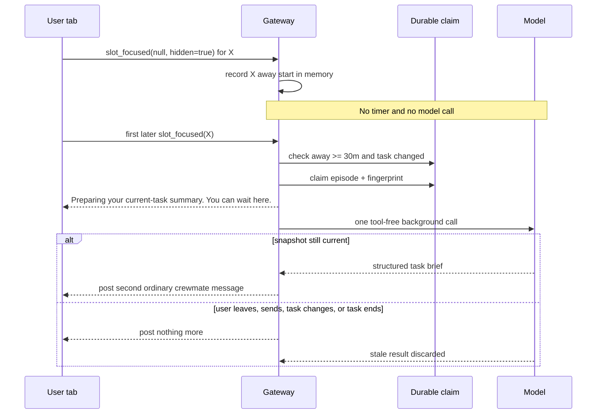

# RFC: Return-triggered warm task brief — replace the immediate warm resume

- Status: `accepted`. Maintainer `iamwhatever` [accepted the direction and explicit-signal false-negative tradeoff](https://github.com/kirodotdev/KiroCrew/pull/20157#issuecomment-6167061835) on 2026-10-14: cold welcome stays unchanged; the user must leave, stay away for at least 30 minutes, and return; the return shows deterministic status before one model call; stale or cancelled work clears that status without publishing its result.
- UX amendment, 2026-10-15: the deterministic preparation and generated summary render as two ordinary crewmate messages, not a card, widget, status banner, or special result row. The second message has **Problem**, **Current status**, and **Suggested actions**. This supersedes the transient-status, unattributed-notice, and silent-invalid-output clauses below.
- UX amendment, 2026-10-16: the first message is a fixed warm opener in first person ("Welcome back, let me catch you up on where we are."), in the script of the user's request; the second is one first-person prose message from the model saying what was asked, where it stands, and one to three suggestions, with no **Problem**/**Current status**/**Suggested actions** headings or lists. This supersedes the three-part shape and gateway-supplied quote of the 2026-10-15 amendment and section 3.5; trigger rules are unchanged.
- Trigger amendment, 2026-10-18: the shipped trigger never fired for the owner. Since #20422 merged, no transcript holds a single claim row. The owner's real return left the crewmate thread for another chat, hid the page there, and opened the crewmate later; section 3.2 counts none of that as away. The amended rules: (1) leaving a thread for another thread starts its away episode, like a hidden page; (2) an episode ends only when an owner frame names that thread again, so frames for other threads, windows, or devices no longer wipe it; (3) a return while the thread runs a turn waits for that turn to end, up to 30 minutes, while the owner stays on the thread, instead of being skipped; (4) a prepared result goes stale only on a new user turn, a new away episode, a reset or replaced slot, or a finished task. Patrol turns, `[work-ledger wake]` rows, and worker reports still change the dedup fingerprint, but they no longer drop a prepared result. A turn running at publication defers the result until it ends. (5) Only a live row the person typed cancels a brief in preparation. Assistant rows, automation rows such as a wake, and turn admission do not. The expected rate is one brief per qualifying return. Patrol cadence adds none; it only makes nearly every such return eligible. The ceiling is 48 per thread per day. The owner's conductor thread on 2026-10-17 had about four returns after 30 minutes or more away, so about four background calls a day. The 30-minute minimum, durable claim, fingerprint dedup, one model call per claim, and the explicit-hidden-signal false negatives are unchanged. This supersedes the "Switch chats", "Hide on X, return on Y", and "worker/task change" rows below.
- Trigger amendment, 2026-10-22: away is time off screen, not a lost leave signal. The 2026-10-18 rules still missed every return after a dropped hide frame or a gateway restart, because the away episode lived only in memory. The amended rules: (1) the gateway keeps, in memory, when each thread was last on screen in any owner view: stamped by an owner frame naming it, an owner frame leaving it, and the close of an owner socket that showed it; (2) an owner frame naming thread X is a return only when no owner view already shows X, so watching a thread, a re-sent frame, and a second window are never returns; (3) away time runs from the latest of that last-on-screen time, the owner's last genuine message, and the last brief claim, the two durable times read from the transcript with naive rows from older builds read as local time; (4) when the process has no on-screen record of X (after a restart, or after the bounded record evicts it), only the durable times count; (5) the frame a socket sends on first connect or reconnect carries `announce: true`, and an announce for a thread with no on-screen record marks it seen now and never briefs, so the reconnect wave after a restart cannot fire a burst; an announce after a recorded absence (a page reloaded after a real leave) still qualifies. A restart while away followed by the tab turning visible is a non-announce frame and briefs from the durable times. Accepted false negatives: a brand-new tab opened after a restart, and a reconnect after sleep, give no brief. The 30-minute minimum, durable claim, fingerprint dedup, one model call per claim, deferral, and stale rules are unchanged. This supersedes the in-memory away episode in sections 3.2 and 3.3 and the "Gateway restarts during away period" row.
- UX amendment, 2026-10-24: the owner found the four-field card too thin to act on. The brief now reads like a manager's report to the owner who hired them: a status and headline first, then what needs the owner, then how far it is from the goal, then what they asked for. Progress (`accepted of total` work items) is counted by the gateway from the ledger, never by the model. The model may add up to two sections of its own for anything else the owner must decide. Section 5.1 holds the shape. Trigger, preparation, spend, staleness and reader-filter rules are unchanged.
- Audited on `d06b611f549d` (`main`, 2026-10-14).
- This amends only the **warm** branch of [rfc-crewmate-greeting.md](rfc-crewmate-greeting.md) and [rfc-crewmate-greeting-as-message.md](rfc-crewmate-greeting-as-message.md). Their cold-welcome decision remains fully in force.

## 1. Problem

The current warm resume appears as soon as a crewmate chat with an open task is opened. It is assembled from fixed client copy and work-ledger counts. It does not begin with the request that caused the work, and it can appear while a newer answer is about to land.

The useful moment is a real return: the user left Kiro Crew, stayed away long enough to lose task context, and came back. Only that return should spend a model call and welcome the user with the original request, current task truth, and the next move.

## 2. Current behavior, verified

When `useMateGreeting` opens a confirmed idle crewmate thread, it immediately reads `GET /api/crew-board`. An open work-ledger item produces `MateResumeCard`, rendered through `ChatPane.crewmateGreeting` as a host-drawn message after the transcript. It uses no model call and writes no transcript row. The same hook takes a separate cold branch only when no goal is in flight.

Kiro Crew already has an owner-gated foreground lifecycle. `attachFocusRelay` sends `slot_focused` over the existing authenticated WebSocket; first connect and reconnect re-announce it through `reconnectCatchUp`; a hidden tab sends `slot: null`; and the server stores one foreground slot per owner connection through `slot_retention.note_foreground`. The Crewmates page separately uses `document.hidden`, `document.hasFocus()`, `window` focus/blur, and `viewedThread` to register a member thread only while it is on screen. `slot_read` is not presence: `_handle_slot_read` is a pure unread-badge relay and stores no read state.

The current foreground seam does not yet express the full return contract. It re-announces `chat.activeSlot`, while a member thread lives in `viewedThread`; it sends blur for a hidden document but not every focus loss or page leave; and it stores no away start. The implementation extends this existing owner presence seam. It does not infer presence from message age, `slot_read`, a client clock, or an ambient “active” flag.

Before this RFC changed anything, focused tests passed on the audited base: 62 backend tests in `test_agent_welcome_message.py` plus `test_mate_welcome.py`, and 45 frontend tests in `mateGreeting.test.ts`, `useFirstGreeting.test.tsx`, and `ChatPane.scrollChrome.test.tsx`. Existing `MembersPage` and WebSocket tests also pin visible/focused `viewedThread` registration, hidden-tab retirement, first-connect focus, and reconnect focus re-announcement.

## 3. Decision

### 3.1 Warm only

Replace only the immediate warm resume. A crewmate chat with an active task no longer draws fixed task status merely because the thread opened.

Every cold-welcome path remains exactly as it is on the audited base:

- `useMateGreeting` still takes the cold branch only when no work-ledger goal is in flight.
- `COLD_AFTER_MS` remains six hours.
- `GET /api/members/{slug}/recap`, `MateWelcomeCard`, its copy, hide action, once-per-idle-stretch rule, failure notice, and user-visible placement remain unchanged.
- `useFirstGreeting`, `POST /api/members/{slug}/greet`, `dashboard.mate_welcome`, the `first_greeting` create flag, and Mate's first model welcome remain unchanged.
- Agent-spec `welcomeMessage` reading, dashboard display, KAS projection, bundled values, and agent-switch behavior remain unchanged.

This RFC does not remove a welcome from a new or cold chat. It changes only the active-task warm resume.

### 3.2 Exact trigger: leave, 30 minutes away, return

A delayed warm task brief is eligible only when all conditions hold in order:

1. The gateway receives `{type: "slot_focused", slot: null, hidden: true}` from the last owner connection whose foreground row names thread X.
2. Thread X stays in that in-memory away episode for at least 30 continuous minutes.
3. The first later owner `slot_focused` frame names thread X; a frame naming anything else ends the episode without a call.
4. On that return, thread X has an open task and a durable original user request.
5. No earlier warm-brief attempt claimed the same durable task fingerprint.

The **return frame** is the trigger. Thirty minutes passing is not a trigger. No periodic timer runs.

| State | Status or model call |
|---|---|
| Page remains visible for 30 minutes or longer | None |
| Page remains visible but window loses focus | None |
| Page remains hidden for 30 minutes or longer | None until a real return |
| User returns before 30 minutes | None |
| Focus event repeats while already foreground | None |
| Another tab already shows the thread | None |
| Switch chats and stay 30 minutes or longer | None |
| Open a non-chat route for 30 minutes or longer | None |
| Leave the New crewmate card open for 30 minutes or longer | None |
| Focus a split-view placeholder pane | None |
| Hide on thread X, return on Y, then open X later | None |
| User returns after 30 minutes, fingerprint already claimed | None |
| First eligible return, or return after task-state change | One claimed warm-brief attempt |

Thirty minutes is the accepted minimum. The implementation names it once as `WARM_TASK_BRIEF_AWAY_SECS = 30 * 60`. It is an away-duration check on a return edge, never a wake timer or repeat cadence.

### 3.3 Trusted presence and multiple tabs

The client extends the existing `slot_focused` frame with one optional reason bit, `hidden: true`. It is valid only with `slot: null`, and only the existing `visibilitychange` hidden branch sends it. The flag says why presence cleared; it supplies no time or duration.

- On a chat route, the presence sender continues to report `chat.activeSlot`.
- On the Crewmates route, a separate mounted-thread presence value reports the confirmed member thread while the document is visible, regardless of window focus. The existing focus-aware `viewedThread` value remains unchanged and serves unread badges only.
- First connect and reconnect use that mounted-thread value on the Crewmates route and `chat.activeSlot` elsewhere, but send no focus frame while `document.hidden` is true. The later `visibilitychange` return sends the real return frame.
- Window focus may re-announce the same slot. Window blur sends nothing. Chat switches, member-thread switches, non-chat routes, the New crewmate card, split-view placeholder focus, page teardown, and socket cleanup keep their existing `slot_focused` behavior but never add `hidden: true`.
- Frames keep the existing WebSocket origin, owner, and app-token checks. The server accepts no client-supplied time or duration.

`document.hidden` is also the sole desktop authority; no native Electron IPC is added. The dashboard's `WebContentsView` leaves `backgroundThrottling` at its default `true`. Electron's [Page Visibility contract](https://www.electronjs.org/docs/latest/api/browser-window#page-visibility) says minimized or explicitly hidden windows report hidden on every platform, and fully occluded windows report hidden on macOS. Therefore macOS minimize, hide-to-tray, and full occlusion can arm; Windows and Linux minimize or `win.hide()` can arm; partial occlusion, side-by-side windows, and unfocused documents that remain visible do not. If a compositor does not report hidden, no brief appears—the accepted explicit-signal false negative.

The implementation pins that controllable premise with an Electron source test that the dashboard view never sets `backgroundThrottling: false`. Release smoke checks minimize and hide-to-tray on macOS, Windows, and Linux; it records platform variance but does not add a second presence authority.

The server updates the existing per-connection foreground registry for every owner `slot_focused` frame. It starts thread X's away episode only when a `hidden: true` null arrives from the last owner connection whose existing row names X. Other nulls, slot replacements, and socket-finally cleanup may clear or replace registry rows for their existing jobs, but they never arm a warm brief.

The gateway stores X's away start and episode generation in memory. The first later owner focus frame ends that episode. It is a return only when it names X; a frame naming Y or null drops X's episode without a call. Return-time gates then require 30 minutes, an open task, a real original request, and a task fingerprint not already claimed. This placement lets a task begin or worker progress land while the user is away.

A normal tab close first fires `visibilitychange` to hidden and sends the hidden-leave while the socket is open. That send remains best-effort. If it is lost, or a crash, power loss, sleep, socket loss, or gateway restart erases the in-memory episode, that return can miss a warm brief. Maintainer `iamwhatever` explicitly accepted those false negatives rather than adding socket-gap inference. The ordinary chat and unchanged cold welcome remain available.

Only the qualifying task fingerprint claim is durable before the visible attempt. Claim-before-preparation prevents duplicate spend across repeated focus, simultaneous tabs, reload, or restart after a return was admitted. Away detection remains in the existing in-memory foreground registry.

### 3.4 Preparation before the model

On an eligible return, the gateway re-reads the durable task snapshot and atomically claims the away episode plus task fingerprint. Only a current, unclaimed snapshot proceeds.

The gateway then posts this deterministic ordinary crewmate message before starting the model call: **“Preparing your current-task summary. You can wait here.”** Producing this message uses no model and no token. It is an `assistant` transcript row tagged `warm_task_brief_preparing`; no new route, listener, status channel, card, widget, or special renderer is added.

The preparing message has one lifecycle:

| Event after preparation | Visible result |
|---|---|
| Model result stays current | A second ordinary crewmate message posts the warm task brief |
| User sends, leaves, resets, closes, or replaces the chat | Stale result is discarded; posted messages stay |
| Worker/task state changes, a new assistant answer arrives, or the task completes/cancels | Stale result is discarded; posted messages stay |
| Model fails, times out, or returns invalid data | A second ordinary crewmate message says “I couldn't prepare the current-task summary.” |

Preparation, result, and failure rows are ordinary crewmate messages. Once posted they stay as ordinary history and follow the normal transcript save path; nothing retracts or rewrites them. A stale result is never posted, so a stale attempt leaves only the preparing message. The fixed preparing and failure lines and the three section headings are English, like other gateway-authored lines; the model writes the current status and suggested actions in the language the user writes in.

There is deliberately no `MateResumeCard` fallback; maintainer `iamwhatever` accepted silence when the explicit leave signal is lost, and cold welcome remains available under its unchanged rules.

### 3.5 Durable input and output

The model prompt snapshot is built on the gateway from existing durable local state:

1. **Original request:** the first genuine user request for the active task, quoted verbatim when it fits the existing transcript-summary user-text bound, otherwise faithfully quoted with an explicit truncation mark. The model never chooses a different origin.
2. **Current task:** the session ledger's `goal`, `phase`, `next`, recent event tail, and artifacts when present; the work ledger's item title, state, worker status, last truthful worker summary, decision, verdict, and artifacts when present; and bounded recent user/assistant transcript turns for context.
3. **Next steps:** one to three actions inferred from that snapshot.

Missing state stays missing. The prompt forbids invented work, progress, percentages, dates, deadlines, elapsed-time claims, and ETAs. Worker transcript text is not read; only the report the worker deliberately wrote to the shared work ledger is eligible.

The model returns a small structured result. The gateway validates it, supplies the exact source quote itself, caps the current-state facts and suggestions, and applies existing display redaction. The visible second message has exactly three parts: **Problem**, which holds the exact original-request quote; **Current status**; and **Suggested actions**. Suggested actions contain one to three self-contained actions for the user. Empty or malformed output produces the ordinary failure message from section 3.4.

Suggested actions are guidance for the user, not reply choices or hidden commands for the crewmate. If the user wants the crewmate to act, their next message states that action in their own words. The generated brief stays out of model replay even when the reply refers to it: admitting model-written suggestions as new model evidence would let generated claims become task truth and recursively ground later work.

A successful brief is a durable `assistant` transcript row tagged `warm_task_brief_result`, rendered through the ordinary crewmate-message path and attributed to the selected crewmate. Role `assistant` is required by that ordinary path: a distinct role would need the card-like or special result renderer this amendment removes. Preparation, result, failure, and claim rows are excluded from task fingerprints, session summaries, model replay and recall, history consolidation, compaction evidence, auto-nudge evidence, metadata-stripping recent projections, and session transfer, so generated speech cannot become new task truth or feed another model call. Every transcript-to-model or metadata-dropping reader applies the shared `is_warm_task_brief_message` predicate from `warm_task_brief_contract.py` before it removes `meta`; focused tests feed generated rows through replay, recent projection, transfer, consolidation, compaction, and nudge readers and fail if any one admits them. Existing redaction runs before persistence. The durable claim and row fingerprint prevent reload from regenerating or duplicating it.

### 3.6 One bounded model call

The warm task brief uses `llm_helpers.run_bg_oneliner` with the governed background model, a bounded prompt, a bounded output, a timeout, and no tools. This is the existing model path: no new provider, endpoint, listener, bind, ingress rule, credential path, or third-party data send is added.

Each completed or failed attempt is charged to the owning session as `warm_task_brief` background work, using the existing input-token, output-token, credit, and duration accounting. The Usage view and crew log therefore show the spend.

The old warm resume used no tokens. The replacement can spend one background model call on one eligible return for each materially changed task snapshot. It spends nothing while visible, while hidden, on a short return, on repeated focus, when another tab remains foreground, for cold welcome, for unchanged state, for terminal work, or for a duplicate claim.

### 3.7 Deduplication, cancellation, and stale results

A canonical task fingerprint covers the original-request identity, the latest genuine user or assistant task row, session-ledger revision, and work-ledger report revision. It contains hashes and sequence values, not copied user text. Preparation, result, and failure rows are explicitly excluded, so publishing a brief cannot make its own task look changed.

Before posting the preparing message or calling the model, the gateway atomically claims the task fingerprint in the transcript and consumes the in-memory away episode. Claim-before-message means repeated focus, two returning tabs, reconnect replay, or gateway restart cannot show two attempts or spend twice on the same task snapshot. A crash after the claim may lose that brief, but cannot loop and spend again while nothing changed.

A later hidden-leave → 30 minutes away → return cycle is eligible only when its task fingerprint differs from the last claimed attempt. No previous claim makes the first eligible return valid. A new user message or worker event can change the fingerprint, but does not itself trigger a call; the next qualifying return does.

The gateway rechecks the foreground episode, slot identity, task fingerprint, and terminal state before preparation, before the model call, and before publication. Any mismatch discards the result; messages already posted stay. Once model acquisition starts, cancellation lets the governed call finish and publication suppression discards any stale output afterward.

## 4. Timing

## 5. User-visible shape

Before this change, opening an active-task chat shows the immediate fixed warm resume.

| Scenario | Result after change |
|---|---|
| Open active-task chat | No immediate warm resume |
| Stay on page for 30 minutes | No new warm welcome |
| Leave window unfocused but page visible | No away episode and no warm welcome |
| Stay away for 30 minutes | No work while away |
| Return after 30 minutes, changed task | Preparing message, then one grounded crewmate message |
| Return after 30 minutes, unchanged task | Nothing |
| Tab/browser close, crash, or sleep sent no leave update | No warm brief; accepted false negative |
| Gateway restarts during away period | No warm brief; accepted false negative |
| Candidate changes after preparation | Preparing message stays; stale result never appears |
| Open cold chat | Unchanged cold welcome |

### 5.1 UX amendment, 2026-10-22: structured brief card

The owner found the one-paragraph prose result tiring to read, with no focus. The result is now structured fields drawn by a fixed card. This supersedes the "not a card, widget, ... or special result row" clause of the 2026-10-15 amendment, the one-prose-message shape of the 2026-10-16 amendment, and the "no card or special renderer" wording of section 3.5. Trigger, preparation, spend, staleness and reader-filter rules are unchanged.

- The model returns JSON with four plain-text fields: `asked`, `now`, `needs_you[]` and `next[]`. Each is redacted, has chat control markers (`[OPTIONS:`, `[STEERING`, `<!--`) defanged so no reader of `content` can turn a field into send buttons or chips, and is length-capped by the gateway. `meta.brief` holds the fields. `content` holds the same brief as labelled plain text, for export and any reader without the card.
- The card is the body of the ordinary assistant bubble (`AssistantMessage`'s `body` prop), drawn in place of the markdown. It shows every field as a plain text node: never markdown, HTML, a link or a button.
- Only an `assistant` row draws the card. Any other role carrying `meta.kind: warm_task_brief_result` draws as an ordinary row of its own role, so a user row can never pass as the crewmate's brief.
- The row keeps the timestamp and row actions of any assistant reply: Copy (the plain-text `content`), Quote and Reply in thread. The raw-markdown toggle is hidden on brief rows, since no markdown is on screen.
- A brief row without a valid `meta.brief` (an older prose brief) keeps the ordinary markdown bubble.

**Amendment, 2026-10-24: a manager's report.** The four fields above are replaced. The prompt casts the model as a professional manager reporting to the owner: lead with whether it is on track and what needs the owner, remind them what they asked, say how far from the goal in real terms, no filler, no retelling the transcript, never an invented number. The redaction, defang, cap and plain-text rules above apply to every new field.

| Field | Source | Limit |
|---|---|---|
| `status` | model; `on_track`, `needs_you`, `blocked` or `done`. Anything else reads as `needs_you` when `needs_you` has items, else `on_track`; `on_track` or `done` beside `needs_you` items reads as `needs_you` | one word |
| `headline` | model; required. An older `now` or prose `message` reads as it | 240 chars |
| `asked` | model; falls back to the gateway-quoted original request | 160 chars |
| `progress` | **gateway**: `{accepted, total}` over the current goal's work items (after a `new_goal` write, only the items it created); left out when there are none or the goal's items cannot be told apart. Model numbers are ignored | — |
| `remaining` | model; what is left before the goal is met | 160 chars |
| `done` | model | 4 items |
| `needs_you` | model; each the action plus what it unblocks | 3 items |
| `next` | model | 3 items |
| `extra` | model; `{title, items}` sections for a risk, a cost or a choice; empty ones dropped | 2 sections, 3 items each |

The card draws them in that reading order: status chip and headline, Needs you (highlighted), Progress (a bar only when `progress` exists, plus `remaining`), What you asked, Done, Next, then the `extra` sections. `content` carries the same order as labelled plain text. An older `meta.brief` (`asked`, `now`, `needs_you`, `next`) still draws, `now` as the headline, with no status chip.

## 6. Spend and privacy

Prompt input can include the user's original request, bounded transcript excerpts, session-ledger state, and shared work-ledger reports. All input stays within the model provider and account already configured for Kiro Crew. No project code, transcript, ledger, credential, or user data is sent to a new service. Existing transcript privacy modes still win; an incognito or otherwise derivation-withheld transcript is ineligible.

The implementation PR body must repeat this spend statement, name the 30-minute away threshold, state that return is the only trigger, and state that the deterministic preparing message costs no model call.

## 7. Authorization and exposure

This change adds no route. It extends an existing owner-only WebSocket presence frame and its server registry. Existing WebSocket origin checks, dashboard authentication, owner/audience checks, app-token denial, transcript privacy checks, provider authorization, and model governance remain unchanged. No listener, public bind, port publication, ingress rule, storage ACL, or auth bypass is added or weakened.

The source fingerprint and durable claim are gateway-owned derived state. They contain no raw request or ledger text, use owner-only storage, follow transcript purge/reset rules, and are never served as an authorization input. The away start stays in memory and is never written.

## 8. Validation

The implementation uses focused tests only.

- A before/after test proves an active-task chat emits no immediate warm resume.
- Existing cold-welcome tests remain unchanged and pass, proving every cold path and visible behavior stayed intact.
- **Visible for 30 minutes or longer:** no message and no model call.
- **Visible but window-unfocused for 30 minutes or longer:** no away episode, message, or model call.
- **Hidden for 30 minutes or longer before return:** no message and no model call.
- **Return before 30 minutes:** no message and no model call.
- **Duplicate focus or multiple tabs:** one return edge, one preparing message, and one model call.
- A return-boundary test proves the deterministic preparing message is persisted and visible before `run_bg_oneliner` starts and costs no model call itself.
- A result test proves **Problem** contains the exact original request, **Current status** stays truthful, and **Suggested actions** contains one to three user-owned actions.
- A state test runs two qualifying away/return cycles with no external task change and proves one model call: generated task-brief messages never alter the fingerprint.
- Race tests prove a user send, a second leave, worker/task change, newer assistant answer, completion, or cancellation suppresses the stale result.
- Message tests pin ordinary crewmate rendering and the exact failure text.
- Lifecycle tests prove reload, reset, close, slot replacement, timeout, model failure, and invalid output post no stale result; a gateway restart during away loses the in-memory episode and makes no call.
- Reconnect tests prove a hidden first connect/reconnect sends no focus frame and cannot return; the later visible transition sends the only return frame.
- Presence tests prove chat routes report `chat.activeSlot`; the Crewmates page reports a separate visible mounted thread regardless of focus; focus-aware `viewedThread` remains unread-only; only `slot_focused(null, hidden=true)` from the last connection arms away; app sockets cannot arm it.
- Negative presence tests prove chat/member switches, non-chat routes, an open New crewmate card, split-view placeholder focus, and socket cleanup create no episode or call; hiding on X then returning on Y consumes X's episode, so opening X later makes no call.
- Electron tests pin that the dashboard view does not set `backgroundThrottling: false`; release smoke checks minimize and hide-to-tray on macOS, Windows, and Linux, while occluded-but-visible and unfocused windows make no synthetic signal.
- Privacy and security tests prove derivation-withheld transcripts are skipped, the call is tool-free, existing auth is unchanged, and no new network surface exists.
- Run targeted backend and frontend tests plus lint and type checks for touched packages; do not run the full pytest suite.

## 9. Rollout and undo

1. Merge this RFC first, with `status: accepted`, so the implementation reads the decision from its base.
2. Land one implementation PR for the warm branch, trusted return detection, an in-memory away episode, a durable return claim, two ordinary crewmate messages, focused tests, system docs, locale cleanup, and spend statement.
3. Do not use a First Principles override. Do not merge the implementation until PR Readiness is green.

Undo is a two-release rollback because ordinary `assistant` rows outlive feature code. First disable new generation while retaining `warm_task_brief_contract.py` and every reader filter, then rewrite every tagged preparation, result, and failure row to an empty display-only `notice` claim under its existing row id. Only after that migration is durable may a second release remove the filters, return detection, and model call and restore the immediate warm resume. The cold branch never changes; in-memory away state disappears with the process.

## 10. Non-goals

- Changing any cold-welcome trigger, read, copy, component, placement, failure state, repeat rule, or user-visible result.
- Changing Mate's first welcome, dashboard-created crewmate greetings, or the greet route.
- Changing custom-agent `welcomeMessage` behavior or KAS projection.
- Calling an LLM because 30 minutes passed.
- Running a periodic 30-minute timer.
- Calling an LLM while the page is visible, while it is hidden, or on a return under 30 minutes.
- Adding a new model provider, external service, route, listener, auth path, or data destination.
- Inventing progress, percentages, deadlines, or ETAs.

## 11. Alternatives considered

- **Thirty-minute idle timer.** Rejected: idle is not return. It would spend while the user stayed on the page or was still away.
- **Client-supplied away timestamp.** Rejected: tabs and clocks disagree, and the gateway already owns authenticated per-connection foreground state.
- **Treat socket disconnect as leave.** Rejected: a network outage is not proof the user left.
- **Use `slot_read` as return.** Rejected: it is a throttled, best-effort unread relay and stores no presence.
- **Delay the fixed warm card.** Rejected: it still lacks the original request and cannot explain the task in current terms.
- **Start the model before the preparing message.** Rejected: the user would see an unexplained wait, and a message that appears later would lie about when work began.
- **Retry a claimed return.** Rejected: automatic retry can repeatedly spend while nothing changes. A changed task and a new qualifying away/return episode are the retry boundary.

## 12. Decision record

Accepted by maintainer `iamwhatever` on 2026-10-14 in [the maintainer decision comment](https://github.com/kirodotdev/KiroCrew/pull/20157#issuecomment-6167061835), with these terms: warm only; cold unchanged; leave, at least 30 minutes away, then return as the sole trigger; no visible-idle, hidden, short-return, periodic, socket-gap, or reconnect inference; silence is accepted when sleep, restart, or network loss loses the explicit leave signal; deterministic visible status before the model call; stale/cancelled results suppressed with status cleared; original request, current state, and one to three next steps in the warm welcome; durable dedup and no-repeat spend rules retained.

Amended by the user's 2026-10-15 UX decision: preparation and result are two ordinary crewmate messages; the result sections are **Problem**, **Current status**, and **Suggested actions**; failure is an ordinary second message; posted messages stay as ordinary history and a stale result is dropped unposted; and the reader filters and two-release rollback above keep generated speech from becoming model evidence.

Amended by the owner's 2026-10-22 UX decision (section 5.1): the result is structured plain-text fields drawn by a fixed card as the body of the assistant bubble, on assistant rows only, with the timestamp, Copy, Quote and Reply in thread kept and the raw-markdown toggle hidden.
