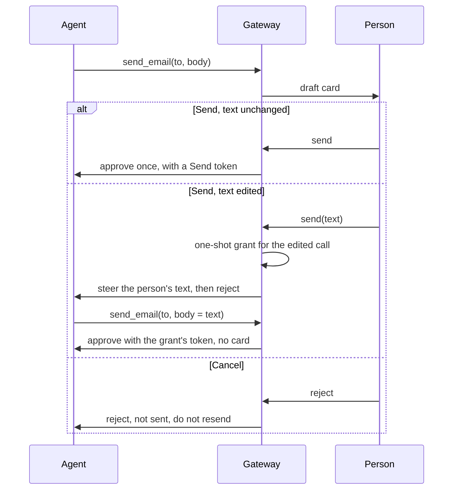

# RFC: A Draft Card Before an Agent Sends a Message for the Person

> **Status:** `draft`. Nothing is built. Acceptance is requested from a
> maintainer. The status moves to `accepted` when one records it in section 12
> with the date. Every claim about the code was checked against main at
> `1b60933075`. This document lands first because it changes what Trust, YOLO,
> an `auto` cron and the standing grants approve for a listed set of tools, and
> the First Principles lane reads that decision from the base branch.

## 1. Summary

When an agent calls a tool that sends a message for the person (an email, a
Slack post), Kiro Crew shows a draft card in the chat before the tool runs. The
card shows where the message goes and its text. The person can edit the text,
then press Send, or press Cancel. A listed tool sends nothing before the person
presses Send, in every approval mode, Trust and YOLO included.

The list is a small reviewed set of `(server, tool, text field)` rows plus the
rows the owner adds in Settings. A call matches a row only by its verified MCP
identity.

Two parts hold the rule. Every site that answers a permission request holds a
listed call: no grant approves it, a dashboard chat shows the draft card, and in
Phase 1 every other surface refuses the call. Under them, the transport refuses
to approve a listed call unless the approval carries the token a Send press
minted, so a path that forgets the hold still sends nothing.

The card cannot change a call in flight. The ACP answer to a permission request
selects one offered option and carries no arguments
(`acp/client_permissions.py`). So Send with an edit rejects the first call, hands
the person's text back to the agent, and lets exactly one matching call through
with no second card. A call that differs from what the person approved gets a
new card.

## 2. Motivation

### 2.1 What main does today

| Part | What it does for an outgoing message | Gap |
|---|---|---|
| Tool approval card (`_on_permission_prompt` in `dashboard/chat_turn/permission_prompt.py`) | Shows the tool and its arguments, with Allow once, Trust and Reject | No edit. Not shown when a grant answers first |
| The approval sites (section 6) | Seven sites answer most permission requests, and a few other paths (the terminal chat, webhook turns, the task planner) approve without them. Between them, Trust, YOLO, an `auto` cron or workflow step, trusted patterns, the hook auto-approve list, the per-tool Always allow grant (`hooks.auto_approve_tool_identities`) and native crew approve a call with no card | A Bot's thread opens in Trust ([rfc-crewmate-profile-settings](rfc-crewmate-profile-settings.md)), so a Bot's email goes out unseen |
| `hooks.confirm_tools` ([mcp.md](../architecture/mcp.md#servers-the-operator-asked-to-confirm)) | Withholds the static grants of named MCP tools, so each call reaches the gate | A session in Trust or YOLO still approves the call. No edit |
| A held rule (`mate_held_rules`) | All seven sites read `held_for`. A call a moved Bot's limit covers is never approved without a person: it goes to the approval card, and a surface with no card refuses it | Only for a moved Bot's limits. No edit |
| MCP elicitation (`acp/elicitation.py`) | A server can put a form to the person. A string field can carry a default the person edits, and no trust tier answers it | Only the server can start it. Kiro Crew cannot make a third-party server ask |
| Slack `review` activation (`review_draft_blocks` in `slack/blocks.py`) | Before the bot posts its reply in a tracked channel, the person gets a private draft with Approve, Manual Override (edit), Refine with AI and Cancel | Slack channel replies only. It is not a tool call and not the dashboard |
| Message-body fields (`security/mcp_body_fields.py`) | Names the body field of common mail and message tools, matched on the call's verified server and tool | Used by the input scan only |

The parts exist, but apart. The gate can tell a send tool by its verified
identity. Every approval site already reads one per-call hold. The elicitation
card can edit a text default. The deny-override card already treats every answer
but its own as a refusal (`deny_override.override_decision`). No path joins them.

### 2.2 The problem

An agent can send an email or a Slack post from the person's own account with
nobody looking: in a Bot thread (Trust by default), under YOLO, in an `auto`
cron run, or after one Trust click on an earlier call. When the person does see
the approval card, the choice is all or nothing. To fix one sentence they reject
the call, type the fix and wait for the agent to try again.

A sent message cannot be taken back, and the person's colleagues read it as the
person's own words.

## 3. Goals

- A call to a listed send tool shows a draft card before it runs, in every
  approval mode. Where no draft card can be shown, the call is refused.
- The person can edit the message text, then Send, or Cancel.
- What goes out is the call the person saw, or that call with the exact text the
  person typed. A listed tool sends nothing else.
- Only the owner's dashboard can add a tool to the list or turn a row off. The
  agent cannot.

## 4. Non-goals

- Sends that are not a listed MCP tool call: a shell command (`curl` to an API),
  the browser, computer use, an unlisted server.
- A grant written outside Kiro Crew that answers the call before it reaches the
  gate, such as a KAS `permissions.yaml` rule or an `allowedTools` entry in an
  agent file Kiro Crew does not write. Section 9 names this residual.
- Editing the recipients, the subject or the attachments. The card shows them
  read-only.
- Rich text editing. An HTML body, or one over the edit cap, is read-only.
- The agent's own replies in a channel. Slack's `review` activation covers a
  tracked Slack channel today.
- Saving a mailbox draft or scheduling a send.

## 5. Design

### 5.1 The list

A new module, `security/draft_send.py`, owns one list of rows
`(server, tool, field)`. `field` is the top-level argument that holds the
message text.

- **Default rows.** The rows of `mcp_body_fields.DEFAULT_BODY_FIELDS` whose tool
  sends: `gmail/send_email/body`, `outlook/send_email/body` and
  `slack/post_message/text`. Its `draft_email` and `create_page` rows send
  nothing and are not drafts. A server name is the name the person gave the
  server in their MCP config, so a default row matches only the usual name.
- **Owner rows.** Stored in `draft_send_tools.json` in the data home and read
  only by the gateway. The only writer is an owner-gated dashboard route (5.6),
  and no MCP tool reads or writes the file. Like `mcp_body_fields.json`, the leaf
  is precreated as `{}` (which reads as the default rows, all on), mounted
  read-only in the sandbox and rewritten in place
  (`atomic_write.rewrite_in_place`), so the seal keeps holding the same file and
  the agent cannot take its own drafts away. Phase 1 registers it where that file
  is registered: `sandbox_leaves.py`, `sandbox_precreate.py` and
  `security/paths_lists.py`.
- **Matching.** A row matches only when the call's identity is verified
  (`mcp_identity_trusted`) and its server and tool equal the row's. A same-named
  tool on another server, or an identity read from the payload, matches nothing.

A call that only its title or an unverified identity names as a listed tool, in
any spelling `hooks.confirm_tools` matches (`@server/tool`,
`Running: @server/tool`, the title and its normalized form), is still never
auto-approved. It gets the ordinary approval card with a line saying Kiro Crew
could not check which tool it is, and no edit.

A list file that cannot be read is unknown, as an unreadable `hooks.confirm_tools`
list is. Until the file reads again, no MCP call takes an auto-approve rung, the
static writers withhold every MCP grant, and the default rows still take the
draft card.

### 5.2 Where the rule holds

1. **Every approval site holds a listed call.** The seven sites that read
   `mate_held_rules.held_for` today read the list beside it:
   `_decide_permission_request` (`dashboard/chat_turn/tool_approval.py`),
   `tool_permission.settle`, `_resolve_permission`
   (`llm_helpers_parts/tool_approval.py`), the channel driver
   (`messaging/driver.py`), the native Slack ladder
   (`slack/handler_runtime/permission_ladder.py`), the background approval
   callback (`slack/gateway_runtime/turn_approvals.py`) and Agent Channels
   (`channel.py`). A listed call is held the way a held rule is: no rung approves
   it on its own. An `auto` cron or workflow step, Trust, YOLO, a trusted
   pattern, the hook auto-approve list, Always allow and native crew all leave it
   to a person. Unlike a held rule, it never reaches a plain approval card. The
   dashboard chat site draws the draft card. In Phase 1 every other site refuses
   the call, with a notice that the message waits for a draft card in a
   dashboard chat (section 6). The terminal prompt of `kirocrew chat`
   (`cli_chat.py`) reads no hold today. It asks the person, then approves, so it
   reads the list too and refuses a listed call before it asks.
2. **The transport refuses an approval with no Send behind it.** `AcpClient` and
   `SessionHandle` are the two transports that can write an allow, and both call
   `permission_floor.refusal_for` inside `approve_tool`. The floor refuses to
   approve a listed call unless the approval carries a Send token that names the
   session, the verified `server/tool` and the params digest. The dashboard hands
   the token to `approve_tool` as it hands deny waivers today
   (`client_accepts_deny_waivers`). A path that writes an approval without
   reading the hold (the plain approve in `AcpClient._handle_permission`, webhook
   turns in `dashboard/handlers/hooks.py`, the task planner) therefore sends
   nothing. Its approval becomes a rejection, recorded as
   `rejected_transport_floor`.
3. **The gate's grant tiers.** The hook gate gives a listed call no grant, as
   `gate_tiers._operator_confirms` already withholds grants from a
   `hooks.confirm_tools` match.
4. **Static grants.** The withholding sits beside
   `_operator_requires_confirmation`, which both `may_skip_gate_now` and the KAS
   per-session `may_skip_gate_for_session` call, so no `allowedTools` or
   `autoApprove` writer grants a listed tool. As with `hooks.confirm_tools`, a
   whole-server grant on a server with a listed tool is withheld too, because it
   covers the listed tool. The server's other tools then ask at the gate, where
   Trust, Always allow and the other grants still answer them. A call that a
   stale static grant pre-allows raises no permission request, so layers 1 to 3
   never see it. 5.6 says how a list change reaches the specs.

Each grant the hold skips is recorded in the SEL as `auto_approve_declined`, with
reason `draft_send` and the tier. That covers every tier the hold skips, more
than `_audit_card_turn_decline` records for a card turn today (the hook and trust
tiers only).

### 5.3 The card

The card sits where the tool approval card sits, in the composer's approval
slot. It shows:

- the kind and the tool from the verified identity, for example
  "Email · outlook / send_email";
- every other top-level argument, read-only (to, cc, subject, a channel, an
  attachment);
- the message text in an editable box, filled with the agent's text;
- Cancel and Send. It has no Trust menu and no Always allow.

The text box is editable only when all of these hold. Otherwise the text is
read-only, and Send still sends it as written.

- The field holds a string of at most `STRING_VALUE_MAX_CHARS` (10,000)
  characters, the bound the elicitation card puts on a typed answer.
- The string holds no HTML tag.
- The backend takes a notice in the running turn (`supports_refusal_steer`,
  which the backends in `ACP_BACKENDS_STEER` report: Kiro CLI and KAS today), so
  the edit can reach the agent (5.4).

Send is offered only when the person can see every byte the call would send. The
card offers Cancel only, and says a part is hidden, when:

- display redaction changed the call's input (`tool_input_redacted`), or the
  redactors change a shown value;
- the call's params did not come from a frame the client parsed
  (`raw_params_trusted` is false).

The card applies this today to a command-scoped trust grant only
(`trust_command_grantable`): a person cannot consent to bytes they cannot see. A
draft applies it to every Send.

A draft waits as long as an approval card waits, and it alerts the person the
same way. When nobody answers in that window, the call is declined as an
unanswered approval is today. Other surfaces that list the approval (the bell
and its channel bridge, a Bot's needs-you row, a linked Slack copy) point at the
card and offer no Send.

After a decision the card leaves one line. Send with no edit leaves "Sent". An
edited Send leaves "Your edit went to the agent" once the steer is written, which
becomes "Sent with your edits" when the grant is used and "Not sent" when it
expires. Cancel leaves "Cancelled". The tool row of a call an edit replaced reads
"Replaced by your edit".

### 5.4 What each answer does

- **Send, text unchanged.** The call is approved once, with a Send token for
  exactly this call. An edit that leaves the text as it was counts as unchanged.
- **Send, text edited.** The gateway drops control characters other than newline
  and tab from the text once, and the same string goes into both the notice and
  the grant. It records the grant, steers the notice into the running turn, and
  only once the steer is written rejects the call. When the steer is not written,
  the call stays waiting, and the card says the edit could not reach the agent
  and offers Send as written and Cancel. The notice has its own wording.
  `_steer_policy_notice` always builds its text with `build_refusal_steer_notice`,
  whose fixed half says a denial was not the person's action, so the draft steers
  its own text. It says the person edited the message, and asks the agent to
  call the same tool again with the same arguments and this exact text. It fits
  under `MAX_STEERING_TEXT_CHARS` (64,000). The grant names the session, the
  verified `server/tool`, and a SHA-256 of the canonical JSON of the expected
  params (the call's own params with the text field replaced). It is used once
  and lasts 10 minutes. The next call that matches is approved with the grant's
  token and no card, after the deny tiers judge it. A call that does not match
  (another word, another recipient, another tool) gets a new draft card, which
  shows what that call holds.
- **Cancel.** The call is rejected. On KAS, where the request offered a one-time
  Deny (`takes_rejection_reason`), the rejection reason (at most
  `REJECTION_REASON_MAX_CHARS`, 1,000) says the message was not sent and must not
  be sent again unless the person asks. On another backend in
  `ACP_BACKENDS_STEER` the same line goes in a steer with that draft wording, not
  the policy notice. On any other backend, its own "user denied" answer is
  already true.

Neither answer arms the batch-rejection cascade (`slot._batch_rejected`): each
draft is its own decision, and the person refused no other call.

A draft settles only on its own results, `sent` and `rejected`, as a
deny-override card settles only on its own actions
(`deny_override.override_decision`). Every other result is a rejection, a plain
`approved` included: a Trust or YOLO sweep, a click on a linked Slack copy,
another surface's one-shot approve. In `apply_approval_mode`, the slot sweep
(`_sweep_pending_approvals`) skips a draft as it skips an elicitation or a
deny-override card today. The background and Agent Channel sweeps beside it skip
nothing today, and they gain the same skip. `resolve_approval` and
`resolve_slot_approval` refuse `approved=True` for a draft. Even a path that
settled one wrongly would send nothing, because its approval carries no Send
token (5.2).

### 5.5 Who may decide

A draft is decided by two verbs only: `send`, with an optional `text`, and
`reject`. Both go to the owner-bound native target of
`POST /api/chat/slots/{slot}/approve` (`origin: "native"` with the card row's
`request_mid`), which names the request a card showed. The request id alone
does not: two sessions can hold the same id, and a stale card's id can name a
newer request (`bare_approval_decide_allowed`). `send` also carries the params
digest the card showed. The gateway mints the Send token only when that digest
equals the waiting call's, and otherwise answers 409 `draft_changed`. A bare
`approve`, the trust verbs on that route and the id-only
`POST /api/approvals/{id}/{action}` answer 409 `draft_needs_send` for a draft, so
a surface that did not show the text cannot approve it.

`send` is open to whoever may decide an approval card on the owner's dashboard
(`is_owner_dashboard_request`). That is the owner and, while Shared Crew roles
are off, every admitted teammate, as the decision
[2026-11-01-shared-crews-give-each-person-one-role](../decisions/2026-11-01-shared-crews-give-each-person-one-role.md)
records. With roles on, the person's role sets that right. An app token and an
internal caller are refused with 403, because neither is a person. Open question
2 asks whether Send should be the machine owner's alone.

Every decision is written to the SEL as `draft_send`, with the outcome (`shown`,
`sent`, `sent_edited`, `cancelled`, `declined_unanswered`, `refused_no_card`,
`hidden_text`, `grant_used`, `grant_expired`), the verified `server/tool` and the
params digest. The message text is never logged.

### 5.6 Settings

Settings > Security gets one section, "Drafts before sending", beside "Message
body fields". It lists the default rows and the owner's rows, each with a switch.
Add picks a connected server, one of its tools and one of that tool's string
arguments from its input schema, so the owner never types a field name. The
routes are `GET`, `POST` and `DELETE /api/security/draft-send-tools`, gated by
`is_owner_dashboard_request` like `/api/security/mcp-body-fields`.

A list change reaches the sites in two ways. The holds, the gate and the
transport floor read the list at each call, so a row turned on holds the next
call. A static grant lives in the agent spec, so a row turned on also runs the
spec rebuild a server enable runs. A static grant is read when a session starts,
so a session already running can keep the old grant until it restarts. Settings
says so, as `hooks.confirm_tools` reports `restart=True`.

Turning a row off or removing it lets that tool's calls be approved without a
draft again. That write is recorded in the SEL as critical before it lands, and
it does not land when the record cannot be written, as the body-field add route
(`api_mcp_body_fields_add`) already does.

## 6. Where the draft shows

| Where the call runs | Site | Phase 1 | Phase 2 |
|---|---|---|---|
| A dashboard chat, a Bot thread and its worker, a harness-native sub-agent whose approvals reach the parent's card | `_decide_permission_request` | Draft card | Draft card |
| A background run: a cron job, a heartbeat, a nudge loop, a sub-agent run, a task-runner task, a workflow step | `tool_permission.settle`, `_resolve_permission`, and the background approval callback they ask | Refused | The callback's dashboard copy becomes a draft card. Its Slack DM copy offers no Send |
| A channel turn, Slack included (`messaging.use_transport` is on by default) | `messaging/driver.py` | Refused | Slack shows the whole text, split across blocks when it is long, with Send, Edit (a modal) and Cancel. Another channel shows the whole text with Send and Cancel where its prompt can show it, else refuses |
| A Slack turn in a `review` channel, or with `messaging.use_transport` off | `slack/handler_runtime/permission_ladder.py` | Refused | As Slack in the row above |
| An Agent Channel | `channel.py` | Refused | Refused |
| A terminal chat (`kirocrew chat`) | `cli_chat.py`, which asks in the terminal and then approves | Refused before it asks | Refused |
| A path that reads no hold: the plain approve in `AcpClient._handle_permission`, webhook turns, the task planner | None. The transport floor | Refused at the transport | Same |

Every site but the dashboard chat refuses in Phase 1. The background callback
answers yes or no, so it cannot carry an edit. The approval prompts of most
channels other than Slack do not show a tool's arguments
([#32904](https://github.com/kirodotdev/KiroCrew/issues/32904)), so the person
could approve text they never saw.

## 7. Migration plan

Each phase is one pull request and can be dropped on its own.

**Phase 1: the dashboard draft card, and a refusal everywhere else.** It holds
`security/draft_send.py`, and the hold at the seven sites and the `kirocrew chat`
prompt. It adds the Send token
at `permission_floor.refusal_for`, and the gate-tier and static-grant withholding
beside `_operator_confirms` and `_operator_requires_confirmation`. It adds the
card, its notice and the `send` verb, the draft-only results and the sweep
skips, the Settings section and its rebuild, the SEL records, the sandbox
registration of `draft_send_tools.json`, and the new catalog keys in every
language. It lands after
[#36150](https://github.com/kirodotdev/KiroCrew/pull/36150), which redesigns the
approval card, and uses that card's status pill and receipt line. Exit, each one
a test:

- a listed call reaches the draft card in a `trust` slot, under YOLO and under an
  Always allow grant;
- at each of the other six sites and the `kirocrew chat` prompt, a listed call
  under that site's most open mode (an `auto` cron, Trust, YOLO) is refused with
  the notice before anyone is asked, and an `approve_tool` call with no Send
  token is refused at the transport;
- Send with no edit approves once. Send with an edit steers, rejects, then
  approves the matching call with no second card, and a call with one changed
  byte gets a new card. A steer that is not written leaves the call waiting. On
  a backend outside `ACP_BACKENDS_STEER` the card offers no edit;
- a used grant, and one older than 10 minutes, approve nothing;
- a switch to Trust or YOLO (slot, background and Agent Channel sweeps), a click
  on a linked Slack copy and `resolve_approval(..., True)` leave a waiting draft
  unapproved;
- `send` on a stale card, or with a digest that differs from the waiting call's,
  sends nothing, and two sessions that wait under the same request id are each
  decided from their own card;
- a redacted value or untrusted params offer no Send, and an over-cap or HTML
  body is read-only;
- `approve`, the trust verbs, the id-only route, an app token and an internal
  caller are refused, and a teammate follows the Shared Crew rule in 5.5;
- an unanswered draft declines at the approval window;
- `may_skip_gate_now` and `may_skip_gate_for_session` are false for a listed
  tool and for its server's whole-server grant, and a row turned on while its
  server is mounted rebuilds the spec;
- an unreadable list leaves no MCP call an auto-approve rung;
- a sandboxed agent can neither create nor write `draft_send_tools.json`;
- a row turned off restores today's behaviour for that tool.

**Phase 2: drafts outside the dashboard chat.** Each site that refuses in Phase 1
gets a draft where it can show the whole text: the background callback's
dashboard copy first, then Slack, with an Edit modal built like review mode's.
`review_draft_blocks` cuts its text at 3,000 characters, so the Slack draft
splits the text across blocks instead. Each other channel waits for #32904 until
its prompt can show the text. Exit, per site: a listed call under its most open
mode reaches the draft, and the draft carries the whole text.

**Phase 3: Kiro Crew's own `send_message`.** A send that names other people (an
explicit Slack `channel` or `user`, or a `channel_type` with a `target_id`)
becomes a draft. A send to the owner's own DM, the bell or the calling
conversation does not. Blocked on open question 3.

## 8. Backward compatibility

Breaking, for calls to the three default rows only. Today a call to
`gmail/send_email`, `outlook/send_email` or `slack/post_message` runs with no
card in a Trust or YOLO session, under an Always allow grant, in an `auto` cron
or a workflow step, or on a static `allowedTools` or `autoApprove` grant. After
Phase 1 it waits for the person's Send in a dashboard chat, and it is refused
everywhere else.

- A cron job, a workflow step, a Slack turn, a channel turn or a `kirocrew chat`
  turn that sends through one of them is refused. A dashboard chat with nobody
  watching declines it when nobody answers. The owner turns that row off to keep
  today's behaviour.
- A server with a listed tool loses its whole-server static grant, so its other
  tools ask at the gate in a chat that is not in Trust, as a
  `hooks.confirm_tools` pattern already makes them ask. Always allow on a read
  tool lets it run with no card again.
- An Always allow grant already stored for a listed tool stays in Settings, but
  it no longer approves that tool.

Nothing changes for a server name the list does not hold, and
`mcp_body_fields.json` is unchanged.

## 9. Security considerations

- **Only two things approve a listed call:** the Send press on the card that
  showed it, and the one-shot grant that Send left. Both reach the transport as a
  Send token, and the transport refuses an approval of a listed call without
  one, whichever site wrote it.
- **A draft settles only on its own answers.** A Trust or YOLO sweep, a linked
  Slack copy or another surface's approve cannot settle it as sent. A Send names
  the card it was pressed on and the params digest that card showed, so it
  cannot send another session's draft or a call the card did not show.
- **The grant is narrow.** It holds one session, the verified `server/tool` and
  the exact params, for one use and 10 minutes. The deny tiers and governance
  still judge the call it lets through.
- **No hidden bytes.** Send needs every byte of the call to be shown. A masked
  value, or params not read from a parsed frame, leave Cancel only.
- **The person's text goes to the model.** These are the person's own words, so
  they add no untrusted input. A model that ignores them and sends other text
  meets a new card.
- **The list is the owner's.** The agent cannot create or write
  `draft_send_tools.json`, because the leaf is precreated and read-only in the
  sandbox and no MCP tool reaches it. A write that loosens the list is recorded
  before it lands, and a list that cannot be read withholds every MCP
  auto-approve.
- **The SEL keeps the decision, not the message.** A record carries the identity
  and a digest only.
- **Residuals.**
  - A grant written outside Kiro Crew answers the call before the gate, so no
    gateway rule can show a draft for it.
  - After a row is turned on, a session already running can keep its old static
    grant until it restarts.
  - A call whose identity is not verified, and that no `hooks.confirm_tools`
    spelling names as a listed tool, matches no row. Trust and YOLO still
    approve it (open question 6).
  - A path that reads no hold (the task planner, the plain approve in
    `AcpClient._handle_permission`) approves a call whose identity is not
    verified, even when its title names a listed tool, because the transport
    floor matches verified identities only. While the list cannot be read, the
    floor knows only the default rows.
  - A shell, browser or computer-use send is not a listed call, and an unlisted
    server sends as it does today.

  The promise holds for the list, not for every way a message can leave.

## 10. Alternatives considered

| Option | Why not |
|---|---|
| Edit the call's arguments in the approval answer | The ACP answer selects one option and carries no arguments. A rewrite on the few harnesses that offer one would make an edit behave differently by harness |
| Hold the call in the dashboard chat ladder only | Six other sites answer permission requests, so an `auto` cron, a Slack turn or a channel turn would still send unseen |
| Enforce only at the transport floor | A site that cannot draw a card would still ask a person, and then fail the approval they gave. The hold refuses first with a notice, and the floor stays as the backstop |
| A `draft_message` tool the agent calls before it sends | It needs the agent's help. A prompt-injected agent skips it and calls the send tool directly |
| MCP elicitation | Only the server can start it. It stays for the servers that ask, and their card is unchanged |
| Make `hooks.confirm_tools` override Trust and YOLO | Its documented meaning is that Trust and YOLO still approve, so the change would alter every existing list. It has no edit either |
| Rewrite the call in the MCP gateway | Only pooled servers pass through `mcp_gateway/`. A server the harness starts itself would get no draft, so there would be two rules |
| Reuse Slack's `review` activation | It reviews the bot's reply in a Slack channel. It is not a tool call and not the dashboard |
| An empty default list, opt-in only | Open question 1. A person who never opens Settings would get no draft, and that person is who this change is for |

## 11. Open questions

1. Do the three reviewed send rows start on, as proposed, or off?
2. Should Send be the machine owner's alone (`is_host_owner_dashboard_request`)?
   The message goes out from the owner's account. However, it would narrow the
   equal rights that the 2026-11-01 Shared Crew decision keeps for teammates
   while roles are off, so a maintainer would record it as a decision entry.
3. Is Kiro Crew's own Slack post to a channel a message for the person? It posts
   under the bot's name, but other people read it as the person's agent.
4. Should a governance policy be able to pin a row on, so that the owner cannot
   turn it off?
5. Can the static writers grant a server's other tools by name, from the probed
   tool inventory, instead of withholding the whole-server grant?
6. While any row is on, should an MCP call with no verified identity lose its
   auto-approve rungs? That closes the third residual, but every such call would
   then ask.

## 12. Acceptance

Proposed 2026-11-18 by jingchaodev. Not yet accepted. A maintainer who accepts
this document records their name and the date here, and the status above moves
to `accepted` in the same change.
