# RFC: ErrorNotice looks as serious as the failure is, through an impact level and a nested form

Status: draft. Acceptance requested from a maintainer of the dashboard. Asked for 2026-11-14 by the repository owner, who chose the layout, the blocking tone and the button styling shown here from earlier design rounds. Code references were read on main at `8a1b4d3855`; the call-site survey ran at `a67cbbb4d3`, and neither `ErrorNotice.tsx` nor `AUTOSDE.yaml` changed between the two. Tracking issue: [#37118](https://github.com/kirodotdev/KiroCrew/issues/37118). This document changes no code.

## Summary

Every failure in the dashboard renders through one component, `ErrorNotice` (`website/src/components/ErrorNotice.tsx`), and every one of them looks the same: a red-bordered, red-tinted box with red body text and `role="alert"`. A failed page load and a missing account name get the same alarm. When the notice sits inside an amber warning box, the result is a red box inside a yellow box.

This RFC keeps the one-component rule and adds two props:

1. `impact`: `blocking` (the default, today's meaning), `partial` or `minor`. It picks the colour, the icon, the frame and the ARIA role.
2. `nested`: the notice sits inside a host that already frames it (a warning box), so it draws no second box. It shows as a line with a thin rule above it.

It also changes the block layout for every impact (icon and title on one line, the body under the title, then one action row), softens the blocking body text, gives host buttons in the action row a real button look, and changes the `errors-use-error-notice` review rule and the component's doc comment to allow a calmer look for a failure that costs less. About 150 call sites move to `partial`, `minor` or `nested`, each checked by hand. The other call sites stay `blocking` and keep today's meaning.

## Motivation

### The example that started this

Open pull request [#36324](https://github.com/kirodotdev/KiroCrew/pull/36324) adds a line to the Kiro sign-in card that names the account Kiro Agent runs as. When the `kiro-cli whoami` read behind that line fails, the card shows a loud red `ErrorNotice` box inside its own yellow warning, even though the text says Kiro CLI is still signed in. Nothing the user came to do failed; only one name is missing. The look tells the user the opposite of the words.

### Current state on main

- `ErrorNotice` has two variants, `block` and `inline` (the "Two variants" section of the component's doc comment). The block variant paints `border-danger/40 bg-danger/10 ... text-danger-text` on the root (the block variant's root `className` in `ErrorNotice`), so the title and the whole body are red. Both variants set `role="alert"` unless `announce` is off.
- The `dismissLabel` doc comment says "there is no toned-down or muted register for an error (a failure toned down to a polite status is still a failure — see `errors-use-error-notice`)" (the `dismissLabel` prop).
- The `errors-use-error-notice` rule in `website/AUTOSDE.yaml` (from line 675) is blocking in AI review. It names "the error sits in a `role="status"` / `aria-live` region, or in a warn- or muted-toned box" as a violation (the bullet that opens "The error sits in a `role="status"`"). So today a call site has no sanctioned way to say "this failure is small".
- No lint rule enforces the component. `website/eslint.i18n.config.js` only lets `noHandoffReason` through as non-copy.
- History points the same way as this RFC: [#21349](https://github.com/kirodotdev/KiroCrew/pull/21349) and [#34399](https://github.com/kirodotdev/KiroCrew/pull/34399) moved hand-written amber banners for partial failures into `ErrorNotice`, where they turned red.
- `docs/decisions/2026-11-07-a-gone-approval-reads-as-status-not-an-error.md` records that something which did not fail is status (`StatusNotice`), not an error. This RFC does not change that line; it is about failures only.

### Survey of call sites

A TypeScript AST pass over `website/src` (tests excluded) at `a67cbbb4d3`:

| Fact | Count |
|---|---|
| `<ErrorNotice>` elements | 1,496 in 572 files |
| `variant`: block (default) / inline / chosen at runtime | 756 / 731 / 9 |
| `askAgent` on | 865 |
| `No hand-off:` comment | 457 |
| `noHandoffReason` | 16 |
| no hand-off decision visible (older sites, menus) | 158 |
| with a `title` | 261 |
| with `onDismiss` | 273 |
| inside an amber or warn container | 22, of which 8 are block (a red box in a yellow box) |
| `actionPlacement` / `messagePlacement` passed | 61 / 67 |

A first-pass grouping by keyword and nesting, to be checked by hand during migration:

| Group | Meaning | Count |
|---|---|---|
| blocking | what the user came to do failed: the main read, a pressed action, a crash fallback, a gate | about 1,366 |
| partial | the surface works, one part of it is missing or stale | about 114 |
| minor | only a detail is missing: a name, a forecast, a count | about 16 |

Most call sites are right to be loud. The problem is concentrated in about 130 partial and minor sites and the 22 nested ones.

## Goals

- A reader can tell from the look alone whether the thing they came to do failed, only part of it is missing, or only a detail is missing.
- One component and one review rule stay the only way to show a failure, with the hand-off and the error-journal context unchanged.
- Forgetting the new prop never hides a real failure: the default is `blocking`.
- Every tone meets WCAG 2.2 AA in light and dark: 4.5:1 for text, 3:1 for icons, button borders and the focus ring.

## Non-goals

- Status, warnings and validation hints that did not fail. They stay out of `ErrorNotice`, as the rule and the 2026-11-07 decision say.
- The translucent fill over the composer dock ([#36835](https://github.com/kirodotdev/KiroCrew/issues/36835)). `--danger-subtle` in `design-tokens.css` is still translucent in both themes, so that dock-only fix stays separate.
- Copy changes. No string changes are planned, so no locale edits. If the code PR changes a string, it updates all 12 locales.
- Toasts, `ErrorCard` rows in the transcript and `ErrorBoundary` fallbacks. The rule's "Does NOT flag" list is unchanged.

## Design

### The `impact` prop

```ts
impact?: 'blocking' | 'partial' | 'minor'   // default 'blocking'
nested?: boolean                             // default false
actions?: React.ReactNode                    // block variant only
```

How a call site picks a level, judged by what the failure costs the user on that surface:

| `impact` | Pick it when | Example |
|---|---|---|
| `blocking` | the user cannot do what they came for: the main read failed, a pressed action failed, a gate cannot pass | the previous sign-in could not be removed and still takes precedence (`kasLogin.previous_sign_in_not_removed` in `KasLoginGate.tsx`) |
| `partial` | the surface works, but one part of it is missing or stale | the account card works but the credit balance read failed (`kiroAccountModal.credit_usage_unavailable` in `KiroAccountModal.tsx`) |
| `minor` | only a detail is missing, and nothing the user does depends on it | the run-out forecast could not be computed (`kiroAccountModal.forecast_unavailable` in `KiroAccountModal.tsx`) |

A pressed action that failed is always `blocking`, wherever it sits.

### How each level looks

Colours are new CSS custom properties in `website/src/styles/design-tokens.css`, defined once as `color-mix()` over the theme tokens so each theme gets its own value. The contrast table below measures them.

| | `blocking` | `partial` | `minor` |
|---|---|---|---|
| Frame (block) | border `danger/40`, fill `bg-danger-subtle` | border `warn/40`, fill `bg-warn-subtle` | no box: a line |
| Icon | `AlertCircle` | `AlertTriangle` | `Info` |
| Icon, title, link | `--danger-ink`: `color-mix(in srgb, var(--danger-text) 84%, var(--text))` | `text-warn-text` | icon `text-muted`; title `text-text`; link `--minor-link`: `color-mix(in srgb, var(--accent) 65%, var(--text))` |
| Title weight | semibold | semibold | medium |
| Body | tone a: `color-mix(in srgb, var(--danger-text) 72%, var(--text))` | `text-text` | `text-muted` |
| Size | 13px | 13px | 12.5px |
| Role | `role="alert"` | `role="status"` | `role="status"` |

The blocking body was chosen from two tones. Tone a, a red mixed toward the normal text colour, was picked over tone b, the full red of today. The red icon, title and border still say "failed"; a red paragraph was the hardest part to read.

The inline variant keeps its shape (no box) and takes the same icon, ink and role for its level.

`announce={false}` keeps its meaning at every level: it drops the role.

### `nested`

A notice inside a host that already frames it draws no box of its own. It renders as a line with a 1px rule above it (`border-danger/25` for blocking, `border-warn/25` otherwise) and keeps its level's icon, colour and role. A pressed action that failed inside a warning is therefore a red line, not a red box (scene 5).

A nested notice sits on the host's fill, which is usually amber, so a nested blocking notice mixes further toward the text colour to keep 4.5:1 there: `--danger-ink-nested` at 65% for the title, icon and link, and 55% for the body.

`nested` is a prop, not a context set by warning hosts. A prop is visible in the diff, so the reviewer can check it; a context would change a notice's look from a file the diff does not show.

### Layout 2

The repository owner picked layout 2 over layout 1 (hand-off beside the title):

- the icon and the title sit on one line;
- the body sits under the title, with a maximum width of about 68ch;
- then one action row holds the host's own buttons (`actions`) followed by "Ask the agent";
- the ✕ stays at the top right.

This makes the block variant always put the message under the title and the hand-off in the action row. `messagePlacement` and `actionPlacement` stop doing anything in the block variant; the inline variant still reads them. The code PR removes them from block-variant call sites, so no call site passes a prop that does nothing.

### Buttons in the action row

A host button passed through `actions` (Retry, Refresh, "Use Kiro CLI instead") looks like a real button at every level:

- fill `var(--card)`, text `var(--text)`, padding 5px 12px, radius 6px, a 1px shadow;
- border `--notice-btn-border`: `color-mix(in srgb, var(--text) 65%, var(--card))`;
- on hover, fill `var(--bg-hover)` and border `color-mix(in srgb, var(--text) 85%, var(--card))`;
- on keyboard focus, `outline: 2px solid color-mix(in srgb, var(--ring) 75%, var(--text))` with a 2px offset.

"Ask the agent" stays an underlined link in the level's link colour, so a reader can tell the host's own action from the hand-off. Scene 3 shows the rest, hover and focus states on each level.

### Accessibility

- Roles: `blocking` keeps `role="alert"`, because the user's task stopped and they should hear it now. `partial` and `minor` use `role="status"`, a polite region that does not interrupt. The text is read in full either way.
- Icons stay `aria-hidden`. Each level's title and body carry the meaning; colour is never the only signal, because the icon shape differs (circle, triangle, info).
- The ✕ keeps its accessible name (`dismissLabel` or "Dismiss").
- The focus ring is 2px with a 2px offset and clears 3:1 on every fill it can sit on.
- Text sizes do not go below 12.5px.

Contrast, measured with the WCAG 2.x formula on computed styles in Chromium, over the card colour with the notice fill composited on it. "Before" is today's colour for the same part (for button borders, `--border-hover`; for the focus ring, plain `--ring`).

| Part | Light before | Light after | Dark before | Dark after | Needs |
|---|---|---|---|---|---|
| Blocking title, icon, link on red fill | 9.40 | 9.50 | 4.23 (4.14 on the new fill) | **4.55** | 4.5 |
| Blocking body, tone a, on red fill | 9.40 | 9.46 | 4.23 | 5.01 | 4.5 |
| Nested blocking title on amber host | — | 9.91 | — | 4.78 | 4.5 |
| Nested blocking body on amber host | — | 9.76 | — | 5.24 | 4.5 |
| Partial title and link on amber fill | — | 8.54 | — | 6.94 | 4.5 |
| Partial body on amber fill | — | 8.27 | — | 9.37 | 4.5 |
| Minor title on card | — | 9.21 | — | 11.95 | 4.5 |
| Minor body on card | — | 6.78 | — | 5.24 | 4.5 |
| Minor link on card | 4.64 | 6.10 | 3.57 | **5.39** | 4.5 |
| Button label on button fill | — | 9.21 | — | 11.95 | 4.5 |
| Button border on amber / red / card | 2.30 / 2.19 / — | **3.19 / 3.04 / 3.55** | 1.92 / 2.14 / — | **4.57 / 5.11 / 5.82** | 3 |
| Button hover border on amber / red | — | 5.38 / 5.13 | — | 7.06 / 7.89 | 3 |
| Focus ring on amber / red / card | 4.17 / 3.97 / 4.64 | 5.08 / 4.84 / 5.65 | 2.80 / 3.13 / 3.57 | 3.72 / 4.16 / 4.74 | 3 |

Three gaps were found in an earlier draft and are closed here: the dark blocking title (4.14, now 4.55), the dark minor link (3.57, now 5.39) and button borders on the amber and red fills (about 2:1, now at least 3.04). Mixing toward `--text` raises contrast in both themes, because `--text` is the theme's strongest colour against its own background. The plain `--ring` also falls below 3:1 on the dark amber fill (2.80), which is why the action-row focus ring uses the 75% mix.

### Screenshots

Component renders with mocked data, not the live page. Each scene copies its host's container classes and the call site's English strings. The left column is the real `ErrorNotice` from main; the right column is a sketch of this design. Scene 5's error text is made up, because the real one comes from the server. Scene 1's call site is in open pull request #36324.

| # | Call site | Level |
|---|---|---|
| 1 | `pages/developer/KiroSignInSources.tsx` (#36324): account name unreadable, inside the sign-in warning | `minor`, `nested` |
| 2 | `components/KiroAccountModal.tsx`, `forecast_unavailable`: run-out forecast failed | `minor` |
| 3 | `components/KiroAccountModal.tsx`, `credit_usage_unavailable`: balance read failed, Refresh in the action row, plus button states on each level | `partial` |
| 4 | `pages/chat/crew-window/CrewChatWindow.tsx`, `effort_options_unavailable`: effort options unavailable, inline | `partial` |
| 5 | `components/KiroPrerequisiteGate.tsx`, `use-kiro-instead-error`: "Use Kiro CLI instead" did not save, inside the not-ready warning | `blocking`, `nested` |
| 6 | `components/KasLoginGate.tsx`, `kas-login-replace-warning`: the previous sign-in could not be removed | `blocking` |
| 7 | `pages/settings/SecurityPanelConfigPending.tsx`, `config-pending-read-error`: the outside-change check failed, Retry in the action row | `partial` |

**1. Sign-in account name (minor, nested)**

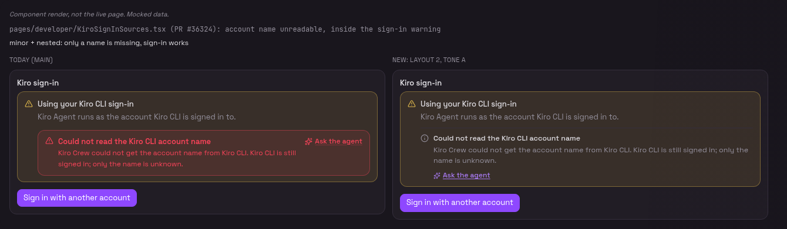
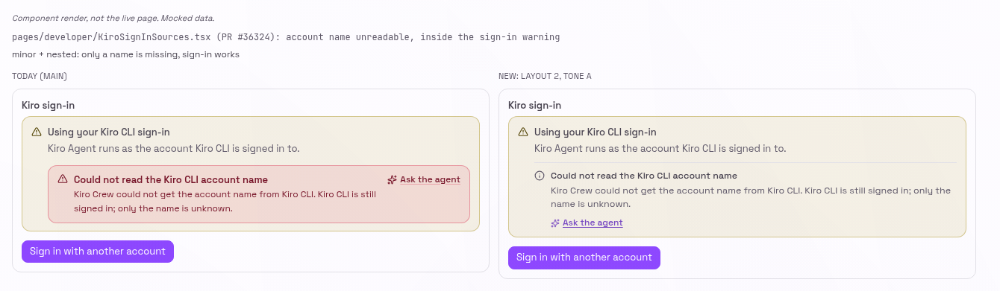

**2. Run-out forecast (minor)**

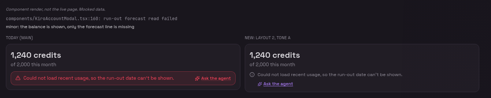
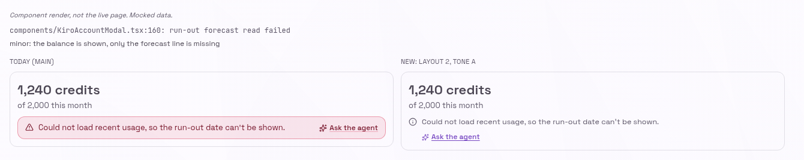

**3. Credit balance (partial) and button states**

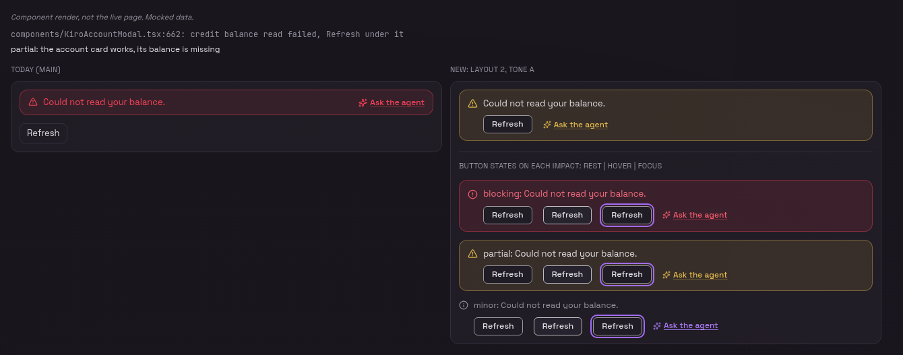
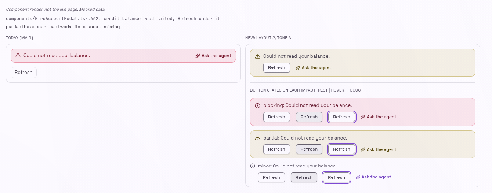

**4. Effort options, inline (partial)**

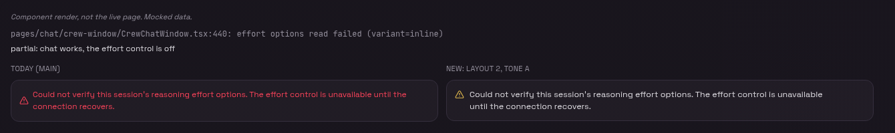
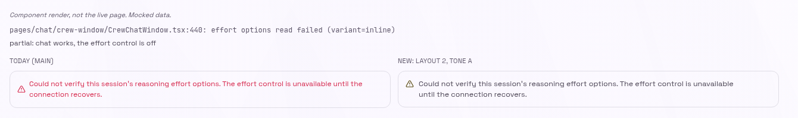

**5. Agent switch inside a warning (blocking, nested)**

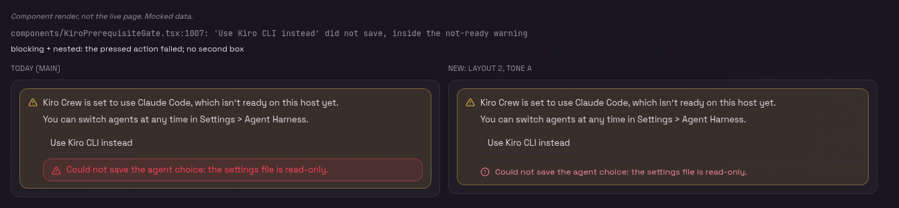
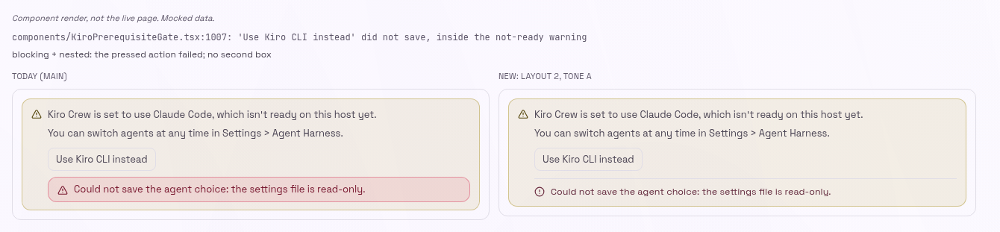

**6. Previous sign-in not removed (blocking)**

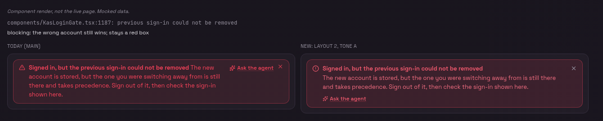
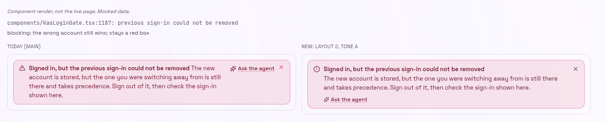

**7. Outside-change check (partial)**

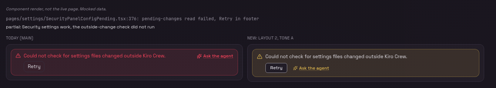
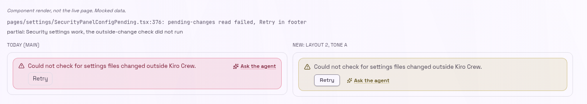

### Changes to the rule and the doc comment

`website/AUTOSDE.yaml`, `errors-use-error-notice`. The bullet that opens "The error sits in a `role="status"`" changes from a ban on any calmer look to a ban on a calmer look outside the component:

> The error sits in a hand-written `role="status"` / `aria-live` region, or in a warn- or muted-toned box (`text-warn`, `text-muted`, a `<td>`). A calmer look for a failure goes through `ErrorNotice`'s `impact`, never around the component.

and a new paragraph is added after the hand-off states:

> `impact` says what the failure costs on this surface. `blocking` (the default) when what the user came to do failed: the main read, a pressed action, a gate. `partial` when the surface works and one part of it is missing or stale. `minor` when only a detail is missing and nothing the user does depends on it. A notice inside a host that already frames it (a warning box) passes `nested`. The reviewer blocks a `partial` or `minor` on a pressed action's failure or on the surface's main read, and blocks a block-variant notice inside a warn-toned box without `nested`. A missing `impact` is never a finding: the default is the safe one.

`ErrorNotice.tsx`, the `dismissLabel` doc comment. The sentence "there is no toned-down or muted register for an error" becomes:

> The control only ever removes the notice. How loud the notice is comes from `impact`, which is chosen by what the failure costs, never by a wish to hide it: a caller that wants the notice gone hides it.

The `messagePlacement` and `actionPlacement` comments say they apply to the inline variant only.

## Migration plan

### Phase 1: one pull request for the component and every call site

Contents:

- `ErrorNotice.tsx`: `impact`, `nested`, `actions`, layout 2, the colours above as tokens in `design-tokens.css`, the role per level, and the doc comment change.
- `AUTOSDE.yaml`: the rule change above.
- Call sites: about 114 move to `partial`, about 16 to `minor`, and the 22 nested ones gain `nested` (the 8 block ones stop drawing a box). Host buttons that retry the failed thing and sit right next to a notice move into `actions`. `messagePlacement` and `actionPlacement` are removed from block-variant call sites.
- Tests: one per level for the icon, ink, frame and role; `nested` renders no box; the default stays `blocking` with `role="alert"`; `announce={false}` drops the role at every level; an `actions` button is a real `<button>` before "Ask the agent". Existing tests that pin `text-danger-text` on the body are updated.
- The PR body carries the v3 screenshots and a table of every moved call site with its level and a one-line reason.

How each moved call site is checked by hand. For each site the author reads the code around it and answers:

1. What failed? Follow the value back to its source (a query, a mutation, a job).
2. Can the user still do the main thing this surface is for? If not, it stays `blocking`.
3. Was the failure caused by a button the user pressed? If so, it stays `blocking`.
4. Is the notice inside a box that already frames it? If so, add `nested`.

A site where any answer is unclear stays `blocking`. The keyword grouping only picks the sites to read; it never decides a level.

Exit criteria:

- `grep -c 'impact="partial"'` plus `impact="minor"` in `website/src` matches the PR body's table, and every row in the table names its reason.
- No block-variant `ErrorNotice` inside a `bg-warn-subtle` or `bg-warn/` container lacks `nested`.
- No block-variant call site passes `messagePlacement` or `actionPlacement`.
- The unit tests above pass, and the contrast numbers above are re-measured on the built component and match.
- A notice with no `impact` renders `role="alert"` and the blocking look.

### Phase 2: none planned

New call sites pick a level when they are written; the rule tells the reviewer what to check.

## Backward compatibility

- A call site that passes no `impact` keeps today's meaning and role. Its look changes: layout 2, the softer body, a lighter fill (`bg-danger-subtle` instead of `bg-danger/10`). This affects every block-variant notice and is the intended change.
- `messagePlacement` and `actionPlacement` stay in the type for the inline variant; the block variant ignores them. A `git revert` of the code PR restores today's look in full. No data, config or stored format changes.
- Screen-reader users hear partial and minor failures politely instead of interrupted. The text is unchanged.

## Security considerations

None. The change is visual and ARIA only. The hand-off, its unsaved-draft safety rule and the error-journal lookup are unchanged.

## Alternatives considered

- A separate warning or status component for small failures. Rejected: the rule's whole point is one component that carries the hand-off and the error context.
- Only `nested` and `minor`, with blocking and partial left as today. Rejected: the partial group is the largest source of false alarm, and the blocking body was still hard to read.
- Keep the blocking body full red (tone b). Rejected by the repository owner for tone a.
- Layout 1, with "Ask the agent" beside the title. Rejected by the repository owner for layout 2, which gives host buttons and the hand-off one row.
- A context set by warning hosts instead of `nested`. Rejected: the reviewer cannot see it in the diff.

## Open questions

1. Is the `partial` and `minor` wording in the rule strict enough that a reviewer can block a wrong level from the diff alone? The proposal blocks only the two clear cases (a pressed action, the main read).
2. Should `messagePlacement="beside"` survive in the block variant for the few notices whose message is one short clause after the title? This RFC says no, to keep one layout; the code PR will list any site that reads worse.
