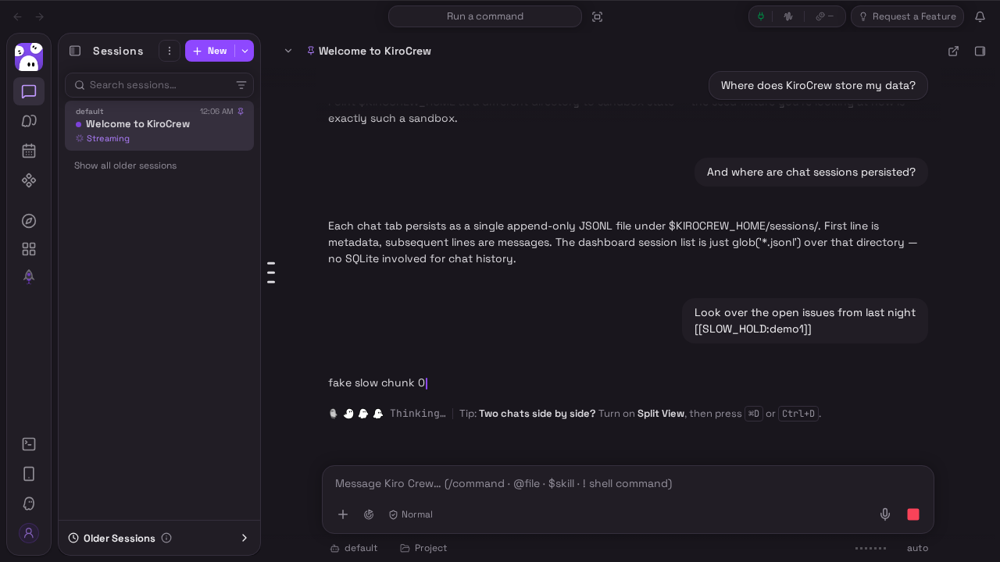
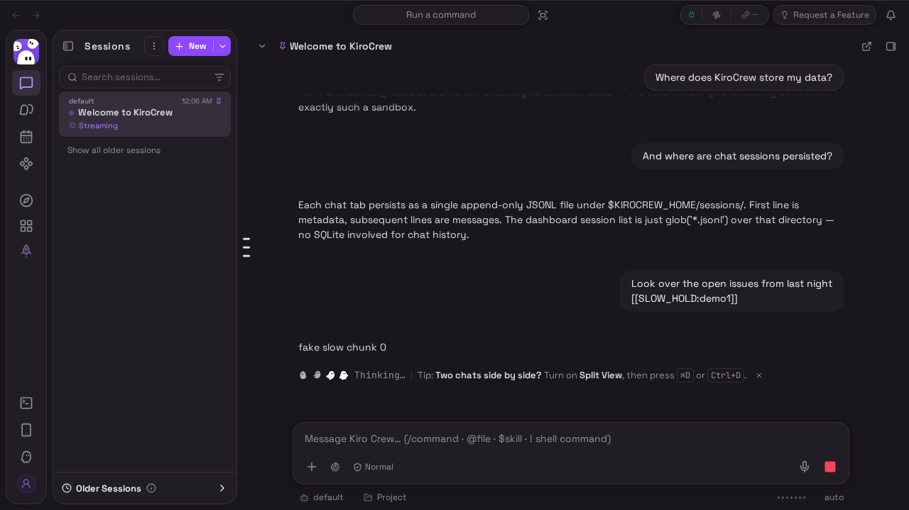
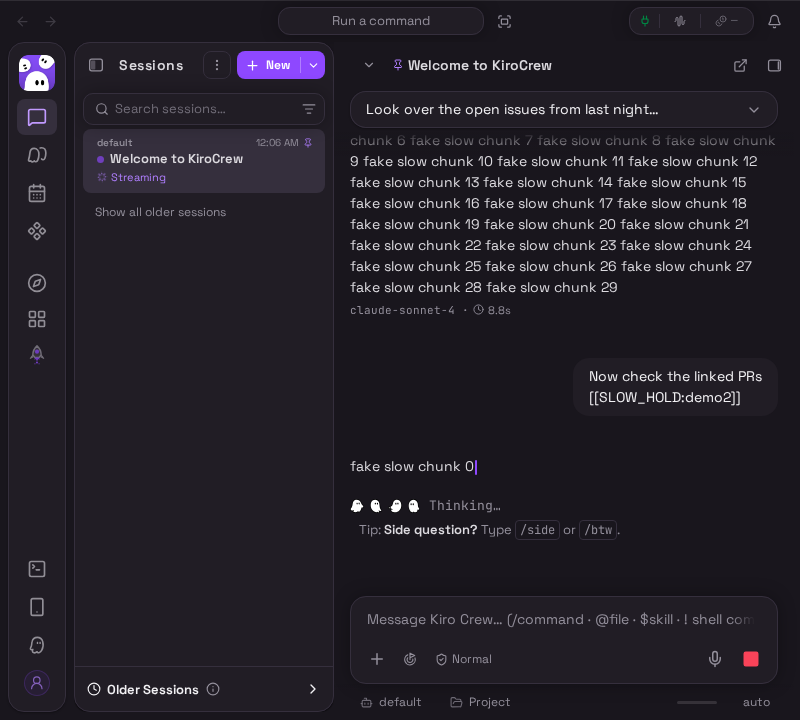

# RFC: Exploratory tips beside "Thinking..."

- Status: draft. Nothing on main follows it. It asks a maintainer to accept one change to what the chat shows by default while a turn runs. A maintainer records acceptance on this Status line, in the `status` field and in the index row.
- Tracking issue: [#39753](https://github.com/kirodotdev/KiroCrew/issues/39753) (its design comment has the same screenshots).
- Implementation: draft [#39769](https://github.com/kirodotdev/KiroCrew/pull/39769), read at head `02e732ded1`. Main was read at `cb3c2f0703`.
- Why this lands first: the First Principles lane blocked #39769 because the tip shows on every desktop turn by default and the only tips RFC on the base, [rfc-tips-kit.md](rfc-tips-kit.md), is `draft`. That lane reads the decision off the base branch, so it needs this document merged with a non-draft status.

## Summary

While a turn runs, the chat shows a ghost and "Thinking...". This change adds one short tip to the end of that row, after a thin divider:

    <ghost> Thinking...  |  Tip: Side question? Type /side or /btw.

Each tip names one dashboard control, such as Split View, Side Chat or the Command Bar. One tip is picked per turn from a shipped list of 11 and goes away when the turn ends. A user can hide any tip for good with its x. The existing Feature Tips switch turns them all off. It is on by default, like the tip card it sits beside.

## Motivation

### Current state

Verified at `cb3c2f0703`:

1. The "Thinking..." row shows while a turn runs: during thinking, tool calls and the gaps between steps. `website/src/pages/chat/ChatFooter.tsx` hides it while reply text is arriving, so in a turn it shows in the gaps, not the whole time. It holds only the ghost and the word.
2. Kiro Crew teaches features through the tip card above the composer (`src/kiro_crew/docs/feature-tips.md`), and Settings > Chat > Discovery lists every curated tip for a user who goes looking (`website/src/pages/settings/FeatureTipsList.tsx`). The card has a six-hour cadence gate and mixes real capabilities (scheduled jobs, apps, MCP) with small interface controls (Split View, Command Bar, Focus mode).
3. `dashboard.tips_enabled` defaults to `True` (`config/sections_dashboard.py`, `tips_enabled`), and the Settings Feature Tips switch is the per-user opt-out.

### Problem

Small controls are found by accident or not at all. In the card they compete with capabilities for one slot every six hours, so a user rarely sees them. The Thinking row is time a user already spends waiting, with room for one line, and today it carries nothing.

## Goals

- Show one short, useful tip on the Thinking row during a turn, with no new layout space.
- Show a tip only where its control works.
- Let a user hide a tip for good, and turn all of them off with the switch they already have.
- Count these tips apart from card tips with no new instrument or attribute key.
- Leave the tip card exactly as it is.

## Non-goals

- Picking a tip from the current task. Tips are picked at random among the eligible ones.
- Clickable chips. `/side`, `Ctrl+K` and the like are plain text.
- Phones, embedded chats, popped-out chats and temporary sessions. They show no tip.
- Any change to the card's pool, cadence, selection or look.
- A new setting.

## Design

### What the user sees

The tip sits on the same row as the ghost and "Thinking...", after a thin vertical divider. "Tip:" is muted, the lead phrase is bold, and keys and commands sit in small code chips. The screenshots below come from a throwaway gateway at head `02e732ded1` driven by an offline fake agent; the chat text is that fake agent.

On hover or keyboard focus, a small x shows at the end of the tip:

When the tip does not fit after "Thinking...", it drops to its own line and wraps. It is never cut off with an ellipsis, and the divider hides while the two are on separate lines. The fade-in is off under reduced motion.

If reading the tips fails with an error other than 404, the row shows a short inline error beside "Thinking..." in place of a tip, for that turn only. A 404 means an older gateway with no tips route, and shows nothing.

### The tips

The list is its own file, `src/kiro_crew/data/tips_exploratory.json`, separate from `tips_curated.json`. Each entry has an id, one line of copy, a `requires` list and a docs link. Copy is split into plain, bold and code runs and is never parsed as HTML or markdown.

| Id | What it teaches | Requires |
|---|---|---|
| `e01-split-view` | Split View, Cmd+D or Ctrl+D | `desktop` |
| `e02-command-bar` | Command Bar, Cmd+K or Ctrl+K | `keyboard`, `command_bar` |
| `e03-steer-or-queue` | Steer or Queue a message while the agent works | `split_send` |
| `e04-terminal` | Terminal in the navigation rail | `desktop`, `terminal` |
| `e05-keyboard-shortcuts` | Keyboard Shortcuts, Option+K or Alt+K | `keyboard` |
| `e07-side-chat` | Side Chat, `/side` or `/btw` | none |
| `e08-file-attachment` | Attach a file with `@` or drag from Files | `project_files` |
| `e09-voice-input` | Voice input | `microphone` |
| `e12-shell-command` | Run one command with `! command` | `local_session`, `terminal_docked` |
| `e13-read-aloud` | More > Read aloud on a finished reply | `speech_playback` |
| `e14-focus-mode` | Focus mode, Option+Shift+M or Alt+Shift+M | `desktop` |

### When it shows

- Only in the full desktop dashboard chat: not below the 768 px phone width, not in an embedded or popped-out chat, not in a temporary session.
- Only when the dashboard confirms every key in the tip's `requires`, for example a fine pointer for `keyboard`, Terminal enabled for `terminal`, a browser that can record for `microphone`. A key the dashboard does not know is never confirmed, so a tip that names it stays hidden.
- One tip per turn. It is picked at random when the turn starts, never changes mid-turn, and leaves with the "Thinking..." row when the turn ends.
- Showing it does not start the card's cadence gate, and the card's gate does not hold it back.

The server side is `GET /api/tips/exploratory`, which returns the list minus the tips this user dismissed. It returns an empty list when `dashboard.tips_enabled` is off, the user opted out, the tips state cannot be read, or an edition pool is active. It uses the same dashboard auth as the other `/api/tips/*` routes. The browser checks `requires`, because most of those facts (pointer, microphone, Terminal popped out) exist only there.

### How a user dismisses it or turns it off

- **One tip:** the x sends `dismiss` through the existing `POST /api/tips/feedback`. The id joins the same dismissed list the card uses, and that tip never shows again for this user. The tip leaves only after the gateway saved the dismissal; a failed save keeps the tip and shows an inline error, and the server takes the id back out of memory so it never serves a dismissal it did not save.
- **All tips, one user:** Settings > Chat > Discovery > Feature Tips, the switch that already turns off the card.
- **All tips, one instance:** `dashboard.tips_enabled: false`.
- Dismissing all 11 also ends them for that user.

### Why on by default

This is the product-shape decision the First Principles lane asked for, and the answer to its concern that a tip "shows on every turn, on by default".

1. **Off by default would reach almost nobody.** A tip that teaches a control a user does not know about only works for people who have not gone looking. A user who goes into Settings to switch tips on is already the one who needs them least.
2. **It matches the default the user already has.** `dashboard.tips_enabled` is `True` today and the card is on by default. This adds a second place under the same switch, not a new default.
3. **It costs little space and attention.** The row exists only while the user waits on the agent, the tip takes the free end of it, and it is gone when the answer arrives. It takes no focus, opens nothing, makes no sound and needs no click. The costs it does have are listed under "Downsides".
4. **It is bounded.** There are 11 tips. Each one can be hidden for good with one click, and one switch hides all of them. A user who never wants to see one again is at most one Settings toggle away.
5. **It stays out of the way of work.** No tip shows where its control does not work, on a phone, in an embedded or popped-out chat, or in a temporary session.

One tip on every turn is the part of this that could be too much for a heavy user. This RFC accepts it for the first release and sets a number for when it is revisited (Open question 1). The follow-up then is a cap per user per day, not a different default.

### Downsides

Each cost below is accepted for the first release. The line under it says how it is bounded.

1. **An agent with many short turns shows a new line every few seconds.** A chat answering a cron, or a steer loop, can start a turn every few seconds, and each turn picks a new tip.
   Bounded: a tip shows only while that chat is open in the full desktop view, and `shown` is sent only when the tip renders. Each tip the user does not want is gone for good with one click, and there are 11. If the dismiss rate passes the threshold in Open question 1, the per-day cap in Alternatives 9 is added.
2. **The row gets wider when the tip appears, which can pull the eye.** The tip is added to the right of "Thinking...".
   Bounded: the ghost and "Thinking..." keep their place; the tip only fills the free space to their right. The tip never changes mid-turn and has no timer of its own; it shows and hides with the row. The fade-in is short and off under reduced motion. In a narrow window the wrapped tip adds one line under "Thinking...".
3. **The tip competes with "Thinking..." itself,** which is the one signal a waiting user is reading.
   Bounded: the tip is muted text after a divider, and "Thinking..." stays first. The tip sits outside the row's `role="status"` element, so screen readers still announce only the status. No tip shows when the row says something other than "Thinking...", such as a stage label or a browser in control.

### How it is measured

Only what #39769 emits at `02e732ded1`. It uses the existing counter `kirocrew.tips.feedback` and its existing keys `action`, `source` and `feature`. It adds one value and no key:

- `source=exploratory` marks a Thinking-row tip. Card tips keep `curated`, `catalog` and `generated`. The schema manifest diff against main is that one added value.
- `feature` is the tip id, such as `e07-side-chat`. Only ids shipped in `tips_exploratory.json` pass; anything else reads `other`.
- `action` is `shown`, sent the first time the tip renders in a turn, or `dismiss`, sent from the x. The route also accepts `ack`, but nothing sends it, because the chips are not clickable.

Expected volume: at most one `shown` per turn in each open view that renders the tip. A turn whose row never shows, or with no eligible tip left, sends none. This repository holds no public figure for turns per user per day, so the range here is an estimate: a user who runs 20 to 100 turns a day in an open desktop chat sends 20 to 100 `shown` a day until they dismiss tips. Card tips are held to at most about four a day by their six-hour gate. So `source=exploratory` will likely be the largest `source` on `kirocrew.tips.feedback`, and dashboards on that counter should split by `source`.

From this we can read, per tip, how often it was shown and how often it was dismissed. We cannot yet read adoption, meaning whether people start using a control after seeing its tip: most of these controls have no use counter (`kirocrew.voice.stt.started` for dictation is one exception). Until a use signal exists per control, a high dismiss rate on one tip is the signal to fix or drop it.

## Migration plan

One phase, in [#39769](https://github.com/kirodotdev/KiroCrew/pull/39769).

Exit criteria:

1. `test/test_tips_exploratory.py` passes: every shipped entry loads and no id collides with a curated id; the route lists the bank minus dismissed tips; the tips switch hides every exploratory tip; exploratory feedback leaves the card's offered tip and cadence alone; an exploratory id is kept as the `feature`; an unsaved dismissal is not kept.
2. `website/src/test/ThinkingTip.test.tsx` passes: one pick per turn with `shown` reported once; a tip whose requirement is not met is skipped; a dismissed tip does not come back; a failed dismiss keeps the tip and names the failure; nothing shows when tips are off or the row is blocked; the Steer / Queue and shell command tips show only where their control exists.
3. Both metric schema gates pass with one added `source` value.
4. On a real gateway, an anonymous `GET /api/tips/exploratory` is refused and the owner gets the 11 ids (checked by hand at `02e732ded1`).

## Backward compatibility

One new read-only route and one new value on an existing counter. Every existing route, field and value keeps its meaning, and the card, its actions and its metrics are unchanged. A dashboard talking to an older gateway gets a 404 from the new route and shows no tip and no error.

## Security considerations

- No new data leaves the machine. A report carries only a tip id from the shipped list and the action, on the same counter as card tips, so the same consent and export settings apply. No chat text, task, file name or user value is included.
- The new route is read-only and uses the existing dashboard auth. The only write is the existing feedback route, which caps the id it accepts.
- Tip copy is shipped text, rendered as plain, bold and code runs, never as HTML.
- Dismissals use the existing tips state file.

## Alternatives considered

1. **Off by default, opt in from Settings.** Rejected: the people who would find the switch are the people who already know the controls (see "Why on by default").
2. **Put these tips in the existing card.** That is today's state. The card's six-hour gate means a control tip is rarely seen, and it takes a slot from a capability tip.
3. **Rotate tips on a timer within a turn.** Text that changes while the user reads it is a distraction, and `shown` would fire many times per turn.
4. **Keep the tip after the turn ends.** It would leave a stale line in the transcript.
5. **Cut long tips with an ellipsis in narrow windows.** The hidden part is often the key or command. The row wraps instead.
6. **Pick the tip on the server.** Most eligibility facts live only in the browser.
7. **A `placement` attribute on the counter.** Built and removed in #39769: every exploratory tip shows only on the Thinking row and every other source only in the card, so it restated `source` and would have cost a permanent key on an append-only schema.
8. **A separate setting for Thinking-row tips.** One Feature Tips switch is easier to find, and the per-tip x covers "not this one".
9. **A built-in damper in this release:** stop showing tips to a user after N turns in a day (for example 20), or once they have seen each tip once. Not in this release, so #39769 ships as built. A daily cap adds per-user daily state to the tips state file and a number to tune, and there is no data yet to tune it on. "Seen each tip once" would end the tips for most users within their first day, which takes away the reach that "Why on by default" argues for. This is the planned follow-up, tied to Open question 1: when that threshold is crossed, add a cap of at most N `shown` per user per day.

## Open questions

1. **Is one tip per turn too often for a heavy user?** Decided for the first release: one per turn. Revisit when, over the first two weeks after release, more than 30% of exploratory `shown` events end in a `dismiss` (`dismiss` count over `shown` count, `source=exploratory`, all tips together). Then add the per-day cap from Alternatives 9. The 30% and two weeks are a starting line chosen in review, not measured from data.
2. **Should chips be clickable?** Clicking `/side` could fill the composer and `Ctrl+K` could open the Command Bar, which would give an `ack` signal. It also makes the row a control with focus and keyboard rules to design. Not in this change.
3. **What is the use signal per control?** Judging adoption needs a content-free "used" event for each control and a link from its tip to that event. Not in this change.
