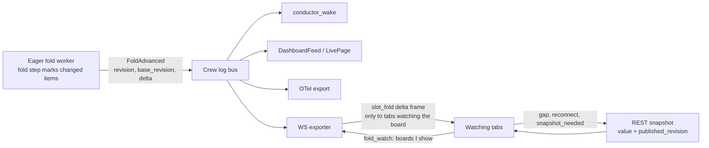

# RFC: Fold advances push deltas, not whole values

Status: draft. Nothing built. Every code reference below was read at `908099fc26`.
Paths are relative to `src/kiro_crew/` unless they start with `website/`.

Each time the crew log's eager folder advances a fold, it renders the WHOLE fold
value, hands it to every bus subscriber, and the dashboard socket exporter sends that
whole value to every open owner tab. On a large conductor board that is about 1 MB to
2.4 MB per advance per tab, and the browser throws away nine of the ten slot folds it
receives. This RFC changes the push to carry only what changed: the `work` board ships
per-item deltas tied to a base revision, the folds no browser reads stop shipping a
value, frames go only to the tabs watching that board, and a fold nobody watches is not
rendered. Every receiver changes with it, and old tabs keep working through a capability
flag.

## 1. Problem

### 1.1 What one advance does today

The publish sites are both in `crew_log/eager.py`. `_advance` (eager.py:831-866) reads
the slot fold through `projection.read_slot_projection`, then `_publish_fold`
(eager.py:868-905) publishes `FoldAdvanced(scope, key, fold, revision, value, seq)`
where `value` is the full render. `_advance_session` (eager.py:762-806) does the same for
every session fold the pass moved. `FoldAdvanced` itself is defined at bus.py:56-87 and
its docstring says `value` is the rendered projection.

Five subscribers read those events:

| # | Subscriber | Filter | What it does with `value` |
|---|---|---|---|
| 1 | WS exporter, slot path: `on_slot_fold` (dashboard/handlers/crew_log.py:931-955), subscribed at crew_log.py:899-901 | scope=slot, any key, any fold | `_push_fold` (crew_log.py:1027-1037) puts the whole value in a `slot_projection` frame. |
| 2 | WS exporter, session path: `on_session_fold` (crew_log.py:957-973), subscribed at crew_log.py:902-906 | scope=session, any key, any fold | Drops folds not in `PROJECTION_NAMES`, coalesces for 0.25 s, then `_send_session` puts the whole value in a `session_projection` frame (crew_log.py:1108-1117). |
| 3 | `conductor_wake._on_event` -> `_observe_event` (conductor_wake.py:360-375, 432-470) | scope=slot, key=board, fold=work, baseline | `_board_items` (conductor_wake.py:164) reads each item's id, status and a report stamp (`_report_stamp`, conductor_wake.py:199). |
| 4 | `DashboardFeed._accept` (dashboard_feed.py:260-276, 317-340), used by `LivePage` (dashboard/handlers/member_dashboard_fields.py:159, 222, 434) and a one-shot read (member_dashboard.py:1016) | one keyed (scope, key, fold) per manifest fold, baseline | Stores the value, resolves a few dotted paths, sends changed fields as a patch. |
| 5 | OTel export `on_fold_advanced` (metrics/crew_log_export.py:529, subscribed at 665-666) | scope=session | Only when telemetry is enabled (crew_log_export.py:643). Diffs two small folds. |

The socket send is `WebSocketHub.broadcast_ws_owners` (dashboard/websocket_hub.py:609-615):
one `json.dumps` on the dashboard loop, then the same string is queued to EVERY owner
socket by `_send_ws_owners` (websocket_hub.py:479-495). There is no filter by board.

In the browser, `slot_projection` is handled at website/src/hooks/useWebSocket.ts:701-743.
`takeFoldedSlotProjection` (website/src/hooks/websocket/slotProjection.ts:87-108) checks
the revision, but `foldQueryKey` (slotProjection.ts:114-115) returns a cache key only for
fold `work`. The value of every other slot fold (`ledger`, `radar`, `panel`, `agentic`,
`mistakes`, `workstreams`, `goal`, `waiting`, `workers`; the list is
`SLOT_PROJECTION_NAMES`, crew_log/projection_catalogue.py:104-115) is parsed and dropped,
and the tab then invalidates the work board of the frame's slot and every ancestor
(useWebSocket.ts:734-741), which refetches it over REST.

### 1.2 Measured cost

Measured at `533afdaa69` on a synthetic slot shaped like a large real board: 134
conductor units, 329,908 entries, 13,700 `work/recorded` entries, 47 items. The host was
loaded (load average 24 on 64 cores), so absolute times are somewhat high. The rendered
board came out larger than the roughly 1 MB real board it was modelled on, so the render
and dump times scale down about 2.4x for that board.

| Step | Number |
|---|---|
| `work` render alone | median 5.5 ms, p90 7.7 ms |
| `work` value as JSON | 2,381,424 B |
| `slot_projection` frame | 2,385,499 B, sent once per open owner tab |
| `json.dumps` of that frame, on the dashboard loop | median 8.8 ms, p90 12.9 ms |
| `workstreams` value | 167,607 B, read by no browser code |
| `workers` value | 157 B |
| Session folds | each render under 0.03 ms, each value 64-687 B |
| ONE eager `_advance(slot, "work")` after one new report | median 3,371 ms, p90 3,506 ms |
| Same with no new entry | 3,329 ms |
| of which `_work_units` unit discovery | 3.25 s, reads all 330,072 entries |
| ONE eager `_advance(slot, "workstreams")` | 6.2-7.1 s (`_board_closure_units` reads 660,144 entries) |
| Cold first read of `work` after a restart | 174-186 s |

So with three tabs open, one report on that board sends about 7 MB of frames, and two of
the three tabs may not even show that board. The browser receives `workstreams` (168 KB)
on every report and reads none of it.

### 1.3 What this RFC does not fix

The largest cost in the table is not the payload. `_work_units`
(crew_log/projection_work.py:38, entry loop at 84) and `_board_closure_units`
(crew_log/projection_workstreams.py:985) re-read every entry of every conductor unit on
every read, even when nothing new arrived. That is about 3.3 s plus 6.5 s per
`work/recorded` batch on the board above, against about 15 ms for render and dump. That
scan is a separate hotfix owned by another line of work, and it is out of scope here.
This RFC removes the bytes on the bus, the socket and the browser, and the renders nobody
reads. It depends on that hotfix only in one place: a snapshot pull (section 2.4) pays
the scan until the hotfix lands, so the delta design keeps snapshot pulls rare.

## 2. Design



### 2.1 The event

`FoldAdvanced` gains two fields and changes the meaning of one:

| Field | Meaning |
|---|---|
| `scope`, `key`, `fold`, `seq` | Unchanged. |
| `revision` | Unchanged: the revision of the value after this advance. |
| `base_revision` | New. The revision this event's delta applies on. 0 when the event is not a delta. |
| `kind` | New. `delta`, `snapshot_needed`, `value` or `signal`. |
| `delta` | New. The delta ops (section 2.3) when `kind` is `delta`, otherwise empty. |
| `value` | Kept only for `kind=value`: small folds whose whole value is cheap (section 2.2) and the baseline a keyed subscriber asks for. Removed from every `work` publish in PR (e). |

`base_revision` is the revision of the PREVIOUS publish for the same (scope, key, fold)
in this process. A delta lists every part of the render that was touched since that
publish, so a receiver holding exactly `base_revision` gets the current render by
applying it.

`snapshot_needed` means the publisher cannot express the change as a delta. It is sent
when:

- the board's generation changed and `_work_reset_board` dropped the earlier board
  (projection_work.py:340-358);
- the memo cell was rebuilt: budget eviction, the per-slot drop on `session/closed`
  (eager.py:723-732), a cold read after a restart, a savepoint resume;
- this is the first publish of the cell in this process, so there is no base;
- the publisher's change marks were lost for any other reason.

A receiver that gets `snapshot_needed` pulls one full snapshot.

Where the marks live: the `work` fold step records the ids of the items it touched, and
whether the header moved, in the fold state's memo cell. The marks are written by
whoever folds the cell (the eager worker or a lazy reader), and they are cleared only by
a publish, under the same memo lock as the render of the marked parts. A memo rebuild
starts with no marks and a flag that forces `snapshot_needed` on the next publish.

Status: PR (c+d), #24749, shipped a render-diff base instead of these marks (section 4).
The marks move to PR (e).

### 2.2 Per fold

| Fold | Size seen | On the bus | To the browser | Why |
|---|---|---|---|---|
| `work` | 1-2.4 MB | `delta`, or `snapshot_needed` | `slot_fold` delta frame to watching tabs | The only slot fold the browser caches (slotProjection.ts:114-115). Per-item replace is correct for every change the fold makes (section 2.3). |
| `agentic` | small, not measured | `value`, rendered only when a keyed in-process subscriber exists | nothing | Read in-process by `DashboardFeed` (member_dashboard.py:1021 reads it too). The browser drops it. |
| `ledger`, `radar`, `panel`, `mistakes`, `waiting`, `goal` | small to medium, not measured | `value`, same rule | nothing | Capped lists with eviction and re-sorting, so a delta is not worth its code. The browser drops them and reads them through their own routes. |
| `workstreams` | 168 KB | `value`, same rule | nothing | No delta: the render mints per-render ordinal `spender` aliases (projection_workstreams.py:724-753), so one new spender can renumber other rows. No browser code reads it. |
| `workers` | 157 B | `value`, same rule | nothing | Merged from several cells with a revision minted from parts. Tiny. |
| session `status`, `usage`, `timeline`, `tools`, `approvals`, `subagents` | under 1 KB each | `value` | `session_projection` whole value, unchanged | Under 1 KB and under 0.03 ms to render. A delta would add an apply path, a gap path and tests to save a few hundred bytes. `status` moves on every entry, which the existing 0.25 s coalesce already covers. |
| `otel_usage`, `otel_session_tree` | under 100 B | `value` | nothing | The metrics exporter already diffs them itself. |

"Nothing" for the browser means a tab that declared the new capability gets no frame at
all for that fold. It does not lose anything: the work board it shows moves only through
the `work` fold, which still sends its own frame, and the board keeps its timed pull
(`WORK_BOARD_PULL_MS`, website/src/pages/chat/command-center/useCommandCenter.ts:34).
A tab without the capability keeps getting a frame for these folds, without a value
(PR (a), section 3).

The render rule for every slot fold: eager renders a (key, fold) only when the bus has a
subscriber whose filter matches it. Today the WS exporter is a wildcard subscriber from
boot (crew_log.py:899-906), so the bus always has one. Under this design the exporter
subscribes keyed, per watched board and only for `work` (section 2.5), so a fold no tab
and no in-process reader watches is folded only lazily, when someone reads it. Eager
folding is already optional by contract: a reader that arrives first is served by the
lazy path.

### 2.3 Wire format

#### The `work` delta ops

The `work` render is `{conductor, items, omitted, forgotten}`, with `items` in creation
order (projection_work.py:708-764). The changes the fold makes are not all "row added":
an event is inserted in time order, two progress reports in a row collapse into one,
the event tail drops its oldest past 200 (projection_work.py:700-701), a close can evict
the oldest closed item (`_work_settle`, `_work_forget`, projection_work.py:474-523), and
a create can apply parked entries. Each of those changes one item, so replacing that item
whole is always correct. The ops are:

```json
{
  "header": {
    "conductor": { "...": "the whole conductor header" },
    "omitted": 3,
    "forgotten": { "...": "the whole forgotten block" },
    "order": ["it_a", "it_b", "it_c"]
  },
  "items": { "it_c": { "...": "item it_c, whole, as the render shows it" } },
  "remove": ["it_old"]
}
```

- `header` is always present. It is small: the conductor header, two counters and the
  list of item ids in render order (at most the open cap plus the closed cap).
- `items` holds every touched item, whole, as the render would show it. Worst case is
  one item with its full 200-event tail, about 100 KB; usually far less.
- `remove` lists item ids the board dropped.

Apply: replace the header fields, drop every id in `remove`, replace or insert every
entry in `items`, then order the list by `header.order`. If `order` names an id the
receiver neither holds nor received in `items`, the delta is inconsistent with what the
receiver holds and the receiver pulls a snapshot. The same apply function is written
once in Python (`crew_log/fold_delta.py`, new) and once in TypeScript, and both are
tested against the same fixtures.

#### The `slot_fold` frame

A new frame type, sent only to sockets that declared the capability:

```json
{
  "type": "slot_fold",
  "data": {
    "v": 1,
    "slot": "<slot key>",
    "fold": "work",
    "kind": "delta",
    "revision": 1043,
    "base_revision": 1039,
    "ops": { "header": {}, "items": {}, "remove": [] }
  }
}
```

`kind` is `delta` or `snapshot_needed`; a `snapshot_needed` frame carries no `ops`. `v`
is the frame schema version. A tab that reads a `v` it does not know treats the frame as
`snapshot_needed`. A new frame type, rather than new fields on `slot_projection`, means
the old handler can never misread a delta as a value, and the new handler can tell the
two paths apart by type.

#### The capability and the hello

The handshake already has a capability list: the tab opens `/api/ws?caps=slot_patch`
(website/src/hooks/websocket/connection.ts:78), and the gateway reads `caps` into a flag
on the socket (dashboard/ws.py:978-987, constants at dashboard/websocket_hub.py:16-22).
This RFC adds one capability, `fold_delta.1`. The gateway answers a socket that declared
it with one frame right after connect:

```json
{ "type": "fold_hello", "data": { "v": 1, "folds": ["work"] } }
```

A tab that declared `fold_delta.1` and receives `fold_hello` uses the new path. A tab
that receives no `fold_hello` is talking to an older gateway and stays on the
whole-value path it has today.

#### The watch message

A tab tells the gateway which boards it shows:

```json
{ "type": "fold_watch", "slots": ["<slot key>", "<slot key>"] }
```

It is sent after `fold_hello` and again whenever the set changes. The set is the roots of
the mounted `['command-center', root, 'work']` queries. It replaces the previous set. An
older gateway ignores it: the message chain in dashboard/ws.py (1366-1819) is an
`if`/`elif` list with no `else`, so an unknown type is dropped silently.

#### The snapshot

A snapshot is the existing REST read,
`GET /api/sessions/{id}/crew-log/projection/work` (`api_session_crew_log_projection`,
crew_log.py:352), with one new field in the response, `published_revision`: the revision
of the last `work` publish for that board in this process, or 0 when there was none.

The content of a snapshot may be NEWER than `published_revision`: a lazy read can fold
entries the eager worker has not published yet. That is safe because every part touched
after `published_revision` is still marked, so the next delta (base
`published_revision`) replaces each of those parts with its current value. A receiver
that holds a snapshot labelled P and applies the delta P -> N ends at render N.

While a snapshot read is in flight, the tab holds the delta frames that arrive. When the
read returns, it drops held frames at or below `published_revision` and applies the rest
in order, by the same base rule. This is the same pattern the bus already uses for a
baseline (`_release_baseline`, bus.py:268-288).

### 2.4 The receiver rule

Every receiver of a `work` delta follows one rule:

1. Hold `(value, revision)` per board.
2. On a delta: if `base_revision == revision held`, apply it and hold the new revision.
   If `revision <= revision held`, drop it as a duplicate. Otherwise pull one snapshot.
3. On `snapshot_needed`: pull one snapshot.
4. On first open, on reconnect, and after a gateway restart: start from a snapshot.
   Revisions are minted per process, and the tab already forgets them on socket open
   (useWebSocket.ts:174-189 calls `resetSlotProjectionRevisions`, slotProjection.ts:56).

A snapshot pull pays the unit scan in section 1.3 until that hotfix lands. Within one
process the bus delivers in order to each subscriber (`_Subscriber.deliver`,
bus.py:162-176), so an in-process receiver sees a gap only at a `snapshot_needed`. A tab
sees one only after a reconnect, a missed frame or a `snapshot_needed`.

### 2.5 Fan-out

The WS exporter keeps a watch set per socket, from `fold_watch`. A `work` delta for board
X goes to a socket when X, or a slot whose team includes X, is in its watch set: the
browser re-reads ancestors today for the same reason (useWebSocket.ts:734-741), and the
gateway knows the same slot tree. Sockets without the capability keep receiving every
board's `slot_projection` frames, as today.

The exporter's bus subscriptions follow the watch sets:

- while any owner socket without the capability is open, the exporter keeps today's
  wildcard slot subscription, so every fold is rendered as today;
- otherwise it holds one keyed subscription for (slot, `work`) per board in the union of
  all watch sets, and no subscription for the other slot folds.

The session path (`on_session_fold`) is unchanged.

### 2.6 Per receiver

| Receiver | Change |
|---|---|
| Browser: website/src/hooks/useWebSocket.ts | Declares `fold_delta.1` in `caps`. Handles `fold_hello`, `slot_fold`, and sends `fold_watch`. Keeps the `slot_projection` case for an older gateway. |
| Browser: website/src/hooks/websocket/slotProjection.ts | Gains the delta apply (the TypeScript twin of `fold_delta.py`), the per-board held revision, and the held-frames-during-snapshot buffer. The `accepted` revision ledger becomes the held revision for the delta path. |
| Browser: website/src/pages/chat/command-center/useCommandCenter.ts | The work read keeps `published_revision` (today it drops the read's `revision`, useCommandCenter.ts:176-185, because a read revision is not comparable to a frame revision; `published_revision` is, by construction). |
| Browser: website/src/hooks/websocket/sessionProjection.ts | Unchanged. Session folds stay whole values. |
| `conductor_wake` | Its registry already keeps a stamp per item per board (`_observe_board`, conductor_wake.py:228). It takes the changed item ids and bodies from the delta and the removed ids, and recomputes only those stamps. Baseline and `snapshot_needed` read the full board, off the bus thread, as `_observe_event` already schedules work on the service loop. |
| `DashboardFeed` / `LivePage` | For `work`, holds the value and applies deltas with the shared Python apply. For every other fold, unchanged (`kind=value`). On a gap it schedules a re-read off the fold worker thread. |
| `metrics/crew_log_export` | Unchanged. It reads only `otel_usage` and `otel_session_tree`, which stay `kind=value`. |
| Bus baseline and `_release_baseline` | The baseline stays a full value (`kind=value`, labelled with `published_revision`). Held events are replayed on that base with the receiver rule: drop at or below the floor, apply a delta whose base equals the floor, and hand the subscriber a `snapshot_needed` for anything else. |
| WS exporter (`dashboard/handlers/crew_log.py`) | Accepts value-less events (today `_unpack`, crew_log.py:977-986, drops an event whose value is not a dict). Keeps per-socket watch sets and capability flags, sends `slot_fold` to capable watchers and `slot_projection` to the rest. |

## 3. Migration and backward compatibility

The dashboard bundle is served by the gateway, so a tab and its gateway usually match.
Two mismatches are real and both must keep working:

- **Old tab, new gateway.** A tab opened before an upgrade keeps running the old bundle
  until it reloads. It does not declare `fold_delta.1`.
- **New tab, old gateway.** A tab whose gateway is rolled back or restarted on an older
  version keeps running the newer bundle. Its `caps` and `fold_watch` are ignored, and it
  gets no `fold_hello`.

The rule: a socket without the capability gets today's whole-value `work` frames until
PR (e) removes that path, and PR (e) does not ship until a release has carried PR (d).

**Does an old tab tolerate a `slot_projection` frame with no `value`?** Yes, and it
behaves exactly as today for a non-work fold. `takeFoldedSlotProjection` returns
`{ kind: 'bare' }` when `value` is not an object (slotProjection.ts:96). The handler then
skips the seed (useWebSocket.ts:727-733 only seeds a `folded` read) and invalidates the
work board for the slot and its ancestors (useWebSocket.ts:734-741). Today a non-work
frame reaches the same loop, because `foldQueryKey` returns `null` for it
(slotProjection.ts:114-115), so `seedFoldedProjection` returns false and `seededRoot`
stays null. The one difference: a bare frame records no revision in the `accepted`
ledger, so a duplicate delivery of a non-work frame would invalidate instead of being
dropped as stale. Each publish mints a new revision and the bus floor already drops
repeats, so this does not happen in practice, and an extra invalidate is harmless.

What an old tab sees after each PR:

| After PR | Old tab (no capability) | New tab, old gateway |
|---|---|---|
| (a) | Non-work `slot_projection` frames arrive without `value`; behaviour identical (above). `work` frames unchanged. | Not applicable: (a) has no client change. |
| (b) | Unchanged. The exporter keeps its wildcard subscription while such a socket is open, and sends it every board, as today. | The tab sends `fold_watch`; the gateway ignores it. The tab gets every board's frames, as today. |
| (c) | Unchanged. The bus carries deltas AND the value for `work` during migration; the exporter still sends this socket the whole value. | Not applicable: (c) has no client change. |
| (d) | Unchanged. | No `fold_hello` arrives, so the tab stays on its `slot_projection` handler with whole values. |
| (e) | `work` frames arrive as bare `{slot, fold, revision}`. The tab invalidates and re-reads the board over REST, plus its timed pull. Correct, slower; a reload fixes it. | Same as after (d). |

## 4. PR plan

Each PR is independent of the ones after it and can be abandoned on its own.

**File ownership.** Another line of work currently owns `crew_log/projection_work.py`,
`crew_log/projection_workstreams.py`, `crew_log/projection_slot_memo.py`,
`crew_log/store*.py`, `crew_log/checkpoint.py` and `dashboard/ws.py` for a hotfix. A PR
below that needs one of those files waits until that hotfix merges. At the time of
writing, open PR #24275 also changes `crew_log/bus.py`, `crew_log/eager.py` and
`dashboard_feed.py`; PRs touching those rebase on it once it merges.

| PR | What | Files | Needs an owned file? |
|---|---|---|---|
| (a) | Stop sending values the browser drops: `_push_fold` omits `value` for every slot fold but `work`. | `dashboard/handlers/crew_log.py` | No. Can start now. |
| (b) | Per-tab watch and skip render of unwatched folds: `fold_delta.1` capability, `fold_hello`, `fold_watch`, per-socket watch sets, keyed exporter subscriptions, a bus "has a matching subscriber" check that eager consults before it reads a slot fold. | `dashboard/ws.py`, `dashboard/websocket_hub.py`, `dashboard/handlers/crew_log.py`, `crew_log/bus.py`, `crew_log/eager.py`, browser `useWebSocket.ts`, `websocket/connection.ts` | Yes: `dashboard/ws.py`. Waits. |
| (c+d) | Shipped together in #24749. Delta for `work` with a RENDER-DIFF base: the publisher holds the last published render per board and diffs the new render against it item by item (`diff_work`), so the fold step and the memo cell are untouched. `base_revision`, `kind`, `delta` on `FoldAdvanced` (value still carried), `snapshot_needed` when no base is held or the revision does not rise, `published_revision` on the REST read (`read_labelled` folds outside `_published_lock`, then checks the label under it), the shared apply in `crew_log/fold_delta.py` and its TypeScript twin. Receivers switched: the bus (per-subscriber base, relabel to `snapshot_needed` on a gap), `conductor_wake` (restamps only the changed items of a delta), the WS exporter (`slot_fold` to tabs that declare `fold_delta.2` and watch the board), the browser (`websocket/workDelta.ts`), and REST. | `crew_log/bus.py`, `crew_log/eager.py`, `crew_log/fold_delta.py` (new), `conductor_wake.py`, `dashboard/handlers/crew_log.py`, `dashboard/websocket_hub.py`, `dashboard/ws.py`, `dashboard/state_parts/*`; browser `useWebSocket.ts`, `websocket/connection.ts`, `websocket/workDelta.ts` (new), `pages/chat/command-center/useCommandCenter.ts` | Landed after the hotfix. |
| (e) | Moved here from (c) and (d): the change-mark delta base (section 2.1: marks in the `work` fold step and the memo cell, replacing the held render and its diff); the `DashboardFeed` delta apply; value-less self-reads (`conductor_wake` reads its own board through `_read_board_items`, and receivers rebuild the value with `fold_delta.value_after`). Then remove the whole-value path: `FoldAdvanced` stops carrying `value` for `work`; eager stops rendering the whole board on a publish; legacy sockets get bare `work` frames. | `crew_log/projection_work.py`, `crew_log/projection_slot_memo.py`, `crew_log/bus.py`, `crew_log/eager.py`, `crew_log/fold_delta.py`, `dashboard/handlers/crew_log.py`, `conductor_wake.py`, `dashboard_feed.py` | Yes: `projection_work.py`, `projection_slot_memo.py`. Ships one release after (c+d). |

PR (a) is the only one that can start before the hotfix. It saves the 168 KB
`workstreams` value and every other non-work value on every advance, per tab.

## 5. Test plan

Unit tests run only the related files. Each PR also has at least one test that runs the
real path end to end: a real gateway with a real crew log on disk, real WS frames, and
the real bus subscriber or the real browser hook reading them.

### PR (a)

- Unit: `_push_fold` sends `value` for `work` and omits it for each other slot fold
  (extend the existing exporter tests beside `test/test_crew_log_fold_eager.py`).
- Unit, browser: a `slot_projection` frame with no `value` for fold `workstreams` runs
  the same invalidations as one with a value (extend
  `website/src/test/slotProjection.revision.test.ts`).
- End to end, old client: a real gateway on a temp home, a real WS client with the
  current bundle's `caps`, append a `work/recorded` entry; assert the `workstreams`
  frame has no `value`, the `work` frame has the whole value, and the browser hook
  driven with those exact frames ends with the same work-board cache as on main.

### PR (b)

- Unit: `caps` parsing sets the flag only for dashboard-user sockets; `fold_watch`
  replaces the set; an unknown slot key is ignored; the exporter switches between
  wildcard and keyed subscriptions as capable and legacy sockets come and go.
- Unit: eager skips the read and render of a (slot, fold) with no matching subscriber,
  and still folds it when `conductor_wake` or `DashboardFeed` subscribes.
- End to end: two real WS clients, one watching board A and one watching board B. A
  report on A reaches only the first client. A third client without the capability
  gets every board's frames.
- End to end, new tab on old gateway: a client declaring `fold_delta.1` against a
  gateway built without it gets no `fold_hello` and keeps applying whole values.

### PR (c)

- Unit, per fold change: for each change the `work` fold makes (append, time-order
  insert, progress collapse, tail cap at 200, close and forget past 32, parked apply on
  create), `render(before) + delta == render(after)`, using the shared apply.
- Unit: a lazy read between two publishes leaves the marks in place, and a snapshot
  labelled with `published_revision` plus the next delta equals the current render.
- Unit: memo eviction, the `session/closed` drop, a generation change and a cold read
  after restart each produce `snapshot_needed`, never a delta.
- End to end: real eager worker on a real crew log on disk, a real keyed bus subscriber
  that applies deltas; after N random appends its value equals a fresh full read.

### PR (d)

- Unit, browser: apply; gap (base not held) pulls a snapshot; duplicate dropped; frames
  held during a snapshot read are replayed above `published_revision`; reconnect resets
  and starts from a snapshot.
- Unit: `conductor_wake` fires on the same items from deltas as it does from whole
  values over the same entry sequence (replay the existing conductor_wake fixtures).
- Unit: `_release_baseline` replays held deltas on the baseline and turns a base
  mismatch into `snapshot_needed`.
- End to end: a real gateway, the real browser hook fed by a real WS client. Append
  reports; assert the hook's cached board equals a REST read after each one. Then:
  restart the gateway (new revisions; the hook starts from a snapshot), force a memo
  eviction (`snapshot_needed`, one pull), drop one frame (gap, one pull), and change
  the board generation (snapshot).
- Playwright: the work board on a real dashboard updates after a report without a REST
  read of the board in the network log.

### PR (e)

- Unit: `work` publishes carry no value; legacy sockets get bare `work` frames.
- End to end, old client: the current-main bundle's handler, driven by the real frames
  after (e), ends with the right board after its REST re-read.

## 6. Open questions

1. **Should `snapshot_needed` carry the value in-process when the publisher has just
   rendered the whole board anyway (a rebuild)?** It would save the in-process
   receivers one read. Recommended default: no. One rule for every receiver is simpler
   to test, and once the unit-scan hotfix lands the read is cheap.
2. **Ancestor routing.** Section 2.5 routes a board's delta to tabs watching that board
   or an ancestor. Recommended default: route by the server's slot tree, and keep the
   browser's ancestor invalidation for frames whose board is not the one the tab holds.
3. **Skipping eager folds warms memos less.** A fold nobody watches is folded only when
   read, so the first read after a long quiet period folds a longer tail. Recommended
   default: accept it. The memo still resumes from its last state, and a cell evicted
   meanwhile would have been a cold read either way.
4. **Snapshot over REST or over the socket.** A socket snapshot would be ordered with the
   deltas by construction, at the cost of a new request type and of sending 1 MB+ on the
   socket. Recommended default: REST, with the held-frames buffer in section 2.3, because
   the tab already reads the board that way on first open.
