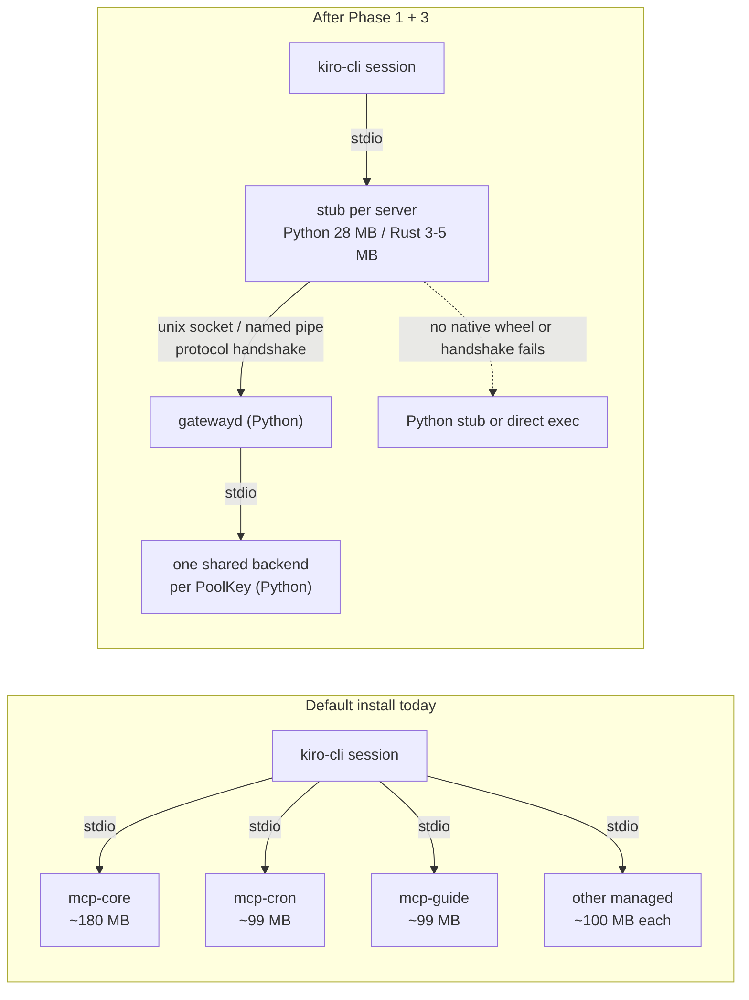

# RFC: Python+Rust hybrid backend, starting with a native MCP stub

Status: accepted. [#19611](https://github.com/kirodotdev/KiroCrew/pull/19611) was approved and merged on 2026-10-13 by chenmingwei23, and the maintainer iamwhatever records the acceptance here, covering all phases in §1. Nothing is built on main. Phase 3's stub has one open draft implementation, [#19627](https://github.com/kirodotdev/KiroCrew/pull/19627), which builds the binary in CI only and ships it nowhere; Phases 1 and 2 have none. Every code reference below was read at the commit in `audited-at`. Resource numbers come from one 48-core Linux host running 546 user processes (49.2 GB RSS, 7.27 cores busy); they show where memory goes, not a fleet average. The three unknowns §2.3 left open were measured on a second host on 2026-10-18; §2.4 records what it found. Every phase and decision below is unchanged by it.

This document lands on its own, before any implementation, because Phase 1 changes a product default (a default install starts the MCP broker and shares Kiro Crew's own servers) and Phase 3 adds a native package to every supported platform. The First Principles lane reads both decisions from the base branch.

## 1. Summary

| Phase | What | Language | Why this order |
|---|---|---|---|
| 1 | Stub and share all ten managed Kiro Crew MCP servers by default | Python + config | Biggest memory win, no new language, makes stubs the common case |
| 2 | Stub handshake carries a protocol range; the daemon owns the generation check and the PoolKey hashes | Python | A non-Python stub cannot pair with gatewayd today |
| 3 | Rust stub as a standalone binary in a wheel-only `kirocrew-native` package, behind `mcp_gateway.stub_impl=native` | Rust + CI | Each stub drops from ~28 MB to an estimated 3-5 MB |
| Later | More Rust only where profiling proves it, as PyO3 modules in the same package | Rust | Packaging is a one-time cost; the boundary stays in Python |

## 2. Motivation

### 2.1 Where the memory goes (one host, measured)

| Consumer | Processes | RSS | CPU (cores) | Evidence | Rust helps? |
|---|---|---|---|---|---|
| `mcp-cron` + `mcp-guide`, launched per session (not stubbed on this host) | 38-44 | 3.4-4.4 GB; 89-99 MB each | ~0 | measured | No: Phase 1 shares them |
| Python `mcp_gateway.stub` | 45-53 | 1.2-1.5 GB; 27-29 MB each | ~0 | measured | Yes: Phase 3 |
| Shared backends (core / work / dashboard) | 3 | 181 / 134 / 151 MB | ~0 | measured | No |
| gatewayd | 1 | 61 MB | ~0 | measured | No |
| Gateway process | 1 | 3.83 GB (3.17 anon, 0.66 file) | 0.49 mean, 0.94 peak minute | measured | Partly unknown, see §2.3 |
| ├ executor-pool threads | 78 threads | in the unattributed remainder | 69% of gateway CPU | share measured; functions measured on a second host (§2.4) | Not on the §2.4 host |
| ├ llama.cpp embedder | 4 threads | 0.46-1.33 GB anon + 0.61 GB model mapping | 24% | share measured, attribution inferred | No: already native |
| ├ OpenBLAS idle pool | 47 threads | tens of MB | 3% | inferred | No: configuration |
| └ unattributed anonymous memory | — | 1.3-2.3 GB | — | inferred residual here; attributed on a second host (§2.4) | Not on the §2.4 host |
| `kiro-cli` + `kiro-cli-chat` | 140 | 15.6 GB | 6.65 | measured | Out of scope (not this repo) |

The managed Python helpers (per-session servers plus stubs) hold more memory than the gateway itself. Each costs an interpreter floor, and almost none of them spend CPU.

### 2.2 Why a Rust stub cannot pair today

| Fact | Where |
|---|---|
| The stub sends `stub_code_fingerprint` for managed servers and refuses a daemon whose `fingerprint` differs, raising `StaleGenerationError` | `register` path in `src/kiro_crew/mcp_gateway/stub_link.py` |
| That fingerprint is the whole package's code identity: git HEAD plus a digest of the tracked diff, or an mtime fallback | `code_fingerprint` in `src/kiro_crew/code_fingerprint.py` |
| The same value is folded into `binary_version`, one of the six `PoolKey` fields | `_pool_binary_identity` in `stub_register.py`; `PoolKey` in `src/kiro_crew/mcp_gateway/pool.py` |
| The stub computes `command_args_hash` and `effective_env_hash` itself | `build_register_payload` in `stub_register.py`, calling `hash_command` / `hash_effective_env` in `src/kiro_crew/mcp_gateway/hashing.py` |
| On mismatch a cold start logs to `stub_fallback.jsonl` and `execvpe`s the real server | `stub.py` module docstring |

A Rust stub has no Python package to fingerprint. It could reimplement `code_fingerprint` and `hashing.py` byte for byte, but any drift either falls back silently (memory win lost) or lands in the wrong pool (a tenant-isolation bug). The local fallback log already holds 88 lines of `gateway code fingerprint does not match this stub` from Python stubs alone. The fix is to move those computations out of the stub, which is Phase 2.

### 2.3 What was not measured on that host

| Unknown | Why it is open | How to measure (owner, outside the agent sandbox) | Now |
|---|---|---|---|
| Which functions burn the 69% executor-thread CPU | the sandbox denies ptrace and every thread is named `kirocrew` | `sudo py-spy record --pid <gateway pid> --duration 120 --nonblocking --threads --idle=false --format speedscope -o gw-cpu.json` | measured, §2.4.1 |
| Who holds the GIL during event-loop stalls (one 5.5 s stall seen) | same | the same command with `--gil` | measured, §2.4.2 |
| What the 1.3-2.3 GB anonymous remainder is | `/proc/<pid>/smaps` is denied | `sudo cat /proc/<gateway pid>/smaps_rollup`; restart once with `PYTHONTRACEMALLOC=25` | attributed except ~1 GB of heap, §2.4.3 |
| Production Rust stub RSS | only a std-only proof of concept exists | Phase 3 exit criterion | open |

`py-spy --nonblocking` does not pause the gateway. Do not attach gdb. Two corrections from the second host: `kirocrew` is only the OS thread name, and py-spy reports the Python names (`mc-default_N`, `mc-maint_N`, …), which is what attributes CPU to a pool. And sudo is not needed when `kernel.yama.ptrace_scope` is 0, because the gateway's owner can attach py-spy and read `smaps` directly.

### 2.4 Measured on a second host (2026-10-18)

A 16-core Linux host with 62 GB RAM and its 32 GB of swap 99.7% used, running upstream `b4cf148542` for four days: 119 threads, RSS 3.08 GB (2.44 GB anonymous, 0.62 GB file) plus 0.70 GB of anonymous memory swapped out. One chat session was open during a 15-minute capture, and the gateway averaged 0.06 cores, so this is a light load. Every code path named below still runs on `audited-at`. The slot-list endpoint still serializes on the loop; the mount sweep, the transcript framing and the vendored embed loop are unchanged since the measured build; other files were edited or split since, so the numbers describe that build.

How it was measured, all read-only and without sudo:

| Source | What it gave |
|---|---|
| `py-spy record --pid <gw> --nonblocking --threads --format raw`, 15 min | stacks for every thread. Three samplers at once on 119 threads with swap full fell to about 1 Hz (1,032 ticks); run one sampler at 25 Hz or less |
| a 10 Hz `GET /api/health` probe that runs `py-spy dump --pid <gw> --nonblocking` once a request has been outstanding 250 ms | the stack of the thread marked `+gil` during each stall |
| `/proc/<gw>/task/*/stat` every 5 s, with tids mapped to names from `py-spy dump` | exact CPU per thread |
| `/proc/<gw>/smaps`, `/proc/<gw>/pagemap`, and glibc and pymalloc allocator headers read from `/proc/<gw>/mem` (present pages only, so nothing is swapped back in) | what each anonymous region is |
| the embedder replayed in a scratch process at `8fd2af91d9` with the same model | which llama.cpp buffer each region is, and how it grows |
| the gateway's own `diag/snapshots-*.jsonl` (98 h of 30 s rows) and `logs/crash-dumps/loopstall-*.txt` | stall, GC and per-thread history |

#### 2.4.1 Executor CPU

| Thread group | Share of gateway CPU (15 min) | What it ran |
|---|---|---|
| `MainThread` | 41.7% | slot-list serialization (§2.4.2) and ordinary loop work |
| `mc-default_*` (20 threads) | 22.8% | the member-memory local-owner check, which scans `/proc/net/tcp` on each request (`member_memory_auth.local_owner_bootstrap_allowed` → `platform_compat_ports._linux_tcp_peer_pid`), and `history.list_sessions` |
| `mc-maint_*` (4) | 21.0% | about 95% in `sandbox_mount_sweep._collect`, called from `cleanup_stale_sandbox_profiles`, which reads `/proc/<pid>/task/<tid>/mountinfo` for every task on the host (14,966). 83% of this pool's CPU is kernel time spent rendering those tables |
| `sel-writer` | 6.8% | SEL batch flush |
| everything else | 7.7% | |

Over 98 hours the recorder's sampled per-thread deltas put `mc-default_*` at 65%, `MainThread` at 12% and the embedder's inference thread at 9.5%, close to the 69% executor share in §2.1. The most frequent `mc-default_*` frame in that sample is `jsonl_util._frames_with_offsets`, the per-line `readline` that frames transcript files (53% of the sampled executor CPU). The 15-minute window did not catch it, so treat its share as an estimate. Its speed was measured directly: over the 20 largest transcripts on the host (41.4 MB, 11,872 records) it frames 77 MB/s, slower than `json.loads` parses the same records (115 MB/s), and 78% of its time is two `_BOUNDARY_RE.search` (`rb"[\r\n]"`) calls per record. CPython's `re` has no `memchr` path for a character class; a plain `bytes.find` loop frames the same bytes at 4.9 GB/s.

#### 2.4.2 Who holds the GIL during stalls

The probe sent 8,943 requests: p50 1.9 ms, p99 3.6 ms. Sixteen took over 100 ms (186-463 ms), about one every 60 seconds. In every stall dump that caught a holder, the holder was `MainThread` itself. 18 of the 22 holder samples were in `api_chat_slots` → `serialize_slots`, which runs on the loop: the per-slot preview stripping (`preview_text.strip_markdown_preview`, `drop_format_chars`), display redaction (`constants`' `sub` / `finditer` / `strip_control_comments`, `security.redaction._credential_redaction_plan`), and then `json.dumps` of the list. Of the other 4, 3 were in redaction code with stacks cut short (a nonblocking read can tear) and 1 was in a config read handler. The trigger was a local client polling `GET /api/chat/slots` once a minute, and any caller of that endpoint pays the same. No executor thread held the GIL in any stall dump, and every holder's innermost frame was Python.

The longer record agrees. Over 98 hours, loop lag passed 250 ms in 13% of the 30-second rows, passed 1 s in 6 and passed 5 s in 3. The three worst (16.4, 21.4 and 23.9 s, one three-minute burst) came with swap at 96-100% and a GIL wait as long as the lag, which fits a GIL holder taking page faults. Memory pressure therefore feeds stalls too. GC ran 100,369 collections with 102.7 s of total pause; the longest was 569 ms. The ten fatal loop-stall dumps the watchdog wrote between 2026-09-15 and 2026-10-08 (older builds) all show the loop thread itself in Python or in a blocking call: a TLS handshake, a `stat`, a synchronous wait on a future, cron-expression expansion, a full vector-store fetch, request routing.

#### 2.4.3 The anonymous remainder

| What | Resident | Swapped | Evidence |
|---|---|---|---|
| llama.cpp per-token output buffer: logits plus embedding for every token of the longest input seen, `(n_vocab 151,669 + n_embd 1,024) × 4 B` = 610,772 B per token, 1,893 tokens here | 961.6 MiB | 141.0 MiB | one 1,102.6 MiB glibc mmap chunk of finite float32; the replay reproduces it and its per-token size |
| llama.cpp compute buffer | 304.2 MiB | 0 | 306.24 MiB chunk, byte-identical to the replay |
| llama.cpp KV cache (n_ctx 2,048, f16) | 224.0 MiB | 0 | 224.00 MiB chunk, byte-identical to the replay; every resident page is zero |
| 64 MiB-aligned heaps, mostly glibc per-thread arenas (145 regions) | 558.5 MiB | 192.3 MiB | allocations made from the pool threads |
| pymalloc arenas | 260.7 MiB | 266.9 MiB | 191 MiB of live blocks in the 259 MiB of pools that were present |
| main-arena heap, thread stacks, other mappings | ~86 MiB | ~82 MiB | |

The embedder's three buffers are 62% of resident anonymous memory on this host. In the replay at `8fd2af91d9` it holds 490 MiB after loading, including a 149 MiB output buffer reserved for 256 tokens. One 731-token input grows that buffer to 426 MiB, a 1,454-token input to 847 MiB, and one 6,000-character input (2,048 tokens) to 1,193 MiB, for 1,869 MiB in all. The buffer is never shrunk while the model stays loaded. The vendored binding marks every input token as an output (`logits_all = True` in `_vendor/llama_cpp/llama.py`), so llama.cpp reserves logits rows for every token, and the buffer's contents show they are computed, even though last-token pooling reads one 1,024-float vector. An embedder that has seen one long input therefore holds about 1.7 GB, which fits the §2.1 host's llama.cpp range plus its unattributed remainder; that host was not re-measured.

What is still open: the ~1 GB of glibc arena and pymalloc heap, meaning Python objects and C allocations made from the pool threads. Attributing it to call sites still needs one restart with `PYTHONTRACEMALLOC=25`.

#### 2.4.4 What this means for Rust

| Finding | Cost on this host | What fixes it | Follow-up |
|---|---|---|---|
| slot list serialized on the loop | 186-463 ms stall per call | Python: memoize the per-slot text work | [#22070](https://github.com/kirodotdev/KiroCrew/pull/22070): 614 → 94 ms per call at 519 slots, same payload |
| embedder output buffer | up to 1.19 GB anonymous, plus logits computed per token | Python and binding: decode a long input in slices of one `n_ubatch` (512 tokens), the micro-batch llama.cpp already uses | [#22083](https://github.com/kirodotdev/KiroCrew/pull/22083): peak 2,245 → 1,601 MiB on a fixed input set, buffer 944 → 298 MiB, vectors byte-identical; logits are still computed |
| mount-namespace sweep | 21% of gateway CPU in the window, 83% of it kernel | Python: read each mount view once | [#22081](https://github.com/kirodotdev/KiroCrew/pull/22081): 13,713 → 902 reads per pass, 3.66 → 0.78 s, same pins |
| transcript framing | top sampled executor frame over 98 h; 77 MB/s, slower than the JSON parse after it | Python: find terminators with `bytes.find` (`memchr`) instead of a per-record regex, which has ~60× headroom | [#22213](https://github.com/kirodotdev/KiroCrew/issues/22213) |
| `/proc/net/tcp` scan per request | part of `mc-default_*` | Python: cache by socket inode | [#22214](https://github.com/kirodotdev/KiroCrew/issues/22214) |
| one Python stub per session per server | 35.2 MB vs 1.2 MB PSS per idle stub, re-measured | Rust (Phase 3) | #19627 (draft): a rebase onto main with a linker-proof digest is offered in a comment there; distribution still waits on Phase 3 packaging |

None of the measured CPU or GIL costs is a compute-heavy leaf that a Rust rewrite would remove: two are kernel work behind `/proc` reads, one is Python orchestration on the loop, one is a regex used where `bytes.find` would do, and the largest memory item is a native buffer. On this host the stub is still the only measured Rust win, and nothing measured here justifies a PyO3 module under §4.5. Phase 3's packaging cost should be weighed against the stub saving alone, about 100-125 MB per session with Phase 1 on by §4.4's RSS figures, or about 150-170 MB using the re-measured saving of 34 MB PSS per stub. Repeat this capture on the §2.1 host before reading it as general: this host averaged 0.06 cores during the capture, against 0.49 there, so §7 still treats any Rust beyond the stub as open.

## 3. Goals and non-goals

Goals: cut per-session memory for Kiro Crew's own MCP servers on every platform; let a non-Python stub pair with gatewayd without copying Python internals; build a native packaging path once and reuse it.

Non-goals: rewriting the gateway, gatewayd, the pool, or any security code; reducing process count (one stub per session per server stays); host-specific tuning.

### Considered and not proposed

Every change here must work for all users on all platforms. These were measured and left out:

| Idea | Measured signal | Why not proposed |
|---|---|---|
| `OPENBLAS_NUM_THREADS=1` for the `gateway` command | 47 idle threads, 3% gateway CPU | Platform-specific (OpenBLAS on Linux wheels); risks slower vector search for normal use |
| `MALLOC_ARENA_MAX=2` | VmData 7.2 GB vs 3.8 GB RSS | glibc-only; effect unmeasured; perf risk under thread contention |
| Truncate embed input below `_MAX_EMBED_CHARS` | a 2000-char CJK entry costs 56 s CPU | Changes what is embedded: retrieval-quality risk |
| Lower `_N_CTX` | KV cache 0.46-1.33 GB | Same retrieval-quality risk; tied to truncation |
| Unload the embedder when idle | cache does not shrink after a long input | Reload latency on the next memory write; perf risk to normal use |

## 4. Design

### 4.1 Before and after

Only the line forwarder between `kiro-cli` and gatewayd changes language. Identity injection, PoolKey, admission and every backend stay in Python.

### 4.2 Phase 1: share managed servers by default

| Change | Where |
|---|---|
| Ship the ten managed servers in the distribution roster: `kirocrew-core`, `-cron`, `-computer`, `-dashboard`, `-work`, `-crew-log`, `-debug`, `-panel`, `-guide`, `-mate` | `_resolve_stub_roster` in `src/kiro_crew/config/integration_sections.py` (today `stub_servers` defaults to `[]`) |
| Default `mcp_gateway.enabled` to true so stubbed servers share | `McpGatewayConfig.enabled` in the same file (today `False`) |
| Drop the `KIROCREW_CHANNEL_ID` env fallback in `cron_add` and thread inheritance when the caller is `from_gateway` | `_call_tool` in `src/kiro_crew/mcp_cron.py`; a shared backend's env belongs to gatewayd, not to any session |
| One cross-session isolation test per server: two callers on one shared backend never see each other's state or defaults | new tests beside `test/test_mcp_managed_caller_identity.py` |
| Keep the breaker fallback to per-session exec | `stub_fallback.py`, gatewayd; unchanged |
| Fix the stale comment that says `kirocrew-cron` reads process identity | `session_bound_by_construction` field in `src/kiro_crew/mcp_gateway/shareability.py` |

Why it is safe: all ten set `ADVERTISE_CALLER_IDENTITY = True`, all ten are in `_MANAGED_SERVERS_CALLER_AWARE` (`src/kiro_crew/mcp_discovery_managed.py`), gatewayd strips any stub-supplied caller and injects its own verified one, and launch approval exempts managed launches (`src/kiro_crew/mcp_gateway/launch_approval.py`).

The default topology changes. A default install today runs no broker and every session spawns its own managed servers. After Phase 1 the gateway starts gatewayd at boot, each session runs a stub per managed server, and one backend per PoolKey serves every session. A shared backend is one failure domain: a slow call queues others, and a crash hits every session until the breaker falls back to per-session exec.

Opt-out, in order of scope:

| Setting | Effect |
|---|---|
| `mcp_gateway.stub_overrides: {"kirocrew-cron": false}` | that one server runs per session again |
| `mcp_gateway.enabled: false` | stubs stay, every stub gets its own backend (no sharing) |
| `mcp_gateway.stub_servers: []` | no stubs, no broker: today's topology (key presence wins over the roster) |

### 4.3 Phase 2: stub protocol handshake (Python only)

| Field / rule | Direction | Purpose |
|---|---|---|
| `protocol: {min, max}` | stub → daemon | wire-format range; daemon answers `protocol_selected`; no overlap → existing fallback |
| `capabilities[]` | both | existing mechanism; unknown capabilities and control frames are ignored |
| `stub_impl`, `stub_version` | stub → daemon | logs and counts only; never part of PoolKey |
| `expected_generation` | rewriter writes it into stub flags; stub echoes it | the code-generation check runs between two Python processes; the stub does not interpret it |
| `command_args_hash`, `effective_env_hash` | rewriter precomputes into stub flags | the stub never runs `hashing.py` |
| generation part of `binary_version` | daemon builds it | PoolKey partitioning stops depending on stub code |
| `stub_code_fingerprint` and the other compat fields | stub → daemon | still sent, so a new stub can pair with an old daemon it adopts |

### 4.4 Phase 3: Rust stub in `kirocrew-native`

| Item | Decision |
|---|---|
| Package | new `kirocrew-native`, **wheels only, no sdist**: `kirocrew update` runs `pip install -e` without `--only-binary` (`src/kiro_crew/dep_sync.py`), so an sdist would compile Rust on user machines |
| Contents | the stub as a standalone binary inside the wheel, found via `importlib.resources` (the shape `uv` ships) |
| Matrix | `manylinux_2_17_x86_64`, `manylinux_2_17_aarch64`, `macosx_x86_64`, `macosx_arm64`, `win_amd64`; built with maturin-action |
| Dependency | pinned `kirocrew-native==X.Y.Z` with a platform marker in `setup.cfg`; other platforms skip it |
| Selection | rewriter writes native argv only when `mcp_gateway.stub_impl=native` and the binary exists; otherwise Python argv |
| Kill switch | `KIROCREW_NATIVE=0` forces the Python stub |
| Runtime fallback | handshake failure → existing `execvpe` path |
| Conformance | CI feeds one register and control-frame corpus to the Python and Rust stubs and compares output byte for byte |
| Transport | unix socket on POSIX, named pipe on Windows (as the Python stub does) |
| Scope | forward lines, register, negotiate capabilities, `ensure_backend`, ping, reconnect, fall back |

Stub footprint:

| Implementation | RSS per stub | Evidence |
|---|---|---|
| Python stub today | ~28 MB | measured |
| Slimmed Python floor (`python3 -I` + `asyncio`, `json`, `socket`) | 18.4 MB | measured |
| std-only Rust forwarder, after 50 × 200 KB frames | 2.1 MB (373 KB binary) | measured proof of concept |
| Production Rust stub (tokio + serde) | 3-5 MB | estimated |

With Phase 1 on, a session runs about 4.5-5 stubs (estimated): ~126-140 MB per session in Python, ~14-25 MB in Rust.

### 4.5 Long-term boundary

The packaging pipeline is a one-time cost. Later Rust pieces ship as PyO3 modules in the same `kirocrew-native`, each with a Python fallback. Python keeps orchestration and the trust boundary. Rust takes forwarding and compute-heavy leaves that profiling (§2.3) proves hot.

Do not touch:

| Module | Reason |
|---|---|
| `src/kiro_crew/security/` | under two human review gates plus the denial-differential corpus, which imports the Python deny logic |
| `sandbox.py`, `sandbox_plan.py`, `sandbox_seatbelt.py` | single source of sandbox policy; two implementations would drift |
| `mcp_gateway/gatewayd.py`, `daemon/`, `pool.py`, `hashing.py`, `socketsec.py`, `rewriter.py` | peer checks, identity, admission, PoolKey injectivity; not hot |
| `dashboard/chat_runner.py`, `dashboard/state.py` | most-changed files; asyncio orchestration and shared mutable state |
| `src/kiro_crew/crew_log/` | authoritative record; I/O bound on fsync |

## 5. Migration plan

| Phase | Success signal | Kill criteria |
|---|---|---|
| 1 | Default install: one backend process per managed server; per-session `mcp-*` processes gone; isolation tests green; no new `stub_fallback.jsonl` lines | any cross-session leak (channel, owner, state) → revert the roster default |
| 2 | Old and new Python stubs pair with old and new daemons; PoolKey values unchanged for the same inputs | the change forces a PoolKey semantic change → stop and redesign |
| 3 | Five-platform wheels build in CI; conformance test green; opt-in stub RSS ≤ 5 MB; fallback rate ≈ 0 | production RSS > 10 MB; conformance does not converge in two weeks; fallback rate > 1% |
| 3 rollout | `stub_impl=native` on work/dashboard, then core, then the rest; stub-side fingerprint compare removed once stable | any regression in the fallback rate |

## 6. Security considerations

Phase 1 widens sharing to servers that hold per-user state (cron, work, crew-log). The guard is the verified caller block, not process identity, so the env fallback removal and the per-server isolation test are prerequisites, not follow-ups. Phase 2 moves hashing into the rewriter and daemon, which already own the trust decision; the stub becomes less trusted, not more. Phase 3 adds a binary to the install: it is pinned, built in CI from this organisation's source, and never decides identity.

## 7. Open questions

| Question | Blocks |
|---|---|
| Does the Windows signing hook (`.github/workflows/build-windows.yml`) sign an `.exe` inside a wheel? Yes for the desktop installer, from reading the code (not yet seen in a signed build). The bundled interpreter's `Lib/site-packages` lives in `backend-dist`, which `website/electron/package.json` ships as `extraResources`. electron-builder 26.15.3 copies extra resources through `WinPackager.createTransformerForExtraFiles`, which hands every `.exe` to `website/electron/scripts/sign-windows.js`, and that hook Authenticode-signs everything except the one pinned `ffmpeg-win-x86_64-v7.1.exe`. So a stub `.exe` inside `kirocrew-native` is signed with no workflow change. Authenticode appends a signature instead of rewriting sections, so #19627's embedded source digest survives, while a pinned whole-file hash would not (the reason ffmpeg is exempt). Source installs sign nothing, as for any wheel today | not Windows in Phase 3; confirm once in the first signed build |
| Does `packaging/resign-macos-libs.sh` cover suffix-less Mach-O binaries? No. It re-signs only `*.so` and `*.dylib` under `purelib`, and only `make build` runs it, so on a source install a stub binary keeps the linker-signed signature the script exists to replace. Phase 3 extends its `find` to Mach-O files by magic. The released app is already covered: `packaging/signing/generate-manifest.py` finds every Mach-O under `Contents/Resources` by magic and signs it with Developer ID, hardened runtime and a timestamp, as it already does for `imageio-ffmpeg`'s suffix-less executable. A runtime check of the stub must accept those signed bytes, which the embedded digest does (see the two-anchor rule in `transcribe_ffmpeg.py`) | local macOS installs in Phase 3, until the script change lands |
| Which functions own the 69% executor CPU and the 1.3-2.3 GB anonymous remainder? Measured on a second host in §2.4: none of it is a leaf Rust would speed up, and the remainder is mostly llama.cpp's per-token output buffer. The question stays open, because that host averaged 0.06 cores against the §2.1 host's 0.49, so a costlier path under load may not have shown up. Still to do: a repeat of the §2.4 capture on the §2.1 host, and the call sites behind ~1 GB of glibc arena and pymalloc heap (one `PYTHONTRACEMALLOC=25` restart), both tracked in [#22215](https://github.com/kirodotdev/KiroCrew/issues/22215) | any Rust beyond the stub |
