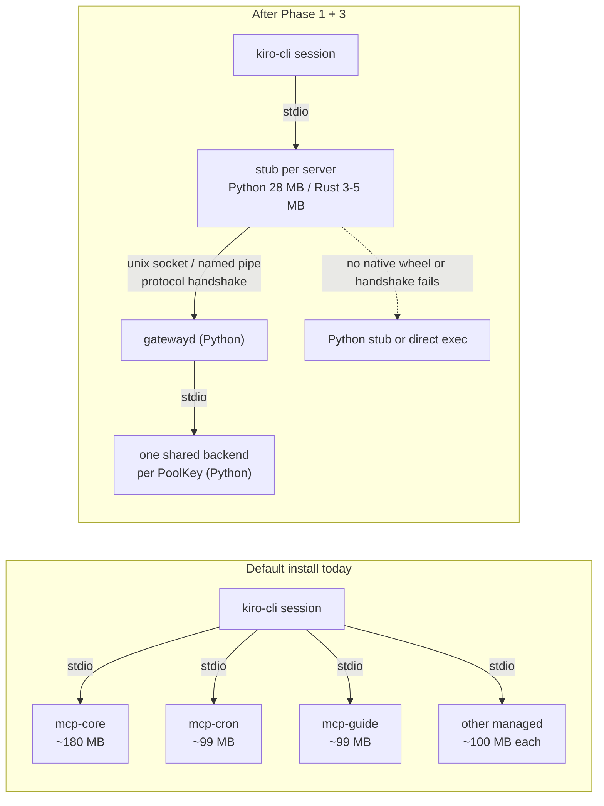

# RFC: Python+Rust hybrid backend, starting with a native MCP stub

Status: accepted. [#19611](https://github.com/kirodotdev/KiroCrew/pull/19611) was approved and merged on 2026-10-13 by chenmingwei23, and the maintainer iamwhatever records the acceptance here, covering all phases in §1. Nothing built. Every code reference below was read at the commit in `audited-at`. Resource numbers come from one 48-core Linux host running 546 user processes (49.2 GB RSS, 7.27 cores busy); they show where memory goes, not a fleet average.

This document lands on its own, before any implementation, because Phase 1 changes a product default (a default install starts the MCP broker and shares Kiro Crew's own servers) and Phase 3 adds a native package to every supported platform. The First Principles lane reads both decisions from the base branch.

## 1. Summary

| Phase | What | Language | Why this order |
|---|---|---|---|
| 1 | Stub and share all ten managed Kiro Crew MCP servers by default | Python + config | Biggest memory win, no new language, makes stubs the common case |
| 2 | Stub handshake carries a protocol range; the daemon owns the generation check and the PoolKey hashes | Python | A non-Python stub cannot pair with gatewayd today |
| 3 | Rust stub as a standalone binary in a wheel-only `kirocrew-native` package, behind `mcp_gateway.stub_impl=native` | Rust + CI | Each stub drops from ~28 MB to an estimated 3-5 MB |
| Later | More Rust only where profiling proves it, as PyO3 modules in the same package | Rust | Packaging is a one-time cost; the boundary stays in Python |

## 2. Motivation

### 2.1 Where the memory goes (one host, measured)

| Consumer | Processes | RSS | CPU (cores) | Evidence | Rust helps? |
|---|---|---|---|---|---|
| `mcp-cron` + `mcp-guide`, launched per session (not stubbed on this host) | 38-44 | 3.4-4.4 GB; 89-99 MB each | ~0 | measured | No: Phase 1 shares them |
| Python `mcp_gateway.stub` | 45-53 | 1.2-1.5 GB; 27-29 MB each | ~0 | measured | Yes: Phase 3 |
| Shared backends (core / work / dashboard) | 3 | 181 / 134 / 151 MB | ~0 | measured | No |
| gatewayd | 1 | 61 MB | ~0 | measured | No |
| Gateway process | 1 | 3.83 GB (3.17 anon, 0.66 file) | 0.49 mean, 0.94 peak minute | measured | Partly unknown, see §2.3 |
| ├ executor-pool threads | 78 threads | in the unattributed remainder | 69% of gateway CPU | share measured, functions **not measured** | Unknown |
| ├ llama.cpp embedder | 4 threads | 0.46-1.33 GB anon + 0.61 GB model mapping | 24% | share measured, attribution inferred | No: already native |
| ├ OpenBLAS idle pool | 47 threads | tens of MB | 3% | inferred | No: configuration |
| └ unattributed anonymous memory | — | 1.3-2.3 GB | — | inferred residual, **not measured** | Unknown |
| `kiro-cli` + `kiro-cli-chat` | 140 | 15.6 GB | 6.65 | measured | Out of scope (not this repo) |

The managed Python helpers (per-session servers plus stubs) hold more memory than the gateway itself. Each costs an interpreter floor, and almost none of them spend CPU.

### 2.2 Why a Rust stub cannot pair today

| Fact | Where |
|---|---|
| The stub sends `stub_code_fingerprint` for managed servers and refuses a daemon whose `fingerprint` differs, raising `StaleGenerationError` | `register` path in `src/kiro_crew/mcp_gateway/stub_link.py` |
| That fingerprint is the whole package's code identity: git HEAD plus a digest of the tracked diff, or an mtime fallback | `code_fingerprint` in `src/kiro_crew/code_fingerprint.py` |
| The same value is folded into `binary_version`, one of the six `PoolKey` fields | `_pool_binary_identity` in `stub_register.py`; `PoolKey` in `src/kiro_crew/mcp_gateway/pool.py` |
| The stub computes `command_args_hash` and `effective_env_hash` itself | `build_register_payload` in `stub_register.py`, calling `hash_command` / `hash_effective_env` in `src/kiro_crew/mcp_gateway/hashing.py` |
| On mismatch a cold start logs to `stub_fallback.jsonl` and `execvpe`s the real server | `stub.py` module docstring |

A Rust stub has no Python package to fingerprint. It could reimplement `code_fingerprint` and `hashing.py` byte for byte, but any drift either falls back silently (memory win lost) or lands in the wrong pool (a tenant-isolation bug). The local fallback log already holds 88 lines of `gateway code fingerprint does not match this stub` from Python stubs alone. The fix is to move those computations out of the stub, which is Phase 2.

### 2.3 What is not measured

| Unknown | Why it is open | How to measure (owner, outside the agent sandbox) |
|---|---|---|
| Which functions burn the 69% executor-thread CPU | the sandbox denies ptrace and every thread is named `kirocrew` | `sudo py-spy record --pid <gateway pid> --duration 120 --nonblocking --threads --idle=false --format speedscope -o gw-cpu.json` |
| Who holds the GIL during event-loop stalls (one 5.5 s stall seen) | same | the same command with `--gil` |
| What the 1.3-2.3 GB anonymous remainder is | `/proc/<pid>/smaps` is denied | `sudo cat /proc/<gateway pid>/smaps_rollup`; restart once with `PYTHONTRACEMALLOC=25` |
| Production Rust stub RSS | only a std-only proof of concept exists | Phase 3 exit criterion |

`py-spy --nonblocking` does not pause the gateway. Do not attach gdb.

## 3. Goals and non-goals

Goals: cut per-session memory for Kiro Crew's own MCP servers on every platform; let a non-Python stub pair with gatewayd without copying Python internals; build a native packaging path once and reuse it.

Non-goals: rewriting the gateway, gatewayd, the pool, or any security code; reducing process count (one stub per session per server stays); host-specific tuning.

### Considered and not proposed

Every change here must work for all users on all platforms. These were measured and left out:

| Idea | Measured signal | Why not proposed |
|---|---|---|
| `OPENBLAS_NUM_THREADS=1` for the `gateway` command | 47 idle threads, 3% gateway CPU | Platform-specific (OpenBLAS on Linux wheels); risks slower vector search for normal use |
| `MALLOC_ARENA_MAX=2` | VmData 7.2 GB vs 3.8 GB RSS | glibc-only; effect unmeasured; perf risk under thread contention |
| Truncate embed input below `_MAX_EMBED_CHARS` | a 2000-char CJK entry costs 56 s CPU | Changes what is embedded: retrieval-quality risk |
| Lower `_N_CTX` | KV cache 0.46-1.33 GB | Same retrieval-quality risk; tied to truncation |
| Unload the embedder when idle | cache does not shrink after a long input | Reload latency on the next memory write; perf risk to normal use |

## 4. Design

### 4.1 Before and after

Only the line forwarder between `kiro-cli` and gatewayd changes language. Identity injection, PoolKey, admission and every backend stay in Python.

### 4.2 Phase 1: share managed servers by default

| Change | Where |
|---|---|
| Ship the ten managed servers in the distribution roster: `kirocrew-core`, `-cron`, `-computer`, `-dashboard`, `-work`, `-crew-log`, `-debug`, `-panel`, `-guide`, `-mate` | `_resolve_stub_roster` in `src/kiro_crew/config/integration_sections.py` (today `stub_servers` defaults to `[]`) |
| Default `mcp_gateway.enabled` to true so stubbed servers share | `McpGatewayConfig.enabled` in the same file (today `False`) |
| Drop the `KIROCREW_CHANNEL_ID` env fallback in `cron_add` and thread inheritance when the caller is `from_gateway` | `_call_tool` in `src/kiro_crew/mcp_cron.py`; a shared backend's env belongs to gatewayd, not to any session |
| One cross-session isolation test per server: two callers on one shared backend never see each other's state or defaults | new tests beside `test/test_mcp_managed_caller_identity.py` |
| Keep the breaker fallback to per-session exec | `stub_fallback.py`, gatewayd; unchanged |
| Fix the stale comment that says `kirocrew-cron` reads process identity | `session_bound_by_construction` field in `src/kiro_crew/mcp_gateway/shareability.py` |

Why it is safe: all ten set `ADVERTISE_CALLER_IDENTITY = True`, all ten are in `_MANAGED_SERVERS_CALLER_AWARE` (`src/kiro_crew/mcp_discovery.py`), gatewayd strips any stub-supplied caller and injects its own verified one, and launch approval exempts managed launches (`src/kiro_crew/mcp_gateway/launch_approval.py`).

The default topology changes. A default install today runs no broker and every session spawns its own managed servers. After Phase 1 the gateway starts gatewayd at boot, each session runs a stub per managed server, and one backend per PoolKey serves every session. A shared backend is one failure domain: a slow call queues others, and a crash hits every session until the breaker falls back to per-session exec.

Opt-out, in order of scope:

| Setting | Effect |
|---|---|
| `mcp_gateway.stub_overrides: {"kirocrew-cron": false}` | that one server runs per session again |
| `mcp_gateway.enabled: false` | stubs stay, every stub gets its own backend (no sharing) |
| `mcp_gateway.stub_servers: []` | no stubs, no broker: today's topology (key presence wins over the roster) |

### 4.3 Phase 2: stub protocol handshake (Python only)

| Field / rule | Direction | Purpose |
|---|---|---|
| `protocol: {min, max}` | stub → daemon | wire-format range; daemon answers `protocol_selected`; no overlap → existing fallback |
| `capabilities[]` | both | existing mechanism; unknown capabilities and control frames are ignored |
| `stub_impl`, `stub_version` | stub → daemon | logs and counts only; never part of PoolKey |
| `expected_generation` | rewriter writes it into stub flags; stub echoes it | the code-generation check runs between two Python processes; the stub does not interpret it |
| `command_args_hash`, `effective_env_hash` | rewriter precomputes into stub flags | the stub never runs `hashing.py` |
| generation part of `binary_version` | daemon builds it | PoolKey partitioning stops depending on stub code |
| `stub_code_fingerprint` and the other compat fields | stub → daemon | still sent, so a new stub can pair with an old daemon it adopts |

### 4.4 Phase 3: Rust stub in `kirocrew-native`

| Item | Decision |
|---|---|
| Package | new `kirocrew-native`, **wheels only, no sdist**: `kirocrew update` runs `pip install -e` without `--only-binary` (`src/kiro_crew/dep_sync.py`), so an sdist would compile Rust on user machines |
| Contents | the stub as a standalone binary inside the wheel, found via `importlib.resources` (the shape `uv` ships) |
| Matrix | `manylinux_2_17_x86_64`, `manylinux_2_17_aarch64`, `macosx_x86_64`, `macosx_arm64`, `win_amd64`; built with maturin-action |
| Dependency | pinned `kirocrew-native==X.Y.Z` with a platform marker in `setup.cfg`; other platforms skip it |
| Selection | rewriter writes native argv only when `mcp_gateway.stub_impl=native` and the binary exists; otherwise Python argv |
| Kill switch | `KIROCREW_NATIVE=0` forces the Python stub |
| Runtime fallback | handshake failure → existing `execvpe` path |
| Conformance | CI feeds one register and control-frame corpus to the Python and Rust stubs and compares output byte for byte |
| Transport | unix socket on POSIX, named pipe on Windows (as the Python stub does) |
| Scope | forward lines, register, negotiate capabilities, `ensure_backend`, ping, reconnect, fall back |

Stub footprint:

| Implementation | RSS per stub | Evidence |
|---|---|---|
| Python stub today | ~28 MB | measured |
| Slimmed Python floor (`python3 -I` + `asyncio`, `json`, `socket`) | 18.4 MB | measured |
| std-only Rust forwarder, after 50 × 200 KB frames | 2.1 MB (373 KB binary) | measured proof of concept |
| Production Rust stub (tokio + serde) | 3-5 MB | estimated |

With Phase 1 on, a session runs about 4.5-5 stubs (estimated): ~126-140 MB per session in Python, ~14-25 MB in Rust.

### 4.5 Long-term boundary

The packaging pipeline is a one-time cost. Later Rust pieces ship as PyO3 modules in the same `kirocrew-native`, each with a Python fallback. Python keeps orchestration and the trust boundary. Rust takes forwarding and compute-heavy leaves that profiling (§2.3) proves hot.

Do not touch:

| Module | Reason |
|---|---|
| `src/kiro_crew/security/` | under two human review gates plus the denial-differential corpus, which imports the Python deny logic |
| `sandbox.py`, `sandbox_plan.py`, `sandbox_seatbelt.py` | single source of sandbox policy; two implementations would drift |
| `mcp_gateway/gatewayd.py`, `daemon/`, `pool.py`, `hashing.py`, `socketsec.py`, `rewriter.py` | peer checks, identity, admission, PoolKey injectivity; not hot |
| `dashboard/chat_runner.py`, `dashboard/state.py` | most-changed files; asyncio orchestration and shared mutable state |
| `src/kiro_crew/crew_log/` | authoritative record; I/O bound on fsync |

## 5. Migration plan

| Phase | Success signal | Kill criteria |
|---|---|---|
| 1 | Default install: one backend process per managed server; per-session `mcp-*` processes gone; isolation tests green; no new `stub_fallback.jsonl` lines | any cross-session leak (channel, owner, state) → revert the roster default |
| 2 | Old and new Python stubs pair with old and new daemons; PoolKey values unchanged for the same inputs | the change forces a PoolKey semantic change → stop and redesign |
| 3 | Five-platform wheels build in CI; conformance test green; opt-in stub RSS ≤ 5 MB; fallback rate ≈ 0 | production RSS > 10 MB; conformance does not converge in two weeks; fallback rate > 1% |
| 3 rollout | `stub_impl=native` on work/dashboard, then core, then the rest; stub-side fingerprint compare removed once stable | any regression in the fallback rate |

## 6. Security considerations

Phase 1 widens sharing to servers that hold per-user state (cron, work, crew-log). The guard is the verified caller block, not process identity, so the env fallback removal and the per-server isolation test are prerequisites, not follow-ups. Phase 2 moves hashing into the rewriter and daemon, which already own the trust decision; the stub becomes less trusted, not more. Phase 3 adds a binary to the install: it is pinned, built in CI from this organisation's source, and never decides identity.

## 7. Open questions

| Question | Blocks |
|---|---|
| Does the Windows signing hook (`.github/workflows/build-windows.yml`) sign an `.exe` inside a wheel? Unverified. | Windows in Phase 3 (Python stub until answered) |
| Does `packaging/resign-macos-libs.sh` cover suffix-less Mach-O binaries? It walks `.so` / `.dylib` today. | local macOS installs in Phase 3 |
| Which functions own the 69% executor CPU and the 1.3-2.3 GB anonymous remainder? | any Rust beyond the stub |
