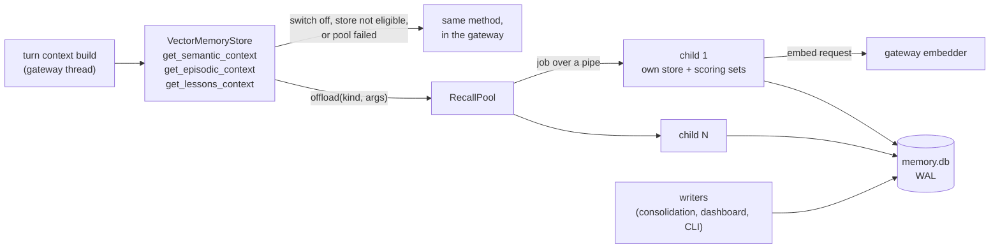

# RFC: Recall process pool

- Status: in-progress. The implementation ships behind
  `memory.recall_pool_processes` (default `0`, off) in the same pull request as
  this document.
- Tracking issue: [#26600](https://github.com/kirodotdev/KiroCrew/issues/26600),
  suggestion 4. Suggestion 1 shipped as #26628 and suggestion 2 as #26655; suggestion 3
  (patching the resident scoring set on a write) is separate work this RFC depends on only
  for cost (section 5).
- Code read at `4537582b9b`. Numbers come from one host (64 cores, 123 GB), a synthetic
  store, and no model: section 2 says exactly what was run.

## 1. Summary

A turn's context build asks the V1 vector store three questions: which facts match
the message, which episodes, which lessons. Each ranks tens of thousands of rows and holds
the interpreter lock for most of its run. Every session builds its context in the gateway's
one interpreter, so concurrent builds take turns: the 100th of 100 simultaneous builds waits
about as long as all the others combined, whatever the core count.

This RFC adds a pool of 1 to 8 spawned child processes that run those three reads. Each
child opens its own `VectorMemoryStore` on the same `memory.db` and keeps its own resident
scoring sets. The gateway sends text, an optional query vector and the caps, and gets the
rendered text back. If a child cannot start, is short of memory, crashes, hangs or reports
an error, the caller runs the same read in the gateway, as it does today.

On the store from #26600 (54k facts, 12k lessons, 27k episodes, 1024-d embeddings), 100
sessions building context at once, with a consolidation-style writer running:

- today (8 threads in one interpreter): p50 115 s, p95 207 s, 0.47 builds/s
- 4 children, writer committing every 2 s: p50 38 s, p95 68 s, 1.43 builds/s
- 4 children, writer committing every 30 s: p50 20 s, p95 36 s, 2.70 builds/s
- today, writer every 30 s: p50 100 s, p95 183 s, 0.55 builds/s

Memory: a child peaks at about 0.71 GB on this 436 MB database. The gateway no longer builds
the sets itself, so its own peak falls from 2.6 GB to 0.3 GB, and 4 children plus gateway
total 3.1 GB against 2.6 GB today.

## 2. Measurements

### What was run

A throwaway script built a V1 `memory.db`: 54,000 semantic rows (37,000 `project.*`), 12,000
lessons, 27,000 episodes, 1024-d float32 embeddings, Zipf-distributed words. It is 436 MB;
the host in #26600 has 880 MB, with longer values, so row text here is lighter and the
embeddings, which dominate the resident set, match.

A second script ran N sessions at once, twice, 2 s apart. One session is the recall part of
one turn's context: `get_semantic_context`, `get_episodic_context` and `get_lessons_context`
with the caps a 200k-token window gets (2,541, 2,541 and 7,458 characters, 37,000 for the
lessons startup tier). Latency is submit to completion. A writer thread in the main process
writes through the store's own API (`set_semantic` x5, `write_lesson`, `write_episodic`) every
2 s (heavy) or every 30 s (light), or not at all. The query embedding is a seeded random
vector computed in the main process in every arm, so embedding cost is out of all of them.

The two scripts are not committed: they reach into private symbols (`_RecallQuery`) and would break silently when those change. This section holds the method and every figure, which is all a reader needs to rebuild them.

Baseline: one `VectorMemoryStore` shared by the 8-thread `mc-embed` pool, as the gateway
runs it. Pool: the same 8 threads, with `recall_pool_processes` set to 2 or 4.

Alone in one process and warm, one recall set takes 0.41 s (facts), 0.38 s (episodes) and
0.40 s (lessons). The first recall in a process takes 3.7 s for facts, which is building the
resident set. #26600 measured 0.36 to 0.51 s for the same facts read in a separate process,
so the synthetic store sits where the real one does.

### Results (100 sessions, two rounds, 200 builds)

- Today, no writer: p50 107 s, p95 192 s, max 201 s, 0.51 builds/s, gateway peak 2.2 GB.
  A single warm build is 1.2 s, so a thread pool gives 0.51 builds/s where one process
  alone gives 0.83: eight threads fighting for the lock are slower than one.
- Today, writer every 30 s: p50 100 s, p95 183 s, 0.55 builds/s, 2.7 GB.
- Today, writer every 2 s: p50 115 s, p95 207 s, 0.47 builds/s, 2.6 GB.
- 2 children, no writer: p50 36 s, p95 67 s, 1.42 builds/s, 1.4 GB total.
- 2 children, writer every 30 s: p50 35 s, p95 63 s, 1.53 builds/s, 1.7 GB total.
- 4 children, no writer: p50 23 s, p95 40 s, 2.41 builds/s, 2.8 GB total.
- 4 children, writer every 30 s: p50 20 s, p95 36 s, 2.70 builds/s, 3.1 GB total.
- 4 children, writer every 2 s: p50 38 s, p95 68 s, 1.43 builds/s, 3.1 GB total.

Fewer sessions (the same arms, with a prototype pool built on `ProcessPoolExecutor` that ran the same functions):

- 20 sessions, today: p50 36 s, p95 50 s. 4 children: p50 9 s, p95 16 s.
- 50 sessions, today: p50 64 s, p95 110 s. 4 children: p50 19 s, p95 34 s.

Per-process peak resident size: each child 0.66 to 0.76 GB (the whole peak, including the
interpreter and the imported package, about 0.08 GB); the gateway process in the benchmark
0.12 to 0.29 GB with children, 2.2 to 2.7 GB without.

### What the numbers say

Throughput scales with children until the writer interferes: 0.51, 1.42 and 2.41 builds/s
for 0 (threads), 2 and 4 children with no writer. Latency under a 100-session burst falls
five-fold at 4 children, and is bounded by throughput: 200 builds at 2.7 per second is 74 s.

A writer that commits every 2 s costs the pool half its throughput (2.70 to 1.43 builds/s),
because each commit by the writer moves SQLite's `data_version` and every child then rebuilds
its resident sets on its next read (3.7 s for facts). The same commit costs the thread
baseline nothing extra only because that baseline is already limited by the lock. Section 5
covers the cost and the follow-up that removes it.

The episodic scoring set is 110 MB here, above the fixed 64 MiB `_EPISODIC_SCORING_MAX_BYTES`,
so episodic reads scan per call in both arms; the log line "Episodic scoring set over
67108864 bytes" appears in each child. It is the same in the baseline, and a separate fix
(scaling that cap as #26655 did for facts) would help both.

### What was not measured

The synthetic episodes never reach the relevance gate, so no episodic read returned a hit and the access-recording path (3.3) ran in no arm.
No model ran, so the real query embedding (in the gateway, the same in both arms) is not in
these figures. The gateway also does other work on its interpreter that the benchmark does
not (the event loop, 200 other threads), which the baseline's real-world numbers in #26600
(126 to 261 s for the memory section) include and ours do not. And the store is synthetic.
The effect to expect from turning the switch on is the shape above, not these exact seconds.

## 3. Design

### 3.1 What moves

Only the three reads on `VectorMemoryStore` (`get_semantic_context`, `get_episodic_context`,
`get_lessons_context`) move. They are pure functions of the database and their arguments, and
they return text, so they are the narrowest seam that holds the cost: `build_message` and
`build_session_context` also read files, config, session state and live objects that cannot
cross a process boundary, and they spend their time waiting for these three reads. Each facade
method calls `recall_pool.offload` first and falls through to its own code when that returns
`None`.

### 3.2 The children

`python -P -m kiro_crew.recall_pool`, spawned (never forked, the gateway has 200 threads), over
newline-delimited JSON on stdin and stdout, like `consolidation_write_child.py` and
`embeddings_child.py`, whose connection and store-cache classes it reuses. Each child runs the
same store method the gateway would have run, against its own `VectorMemoryStore` on the same
`memory.db`, and so holds its own resident scoring sets. A child serves one job at a time; the
pool has `memory.recall_pool_processes` of them (1 to 8) and a caller waits for a free one.

### 3.3 What stays in the gateway

- The query embedding. The child asks over its pipe, the gateway answers from its own embedder
  with the embedding-space token (`consolidation_write_offload._serve_embed`), and no second
  copy of the model loads.
- The `last_accessed_at` touch of an episodic hit. The child reports the row ids and the
  gateway buffers them and writes them through its debounce at most every 5 minutes. A child
  therefore never commits, and the gateway's commit for the accesses moves `data_version` for
  every child once per flush, not once per read (a rebuild of the facts costs several seconds
  per child, so a commit per read would put every pooled read back on a cold set).
- The embedding-space check of a lessons query vector. It runs in the gateway, where the
  embedder is known, before the job is sent; a stale vector is dropped there with the
  in-process outcome (keyword ranking for a background read, the exception for an explicit one).
- All writes.

Two things a read produces besides its text are per-turn records held in ContextVar collectors that the
turn opened: the omission record (`context_omissions`, what a budget cut) and the injection
receipt (`injection_receipts`, which lesson rows were shown). They do not cross a process, so
the child runs each read under its own collectors and returns what they hold, and the gateway
replays it into the turn's collectors before returning the text. A record the read left alone
stays alone, a record it made replaces the earlier one, and a record it cleared (a final render
that kept everything) is cleared, which is what the in-process read does.

### 3.4 Staying consistent

A resident set is valid for one in-process generation and one SQLite `data_version`
(`semantic_scoring_set`, `episodic_scoring_set`). A child never writes, so its generation never
moves; a commit by any other connection moves `data_version`, and the next read in that child
rebuilds, exactly as the gateway's store does after a CLI write today. Every read therefore sees
every write committed before it started. Writes need no notification: each read compares the
pragma, as it does now.

### 3.5 Failure and fallback

The caller runs the same read in the gateway when:

- the pool is off, the store is a private member store (V2), or it is not a real
  `VectorMemoryStore` with a database file;
- no child can start, or the host has less than `recall_pool_worker_max_mb` free;
- a child exits, answers nothing for 120 s, or sends a frame it cannot parse (it is killed first);
- a child reports an error, which includes an embedding-space change it cannot honour.

A failure starts a backoff of 1 s, doubling to 300 s, reset by the next completed job; reads go
straight to the gateway while it lasts. A caller that finds all children busy waits up to 60 s
and then reads in the gateway. Reads are idempotent, so the rerun is safe. Idle children stop
after 900 s and exit when the gateway does (stdin EOF or a changed parent pid).

### 3.6 Memory

Each child holds the facts' embeddings and text (the scoring set, clamped by the existing
`_semantic_scoring_max_bytes`: 1/16 of free memory, 1 GiB at most), the episodic matrix or
scan, and the lesson rows. Two settings bound it:

- `memory.recall_pool_processes` (0 to 8, default 0): how many children.
- `memory.recall_pool_worker_max_mb` (default 3072): no child starts while less than this is
  free on the host, and a child whose resident size passes it after a job exits; the next job
  starts a fresh one without a backoff.

A rule of thumb: one child needs about the store's embedding bytes (rows x dimension x 4, over
facts, episodes and lessons) plus 0.3 GB for the interpreter, the package and the row text. On
the benchmark store that is 93,000 x 4,096 B = 0.38 GB plus 0.3 GB, against 0.71 GB measured.
`N` children need `N` times that, and the gateway needs less than before, since it no longer
builds the sets while the pool is healthy. On the
benchmark store, 4 children and the gateway used 3.1 GB against 2.6 GB for the gateway alone.

### 3.7 Default and rollout

Off. `recall_pool_processes: 0` runs the code that runs today; the only added work is a
cached read of the setting (reused for one second). An operator turns it on by setting a count;
a change is seen within a second, and a lowered count closes the old pool at the next read.
Rollback is setting it back to 0, or doing nothing if a child fails: the fallback is the
default path.

## 4. Goals and non-goals

Goals: concurrent turn-context builds use several cores; a turn never waits on a child that is
not coming back; the answer is the one the gateway would have given.

Non-goals:

- Moving `build_message` or `build_session_context`. See 3.1.
- Moving the query embedding, which has its own child option (`embedding_child_process`).
- The private member store (V2): it has its own admission and fusion path and is not changed.
- A shared-memory scoring set. Each child holds its own copy; see 6.
- Turning the pool on by default. That needs a measurement on a live gateway first.

## 5. Risks

- **Write cost.** Every commit by another connection makes each child rebuild its sets on its
  next read: 3.7 s for facts on this store, per child. With a writer committing every 2 s the
  pool kept half its throughput (section 2); at every 30 s it kept nearly all. Consolidation
  commits in bursts, not steadily, but a busy gateway may sit nearer the heavy case. The remedy
  is to patch a resident set from the rows a commit changed instead of discarding it, which is
  suggestion 3 of #26600 and which a child can reuse once it exists. It is not in this change.
  A related effect: with `memory.consolidation_write_child_process` on, every consolidation
  commit is already a cross-process commit for the gateway's own sets.
- **Memory multiplies.** N children hold N copies. The limit and the free-memory gate bound it,
  but on a small host the gate will keep the pool from starting, and every read stays in the
  gateway (correct, and not faster).
- **Tier differences.** A child answers episodic reads from the numpy scoring tier. On an
  install with `faiss` available, the gateway may answer from its FAISS view; the two rank the
  same candidates but are separate code. The child does not build a FAISS index.
- **Read counters.** The store's read-volume totals (`read_counters`) count rows the gateway's own connection scanned, so reads answered by a child are not in them.
- **First read in a cold child** takes about 10 s for the three sets. A pool that has been idle
  for 900 s starts cold again.
- **Config in children.** A child re-reads `memory.*` before each job, as the write child does;
  a setting that changes while a job runs applies at the next one.

## 6. Alternatives considered

- **A process pool for the whole context build.** It would need `build_message` and its
  inputs to be pickled, and most of it is not CPU-bound. Rejected for the reason in 3.1.
- **One persistent worker with a faster algorithm.** Matrix-form scoring of the facts changes
  the last bits of every score (measured in `_scoring_cosines`) and would change what is
  injected on existing installs. It is orthogonal to this change and can be done inside the
  child later.
- **`concurrent.futures.ProcessPoolExecutor` with `spawn`.** Used for the benchmark prototype.
  It works, but has no per-job deadline, no backoff, no memory limit, no stdin-EOF cleanup, and
  cannot serve an embedding request in the middle of a job. The write child's connection
  classes cover all four.
- **Shared-memory or `mmap` scoring sets.** Children could map one copy of the embeddings. That
  turns N copies into one but needs a file format for the set, an invalidation protocol and a
  writer for it. Worth doing if N copies prove too costly; measure first.
- **Sticky routing (a store always goes to the same child).** Does not help with one store, the
  common case, and costs balance.
- **Notifying children of writes.** `data_version` already tells them; a push channel adds a
  message that can be lost.

## 7. Migration plan

One phase, this pull request: the pool, the two settings, the fallback, the tests and this
document. Exit criteria, each testable:

- with the switch off, no pool is built and the three methods run their own code;
- with it on, the three reads return the text the gateway renders for the same arguments;
- a committed write is visible to the next read;
- a child that cannot start, crashes, hangs, errors, or has too little free memory leaves the
  read to the gateway and starts a backoff (an error frame does not);
- a child over its memory limit is replaced without a backoff.

Next, outside this change: patch the resident set on a write (suggestion 3), measure on a live
gateway, decide the default.

## 8. Backward compatibility

The settings are new and default to off. Nothing is renamed or removed. The three store methods
keep their signatures and return the same text.

## 9. Security considerations

No listener, socket or port: the pool is one `python -P -m kiro_crew.recall_pool` spawn per
child with a fixed argv, and jobs travel on its pipes as data. The child opens only the
`memory.db` path the gateway names, with the permissions the gateway has, and runs no code from
the job. A job carries the user's message text, which the gateway would have used in-process
anyway.

## 10. Open questions

- Should the pool size follow the host (for instance half the cores, up to 4) when the setting
  is `auto`? Not proposed here; the explicit count is simpler to reason about.
- At what write rate does the pool stop paying? On the benchmark store, a commit every 2 s
  halved the gain and every 30 s nearly kept it; the break-even was not located.
- Should a child also serve `recall` (the on-demand `memory_recall` tool)? It reads the same
  store and is not on the turn's critical path, so it is left out.
