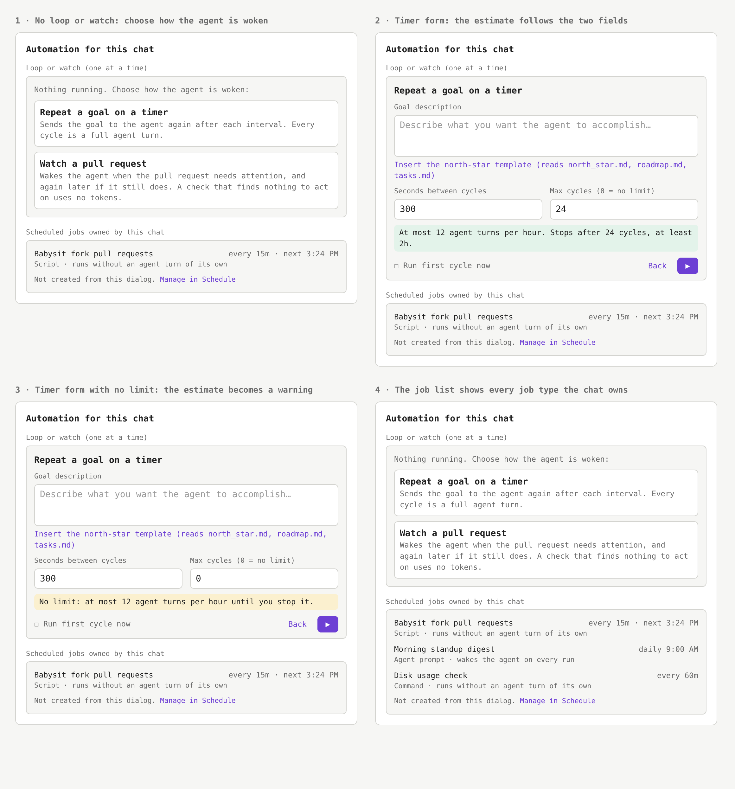

# RFC: Session automation popover layout

- Status: draft. Nothing built; this document changes no code.
- Author: rinbn
- Created: 2026-11-12
- Tracking issue: [#35595](https://github.com/kirodotdev/KiroCrew/issues/35595)
- Related: [rfc-goal-popover-pause-play-controls.md](rfc-goal-popover-pause-play-controls.md) (the state model and controls of an existing loop, which this document keeps), [rfc-consolidated-monitor.md](rfc-consolidated-monitor.md) (its *Dashboard surface* section names the same three inputs as drifting), [`../system-specs/modules/learn-cron-dashboard.md`](../system-specs/modules/learn-cron-dashboard.md), and [`../system-specs/modules/monitor-architecture.md`](../system-specs/modules/monitor-architecture.md).

## Summary

The composer's `Set a goal` popover shows three automation mechanisms in one form and does not say how they differ. This document proposes four changes to the popover of a chat that has no loop or watch yet:

1. The popover opens on a choice between `Repeat a goal on a timer` and `Watch a pull request`, each with one sentence on when the agent is woken and what a quiet check costs.
2. The list of scheduled jobs the chat owns moves below the form, under a heading that says what the items are, and lists every job type with its cost on each row.
3. The word `nudge` leaves every string a person reads in the popover.
4. The timer form shows a cost estimate computed from its two number fields, and opens with a finite cycle limit.

A chat that already has a loop keeps the states and controls of [rfc-goal-popover-pause-play-controls.md](rfc-goal-popover-pause-play-controls.md). Its strings change as *Wording* lists, and its job list changes as *The scheduled-job list* describes. A chat that already has a monitor keeps its view and gains the job list below it.

## Motivation

### Current state

Measured at `72fc5309f7`. A chat with no automation opens the popover on the goal-loop editor (`legacyView` and the `boundedModeSlot` state in `website/src/components/SessionAutomationPopover.tsx`). The editor is `website/src/components/AutoNudgePopover.tsx`. From top to bottom the editor renders:

| Order | Element | Source |
|---|---|---|
| 1 | Title `Set a goal` | key `components.autoNudgePopover.set_a_goal` in the English catalogs under `website/src/i18n/locales/` |
| 2 | Link `Watch a pull request instead` | the `onSetUpBoundedMonitor` button, key `components.sessionAutomationPopover.set_up_bounded_monitor` |
| 3 | Warning `This goal loop invokes the agent every cycle and can run without a limit.` | key `components.sessionAutomationPopover.legacy_notice` |
| 4 | Description `… sends the agent a nudge with that goal at the interval below …` | key `components.autoNudgePopover.give_the_agent_a_goal_and_it_will_keep_working_t` |
| 5 | Box `Zero-token watches`, one row per script cron the chat owns | the `watches` list, key `components.autoNudgePopover.watches_title` |
| 6 | `Goal description`, prefilled | the `message` state, initialised from `defaultMsg()` |
| 7 | `Seconds between nudges`, default `60` | the `idleInput` state |
| 8 | `Max cycles (0 = ∞)`, default `0` | the `maxCyclesInput` state |
| 9 | `Run first cycle now` and the Play control | the `runFirstNow` state |

Three mechanisms appear in that one view:

| Mechanism | Where it appears | What wakes the agent | How many per chat |
|---|---|---|---|
| Goal loop | the form (rows 6-9) | every interval | one loop or one monitor, never both (`SessionAutomationPopover` takes a single `automation` record of kind `legacy_goal_loop` or `structured_monitor`) |
| Structured pull-request monitor | the link in row 2 | the pull request needing attention (its checks, reviews, or mergeability), and again later while it still does | the same single slot |
| Script cron owned by the chat | the box in row 5 | the script reporting a result or sending the chat a message | any number |

The box in row 5 lists a cron when its `session_key` maps to this chat slot and it carries a `script` (the `watches` memo, which filters with `runBelongsToSlot`). The agent creates such a job with the `cron_add` tool from the chat, or an operator assigns an existing job to the chat with the cron CLI's `adopt` command. A person manages it on the Schedule page. The popover cannot create one.

### Problems

Each item below is what a first-time reader met in [#35595](https://github.com/kirodotdev/KiroCrew/issues/35595).

1. **The job box reads as part of the goal being set.** It sits between the description and `Goal description`. The reporter assumed the listed job was linked to the goal, then assumed the `Watch a pull request instead` link had created it. The agent had created it with `cron_add`.
2. **The popover does not say how the three mechanisms differ.** The pull-request monitor is a link with the word `instead`. Nothing states that it wakes the agent only when the pull request needs attention, while the goal loop wakes it every interval.
3. **The job box is an incomplete list.** A chat can also own a command cron and a message cron. The cron CLI treats script and command jobs alike (`zero_token = bool(script or command)` in `src/kiro_crew/cli_commands_cron.py`), but the box lists only script jobs. The comment on the `watches` filter explains why: a message cron wakes the agent, so it does not belong under a heading that promises zero tokens. The heading forces the omission.
4. **The form opens on its most expensive setting.** `60` seconds and `0` cycles mean one full agent turn per minute with no end. The warning in row 3 says the loop can run without a limit. It does not say that each cycle is a full agent turn, and it shows whether or not the reader set a limit. The agent-facing path already differs: an ungated loop armed through the MCP tool with no cap named gets `_MONITOR_DEFAULT_MAX_CYCLES = 24` (`src/kiro_crew/mcp_tools/_limits.py`). [rfc-consolidated-monitor.md](rfc-consolidated-monitor.md) records the same inconsistency under *Dashboard surface*.
5. **`Goal description` is prefilled with text most projects cannot use.** The default names `north_star.md`, `roadmap.md`, and `tasks.md`. A reader cannot tell a placeholder from text that will be sent, and pressing Play sends it.
6. **`nudge` is undefined.** It appears in the description, in `Seconds between nudges`, and in the fire control's accessible names (`Nudge now`, `Save edits and nudge now`, keys `nudge_now` and `trigger_nudge`). The popover's own title says `goal`, and the Schedule page's control for the same action reads `Run Now`.

## Goals

1. A reader who opens the popover for the first time can say which mechanism they are about to start and what it costs before pressing Play.
2. A reader can tell which items on the surface the form will create and which already exist.
3. The scheduled-job list is complete for the chat.
4. Pressing Play on an untouched timer form starts a loop that ends by itself.

## Non-goals

1. Any change to the states, controls, or resume rules of an existing loop. [rfc-goal-popover-pause-play-controls.md](rfc-goal-popover-pause-play-controls.md) owns them.
2. Any change to the structured monitor's form, budgets, or status fields. The monitor view gains the scheduled-job list below it and is otherwise unchanged.
3. Any change to how a loop, a monitor, or a cron runs, or to any route, tool, or stored field.
4. Creating, editing, or deleting a cron from the popover. The Schedule page stays the place for that.
5. The gateway-wide watch surface that [rfc-consolidated-monitor.md](rfc-consolidated-monitor.md) step 7 describes. This document covers the per-chat popover as it exists before that step.

## Design

The picture is a static mock, not a build of the dashboard. It shows the layout and the wording; colours and spacing follow the existing popover.

### Two blocks

The popover gets the title `Automation for this chat` and two blocks.

| Block | Holds | Count |
|---|---|---|
| `Loop or watch (one at a time)` | the mechanism choice, then the chosen form, then the status of the running loop or monitor | zero or one |
| `Scheduled jobs owned by this chat` | one row per enabled cron whose `session_key` maps to this chat | any number, hidden when zero |

Both blocks appear in every view of the popover: the choice, either form, a loop, and a monitor. The monitor view renders no job list today, because the editor reads the job list only when it renders its own form.

### The mechanism choice

A chat with no loop and no monitor opens on two options instead of a form.

| Option | Sentence under it | Opens |
|---|---|---|
| `Repeat a goal on a timer` | `Sends the goal to the agent again after each interval. Every cycle is a full agent turn.` | the goal-loop editor |
| `Watch a pull request` | `Wakes the agent when the pull request needs attention, and again later if it still does. A check that finds nothing to act on uses no tokens.` | the existing structured-monitor form |

Each form carries a `Back` text link that returns to the choice and keeps the draft. A chat that already holds a loop or a monitor skips the choice and opens on that record's view, as it does today.

[#10446](https://github.com/kirodotdev/KiroCrew/pull/10446) made the goal loop the opening view, because the pull-request form is one a chat about anything else cannot fill. The choice keeps that property: no reader lands on a form they cannot use. It costs a goal-loop user one more click than today. *Open questions* asks whether to preselect the goal loop instead.

### The timer form

1. `Goal description` starts empty and shows the existing placeholder. An `Insert the north-star template` link fills in the current default text and names the three files the text reads.
2. `Seconds between nudges` becomes `Seconds between cycles`.
3. A line under the two number fields states the cost of the values in them. With a limit: `At most 12 agent turns per hour. Stops after 24 cycles, at least 2h.` With `0`: `No limit: at most 12 agent turns per hour until you stop it.`, in the warn tone. The estimate says `at most` because the interval is an idle gap after the previous turn ends, as [rfc-consolidated-monitor.md](rfc-consolidated-monitor.md) notes.
4. The estimate line replaces the fixed warning in row 3 of the current view. The warning's cost cue stays on the surface and now follows what the reader typed.
5. The form opens with `300` seconds and `24` cycles. `24` is the default cap the MCP path applies to an ungated loop when none is named. `0` stays a valid value.
6. `Run first cycle now` and the Play control are unchanged.

### The scheduled-job list

1. The list moves below the loop-or-watch block.
2. The heading `Zero-token watches` becomes `Scheduled jobs owned by this chat`.
3. The list includes every enabled cron the chat owns. Each row keeps the name, the schedule, and the next run, and adds one line for the type, read from the `script` and `command` fields the job list already returns (the `CronJob` type in `website/src/types/index.jobs.ts`):

   | Job carries | Type line |
   |---|---|
   | `script` | `Script · runs without an agent turn of its own` |
   | `command` | `Command · runs without an agent turn of its own` |
   | neither | `Agent prompt · wakes the agent on every run` |

   A script can still start a turn by sending the chat a message, and a job with an agent sequence runs more than one turn, so the lines state what the job type does and promise no token count.

4. The note under the list reads `Not created from this dialog.` with a `Manage in Schedule` link.

### Wording

| Current string | Proposed string |
|---|---|
| `Set a goal` (popover title) | `Automation for this chat`, under a new catalog key |
| `Watch a pull request instead` | `Watch a pull request` (an option, not a link) |
| `… sends the agent a nudge with that goal at the interval below …` | `Sends the goal to the agent again after each interval. Every cycle is a full agent turn.` |
| `Seconds between nudges` | `Seconds between cycles` |
| `Max cycles (0 = ∞)` | `Max cycles (0 = no limit)` |
| `Max cycles (0 = infinite)` (the field's accessible name) | `Max cycles (0 = no limit)` |
| `Nudge now` (accessible name and hover title) | `Run now` |
| `Save edits and nudge now` | `Save edits and run now` |
| `Resume loop and nudge now` | `Resume loop and run now` |
| `Save edits, resume loop and nudge now` | `Save edits, resume loop and run now` |
| `… is filled in when each nudge is sent …` (the stop-file help) | `… is filled in each time the goal is sent …` |
| `… Nudges resume when a worker reports back.` (the waiting-on-you status) | `… Cycles resume when a worker reports back.` |
| `Zero-token watches` | `Scheduled jobs owned by this chat` |

The composer chip keeps the label `Set a goal`. The chip and the popover title read the same key today (`components.autoNudgePopover.set_a_goal`), so the title gets a key of its own. Every other key keeps its name and only its value changes, in every locale, following [`i18n-catalog.md`](../../website/docs/i18n-catalog.md).

## Migration plan

Each phase is one pull request and can ship or be dropped without the others.

| Phase | Change | Exit criteria |
|---|---|---|
| 1 | Wording: the table above, in every locale catalog | No string rendered by `AutoNudgePopover.tsx` or `SessionAutomationPopover.tsx` contains `nudge`. The fire control's accessible name is `Run now` while a loop runs. |
| 2 | Scheduled-job list: position, heading, all three job types, the type line, and the note | With one script, one command, and one message cron owned by the chat, the list renders three rows in that block, each with its type line, below the form. A cron owned by another chat is absent. A chat holding a monitor shows the same list below the monitor's status. |
| 3 | Mechanism choice and the `Back` link | A chat with no automation opens on the two options and no form field. Choosing an option opens its form. `Back` returns to the choice with the draft kept. A chat holding a loop or a monitor opens on that record's view. |
| 4 | Estimate line; `Goal description` starts empty with the template link | The line shows the turn rate and the end for the values in the two fields, and switches to the warn tone at `0`. An untouched form has an empty `Goal description`, and Play stays disabled until it has text, as it is today for an empty goal. |
| 5 | Defaults `300` and `24`. **Blocked on open question 1.** | An untouched form creates a loop with `idle_secs: 300` and `max_cycles: 24`. A remembered draft keeps its own values. Typing `0` saves `max_cycles: 0`. A loop that exists with `max_cycles: 0` opens showing `0`. |

## Backward compatibility

No route, tool, stored field, or catalog key is renamed or removed. One catalog key is added for the popover title. A loop that exists keeps its interval and cycle limit. A draft the popover remembered for a chat keeps its values. Phase 5 changes what an untouched form sends; a reader who wants today's behaviour types `60` and `0`.

The component tests that read these strings (`website/src/test/AutoNudgePopover.test.tsx`, `website/src/test/SessionAutomationPopover.test.tsx`) change in the phase that renames each one.

## Security considerations

None new. The job list reads the same `cron-jobs` query the popover reads today and keeps the slot ownership filter (`runBelongsToSlot`), so a chat still sees only its own jobs. The popover gains no write path.

## Alternatives considered

1. **Keep the layout and add an origin line to the job box.** It answers problem 1 and leaves problems 2 through 6. Rejected as incomplete.
2. **Remove the job box and leave scheduled jobs to the Schedule page.** It is the smallest change. Rejected because the popover would stop being the one place that shows everything able to wake the chat, and [rfc-consolidated-monitor.md](rfc-consolidated-monitor.md) states that a running watch must stay visible there.
3. **Keep the goal loop as the opening view and turn the link into a labelled two-option switch above the form.** It keeps the zero-click path [#10446](https://github.com/kirodotdev/KiroCrew/pull/10446) chose. The reporter preferred choosing first, because a form on screen reads as the thing to fill before the option above it is read. Kept as open question 2.
4. **Keep `0` as the default and rely on the estimate line.** The line makes the cost visible, but an untouched form still starts a loop with no end. Rejected for goal 4.
5. **Rename the catalog keys along with the values.** Rejected: it touches every locale file for no reader-visible gain.

## Open questions

1. **Does the change of defaults in phase 5 need its own decision?** CONTRIBUTING.md lists a changed default as a product-shape decision. The values proposed are `300` seconds and `24` cycles. Phases 1 through 4 do not depend on the answer.
2. **Choice first, or goal loop preselected?** The design above opens on the choice. Alternative 3 opens on the goal-loop form with the two options above it. The author recommends the choice, and asks the product owner to rule, since [#10446](https://github.com/kirodotdev/KiroCrew/pull/10446) set the current opening view.
3. **Should the popover title stay `Set a goal` to match the composer chip?** The proposed title names both blocks. Keeping the chip label and changing the title means the two differ.
