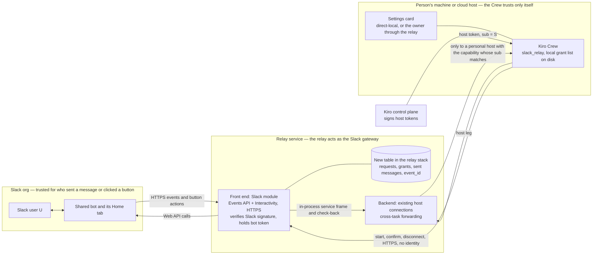
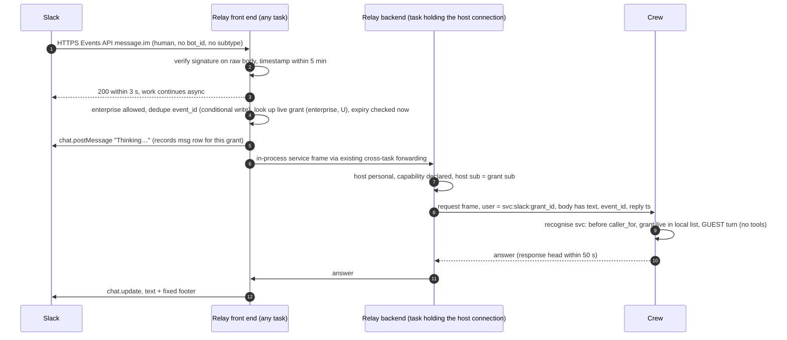
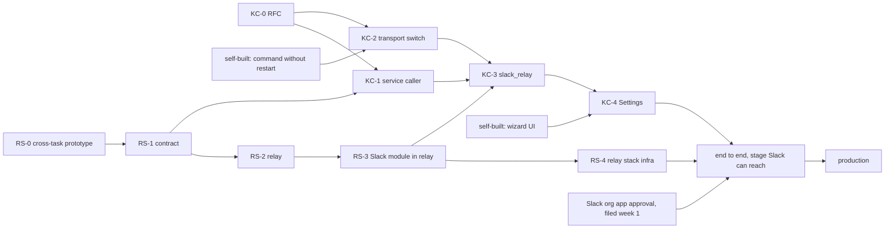

# RFC: One shared Slack app through the Kiro relay

Status: draft, re-acceptance requested. The 2026-11-18 design (a one-time pairing code DMed by the bot) was accepted 2026-11-20 by Bolin Chen (bolichen97, maintainer) in [the design sign-off on #39165](https://github.com/kirodotdev/KiroCrew/pull/39165#pullrequestreview-5989069615), on commit `e243e19314`. The 2026-11-21 amendment below replaces that pairing with a different design, so the status is back to `draft` until a maintainer re-accepts the amended design and records it here; it then flips back to `accepted`. Nothing is built yet and this document changes no code. It answers [#39154](https://github.com/kirodotdev/KiroCrew/issues/39154). Every Kiro Crew reference below was read at `523959148`. The relay service is operated outside this repository; its behaviour below was read from its source on 2026-11-18 and 2026-11-21 and is described, not linked.

**Amended 2026-11-21, owner-directed.** The product owner (iamwhatever) directed this amendment: "use the Slack profile ID: the person first signs in to Kiro, which proves who they are, then enters a Slack profile ID to connect; the core is that the grant has a time limit." What changed: the one-time pairing code is gone. The owner types a Slack member ID on their Crew; the relay records a pending request and sends nothing; the Slack user opens the bot's Home tab, sees the request and picks the number the Crew shows; the owner confirms on the Crew; the result is a **grant** that lasts 10 hours, renewable up to 30 days. The bot never speaks first. The owner's four decisions of 2026-11-21 are recorded in [Decisions](#decisions), the accepted risk is rewritten in [Accepted risk](#accepted-risk-option-a), and an independent review of the first draft of this design is in [Review findings](#review-findings-and-their-disposition). Kept unchanged: the relay as the Slack gateway, in-process service frames with no service token, the relay asking the Crew to confirm anything it started, the local confirm, the fixed footer, the chat-only `Audience.GUEST` turn and the `slack.transport` switch.

## Summary

Today a person who wants to reach their Crew from Slack builds their own Slack app. This RFC adds a second, optional path: **one shared Slack app**, served by the Kiro relay itself. **The relay acts as the Slack gateway; the existing host connections are its backend.** Its front end is a Slack module inside the relay process that takes the Slack Events API and Interactivity over HTTPS. Its backend is what the relay already has: each Crew's host connection, reached through the relay's existing cross-task forwarding. The module turns the person's DM to the shared bot into a **service frame** and delivers it in-process to that person's own Crew. The Crew answers; the relay posts the answer back as the bot. There is no new external service, no service token and no new token issuer.

Below, "the gateway" means the relay in this Slack-gateway role.

Who proves what:

- **The Kiro side** is the Crew's owner, proved on every delivery by the Kiro-signed host token the relay already checks. Only an IAM Identity Center or enterprise identity provider sign-in can own a personal Crew, so only those can use the shared app.
- **The Slack side** is the Slack user who clicked a Slack-signed button on a request meant for them.
- **The grant** between the two lasts 10 hours and can be renewed up to 30 days after the request was first made.

The person connects in three steps and pastes no token: type a Slack member ID on the Crew's Settings page and click Start; in Slack, open the bot's Home tab and pick the number the Crew shows; back on the Crew, check the Slack name and avatar and click Confirm.

Phase 1 is **chat only**. A relayed DM runs as the existing `Audience.GUEST`: no tools, no memory read, no approval card. Tools, channels and streaming are a later RFC.

### Decisions

Recorded 2026-11-18 by the product owner, iamwhatever, and kept:

1. **The Kiro side of a grant is the Kiro login.** It is the Kiro user ID (`sub`) that the relay proves from the Crew's Kiro-signed host token. The display email plays no part.
2. **Phase 1 is chat only.** Relayed conversations get no tools, read no memory, and need no approvals.
3. **Option A: no cross-check that the Kiro account is the Slack user.** Amended 2026-11-21: security now rests on the Slack user approving only a request they started themselves. The accepted risk is restated in [Accepted risk](#accepted-risk-option-a).
4. **Every relayed message carries a fixed footer** naming the source Crew by its grant ID. No name the Crew supplies is shown, in any message or on the Home tab.

Recorded 2026-11-21 by the product owner, iamwhatever ("all four as recommended, open the RFC amendment PR"):

5. **Renewal.** The Slack user renews with one click. Every renewal leaves a notice on the Crew, and the Settings page always shows "@handle connected until `<time>`" with Disconnect.
6. **Remote view.** A remote viewer who is the Crew's owner, arriving through the relay, may start, confirm and disconnect a grant. Only these three entry points. Every other setting stays local-only.
7. **Accepted risk.** The owner re-accepts the risk that a Slack user is tricked into approving an attacker's request ([Accepted risk](#accepted-risk-option-a)). Maintainer sign-off on the amending PR is still needed.
8. **Limits.** A grant lasts 10 hours and at most 30 days in total from the first request. A pending request is valid 10 minutes. Each owner may have at most 3 pending requests at once and start at most 10 a day. After a rejection, the same owner cannot ask the same Slack user again for 24 hours.

## Motivation

### Current state

- Slack in Kiro Crew is a self-built app per person, connected over Socket Mode with the person's own bot and app tokens. Without an owner the gateway refuses to connect (`init_socket_mode` in `src/kiro_crew/slack/events.py`); [rfc-slack-owner-claim.md](rfc-slack-owner-claim.md) proposes removing the owner-ID paste.
- Slash-command names collide across a whole Enterprise Grid org (the comment above `DEFAULT_ALIAS` in `src/kiro_crew/slack_manifest.py`), which already shapes the self-built path.
- A Crew with Remote Control on holds a host connection to the Kiro relay. Its host token comes from `RenewCrewLease`, using the local Kiro sign-in (`SIGN_IN_CREDENTIAL = "kiro-sign-in"` in `src/kiro_crew/relay_client/lease.py`). A personal Crew's owner is the host token's `sub` (`host_binding` in `src/kiro_crew/relay_client/token_source.py`). Only an IAM Identity Center or enterprise identity provider sign-in can lease a personal Crew (`src/kiro_crew/relay_client/lease_signin.py`).
- The relay lets a request reach a personal Crew only when the access token's `sub` equals the host token's `sub`. Its host-connection record keeps each Crew's kind and owner `sub`. Its host token carries no organisation field, so the relay cannot tell which company a Crew owner belongs to. The relay already has a public HTTPS entrance, open outbound access, a secret store, a table pattern and cross-task forwarding to whichever task holds a Crew's host connection. Nothing in it delivers a message to a Crew except on behalf of an access-token holder. On the host connection, requests flow only from the relay to the Crew; the Crew sends back responses and connection frames.
- Relayed requests are matched exactly on the stable Kiro user ID, with `hmac.compare_digest` and no email (`caller_for` in `src/kiro_crew/dashboard/kiro_relay/caller.py`). A relayed request is never direct-local (`RELAY_REMOTE` in the same file). A relayed owner is admitted with the owner's dashboard identity (`src/kiro_crew/dashboard/kiro_relay/admission.py`). A team Crew makes any well-formed relayed user a teammate (`caller_for`, `CrewKind.TEAM` branch).
- Every messaging-channel Settings write is direct-local only; a remote viewer sees it read-only (`is_direct_local_request` in `src/kiro_crew/dashboard/messaging_api/slack_settings.py`).
- The Crew's credential store holds no email ("It stores no e-mail", `src/kiro_crew/auth/whoami.py`). In the relay contract, the access token's `email` and `name` are display only and never compared.
- `Audience.GUEST` already exists: `deny_all_tools`, interactive approval mode with no decider and no grant, `minimal_context` (`_run_admitted` call in `src/kiro_crew/messaging/dispatch.py`, `guest = asker.audience is Audience.GUEST`). The guest agent spec has `"tools": []`, `"mcpServers": {}`, `"includeMcpJson": False` (`src/kiro_crew/agent_materialization/service_agents.py`).

### Problem

1. Each person needs their own Slack app, and in a large Slack org each new app waits for the org's app-approval review.
2. The self-built path still needs two token pastes. They cannot be removed for a self-built app: the app-level token has no API.
3. Nothing today lets a third party deliver a message to a Crew over the relay without being its owner.

## Goals

- A person whose Crew can hold a host connection can talk to it from Slack with no Slack app of their own and no token paste.
- No new externally reachable service: the Slack front end lives in the relay process.
- The shared bot's token and Slack signing secret never leave the relay.
- The bot never sends anything to a Slack user who has not first opened the bot themselves.
- A grant takes effect only on the Crew that started it, for the Slack user who approved it, after the owner confirms on that Crew.
- A grant expires on its own: 10 hours, renewable, never past 30 days from the first request.
- A relayed DM can make the Crew do nothing but answer in text.
- The self-built path keeps working unchanged and stays the default.

## Non-goals

- Tools, approvals, memory, channels, `app_mention`, threads, reactions, streaming and slash commands for relayed turns. A later RFC covers them.
- Cross-checking that the Kiro account and the Slack user are the same person (Option A). The Kiro owner is proved by the host token and the Slack user by their approval; nothing compares the two. See [Future upgrade](#future-upgrade).
- Team Crews. Phase 1 serves personal Crews only.
- Builder ID and social sign-ins. They cannot own a personal Crew; the Settings page says "Shared Slack needs an organisation sign-in."
- Slack workspaces outside the one Enterprise org the shared app is installed in.
- Any change to the Kiro control plane or to the host-connection protocol.

## Design

### 1. Components and trust boundaries

The relay acts as the Slack gateway; the existing host connections are its backend.



| Boundary | What crosses it | What the receiver trusts |
|---|---|---|
| Slack → relay front end | Events API and Interactivity requests over HTTPS, on a reserved relay host name | The Slack request signature over the raw body, with a 5-minute timestamp window; then Slack's `user` and `enterprise_id` on the event or action |
| Front end → backend (inside the relay) | A service frame or a check-back, built in-process | Nothing outside the process: only the Slack module can build either, and no external request can (§5) |
| Relay backend → Crew | A request frame on the existing host connection | The relay; the frame's user is a synthetic `svc:slack:<grant_id>`, never the owner (§5) |
| Crew → relay front end | Start (Slack member ID, endpoint, request nonce), confirm (grant ID), disconnect (grant ID), over HTTPS on the same reserved name | Nothing: each is rate limited and only acted on after the relay checks back with that Crew over its host connection (§3.4) |
| Settings card → Crew | Start, confirm, disconnect | `shared_slack_owner_write_allowed`: a direct-local request with an allowed `Origin`, or the Crew's owner through the relay (§3.5) |
| Kiro control plane → Crew | Host token | Kiro's ES256 signature; the Crew never sends this token anywhere but the relay |

### 2. Message flow (phase 1)



- Slack expects a 2xx within 3 seconds and retries a failed delivery up to 3 times, possibly to another relay task. The front end acknowledges first and does the rest asynchronously, and de-duplicates on `event_id` with a conditional write in the relay's table, so a retry landing on another task is dropped.
- Once the front end has acknowledged, Slack does not resend, so a relay deploy cannot rely on Slack's retry. The relay registers each in-flight Slack turn with its drain; a turn that cannot finish before its task stops gets its "Thinking…" message edited to "The answer was interrupted, please send it again."
- The Crew sends the response head within 50 seconds and keeps the body from going silent for longer than the relay's 290-second idle limit.
- How the answer gets back (the response of the same request, as drawn, or the write API in §6) is settled by the cross-task prototype in the Migration plan. With the response path the Crew holds no Slack-side credential.
- Two Slack calls per turn. The gateway keeps a per-workspace budget for `chat.postMessage` and `chat.update` and backs off on `429` per `Retry-After`.
- "Your Crew is offline" is sent at most once per grant per 10 minutes, and only as a reply to a message the user sent.
- The gateway stores no message body.

### 3. Requests and grants

#### 3.1 Rules

| Rule | How |
|---|---|
| Who speaks first | **The Slack user.** The bot never DMs, looks up or names anyone because a Crew asked. A request sits in the relay's table and is shown only when the target user opens the bot's Home tab, or as the answer to a DM the user sent first. This keeps the direction of the 2026-11-18 design (the initiative is the Slack user's), for the reason in [Threat model](#threat-model), A1. |
| Where | Every gateway HTTPS endpoint below (`/v1/requests`, `/v1/grants/…`, `/v1/messages/…`) is served on the relay's reserved Slack host name, the same name Slack's Request URLs point at. |
| Start | On the Settings card the owner types a Slack member ID and clicks Start. The Crew records a pending request locally (member ID, a random request nonce it generates, 10-minute expiry) on disk, then sends `POST /v1/requests {member_id, endpoint, nonce}`. No `sub`, no secret, no credential. |
| Rate limit before anything | Limits per source IP are checked first. An endpoint alone is **never** locked, because the endpoint is a field any caller can name. |
| Check back | The relay asks that endpoint's Crew over its host connection: "did you start a request for member ID X with nonce N?" The Crew says yes only if it has that pending request, the nonce matches and it is unexpired. The owner `sub` comes from the relay's own host-connection record, never from the request. |
| Owner limits | Counted per owner `sub`, across all of that owner's Crews: one pending request per (owner, member ID); at most 3 pending at once; at most 10 a day; 24 hours before the same owner may ask the same member ID again after a rejection or a wrong number; "Never from this person" blocks that owner `sub` for that Slack user for good. A global daily request budget raises an alarm and pauses new requests. |
| What the relay writes | A pending request: request ID, owner `sub`, endpoint, member ID, a two-digit match number M, start time, 10-minute expiry. **No Slack API call.** |
| Anonymous answer | `POST /v1/requests` always answers the same "received", whether or not the member ID exists or the request was recorded. The request ID, M and a deep link to the bot's Home tab go to the Crew only in the check-back. |
| Home tab | When U opens the Home tab, Slack sends a signed `app_home_opened`. Only then does the relay look anyone up, and only U: deactivated, guest or restricted, external (Slack Connect), bot, or outside the allowed enterprise → "Shared Slack is not open to you", no requests shown. Otherwise the relay finds the pending requests for `(enterprise_id, org-wide user ID)` and publishes the Home view for U alone. |
| Home tab content | Only facts the relay holds: "Someone typed your Slack ID into a Kiro Crew and wants your DMs to this bot sent to that Crew, which will also send the replies. Request `<short id>`, started `<time>`. Pick the number your Crew shows only if you just clicked Start on your own Crew." Three number buttons (one is M), Reject, Never from this person. No name the Crew supplied. With requests from two or more owners, a warning on top: "More than one person is asking to connect to you. If you started only one, the others are someone else." The Home tab also shows "Your Slack member ID is `<id>`" with a copy button, so the ID the owner types is the one events and actions carry. |
| A DM before any grant | If U DMs the bot with requests pending, the bot answers that DM: "You have N connection requests. Open the Home tab to see them." It never posts unprompted. |
| Approve | Each button's value carries the request ID and the number. The relay checks that the clicker is the request's target `(enterprise_id, user ID)` and that the request is current, unexpired and not replaced, then switches it from pending to approved with one conditional write. A wrong number or Reject voids the request and starts the 24-hour cooldown. A repeated click fails the conditional write and gets the same answer as the first, with no second effect. A button on an expired, voided or replaced request is refused and the Home view is refreshed. |
| Identity to the Crew | After approval the relay reads U's real name, `@handle` and avatar and sends `{request ID, grant ID, name, handle, avatar}` to the Crew in a check-back. The Crew accepts it only for a pending request it holds, and writes a grant "awaiting owner confirm" to its local list on disk. Otherwise it answers no and the relay voids the request. |
| Local confirm | The confirm card shows the Slack real name, `@handle` and avatar and says "This Slack account's DMs will come to this Crew." This is where an owner tricked into typing someone else's ID sees who it is. |
| Two-step activation | The relay's grant is "awaiting activation" and is deleted on both sides if not confirmed within 10 minutes. On Confirm, the Crew marks its entry confirmed on disk, then sends `POST /v1/grants/<id>/confirm`; the relay checks back ("did you confirm this grant?"), re-checks that the Crew is online, personal, has declared the capability and still has the owner `sub` recorded at Start, and only then switches the grant to live with one conditional write. Expiry = relay clock now + 10 hours. |
| Clock | Expiry follows the relay's clock. The relay sends the Crew both the expiry and the seconds left; the Crew computes its local expiry from its own clock plus the seconds left, and adds 2 minutes of tolerance. The relay stops forwarding at expiry itself, so the tolerance only stops a slow Crew clock ending a live grant early. The first service frame for a grant is also proof to the Crew that it is live. |
| After activation | The relay updates U's Home tab: "Connected to Kiro Crew `<short id>` until `<time>`. [Disconnect]". Only facts the relay holds. |
| Crew's answer to a frame | "Not in my list" or "disconnected" is a definite no: the relay ends the grant. A temporary error reading the list refuses only that message and keeps the grant. |
| One Slack user per Crew | If the Crew already has a grant, the confirm card says "This disconnects @old-handle", and the old user's Home tab says so. |
| One Crew per Slack user | Activating a new grant for U ends U's grant on any other Crew; the relay tells the old Crew over the relay and U's Home tab says so. |
| Expiry at the edge | Whether a grant is live is decided once, when the relay receives the Slack message. A message accepted while live is delivered and its answer posted, up to the 290-second idle limit. A message arriving after expiry is not delivered; the bot answers "This connection expired. [Renew]". There is no reminder before expiry. |
| Renewal | U clicks Renew (the button carries the current grant ID; a Renew on an older grant is refused). The relay checks that the clicker is U, the grant is the current one, the Crew is online, personal, declared and has the same owner `sub`, and the 30 days from first Start have not passed; then it checks back with the Crew, which agrees only if the grant is still in its list and not disconnected. The grant gets 10 more hours, never past the 30-day cap. When the Crew agrees it posts a notice "@handle renewed the shared Slack connection until `<time>`". After 30 days no Renew is offered: "Ask the Crew's owner to start again." |
| Disconnect | Anyone, at once. U from the Home tab or a DM button (bound to the grant ID). The owner from the Settings card: the Crew marks the entry disconnected on disk, then tells the relay over HTTPS (checked back as above). If telling the relay fails, the Crew refuses every later frame and the relay ends the grant on the first refusal. The relay operator can turn the Slack module off as a whole. |
| Owner change | A Crew signed in to a different Kiro account has a different `sub`. The next delivery or renewal check fails, the relay ends the grant, and the user's next message is answered "This Crew changed owner; the connection has ended." |
| Local grant list | A file of its own in the Crew's data directory, written atomically (temporary file, then rename): grant ID, Slack user ID, `@handle`, state, expiry, first-start time. No credential. A Crew restart keeps its grants. The exact path is settled in KC-3. |

#### 3.2 Sequence

```mermaid
sequenceDiagram
    autonumber
    participant O as Owner (Settings card)
    participant C as Crew (local or cloud)
    participant R as Relay (Slack module, request and grant table)
    participant S as Slack
    participant U as Slack user
    C->>R: host connection, declares the shared Slack capability
    O->>C: type Slack member ID, click Start
    C->>C: record pending request (member ID, nonce N, 10 min) on disk
    C->>R: HTTPS POST /v1/requests {member_id, endpoint, N} (no identity, IP rate limit)
    R->>C: check back: did you start (member_id, N)?
    C-->>R: yes
    R->>R: owner limits by sub; write pending request (request ID, M); no Slack call
    R->>C: check back: request ID, M, Home tab deep link
    C->>O: "Open the bot's Home tab in Slack and pick M"
    U->>S: opens the bot's Home tab
    S->>R: signed app_home_opened (user = U)
    R->>S: look up U only: exclude deactivated, guest, external, bot
    R->>S: publish Home view for U: short ID, time, three number buttons
    U->>S: picks M
    S->>R: signed block_actions (value = request ID + number)
    R->>R: clicker = target; conditional write pending → approved (idempotent)
    R->>C: check back: grant ID + U's name, handle, avatar
    C->>C: local list: awaiting owner confirm (on disk)
    O->>C: sees U's identity, clicks Confirm
    C->>R: HTTPS POST /v1/grants/id/confirm
    R->>C: check back: did you confirm?
    C-->>R: yes
    R->>R: online, personal, declared, same sub; conditional write → live (relay clock + 10 h)
    R->>C: check back: expiry and seconds left
    R->>S: publish Home view for U: "Connected until <time> [Disconnect]"
    Note over R,U: after expiry a DM gets "expired [Renew]"; each renewal leaves a notice on the Crew; after 30 days the owner starts again
```

#### 3.3 What the time limit does and does not do

The 10-hour grant follows the relay's existing internal-host grant, which caps a sign-in just under 10 hours and re-checks the person every 15 minutes. Only half of that carries over, stated plainly:

- **The re-check half carries over.** Every delivery and every renewal checks that the Crew's owner `sub` has not changed, and the host connection needs a live Kiro sign-in to stay up.
- **The re-proof half does not.** A renewal is one click in a Slack client that is already signed in; it does not prove the Slack user again. If the owner was tricked into typing an attacker's Slack ID (T2), the attacker is that Slack user and can keep clicking Renew. What really bounds that case is the 30-day cap and the renewal notices on the Crew, which the owner sees every day. The 10 hours mostly limits how long a forgotten grant stays open.

The owner chose this (Decision 5) over requiring the owner to confirm every renewal on the Crew, which would stop the T2 attacker from renewing but interrupt the owner every 10 hours.

#### 3.4 Crew to relay: which channel

Start, confirm, disconnect and the Crew's answer to a renewal all use **HTTPS to the relay's Slack host name, carrying no identity, followed by the relay checking back with the Crew over its host connection.** Reasons:

1. On the host connection the Crew cannot send a request today; requests flow only from the relay to the Crew, and the relay rejects frame types it does not know. A new Crew-to-relay frame would change the protocol, the relay's frame parser and every host client.
2. The 2026-11-18 design already used this shape and it was reviewed: an anonymous call, then a relay check-back that the Crew answers only for what it started.
3. The check-back is a relay-to-Crew request frame, which RS-2 builds anyway. The capability declaration fits in the host connection's existing feature list.

Cost: one extra round trip each time, and the anonymous entrance needs per-IP limits. If the cross-task prototype picks the write API in §6 for replies, disconnect and replies may use the grant credential instead; start and confirm keep the check-back.

#### 3.5 Remote entry points

A Crew on a cloud host is usually reached through Remote Control, not on loopback. Today every messaging-channel Settings write refuses any request that is not direct-local, and a relayed request is never direct-local. Per Decision 6, the three shared-Slack entry points (**Start**, **Confirm**, **Disconnect**) accept the Crew's owner through the relay, and nothing else changes.

This is safe: a relayed owner already gets the owner's dashboard identity and passes every owner gate, proved by the relay from a Kiro-signed token. That is stronger than what the local-only rule guards against (a caller holding only a dashboard token). Someone who has stolen the owner's Kiro session can already do worse.

One dedicated check, `shared_slack_owner_write_allowed(request)`, used by those three endpoints only. It is true when either:

- the request is direct-local (`is_direct_local_request` in `src/kiro_crew/dashboard/origin.py`) **and** carries an `Origin` in the allowed list; a loopback request with no `Origin`, which `check_origin` otherwise trusts for local processes such as `mcp-core`, is refused; or
- `published_relay_caller(request)` (`src/kiro_crew/dashboard/kiro_relay/caller.py`) exists and `is_owner` is true, the Crew is personal, and the method is not `GET`.

Both branches refuse an app token, a teammate, an MCP tool entry and a request through an SSM listener. Every other Settings write keeps `is_direct_local_request`.

Cross-site protection on the relay branch: the remote viewer opens the remote Crew under a per-session `localhost` origin on the viewer's own machine and refuses non-`GET` requests from any other `Origin` there (`src/kiro_crew/relay_viewer/browser_origin.py`). Whether and how that `Origin` header reaches the remote Crew was not verified, so the relay branch does not depend on the Crew's own `Origin` list. KC-4 runs the card end to end through a remote view once.

SSH port forwarding works today with no change: a loopback request with no forwarding headers is direct-local. The Settings page and docs say: use `ssh -L <dashboard port>:127.0.0.1:<dashboard port>` with the same port on both sides, so the `Origin` matches exactly.

What the local branch does and does not stop, unchanged from the 2026-11-18 design: it stops a cross-site browser page and every caller that is neither local nor the relayed owner. It does **not** stop a local process running as the person, because `Origin` is a header any local client can set. That is the same boundary as every other direct-local Settings write today. Such a process can start a request for a Slack ID an attacker supplied, for example from a prompt-injected agent shell: that is T2, and the attacker still needs the match number M and the owner's Confirm. A stronger user-presence step is deferred (see Open questions).

### 4. What a relayed turn may do (phase 1)

- Only `message.im` from a human (no `bot_id`, no non-human `subtype`), in the allowed enterprise, from a user with a live grant.
- The turn runs as `Audience.GUEST` through the existing channel answer path: no tools, no MCP servers, no approval card, `minimal_context`, so no memory, lessons or skills enter the prompt.
- The relayed conversation is kept out of the owner's memory: it is not read by memory consolidation and does not appear in `search_chat_history`. Whether a guest turn's transcript reaches either today was not verified (`session_store_for_turn` is called for every turn in `dispatch.py`); the slack_relay PR verifies it and pins it with a test.
- No slash command is registered, so the shared app cannot collide with any self-built `/kirocrew`.
- If replies use the write API in §6, its grant credential is kept out of every agent subprocess: it is added to `_AGENT_DENIED_ENV_KEYS` (`src/kiro_crew/sandbox_tiers.py`) and to `VAULT_CHANNEL_CREDENTIAL_KEYS`, is **not** added to `CREDENTIAL_KEYS` (`src/kiro_crew/config/loader_credentials.py`), is never written to `os.environ`, and is read from the vault only by `slack_relay`. A test checks the guest turn's subprocess environment and `os.environ`.

### 5. Service frames inside the relay

The relay acts as the Slack gateway, so there is no service token, no service leg on the front door and no new token issuer. Delivery from the Slack front end to a Crew's host connection, and every check-back, happens inside the relay process, reusing the existing cross-task forwarding.

- **Who can build a service frame or a check-back.** Only the relay's Slack module, in-process. No external request, on any leg or host name, can produce one or set its user; the access leg and the Slack HTTPS routes never turn request content into one. A relay test pins this.
- **Delivery checks.** A service frame goes only to a personal Crew; team hosts get none. On every delivery, the host's `sub` from the relay's own host-connection record must equal the grant's recorded `sub`, so a grant stops working when the endpoint changes owner. Each has a relay test.
- **Slack request checks.** Every Events API and Interactivity request is verified with the Slack signing secret over the raw request body, with a 5-minute timestamp window, before it is parsed. `event_id` is de-duplicated across tasks with a conditional write. Accepted events: `message.im` and `app_home_opened`. Accepted actions: the three number buttons, Reject, Never from this person, Renew and Disconnect. Every button value carries a request ID or a grant ID, and every state change is one conditional write, so a replayed or repeated click has no second effect.
- **Capability.** The relay sends a service frame or check-back only to a host that declared the shared Slack capability on its host connection; KC-1 adds that declaration. A Crew without KC-1 never receives one. This is the primary guard for old Crews, and a relay test pins it.
- **Frame user.** `svc:slack:<grant_id>`, never the owner. It is the second guard: a personal Crew without KC-1 finds no owner match in `caller_for` and refuses it. It does **not** guard an old team Crew: `caller_for` makes any well-formed ID a teammate there, and `svc:slack:…` matches `_KIRO_USER_ID_RE` in `caller.py`. Team Crews are therefore covered only by the capability rule and the relay's refusal of team hosts.
- **Crew side.** `_serve_handover` (`src/kiro_crew/dashboard/kiro_relay/ingress.py`) recognises the `svc:` prefix **before** `caller_for`. A team Crew refuses it. The service caller reaches only the service path, and the service path admits only the service caller. The Crew also de-duplicates on Slack `event_id`, and checks that the grant ID is in its local list, live or confirmed, and within its local expiry plus tolerance.
- **Isolation.** The Slack module shares a process with every Crew host connection on that task. It acknowledges first and works asynchronously, with bounded memory and bounded concurrency, so a Slack burst or fault does not drop host connections. The relay's per-IP web firewall limit gets its own rule for the Slack host name, because Slack sends from few addresses.

### 6. Gateway write API (only if replies do not ride the response)

Served over HTTPS on the relay's reserved Slack host name, authenticated by a grant credential the Crew receives in the activation check-back and holds in its vault. Used only if the cross-task prototype rules out answering in the response.

| Call | Allowed when |
|---|---|
| `PATCH /v1/messages/<ts>` | The message row for `<ts>` belongs to this grant |
| `POST /v1/messages` | Target is this grant's DM |
| `DELETE /v1/grants/<id>` | Either side |

The credential expires with the grant and is revoked the moment the grant ends. One exception: the "Thinking…" message created before expiry may be updated for 5 more minutes.

Every message the gateway posts for a grant gets the fixed footer "From the Kiro Crew you approved · grant `<short id>`". The Crew cannot remove or change it. The bot's Home tab says replies come from the Crew you approved, not from the Kiro Crew project.

### 7. Coexistence with the self-built app

- A new `slack.transport` setting, `socket` (default, today's behaviour) or `relay`, in `src/kiro_crew/config/sections_slack.py`.
- With `relay`, the Crew starts no Socket Mode connection and needs no `KIROCREW_OWNER_ID`. Owner-claim state from [rfc-slack-owner-claim.md](rfc-slack-owner-claim.md) is kept untouched and only unused, so switching back to `socket` restores it.
- Relay mode needs a host connection. When Remote Control is off, the Crew opens a host leg that serves only the Slack service path, and the Settings page says so: "Shared Slack has opened a relay connection that only receives Slack."
- If the account or org has remote access turned off (`remoteaccessdisabled` in `src/kiro_crew/relay_client/lease.py`), relay mode cannot work and the Settings page says so. A Builder ID or social sign-in gets "Shared Slack needs an organisation sign-in."
- The self-built setup wizard stays the default path. The Slack Settings panel offers the shared app as a second card. New strings use their own `slackRelay.*` key prefix so they do not collide with the wizard's strings.
- File overlap with the self-built work is ordered in §Migration plan.

## Migration plan

### Relay service changes (outside this repository)

Uploaded for the relay owner's review in this order. Each is reviewed in the relay service's own process.

| # | Change | Depends on |
|---|---|---|
| RS-0 | Prototype: one service frame sent from another task to the task holding the host connection, carrying a 290-second stream back | — (parallel with KC-0) |
| RS-1 | Relay contract: service frame shape, check-back shapes, synthetic frame user, shared Slack capability on the host connection, the anonymous `/v1/requests` and `/v1/grants/…` calls, reply path per RS-0. No service token | RS-0 |
| RS-2 | Relay: in-process service frames and check-backs carried by the existing cross-task forwarding; delivery checks (§5): personal host only, capability declared, host `sub` equals grant `sub`; in-flight Slack turns registered with drain | RS-1 |
| RS-3 | Slack module inside the relay: Events API and Interactivity routes, signature check, `event_id` de-duplication, requests, Home tab, self-only lookup, number buttons, conditional writes, two-step grants, renewal, disconnect, owner limits, global budget, footer, isolation (§3, §5) | RS-2 |
| RS-4 | Infrastructure in the relay stack: new table with expiry, bot token and signing secret in the secret store, reserved Slack host name and its DNS, a web firewall rule for that name, Slack app Request URLs, Home tab and the scopes it needs; handle the beta stage's inbound restriction (Slack cannot reach a beta that accepts only corporate networks), so end to end runs on a later stage or through an exception for that name | RS-3 |

### Kiro Crew pull requests

| # | Pull request | Depends on | Exit criteria |
|---|---|---|---|
| KC-0 | This RFC | — | Status `accepted` (re-accepted after the 2026-11-21 amendment) |
| KC-1 | Service caller: declare the shared Slack capability on the host connection, `svc:` prefix before `caller_for`, team refusal, service-path-only routing | KC-0; field names per RS-1 | A team Crew refuses a `svc:` frame; a personal Crew without the feature answers not-owner; a service caller cannot reach any other route |
| KC-2 | `slack.transport` switch | KC-0; after the self-built "command without restart" change to `sections_slack.py` lands | `relay` starts no Socket Mode and needs no owner; switching back restores owner-claim state |
| KC-3 | `slack_relay`: local grant list on disk, check-back answers, clock tolerance, guest dispatch, 50-second response head, reply, `shared_slack_owner_write_allowed` | KC-1, KC-2; API per RS-1 and RS-3 | Every case in §Tests passes |
| KC-4 | Settings: Start card, match number and Home tab link, confirm card, connected-until line, renewal notices, disconnect, relay-only, organisation-sign-in and remote-access-off notices, every locale; the relayed owner can use Start, Confirm and Disconnect | KC-3; after the self-built wizard UI lands | A remote viewer who is not the owner sees no Start, Confirm or Disconnect control; the relayed owner sees and can use them; one end-to-end run through a remote view |



Each phase can be abandoned on its own: KC-1 and KC-2 change nothing while `slack.transport` is `socket`.

## Tests

| Area | Case |
|---|---|
| Start | A forged start with the wrong nonce, no pending request or an expired one is answered no by the Crew and records nothing |
| Anonymous answer | `/v1/requests` answers the same for an existing and a non-existent member ID, and never carries a request ID, number, Slack identity or credential |
| No first contact | Recording a request makes no Slack write call; nothing reaches U until U opens the Home tab or DMs the bot |
| Home tab eligibility | A deactivated, guest or restricted, external or bot user opening the Home tab sees no request |
| Approval | A click by anyone but the target is refused; a wrong number counts as Reject and starts the 24-hour cooldown; the same click arriving twice takes effect once; a button on an expired, voided or replaced request is refused |
| Owner limits | One pending per (owner, member ID); a fourth concurrent and an eleventh daily request are refused; the cooldown and "Never from this person" hold across all of one owner's Crews |
| Two-step activation | An approved but unconfirmed grant is deleted on both sides after 10 minutes; the relay activates only after the Crew answers yes to the confirm check-back |
| Local list | A Crew restart keeps its grants; "not in my list" ends the grant; a read error refuses only that message |
| Expiry | A message accepted before expiry is answered after it; a message after expiry is not delivered and gets Renew; a renewal never passes 30 days from first Start; a Renew on an older grant is refused; every renewal leaves a notice on the Crew |
| Owner change | Delivery and renewal stop when the endpoint's owner `sub` changes |
| Entry points | `shared_slack_owner_write_allowed` accepts direct-local with an allowed `Origin` and the relayed owner on a personal Crew; it refuses no `Origin` from loopback, a disallowed `Origin`, forwarded headers, an app token, a teammate, a relayed non-owner, an MCP tool entry and an SSM listener; every other Settings write still refuses the relayed owner |
| Service caller | A `svc:` frame on a team Crew is refused; on a personal Crew it reaches only the service path |
| Guest turn | No tools, no MCP servers, no approval card; the transcript is not read by memory consolidation and not returned by `search_chat_history` |
| Credential (write API only) | Absent from the guest turn's subprocess environment and from `os.environ`; revoked when the grant ends |
| Replacement | A second Slack user on the same Crew ends the first, and the card names them; a new grant for U on another Crew ends the old one |
| Grid IDs | The member ID shown on the Home tab, the user ID on events and the user ID on button actions are equal (end to end) |
| Relay (RS-2, RS-3) | No external request on any leg or host name produces a service frame or check-back; a Slack request with a bad signature or a timestamp older than 5 minutes is refused before parsing; a retried `event_id` landing on another task is dropped; an unknown action ID is refused; a team host gets no service frame; a host without the capability gets no service frame; an in-flight turn cut by a deploy edits its message to "interrupted" |

## Backward compatibility

Compatible. `slack.transport` defaults to `socket`, which is today's behaviour. A Crew without KC-1 never declares the capability, so the relay sends it no service frame (§5); a personal Crew that got one anyway would refuse its synthetic user. Every Settings write other than the three shared-Slack entry points keeps the direct-local rule. Nothing is removed or renamed.

## Rollback

- Code: set `slack.transport` back to `socket`, or revert KC-3 and KC-4. KC-1 and KC-2 are inert without KC-3.
- A wrong grant: Disconnect in Slack or on the Settings card; both sides drop it at once. Unattended, it ends within 10 hours.
- Gateway-wide: the relay owner turns the relay's Slack module off; every Crew's host connection keeps working, and self-built Slack is unaffected.

## Security considerations

### Threat model

Assets: the person's Slack DMs, the bot's voice, the org's Slack directory, the owner's Crew authority and memory. Actors: another Slack user in the org, **a Kiro Crew owner outside the org** (any IAM Identity Center or enterprise identity provider tenant can own a personal Crew, and the relay cannot tell which company it belongs to), a local process on the person's machine, a holder of a relay log line, the relay operator.

| # | Threat | Mitigation |
|---|---|---|
| A1 | A Crew owner outside the org types an employee's Slack ID to make the official bot DM them or to read their name and avatar | The relay makes no Slack call for a request; it looks up only the user who opened the Home tab; the anonymous answer is the same whether the ID exists; nothing reaches the employee until they open the Home tab |
| A2 | Requests are used to pester a Slack user or use up their quota | Unseen until the user opens the Home tab; owner limits per `sub` across Crews; a multi-request warning; "Never from this person" per owner `sub` |
| T1 | U is tricked into approving an attacker's request (rewritten 2026-11-21; was "someone obtains U's code") | **Accepted risk** (Option A, below). U must open the Home tab themselves; the Home tab says to pick a number only for a request you just started; the number must match; a multi-request warning; the owner confirms on the Crew; 10 hours per grant, 30 days at most; footer and Disconnect |
| T2 | An attacker gets the owner to type the attacker's Slack ID, binding the attacker's Slack user to the owner's Crew | The attacker also needs the match number M from the owner's Crew; the confirm card shows the Slack real name, handle and avatar; one Slack user per Crew, and the card names the user it disconnects; renewal notices on the Crew; 30-day cap; the attacker gets only tool-less guest answers on the owner's quota |
| T3 | A Crew is made to take a grant it did not start | The relay checks back; the Crew answers yes only for a pending request whose member ID and nonce it recorded, and only for a confirm it made (§3.1) |
| T4 | The anonymous caller learns something | The answer is always "received"; the request ID, number and identity travel only in check-backs |
| T7 | A local process or agent shell starts and confirms a grant | Partly mitigated (§3.5): remote non-owners and cross-site callers are refused; a local process can only start a request for an ID someone gave it, which is T2 with T2's consequence |
| T8 | Relayed text enters the owner's memory or a tool | Guest turn with no tools; relayed conversation excluded from memory and chat-history search (§4) |
| T9 | A Crew impersonates the official bot or names itself "Kiro Crew security" | Fixed gateway footer with the grant ID; no Crew-supplied name in any message or on the Home tab (§3.1, §6) |
| T10 | An external request forges a service frame or check-back into a Crew | No service token and no new issuer exist; only the in-process Slack module builds them, and no external request on any leg or host name can produce one (§5, relay test) |
| T11 | An old Crew treats a service frame as its owner | Relay sends service frames only to hosts that declared the capability; synthetic frame user `svc:slack:<grant_id>` as a second guard on personal Crews |
| T12 | A team Crew treats a service frame as a teammate | Relay sends no service frame to team hosts or to hosts without the capability; a KC-1 Crew refuses `svc:` on a team Crew. An old team Crew relies on the relay alone (§5) |
| T13 | A Slack request is forged or replayed, or an old button is clicked | Slack signature over the raw body, 5-minute timestamp window, cross-task `event_id` de-duplication; every button bound to a request or grant ID; every state change one conditional write; repeated clicks idempotent |
| T14 | A Crew edits a message that is not its own | Message rows tie each `ts` to its grant (§6) |
| T15 | A grant credential leaks to an agent subprocess (write API only) | Denied env key, vault only, not in `os.environ` (§4) |
| T16 | Renewal keeps an unwanted grant alive forever | Renewal never passes 30 days from first Start; every renewal leaves a notice on the Crew |
| T17 | The relay operator reads DMs | Stated, not mitigated: the relay is the gateway, so DM text passes through the relay process in transit. The relay stores no message body |
| T18 | The person changes Kiro sign-in method (for example Builder ID to an organisation identity) | That is a different `sub`; delivery stops and the Settings card asks to start again |
| T19 | A fault or burst in the Slack module drops the Crew host connections on the same relay task | Ack first, then async work; bounded memory and concurrency; a separate web firewall rule for the Slack host name (§5). Residual: a crash still drops that task's host connections, which reconnect as on any relay task restart |
| T20 | A deactivated, guest or external Slack user gets a grant | The Home tab looks up the user who opened it and shows no request to these (§3.1) |
| T21 | A remote viewer changes other Slack settings | Only Start, Confirm and Disconnect use `shared_slack_owner_write_allowed`; it admits only the relayed owner; every other Settings write stays direct-local (§3.5) |

The 2026-11-18 threats T5 (a guessed claim voids a code) and T6 (a code read from a lock-screen preview) went away with the code.

### Accepted risk (Option A)

Phase 1 does **not** check that the Kiro account on the Crew is the same person as the Slack user. The relay proves which Kiro user owns the Crew; nothing compares that user with the Slack user. Security rests on the Slack user approving only a request they started themselves.

Stated plainly: **whoever talks a Slack user into opening the bot's Home tab and picking the number on the attacker's own Crew can read that user's DMs to the bot and send them messages as the bot, for 10 hours at a time, up to 30 days if the user keeps renewing, until the user disconnects.** This is no harder than obtaining the old one-time code: the attacker only has to say "open the bot and pick 42". The number match stops casual approval (clicking without reading, the shape of push-notification fatigue attacks); it does not stop an attacker who tells the user the number. The attacker owns the receiving Crew, so the guest restrictions do not bind them. The footer shows that a message came from an approved Crew and its grant ID, not that it came from the right person.

What separates this from the "Crew shows a code, the person sends it to the bot" design rejected on 2026-11-18, which has the same shape: the bot pushes nothing to the user, so the user must go to the Home tab on their own; the Home tab says to pick a number only for a request you just started; and two or more requests from different owners raise a warning.

The product owner (iamwhatever) accepted the 2026-11-18 form of this risk and re-accepted this form on 2026-11-21 (Decision 7). The maintainer acceptance of 2026-11-20 covered the earlier form only; a maintainer's re-acceptance of this amendment is required before the status returns to `accepted`.

### Future upgrade

- **Email cross-check.** When Kiro tokens carry a verified, immutable email (or another verified account attribute), the gateway adds one check at Start: the Kiro attribute must equal the target Slack user's verified email, else the request is never shown. The rest of the flow stays as it is. Today the access token's `email` is display only, and the Crew holds no access token to present; this needs a Kiro control-plane change outside this repository.
- **Corporate hosts only.** The relay already knows a second kind of host whose owner is proven by the company's own sign-in. Accepting requests only from that kind would remove A1 entirely and would let the gateway match the owner to the Slack account, closing T1. Kiro Crew has no client for that host kind today, so it is not phase 1.

### Rejected: hand the gateway a Kiro access token

The Crew could mint an access token for its own endpoint and give it to the gateway to prove its `sub`. Rejected: for its lifetime that token is the key to the owner's own Crew, and handing it to a third service adds a place it can leak. The relay proves the same fact without the token leaving the Crew.

## Review findings and their disposition

### 2026-11-18 design

The pairing-code design had an independent review. Findings B1, S2 and S3 concerned the code and **went away with the code** in the 2026-11-21 amendment.

| # | Finding | Disposition |
|---|---|---|
| B1 | The earlier handshake could not be verified and did not say how the credential reaches the Crew; a Crew could answer a pairing it never started | Fixed then; removed with the code. The check-back that replaced it is kept (T3) |
| B2 | The accepted risk was understated, and nothing checks that the Kiro account is the Slack user | Fixed in wording, risk accepted; restated for the 2026-11-21 design |
| S1 | Simpler handshake: the relay supplies the host `sub` | Kept: the relay reads it from its own host-connection record |
| S2 | The code was deleted before verification | Removed with the code |
| S3 | The code stays visible in the DM | Removed with the code |
| S4 | Loopback requests with no `Origin` bypass the local check | Kept: the local branch of `shared_slack_owner_write_allowed` requires an allowed `Origin` (§3.5, T7) |
| S5 | "No memory" was shown for reads only, not for writes | Deferred to KC-3 with a required test (§4) |
| S6 | Users cannot tell which Crew a bot message came from | Kept: fixed footer and Home tab text (§6) |
| S7 | "No Kiro change" assumes a restricted gateway issuer | Removed by design: no gateway issuer and no service token (§5, T10) |
| S8 | Replacing a binding on the same Crew was not specified | Kept for grants (§3.1, one Slack user per Crew) |

### 2026-11-21 design

The first draft of the Slack-ID design had the relay look up the typed ID and DM that person an Approve button. An independent review found:

| # | Finding | Disposition |
|---|---|---|
| P1 | Any Kiro Crew owner in any company could make the org's bot DM any employee and read their name and avatar | **Fixed.** The bot never speaks first; the relay looks up only the user who opened the Home tab (§3.1, A1) |
| P2 | "Get the user to click Approve" is easier than the old T1, yet the draft called T1 closed | **Fixed in design, risk re-accepted.** Number match instead of compare-and-click; T1 rewritten; re-accepted by the owner (Decision 7) |
| P3 | The request DM showed a Crew-supplied name, against Decision 4 | **Fixed.** Only relay-held facts on the Home tab (§3.1, T9) |
| P4 | Limits per Crew could be bypassed with more Crews; a per-Slack-user daily cap could be used up by others | **Fixed.** Limits per owner `sub`; no per-Slack-user cap (Decision 8) |
| P5 | Buttons were not bound to a request; replay and old buttons undefined | **Fixed.** Buttons carry request or grant IDs; conditional writes; idempotent clicks (§3.1, §5) |
| P6 | The grant took effect before the Crew acknowledged; the Crew list could be memory-only; clocks could disagree | **Fixed.** Two-step activation, list on disk, relay clock with 2-minute tolerance (§3.1) |
| P7 | In-flight messages at expiry undefined | **Fixed.** Decided once on receipt (§3.1, §6) |
| P8 | Renewal is not re-proof | **Stated** (§3.3); owner chose user renewal with notices (Decision 5) |
| P9 | The Crew cannot send a request on the host connection | **Fixed.** Anonymous HTTPS plus check-back (§3.4) |
| P10 | Remote entry is safe but is three entry points, and two lines of this RFC said the opposite | **Fixed.** One dedicated check for the three entry points (Decision 6, §3.5); KC-4 exit and tests rewritten |
| P11 | Lookup did not exclude deactivated, guest and external users; Grid ID types unverified | **Fixed** for exclusions (T20); the Home tab shows the user's own ID; an end-to-end test checks the three IDs match |
| P12 | Items missing from the change list | **Fixed** in this amendment |
| P13 | SSH port forwarding works, with a same-port condition | **Recorded** (§3.5) |
| P14 | Corporate-only hosts would close the risk | **Recorded** under Future upgrade |
| P15 | A section number was wrong in a supporting note | Not in this repository |

## Alternatives considered

- **Self-built app only.** Kept as the default; it needs a Slack app per person and two token pastes.
- **One-time pairing code DMed by the bot** (the 2026-11-18 design). Replaced by the owner on 2026-11-21: grants with a time limit fit the owner's model, and no code has to be copied between Slack and the Crew.
- **The relay DMs the typed Slack ID an Approve button.** Rejected (P1): it lets any Kiro Crew owner, in any company, make the org's bot message and look up any employee.
- **Restrict who may start a request to the org.** Not possible without the control plane putting an organisation in the host token, which this RFC does not change.
- **The owner confirms every renewal on the Crew.** Not chosen (Decision 5): it stops a T2 attacker from renewing but interrupts the owner every 10 hours.
- **Email comparison now.** Not possible: the Crew holds no verified email and Kiro tokens' email is display only.
- **Corporate SSO in front of a pairing page.** Rejected by the product owner: it ties the feature to one company's sign-in.
- **Crew shows a code, the person sends it to the bot.** Rejected: an attacker can hand a victim their own code. The number match keeps a similar shape; §Accepted risk says what separates them.
- **One Crew holds the shared app and forwards to other Crews.** Rejected: that Crew's owner would read everyone's traffic.
- **A separate gateway service beside the relay, on Socket Mode, delivering through a service token.** Rejected by the product owner: a new external service to run, plus a token issuer the relay must trust and restrict. Socket Mode also allows few connections per app, which does not fit a relay with many tasks; the Events API has no long-lived connection, so any task can receive.
- **Put the Slack front end in the Kiro web backend.** Rejected for phase 1: it counts as a Kiro control-plane change, needs another team, puts every Kiro web user in the blast radius, and that backend has no relay client today, so it would still need a service token.

## Unverified

1. Whether a Kiro `sub` stays the same for life (rename, change of organisation identity instance, account merge), and its real format; the relay contract itself marks the format as unverified.
2. Whether the org's Enterprise Grid accepts the app's Events API and Interactivity Request URLs and delivers `app_home_opened` and `block_actions` to the relay, and whether a deep link opens the bot's Home tab directly in the org's Slack client.
3. Whether the member ID a person copies from their profile on Enterprise Grid is the same kind of ID that events and actions carry. If not, the request simply never shows; the Home tab shows the user's own ID to copy.
4. The exact Slack user fields for deactivated, guest or restricted and external users, and the scopes the shared app needs (Home tab publish, self lookup, DM replies, buttons), and whether the org's app review accepts them.
5. Slack rate limits for `chat.postMessage`, `chat.update` and Home tab publishing per workspace for one shared app under many users.
6. How long the Slack org's app-approval review takes; it is filed in week 1 and gates only end to end.
7. Whether a guest turn's transcript reaches memory consolidation or chat-history search today (S5).
8. Whether the relay's existing cross-task forwarding can carry an in-process service frame and a long stream as is; RS-0 settles it.
9. Whether and how a relayed request's `Origin` reaches the remote Crew, and whether the Settings card can be operated through a remote view (§3.5).
10. How the relay's per-IP web firewall limit treats Slack's few sending addresses, and the exact rule the Slack host name needs.
11. Which relay stage end to end can run on, given that the beta stage accepts only corporate networks and Slack cannot reach it.

## Open questions

None blocking. The limits in Decision 8 are the owner's chosen defaults; a reviewer may change any of them without reshaping the design: the 10-hour grant, the 30-day cap, the 10-minute pending request and pending activation, the two-digit match number with three buttons, 3 concurrent and 10 daily requests per owner, the 24-hour cooldown, the 2-minute clock tolerance, and the one-Slack-user-per-Crew limit.

Deferred, not blocking: a user-presence step on Start and Confirm that neither a local process nor a stolen Kiro session can forge (§3.5). It matters more now that the relayed owner may use these entry points. The dashboard has no such primitive today; adding one would serve every owner write, not only these, so it belongs in its own RFC.
