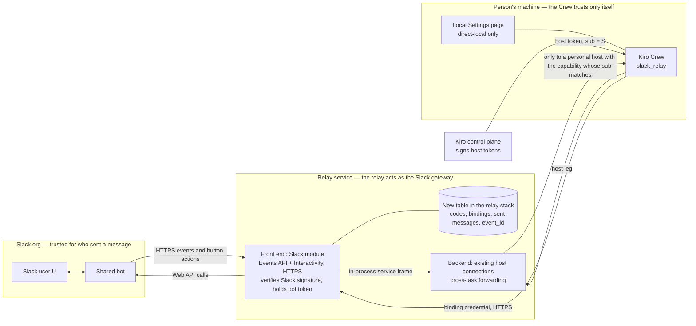
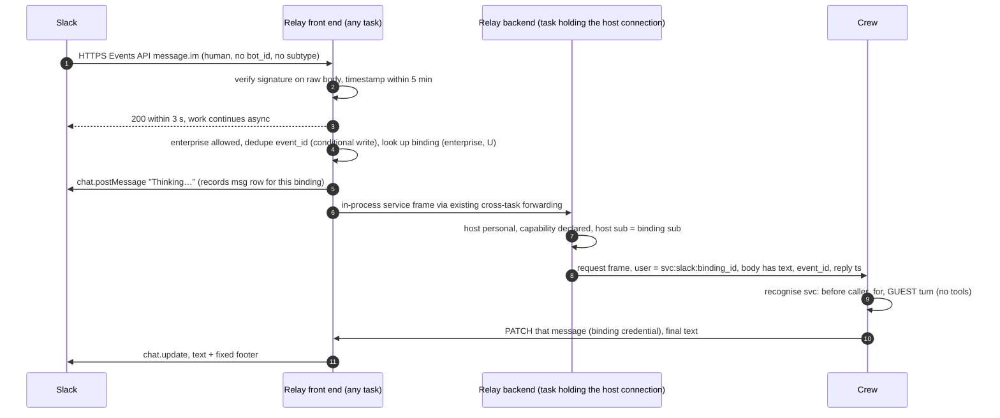
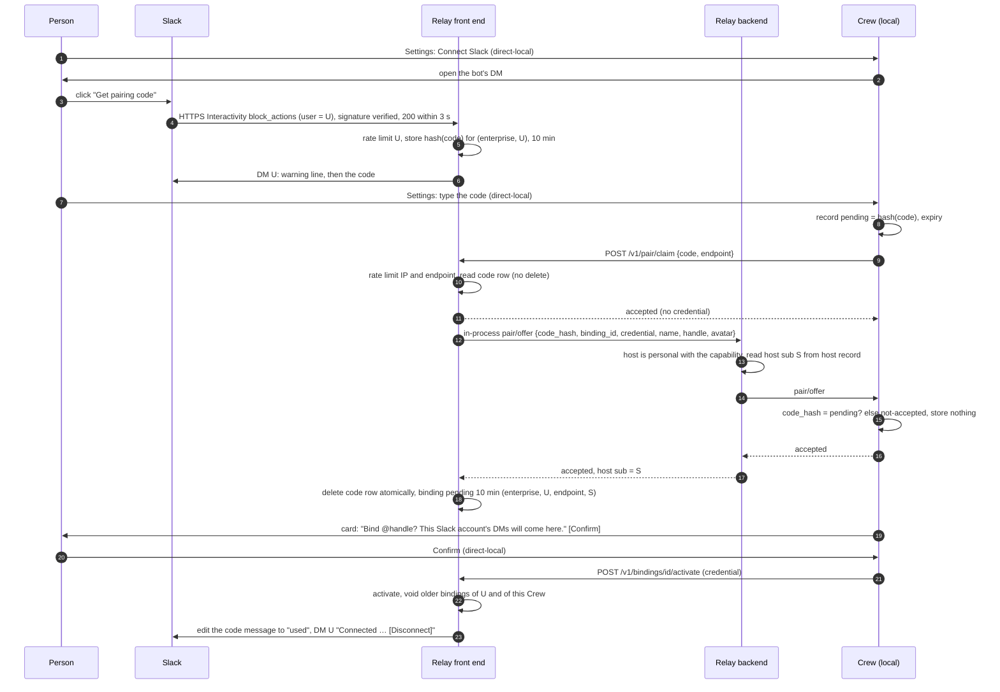
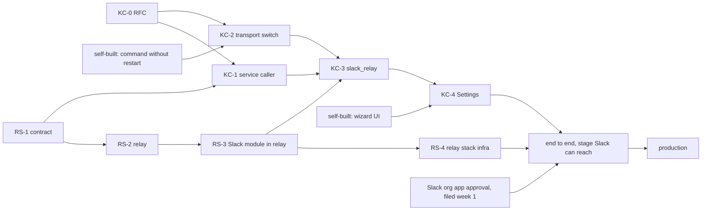

# RFC: One shared Slack app through the Kiro relay

Status: accepted. Accepted 2026-11-20 by Bolin Chen (bolichen97, maintainer) in [the design sign-off on #39165](https://github.com/kirodotdev/KiroCrew/pull/39165#pullrequestreview-5989069615), on commit `e243e19314`. Nothing is built yet and this document changes no code. It answers [#39154](https://github.com/kirodotdev/KiroCrew/issues/39154). Every Kiro Crew reference below was read at `44769dba4`. The relay service is operated outside this repository; its behaviour below was read from its source on 2026-11-18 and is described, not linked.

## Summary

Today a person who wants to reach their Crew from Slack builds their own Slack app. This RFC adds a second, optional path: **one shared Slack app**, served by the Kiro relay itself. **The relay acts as the Slack gateway; the existing host connections are its backend.** Its front end is a Slack module inside the relay process that takes the Slack Events API and Interactivity over HTTPS. Its backend is what the relay already has: each Crew's host connection, reached through the relay's existing cross-task forwarding. The module turns the person's DM to the shared bot into a **service frame** and delivers it in-process to that person's own Crew. The Crew answers; the relay posts the answer back as the bot. There is no new external service, no service token and no new token issuer.

Below, "the gateway" means the relay in this Slack-gateway role.

The person connects in three steps and pastes no token: click Connect on the local Settings page; click "Get pairing code" in the bot's DM; type the code on the local Settings page and confirm.

Phase 1 is **chat only**. A relayed DM runs as the existing `Audience.GUEST`: no tools, no memory read, no approval card. Tools, channels and streaming are a later RFC.

Four decisions are recorded here, made on 2026-11-18 by the product owner, the author of this RFC (iamwhatever):

1. **Pairing identity is the Kiro login.** The Crew side of a pairing is the Kiro user ID (`sub`) that the relay proves from the Crew's Kiro-signed host token. The display email plays no part.
2. **Phase 1 is chat only.** Relayed conversations get no tools, read no memory, and need no approvals.
3. **Option A: no cross-check that the Kiro account is the Slack user.** Security rests on the one-time code being seen only by the Slack user it was sent to. The accepted risk is stated in [§Security considerations, Accepted risk](#accepted-risk-option-a).
4. **Every relayed message carries a fixed footer** naming the source Crew by its binding ID. No name the Crew supplies is shown.

## Motivation

### Current state

- Slack in Kiro Crew is a self-built app per person, connected over Socket Mode with the person's own bot and app tokens. Without an owner the gateway refuses to connect (`init_socket_mode` in `src/kiro_crew/slack/events.py`); [rfc-slack-owner-claim.md](rfc-slack-owner-claim.md) proposes removing the owner-ID paste.
- Slash-command names collide across a whole Enterprise Grid org (the comment above `DEFAULT_ALIAS` in `src/kiro_crew/slack_manifest.py`), which already shapes the self-built path.
- A Crew with Remote Control on holds a host connection to the Kiro relay. Its host token comes from `RenewCrewLease`, using the local Kiro sign-in (`SIGN_IN_CREDENTIAL = "kiro-sign-in"` in `src/kiro_crew/relay_client/lease.py`). A personal Crew's owner is the host token's `sub` (`host_binding` in `src/kiro_crew/relay_client/token_source.py`).
- The relay lets a request reach a personal Crew only when the access token's `sub` equals the host token's `sub`. The relay already has a public HTTPS entrance, open outbound access, a secret store, a table pattern and cross-task forwarding to whichever task holds a Crew's host connection. Nothing in it delivers a message to a Crew except on behalf of an access-token holder.
- Relayed requests are matched exactly on the stable Kiro user ID, with `hmac.compare_digest` and no email (`caller_for` in `src/kiro_crew/dashboard/kiro_relay/caller.py`). A team Crew makes any well-formed relayed user a teammate (same function, `CrewKind.TEAM` branch).
- The Crew's credential store holds no email ("It stores no e-mail", `src/kiro_crew/auth/whoami.py`). In the relay contract, the access token's `email` and `name` are display only and never compared.
- `Audience.GUEST` already exists: `deny_all_tools`, interactive approval mode with no decider and no grant, `minimal_context` (`_run_admitted` call in `src/kiro_crew/messaging/dispatch.py`, `guest = asker.audience is Audience.GUEST`). The guest agent spec has `"tools": []`, `"mcpServers": {}`, `"includeMcpJson": False` (`src/kiro_crew/agent_materialization/service_agents.py`).

### Problem

1. Each person needs their own Slack app, and in a large Slack org each new app waits for the org's app-approval review.
2. The self-built path still needs two token pastes. They cannot be removed for a self-built app: the app-level token has no API.
3. Nothing today lets a third party deliver a message to a Crew over the relay without being its owner.

## Goals

- A person whose Crew has Remote Control available can talk to it from Slack with no Slack app of their own and no token paste.
- No new externally reachable service: the Slack front end lives in the relay process.
- The shared bot's token and Slack signing secret never leave the relay.
- A pairing completes only on the Crew that started it, with the Slack user who received the code, after a confirm on that Crew's local Settings page.
- A relayed DM can make the Crew do nothing but answer in text.
- The self-built path keeps working unchanged and stays the default.

## Non-goals

- Tools, approvals, memory, channels, `app_mention`, threads, reactions, streaming and slash commands for relayed turns. A later RFC covers them.
- Cross-checking that the Kiro account and the Slack user are the same person (Option A; see [Future upgrade](#future-upgrade-email-cross-check)).
- Team Crews. Phase 1 serves personal Crews only.
- Slack workspaces outside the one Enterprise org the shared app is installed in.
- Any change to the Kiro control plane.

## Design

### 1. Components and trust boundaries

The relay acts as the Slack gateway; the existing host connections are its backend.

| Boundary | What crosses it | What the receiver trusts |
|---|---|---|
| Slack → relay front end | Events API and Interactivity requests over HTTPS, on a reserved relay host name | The Slack request signature over the raw body, with a 5-minute timestamp window; then Slack's `user` and `enterprise_id` on the event |
| Front end → backend (inside the relay) | A service frame, built in-process | Nothing outside the process: only the Slack module can build a service frame, and no external request can (§5) |
| Relay backend → Crew | A request frame on the existing host connection | The relay; the frame's user is a synthetic `svc:slack:<binding_id>`, never the owner (§5) |
| Crew → relay front end | Claim (code, endpoint), activate, final reply, disconnect, over HTTPS on the same reserved name | Claim: nothing (rate limited). Everything else: the binding credential |
| Local page → Crew | Code entry and confirm | A direct-local request with an allowed `Origin`; a local process running as the person is inside this boundary, as for every direct-local Settings write (§3.3) |
| Kiro control plane → Crew | Host token | Kiro's ES256 signature; the Crew never sends this token anywhere but the relay |

### 2. Message flow (phase 1)

- Slack expects a 2xx within 3 seconds and retries a failed delivery up to 3 times, possibly to another relay task. The front end acknowledges first and does the rest asynchronously, and de-duplicates on `event_id` with a conditional write in the relay's table, so a retry landing on another task is dropped.
- A relay deploy drains tasks; an event in flight is covered by Slack's retry plus the `event_id` de-duplication.
- Two Slack calls per turn. The gateway keeps a per-workspace budget for `chat.postMessage` and `chat.update` and backs off on `429` per `Retry-After`.
- "Your Crew is offline" is sent at most once per binding per 10 minutes.
- The gateway stores no message body.

### 3. Pairing

#### 3.1 Rules

| Rule | How |
|---|---|
| Code direction | The code goes **from Slack to the person**, then into their Crew. A Crew never shows a code for the person to send to the bot: that is the phishing shape where an attacker hands a victim their own code. |
| Code | 8 characters from an alphabet without look-alike characters, normalised on both sides (upper case, spaces and dashes removed) before any hash; the gateway stores only an HMAC of it under a gateway-held key; 10 minutes; tied to (enterprise, U); a new code for U voids U's older one. |
| Code message | The code sits on the second line, so a push preview shows only the first. The DM says to type it only into your own Kiro Crew, and that anyone who asks for it is trying to take your Slack DMs. After use or expiry the gateway edits the message to "used" or "expired" with `chat.update`. |
| Where | Every gateway HTTPS endpoint below (`/v1/pair/claim`, `/v1/bindings/…`, `/v1/messages/…`) is served on the relay's reserved Slack host name, the same name Slack's Request URLs point at. |
| Claim carries no identity | `POST /v1/pair/claim` carries `{code, endpoint}` only. No `sub`, no secret, no hash. The answer is "accepted" or a refusal; it never carries a credential. |
| Rate limit before lookup | Limits are checked before the code is read. Failures lock per source IP (5 an hour, then 1 hour) and per (source IP, endpoint) pair; an endpoint alone is **never** locked, because the endpoint is a field any caller can name, and locking it would let anyone stop a Crew from pairing. A global hourly failure budget raises an alarm and locks nothing. |
| The code is not burned by a claim | The code is deleted only when the target Crew accepts the offer. A guessed or raced claim cannot void someone else's code. If two Crews accept offers for the same code, the atomic delete lets only the first create a binding; the gateway tells the second Crew over the relay that its offer is void. |
| Offer travels only through the relay | After a claim, the Slack module builds a `pair/offer` service frame for the endpoint and hands it in-process to the host connection for that endpoint, through cross-task forwarding when another task holds it. It is delivered only to a personal host that declared the capability; the relay reads that host's `sub` from its own host-connection record, never from the claim. The binding records that `sub`. |
| Crew accepts only what it started | The Crew keeps a pending pairing in memory: the SHA-256 of the normalised code it recorded when the person typed it, and its expiry. It accepts an offer only when the offer's code hash equals that pending hash and the pending entry is unexpired and unused. It answers the gateway, over the relay, `accepted` or `not-accepted`; on `not-accepted` it stores nothing and the gateway keeps the code and creates no binding. The claim caller never learns which. There is no other way for a Crew to start or finish a pairing. |
| Credential paths | The binding credential reaches the Crew only in the relayed offer, and later in the answer to a `rotate` call that the old credential authenticates (§6). It never appears in a claim answer. The Crew holds it in its vault. |
| Pending binding | An accepted offer creates a pending binding that lives 10 minutes. Unconfirmed by then, the gateway deletes it and the Crew deletes the pending credential. |
| Local confirm | The confirm card shows the Slack real name, `@handle` and avatar from the offer, and says "This Slack account's DMs will come to this Crew." |
| One Slack user per Crew | If the Crew already has a binding, the card says "This disconnects @old-handle", and the gateway DMs the old user when the new binding activates. |
| One Crew per Slack user | If U is already bound to another Crew, activating the new binding voids the old one; the gateway tells the old Crew over the relay and DMs U. |
| After activation | The gateway DMs U: "Connected to a Kiro Crew, binding `<short id>`, at `<time>`. Not you? [Disconnect]". Only facts the gateway itself holds; no name the Crew supplied. |
| Disconnect | From the Slack button or the Crew's Settings page; effective at once on both sides. |
| Lifetime | A binding expires 90 days after activation. Credential rotation replaces the credential but **never extends** that expiry. After expiry the gateway DMs U to reconnect. |

#### 3.2 Sequence

#### 3.3 The two local endpoints

The code-entry and confirm endpoints require `is_direct_local_request` (`src/kiro_crew/dashboard/origin.py`) **and** an `Origin` header in the allowed list. They refuse a request with no `Origin` (which `check_origin` in the same file otherwise trusts from loopback, for local processes such as `mcp-core`), an app token, a teammate, a relayed caller and any MCP tool entry.

What this does and does not stop, stated plainly: it stops a cross-site browser page and every remote caller. It does **not** stop a local process running as the person, because `Origin` is a header any local client can set. That is the same boundary as every other direct-local Settings write today (Slack tokens, owner ID). Through the Crew, such a process cannot learn a real code for the person: the code exists only in their Slack DM, and in relay mode the Crew holds no Slack token to read it. (A process that can read the person's own Slack client is outside what any Crew-side check can defend.) What it can do is enter a code an attacker supplied, for example from a prompt-injected agent shell: that is T2, with T2's consequence (the attacker's Slack user gets tool-less guest answers) and T2's notices (the displaced Slack user, if any, gets a DM). A stronger user-presence step is out of scope for phase 1 and listed under Open questions.

### 4. What a relayed turn may do (phase 1)

- Only `message.im` from a human (no `bot_id`, no non-human `subtype`), in the allowed enterprise.
- The turn runs as `Audience.GUEST` through the existing channel answer path: no tools, no MCP servers, no approval card, `minimal_context`, so no memory, lessons or skills enter the prompt.
- The relayed conversation is kept out of the owner's memory: it is not read by memory consolidation and does not appear in `search_chat_history`. Whether a guest turn's transcript reaches either today was not verified (`session_store_for_turn` is called for every turn in `dispatch.py`); the slack_relay PR verifies it and pins it with a test.
- No slash command is registered, so the shared app cannot collide with any self-built `/kirocrew`.
- The binding credential is kept out of every agent subprocess: it is added to `_AGENT_DENIED_ENV_KEYS` (`src/kiro_crew/sandbox_tiers.py`) and to `VAULT_CHANNEL_CREDENTIAL_KEYS`, is **not** added to `CREDENTIAL_KEYS` (`src/kiro_crew/config/loader_credentials.py`), is never written to `os.environ`, and is read from the vault only by `slack_relay`. A test checks the guest turn's subprocess environment and `os.environ`.

### 5. Service frames inside the relay

The relay acts as the Slack gateway, so there is no service token, no service leg on the front door and no new token issuer. Delivery from the Slack front end to a Crew's host connection happens inside the relay process, reusing the existing cross-task forwarding.

- **Who can build a service frame.** Only the relay's Slack module, in-process. No external request, on any leg or host name, can produce a service frame or set its user; the access leg and the Slack HTTPS routes never turn request content into one. A relay test pins this.
- **Delivery checks.** A service frame goes only to a personal Crew; team hosts get none. On every delivery after pairing, the host's `sub` from the relay's own host-connection record must equal the binding's recorded `sub`, so a binding stops working when the endpoint changes owner. Each has a relay test.
- **Slack request checks.** Every Events API and Interactivity request is verified with the Slack signing secret over the raw request body, with a 5-minute timestamp window, before it is parsed. `event_id` is de-duplicated across tasks with a conditional write. Only two Interactivity action IDs ("Get pairing code", "Disconnect") are accepted.
- **Capability.** The relay sends a service frame only to a host that declared the Slack service capability on its host connection; KC-1 adds that declaration. A Crew without KC-1 never receives one. This is the primary guard for old Crews, and a relay test pins it.
- **Frame user.** `svc:slack:<binding_id>`, never the owner. It is the second guard: a personal Crew without KC-1 finds no owner match in `caller_for` and refuses it. It does **not** guard an old team Crew: `caller_for` makes any well-formed ID a teammate there, and `svc:slack:…` matches `_KIRO_USER_ID_RE` in `caller.py`. Team Crews are therefore covered only by the capability rule and the relay's refusal of team hosts.
- **Crew side.** `_serve_handover` (`src/kiro_crew/dashboard/kiro_relay/ingress.py`) recognises the `svc:` prefix **before** `caller_for`. A team Crew refuses it. The service caller reaches only the service path, and the service path admits only the service caller. The Crew also de-duplicates on Slack `event_id`.
- **Isolation.** The Slack module shares a process with every Crew host connection on that task. It acknowledges first and works asynchronously, with bounded memory and bounded concurrency, so a Slack burst or fault does not drop host connections. The relay's per-IP web firewall limit gets its own rule for the Slack host name, because Slack sends from few addresses.

### 6. Gateway write API (binding credential)

Served over HTTPS on the relay's reserved Slack host name.

| Call | Allowed when |
|---|---|
| `PATCH /v1/messages/<ts>` | The message row for `<ts>` belongs to this binding |
| `POST /v1/messages` | Target is this binding's DM |
| `POST /v1/bindings/<id>/rotate` | Old credential valid for 5 more minutes; expiry unchanged |
| `DELETE /v1/bindings/<id>` | Either side |

Every message the gateway posts for a binding gets the fixed footer "From the Kiro Crew paired with you · binding `<short id>`". The Crew cannot remove or change it. The bot's Home tab says replies come from the Crew you paired, not from the Kiro Crew project.

### 7. Coexistence with the self-built app

- A new `slack.transport` setting, `socket` (default, today's behaviour) or `relay`, in `src/kiro_crew/config/sections_slack.py`.
- With `relay`, the Crew starts no Socket Mode connection and needs no `KIROCREW_OWNER_ID`. Owner-claim state from [rfc-slack-owner-claim.md](rfc-slack-owner-claim.md) is kept untouched and only unused, so switching back to `socket` restores it.
- Relay mode needs a host connection. When Remote Control is off, the Crew opens a host leg that serves only the Slack service path, and the Settings page says so: "Shared Slack has opened a relay connection that only receives Slack."
- If the account or org has remote access turned off (`remoteaccessdisabled` in `src/kiro_crew/relay_client/lease.py`), relay mode cannot work and the Settings page says so.
- The self-built setup wizard stays the default path. The Slack Settings panel offers the shared app as a second card. New strings use their own `slackRelay.*` key prefix so they do not collide with the wizard's strings.
- File overlap with the self-built work is ordered in §Migration plan.

## Migration plan

### Relay service changes (outside this repository)

Uploaded for the relay owner's review in this order. Each is reviewed in the relay service's own process.

| # | Change | Depends on |
|---|---|---|
| RS-1 | Relay contract: service frame shape, synthetic frame user, Slack service capability on the host connection, reserved service path. No service token | — (parallel with KC-0) |
| RS-2 | Relay: in-process service frames carried by the existing cross-task forwarding; delivery checks (§5): personal host only, capability declared, host `sub` equals binding `sub`; the Crew's offer answer and host `sub` returned to the Slack module | RS-1 |
| RS-3 | Slack module inside the relay: Events API and Interactivity routes, signature check, `event_id` de-duplication, pairing (§3), bindings, write API (§6), footer, rate budget, isolation (§5) | RS-2 |
| RS-4 | Infrastructure in the relay stack: new table, bot token and signing secret in the secret store, reserved Slack host name and its DNS, a web firewall rule for that name, Slack app Request URLs; handle the beta stage's inbound restriction (Slack cannot reach a beta that accepts only corporate networks), so end to end runs on a later stage or through an exception for that name | RS-3 |

### Kiro Crew pull requests

| # | Pull request | Depends on | Exit criteria |
|---|---|---|---|
| KC-0 | This RFC | — | Status `accepted` |
| KC-1 | Service caller: declare the Slack service capability on the host connection, `svc:` prefix before `caller_for`, team refusal, service-path-only routing | KC-0; field names per RS-1 | A team Crew refuses a `svc:` frame; a personal Crew without the feature answers not-owner; a service caller cannot reach any other route |
| KC-2 | `slack.transport` switch | KC-0; after the self-built "command without restart" change to `sections_slack.py` lands | `relay` starts no Socket Mode and needs no owner; switching back restores owner-claim state |
| KC-3 | `slack_relay`: routes (`event`, `pair/offer`), pending pairing, local endpoints (§3.3), guest dispatch, final reply, credential storage and isolation | KC-1, KC-2; API per RS-3 | Every case in §Tests passes |
| KC-4 | Settings: Connect card, code box, confirm card, disconnect, relay-only and remote-access-off notices, every locale | KC-3; after the self-built wizard UI lands | A read-only viewer sees no Connect, code or Confirm control |

Each phase can be abandoned on its own: KC-1 and KC-2 change nothing while `slack.transport` is `socket`.

## Tests

| Area | Case |
|---|---|
| Offer acceptance | The Crew answers `not-accepted` and stores nothing for: a code hash that differs from the pending one; no pending entry; an expired pending entry; an already-used pending entry |
| Unstarted pairing | An attacker's claim with their own code and the victim's endpoint produces an offer the victim's Crew answers `not-accepted`; the gateway keeps the code and creates no binding |
| Same code, two Crews | Only the first accepted offer creates a binding; the second Crew is told its offer is void and drops its pending credential |
| Pending expiry | An unconfirmed pending binding is deleted on both sides after 10 minutes |
| Lockout | Bad claims naming a victim's endpoint from one IP lock that IP, and a claim for the same endpoint from another IP still succeeds |
| Claim answer | The claim answer never carries a credential, `sub`, Slack identity or binding ID |
| Code burn | A failed or raced claim leaves the code valid; only an accepted offer deletes it |
| Local endpoints | Code entry and confirm refuse: no `Origin` from loopback, a disallowed `Origin`, forwarded headers, an app token, a teammate, a relayed caller, an MCP tool entry |
| Service caller | A `svc:` frame on a team Crew is refused; on a personal Crew it reaches only the service path |
| Guest turn | No tools, no MCP servers, no approval card; the transcript is not read by memory consolidation and not returned by `search_chat_history` |
| Credential | Absent from the guest turn's subprocess environment and from `os.environ` |
| Lifetime | Rotation keeps the 90-day expiry; an expired binding delivers nothing |
| Replacement | Pairing a second Slack user disconnects the first and the card names them; re-pairing U from another Crew voids the old binding |
| Relay (RS-2, RS-3) | No external request on any leg or host name produces a service frame; a Slack request with a bad signature or a timestamp older than 5 minutes is refused before parsing; a retried `event_id` landing on another task is dropped; an unknown action ID is refused; a team host gets no service frame; a host without the Slack service capability gets no service frame; owner change on the endpoint stops delivery |

## Backward compatibility

Compatible. `slack.transport` defaults to `socket`, which is today's behaviour. A Crew without KC-1 never declares the service capability, so the relay sends it no service frame (§5); a personal Crew that got one anyway would refuse its synthetic user. Nothing is removed or renamed.

## Rollback

- Code: set `slack.transport` back to `socket`, or revert KC-3 and KC-4. KC-1 and KC-2 are inert without KC-3.
- A wrong pairing: Disconnect in Slack or in Settings; both sides drop the binding at once.
- Gateway-wide: the relay owner turns the relay's Slack module off; every Crew's host connection keeps working, and self-built Slack is unaffected.

## Security considerations

### Threat model

Assets: the person's Slack DMs, the bot's voice, the owner's Crew authority and memory. Actors: another Slack user in the org, a local process on the person's machine, a holder of a relay log line, the relay operator.

| # | Threat | Mitigation |
|---|---|---|
| T1 | Someone obtains U's code and binds U to their own Crew | **Accepted risk** (Option A, below). Code only in U's DM, warning text, 10 minutes, one-time, edited to "used", post-pairing DM with Disconnect |
| T2 | An attacker gets U to type the attacker's code into U's Crew, binding the attacker's Slack user to U's Crew | Confirm card shows the Slack real name, handle and avatar; one Slack user per Crew, and the card names the user it disconnects; the attacker gets only tool-less guest answers on U's quota |
| T3 | A Crew completes a pairing it did not start | The Crew accepts an offer only when its code hash matches the pending one it recorded locally (§3.1) |
| T4 | The claim caller receives the binding credential | The credential travels only in the relayed offer; the claim answer carries none |
| T5 | A guessed or raced claim voids U's code, or bad claims naming a victim's endpoint lock that Crew out of pairing | Rate limit before lookup; the code is deleted only on an accepted offer; locks are per IP and per (IP, endpoint), never per endpoint alone |
| T6 | The code is read from a lock-screen preview or screen share | Code on the second line; edited away after use or expiry |
| T7 | A local process or agent shell enters and confirms a code | Partly mitigated (§3.3): remote and cross-site callers are refused; a local process can only enter a code someone gave it, which is T2 with T2's consequence |
| T8 | Relayed text enters the owner's memory or a tool | Guest turn with no tools; relayed conversation excluded from memory and chat-history search (§4) |
| T9 | A Crew impersonates the official bot or names itself "Kiro Crew security" | Fixed gateway footer with the binding ID; no Crew-supplied name anywhere (§6) |
| T10 | An external request forges a service frame into a Crew | No service token and no new issuer exist; only the in-process Slack module builds service frames, and no external request on any leg or host name can produce one (§5, relay test) |
| T11 | An old Crew treats a service frame as its owner | Relay sends service frames only to hosts that declared the capability; synthetic frame user `svc:slack:<binding_id>` as a second guard on personal Crews |
| T12 | A team Crew treats a service frame as a teammate | Relay sends no service frame to team hosts or to hosts without the capability; a KC-1 Crew refuses `svc:` on a team Crew. An old team Crew relies on the relay alone (§5) |
| T13 | A Slack request is forged or replayed | Slack signature over the raw body, 5-minute timestamp window, cross-task `event_id` de-duplication in the relay; the Crew also de-duplicates `event_id` |
| T14 | A Crew edits a message that is not its own | Message rows tie each `ts` to its binding (§6) |
| T15 | The binding credential leaks to an agent subprocess | Denied env key, vault only, not in `os.environ` (§4) |
| T16 | Rotation keeps an unwanted binding alive forever | Rotation never extends the 90-day expiry |
| T17 | The relay operator reads DMs | Stated, not mitigated: the relay is the gateway, so DM text passes through the relay process in transit. The relay stores no message body |
| T19 | A fault or burst in the Slack module drops the Crew host connections on the same relay task | Ack first, then async work; bounded memory and concurrency; a separate web firewall rule for the Slack host name (§5). Residual: a crash still drops that task's host connections, which reconnect as on any relay task restart |
| T18 | The person changes Kiro sign-in method (for example Builder ID to an organisation identity) | That is a different `sub`; delivery stops and Settings asks to reconnect |

### Accepted risk (Option A)

Phase 1 does **not** check that the Kiro account on the Crew is the same person as the Slack user. The relay proves which Kiro user owns the Crew; nothing compares that user with the Slack user. Security rests on the one-time code being seen only by the Slack user it was DMed to.

Stated plainly: **whoever obtains the code can read that Slack user's DMs to the bot and send them messages as the bot, until the user disconnects or the binding expires, up to 90 days.** The attacker owns the receiving Crew, so the guest restrictions do not bind them. The footer shows that a message came from a paired Crew and its binding ID, not that it came from the right person. The product owner, the author of this RFC (iamwhatever), accepted this risk on 2026-11-18, and the maintainer acceptance on the Status line covers the design with this risk stated.

### Future upgrade: email cross-check

When Kiro tokens carry a verified, immutable email (or another verified account attribute), the gateway adds one check at claim time: the Kiro attribute must equal the Slack user's verified email, else refuse. The code flow, the offer, the local confirm and every message path stay as they are, so this needs no redesign. Today the access token's `email` is display only, and the Crew holds no access token to present; this needs a Kiro control-plane change outside this repository.

### Rejected: hand the gateway a Kiro access token

The Crew could mint an access token for its own endpoint and give it to the gateway to prove its `sub`. Rejected: for its lifetime that token is the key to the owner's own Crew, and handing it to a third service adds a place it can leak. The relay proves the same fact without the token leaving the Crew.

## Review findings and their disposition

The design behind this RFC had an independent review. Each finding:

| # | Finding | Disposition |
|---|---|---|
| B1 | The earlier handshake could not be verified (the gateway held only a hash of the HMAC key) and did not say how the credential reaches the Crew; a Crew could answer a pairing it never started | **Fixed.** No HMAC and no self-reported `sub`; the credential travels only in the relayed offer; the Crew accepts only an offer matching its locally recorded code (§3.1, T3, T4) |
| B2 | The accepted risk was understated, and nothing checks that the Kiro account is the Slack user | **Fixed in wording, risk accepted.** Stated as above; the owner chose Option A; footer and gateway-only facts in the post-pairing DM (T9) |
| S1 | Simpler handshake: claim carries only code and endpoint; the relay supplies the host `sub` | **Fixed** (§3.1, §5); the relay reads it from its own host-connection record |
| S2 | The code was deleted before verification, so a guess could void it; "5 wrong tries void the code" could not work | **Fixed.** Rate limit first, delete only on acceptance; the per-code counter is replaced by per-IP and per-endpoint locks (§3.1) |
| S3 | The code stays visible in the DM | **Fixed.** Second line, edited after use or expiry (§3.1) |
| S4 | Loopback requests with no `Origin` bypass the local check | **Fixed for no-`Origin` callers; residual stated.** Both endpoints require an allowed `Origin`. A local process that forges one remains possible, as for every direct-local Settings write today; its reach is T2 (§3.3, T7) |
| S5 | "No memory" was shown for reads only, not for writes | **Deferred to KC-3 with a required test.** Not verifiable without the code; §4 states the rule and §Tests pins it |
| S6 | Users cannot tell which Crew a bot message came from | **Fixed.** Fixed footer and Home tab text (§6) |
| S7 | "No Kiro change" assumes the gateway's issuer is restricted to service tokens | **Removed by design.** The relay is the gateway, so there is no gateway issuer and no service token; the matching guarantee is that only the in-process Slack module builds service frames, pinned by a relay test (§5, T10) |
| S8 | Replacing a binding on the same Crew was not specified | **Fixed** (§3.1, one Slack user per Crew) |

## Alternatives considered

- **Self-built app only.** Kept as the default; it needs a Slack app per person and two token pastes.
- **Email comparison now.** Not possible: the Crew holds no verified email and Kiro tokens' email is display only.
- **Corporate SSO in front of the pairing page.** Rejected by the product owner: it ties the feature to one company's sign-in.
- **Crew shows a code, the person sends it to the bot.** Rejected: an attacker can hand a victim their own code.
- **One Crew holds the shared app and forwards to other Crews.** Rejected: that Crew's owner would read everyone's traffic.
- **A separate gateway service beside the relay, on Socket Mode, delivering through a service token.** Rejected by the product owner: a new external service to run, plus a token issuer the relay must trust and restrict. Socket Mode also allows few connections per app, which does not fit a relay with many tasks; the Events API has no long-lived connection, so any task can receive.
- **Put the Slack front end in the Kiro web backend.** Rejected for phase 1: it counts as a Kiro control-plane change, needs another team, puts every Kiro web user in the blast radius, and that backend has no relay client today, so it would still need a service token. It is the path for a later upgrade that closes the Option A risk: a web pairing page where the person is signed in to Kiro and signs in with Slack in the same session, then hands the verified `(Slack user, Kiro sub)` pair to the relay. That would go through its own RFC.

## Unverified

1. Whether a Kiro `sub` stays the same for life (rename, change of organisation identity instance, account merge), and its real format; the relay contract itself marks the format as unverified.
2. Whether the org's Enterprise Grid accepts the app's Events API and Interactivity Request URLs and delivers `block_actions` for a DM button, and whether the bot-DM deep link opens the DM directly in the org's Slack client.
3. Slack rate limits for `chat.postMessage` and `chat.update` per workspace for one shared app under many users.
4. How long the Slack org's app-approval review takes; it is filed in week 1 and gates only end to end.
5. That the shared app's user ID translation is off, so user IDs are the org-wide IDs.
6. Whether a guest turn's transcript reaches memory consolidation or chat-history search today (S5).
7. Whether the relay's existing cross-task forwarding can carry an in-process service frame as is; it was not read line by line.
8. How the relay's per-IP web firewall limit treats Slack's few sending addresses, and the exact rule the Slack host name needs.
9. Which relay stage end to end can run on, given that the beta stage accepts only corporate networks and Slack cannot reach it.

## Open questions

None blocking. Proposed defaults a reviewer may change without reshaping the design: the 8-character code, the 10-minute code and pending-binding lifetimes, the 5-an-hour failure lock, the 90-day binding expiry, and the one-Slack-user-per-Crew limit.

Deferred, not blocking: a user-presence step on the confirm that a local process cannot forge (§3.3). The dashboard has no such primitive today; adding one would serve every direct-local Settings write, not only this one, so it belongs in its own RFC.
