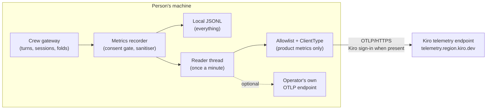

# RFC: send product metrics to the Kiro telemetry endpoint

- Status: draft. Nothing in this document is built. Code facts are measured at
  `afed43d2c0`.
- Author: chenmingwei23
- Tracking issue: [#21270](https://github.com/kirodotdev/KiroCrew/issues/21270)
- Related: [rfc-crew-usage-metrics.md](https://github.com/kirodotdev/KiroCrew/blob/docs/21270-crew-usage-metrics-rfc/docs/request-for-change/rfc-crew-usage-metrics.md) (the metrics
  this sends), [rfc-crew-log-telemetry-export.md](https://github.com/kirodotdev/KiroCrew/pull/21288)
  (the counting-fold export model),
  [metrics.md](../system-specs/modules/metrics.md) (the recorder, the consent gate
  and the destination seam), [telemetry-otlp-export.md](../guides/telemetry-otlp-export.md)
  (the operator guide).
- Depends on: a separate consent change that makes `telemetry.enabled` default
  on, with a first-run prompt and an opt-out in settings. This RFC does not
  decide consent; it decides what happens once consent is given.

## 1. Summary

Today Kiro Crew sends no metrics anywhere: `telemetry.enabled` is off by
default, and even when it is on, data leaves the machine only if the operator
sets `telemetry.otlp_endpoint`. So we have no product numbers at all.

This RFC adds one built-in destination, the Kiro telemetry endpoint
(`https://telemetry.<region>.kiro.dev/v1/metrics`, standard OTLP/HTTP). It sends
only a reviewed allowlist of product metrics, adds one fixed attribute
`ClientType=kiro-crew` to every data point, and uses the person's existing Kiro
sign-in when there is one. It counts nothing per machine. Everything else stays
local. An operator's own
`telemetry.otlp_endpoint` keeps working unchanged next to it.

## 2. Motivation

Today we decide what to build without seeing how Kiro Crew is used. We do not
know whether people use the conductor, how many workers a conductor runs, how
deep and wide session trees get, whether monitor loops do real work or tick
quietly, or how often work ledger items end accepted. No install reports
anything.

With these numbers we can:

- Put effort where people actually are. If few people run conductors, the
  conductor is a discovery problem, not a feature gap. If most do, its rough
  edges come first.
- See whether a change helped. A release that changes the conductor or the
  monitor loop can be checked against the week before, instead of argued
  about.
- Catch problems people never report. A rise in failed sub-agents, quiet
  monitor ticks, or dropped crew log writes shows up in the numbers before it
  shows up in an issue.
- See Crew next to the rest of Kiro. Every Kiro client already reports to the same
  Kiro telemetry endpoint, so Crew numbers sit next to the rest of Kiro instead
  of in a separate system.

The cost has to stay near zero for the person running Crew, and what is sent
has to be small, reviewed and anonymous. The rest of this document is about
keeping it that way.

## 3. Goals and non-goals

Goals:

- **No effect on the person using Crew.** Sending metrics must not slow the
  gateway, a turn, or the dashboard. It runs on the metrics reader thread that
  already exists, once a minute, and does nothing on the turn path.
- **Failures stay contained.** A slow, down or unreachable endpoint, a bad
  network, or a refused request must never raise into the gateway, block a
  thread the gateway needs, or restart anything. The worst case is a lost
  minute of numbers.
- **Quiet logs.** A failing export logs one warning, then stays at debug. It
  never writes one log line per minute, and never per metric.
- **Small and reviewed.** Only a reviewed list of product metrics is sent.
  Debug and resource metrics stay on the machine.
- **Anonymous.** No account id, user id, host name, path or user text.
- **Easy to turn off,** with one setting, and on whenever telemetry is on.

Non-goals:

- **Low-latency delivery.** Numbers arrive about once a minute. Nothing reads
  them in real time.
- **High availability or guaranteed delivery.** No disk queue, no long
  retries, no failover between endpoints. If an interval cannot be sent, it is
  dropped.
- **Fault tolerance beyond "do no harm".** The design only promises that a
  failure cannot hurt the gateway, not that every number arrives.
- The consent prompt and the default of `telemetry.enabled` (separate change).
- Counting machines or installs. People who are not signed in are not counted
  as people.
- Traces. The endpoint accepts `/v1/traces`; spans for exact latencies are a
  later RFC.
- The daily beacon. It keeps its own path and switch.

## 4. Design



The gateway only records numbers in memory. Everything to the right of the
recorder runs on the reader thread, so a slow or failing endpoint can only
delay the reader, never the gateway.

### 4.1 The built-in destination

`DefaultTelemetryProvider.otlp_destinations` returns, in addition to the
operator destination it returns today:

```
OtlpDestination(
    name="kiro-telemetry",
    endpoint="https://telemetry.us-east-1.kiro.dev/v1/metrics",
    signals=frozenset({"metrics"}),
    session=<requests.Session whose auth sets the identity headers of 4.4>,
    allow=PRODUCT_METRICS,                      # new field, 4.2
    point_attributes={"ClientType": "kiro-crew"},  # new field, 4.3
)
```

It is returned only when all of these hold:

- `telemetry.enabled` is true (the existing consent gate, checked before the
  provider is called);
- the new key `telemetry.kiro_export` is true (default true);
- the environment does not set `DO_NOT_TRACK=1` or
  `KIROCREW_TELEMETRY_KIRO_EXPORT=0`;
- the process is not in `--test-mode`.

Region: `telemetry.kiro_export_region`, one of `us-east-1` (default) and
`eu-central-1`. Any other value disables the destination rather than guessing.

### 4.2 Export allowlist

`OtlpDestination` gains an optional `allow: frozenset[str] | None`. When it is
set, the core wraps that destination's exporter so a metric whose name is not in
the set is dropped before encoding. `None` keeps today's behaviour (send
everything), so operator destinations are unchanged.

This keeps the seam add-only: a destination can only narrow what it receives.
It still cannot remove the local sink, relax consent, or bypass the attribute
sanitiser.

`PRODUCT_METRICS` lives in one module next to the instrument declarations, and a
test fails when a name in it has no instrument or is not a counter or a gauge.
The v1 list is the metrics of the metrics RFC plus these existing ones:
`session.started`, `session.idle_expired`, `turn.tokens`, `subagent.spawned`,
`cron.fires`, `artifact.created`, `workflow.runs`, `approval.decisions`,
`context.compactions`, and the `inventory.*` gauges.

Rule for the list: counters and gauges only. A fixed-bucket histogram is not
sent, because its buckets may not survive the receiving backend; a metric that
needs a distribution uses a bucket-labelled counter (metrics RFC, section 4).

### 4.3 Fixed point attributes

`OtlpDestination` gains an optional `point_attributes: Mapping[str, str]`. The
exporter wrapper adds these to every data point of that destination only. Values
are constants fixed at construction, checked against a short allowlist of keys
(`ClientType` in v1), and never logged with the endpoint.

The attribute goes on the data point, not on the Resource, because the receiving
side routes on point attributes.

### 4.4 Identity: the Kiro sign-in, nothing per machine

Kiro Crew does not count machines. Counting people relies on the Kiro sign-in
the person already has, the same way other Kiro clients do it.

| Person | Request headers | Counted as a person? |
|---|---|---|
| Signed in to Kiro | `Authorization: Bearer <Kiro access token>`, plus `x-kiro-profile-arn` and `x-kiro-token-type` when the sign-in needs them | Yes, by the endpoint, which validates the token as every Kiro client's is validated. Crew sends no user id of its own |
| Not signed in | `x-kiro-machineid` only, because the endpoint requires one of the two | No. The value is a header the endpoint requires, not a metric attribute, and Crew does not count by it |

The token is the one Crew already holds for model calls (the auth provider),
read from its cache:

| Sign-in kind | `x-kiro-token-type` | `x-kiro-profile-arn` |
|---|---|---|
| Builder ID, Identity Center, social | omitted (the endpoint defaults to `SSO_OIDC`) | sent when the sign-in has one |
| External IdP | `EXTERNAL_IDP` | sent |
| API key | `API_KEY` | sent when present |

Rules:

- The token is read from the cache on each export. Export never starts a sign-in
  and never forces a refresh; a token that is missing or within its expiry
  margin sends the request as not signed in instead.
- A request whose token is refused (401) is dropped, not retried as not signed
  in, so one interval is never counted twice.
- The token, the profile ARN and the machine id go in headers only. None of them
  becomes a metric attribute, enters a series, or is written to the local sink.
- The machine id for people who are not signed in is a one-way hash of the
  existing install id with a fixed prefix, so it cannot be joined with the
  beacon, and no new file is created.

### 4.5 Instrumentation scope

Product metrics are recorded on a second meter with scope `kiro.crew`, matching
the scope naming of other Kiro clients. Debug and resource metrics stay on the
existing `kiro_crew` scope. The allowlist is the gate; the scope split makes the
data easy to route on the receiving side.

### 4.6 Resource attributes

The Kiro destination sends `service.name`, `service.version`, `os.type` and
`process.pid` (needed so gauges from several processes of one install do not
interleave into one series). No host name, no user name, no cloud account.

### 4.7 Failure behaviour

Each rule below serves the goals in section 3.

| Case | What happens |
|---|---|
| Endpoint slow | The request times out after 10 seconds, inside the reader thread. The gateway does not wait for it |
| Endpoint down or unreachable | The interval is dropped. No disk queue, no retry beyond the SDK's bounded retry |
| Request refused (4xx) | The interval is dropped. After 3 refusals in a row, this destination pauses for an hour so a bad config does not retry every minute |
| Any exception in the exporter or the filter | Caught at the destination boundary. The local sink and the operator's own endpoint keep working |
| Logging | One warning on the first failure, then debug only. One info line when sending recovers |
| Memory | Nothing is buffered across intervals, so a long outage holds no growing data |

No work is added to the turn path, the dashboard request path, or the crew log
append path.

## 5. What the person sees

- The privacy panel and `docs/guides/telemetry-otlp-export.md` list the exact
  metrics in `PRODUCT_METRICS`, the endpoint host, that the Kiro sign-in is
  used when present, and how to turn it off.
- Opt-out, any one of: turn off telemetry in settings, `kirocrew config set
  telemetry.kiro_export false`, `DO_NOT_TRACK=1`, or
  `KIROCREW_TELEMETRY_KIRO_EXPORT=0`.
- The local JSONL sink still records everything, so a person can read what was
  measured on their own machine.

## 6. Phases

1. Seam: add `allow` and `point_attributes` to `OtlpDestination`, the exporter
   wrapper, `PRODUCT_METRICS` and its test. No behaviour change.
2. Kiro destination behind `telemetry.kiro_export`, default false, with the
   identity headers of 4.4. Validated against the pre-production endpoint for
   each sign-in kind and for no sign-in.
3. Flip `telemetry.kiro_export` to default true once the consent change has
   landed.

## 7. Backward compatibility

- Operator destinations: unchanged (`allow=None`, no point attributes).
- Installs with `telemetry.enabled=false`: unchanged, nothing is sent.
- Code that overrides `otlp_destinations`: unchanged; the new fields are
  optional.

## 8. Security and privacy considerations

- Data sent: counters and gauges from a reviewed list, with closed-enum
  attributes, one constant `ClientType`, and resource attributes listed in 4.6.
- Not sent: user id, account id, host name, paths, prompts, tool arguments,
  model output, or any free text.
- Identity is the existing Kiro sign-in, sent as a header, as other Kiro
  clients do. Crew never sends a user id, email or account id.
- Nothing is counted per machine. The machine id header exists only because
  the endpoint requires it when no one is signed in; it is a hash, not the
  beacon id, and never a metric attribute.
- Tokens are never logged, never written to the local sink, and never refreshed
  by the exporter.
- Anyone can post to an anonymous endpoint, and a modified build can send the
  same `ClientType`. We accept that: the numbers are statistical, and abuse
  control belongs to the endpoint.
- TLS only; the endpoint is a constant, not configurable to plain HTTP.

## 9. Alternatives considered

- Send everything the recorder has. Rejected: most instruments are for local
  debugging, and the larger the set, the larger the privacy review.
- Put `ClientType` on the Resource. Rejected: the receiving side routes on point
  attributes.
- A fixed machine id shared by every install. Rejected: requests are rate
  limited per id, so all installs would share one limit.
- An email or a user id sent by Crew. Rejected: personal data, and the sign-in
  token already identifies the account to the endpoint.
- Reuse the beacon id as the machine id. Rejected: it would join the two
  streams.
- A Kiro Crew owned collector in front of the endpoint. Rejected for v1: more to
  run, and the endpoint is already public and standard OTLP.
- A disk queue with retries for guaranteed delivery. Rejected: it adds disk
  writes and memory on the person's machine for numbers that are only read in
  aggregate. A lost minute does not change any answer.
