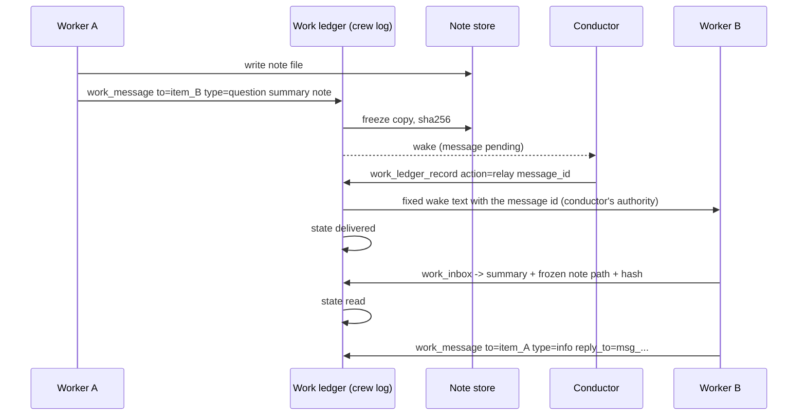

# RFC: Worker messaging — typed messages, receipts and code-checked threads on the work ledger

Status: draft. Nothing built; this document changes no code. Every code reference
was read at `1bd20d010a`. It builds on two earlier steps. The worker-debate
protocol ([#26316](https://github.com/kirodotdev/KiroCrew/pull/26316), merged) is
skill text only:
[`goal-conductor/references/worker-debate.md`](../../src/kiro_crew/builtin_skills/goal-conductor/references/worker-debate.md).
The approval-free relay
([#26485](https://github.com/kirodotdev/KiroCrew/pull/26485), open when this was
written) lets a Conductor `session_send` to a session it created without a per-call
prompt, unless the user's `hooks.confirm_tools` names the call. This RFC is the
third step. If accepted, it replaces the Phase 5 design in
[`rfc-conductor-work-ledger.md`](rfc-conductor-work-ledger.md) (`work_request`,
`work_message`, channels), which was never built.

---

## Summary

A worker can say one thing to its conductor today: a `work_report` status on its
own item. Anything meant for a sibling worker or for the human rides inside that
report's prose, and the conductor decides by reading it who it is for, retypes it
into a `session_send`, and remembers whether it arrived. The debate protocol runs on
top of that and works, but every rule in it (who speaks next, how many rounds, when
to stop) is kept by the conductor's judgment.

This RFC adds one record kind, a **message**, to the work ledger's crew-log
projection. A message has a server-resolved sender, a typed recipient (a worker
item, the conductor, or the human), a type (`question`, `info`, `objection`,
`ruling`, `handoff`), a server-minted id, an optional `reply_to`, and a delivery
state (`sent`, `delivered`, `read`) that only the server advances. The ledger holds
a summary of at most 500 characters and a pointer to a **frozen note**. The full
text lives only in the note.

Routing keeps the creator fence. A worker never reaches a sibling's session. The
conductor approves each delivery with one ledger write, and code does the delivery
under the conductor's own authority. A later phase adds **threads**: a conductor
opens one per debate, ask or handoff, names its participants and caps, and code
then relays inside it, counts rounds and refuses what the caps forbid. The
conductor still rules on every objection.

## Motivation

### What the phase-1 protocol leaves to judgment

The debate protocol is honest about its limits ("Any participant can edit any file
in the directory", worker-debate.md §Limits). Five gaps follow from it running on
convention alone:

| # | Gap | Today |
|---|---|---|
| 1 | Worker-to-worker vs worker-to-human | Both arrive as a `question` report. Only the optional `reason=needs_human` (`WORK_BLOCKED_REASONS` in `work_vocab.py`) and the conductor's reading tell them apart. |
| 2 | Delivery | No message id exists in code. Nothing records that a relay reached the target, or that the target read it. With several workers, correctness rests on the conductor's round log in `note.md`. |
| 3 | Rounds and stop rules | Counted and applied by the conductor. A conductor that miscounts, or forgets a critic, is caught only by a critic reading the note. |
| 4 | Tampering | Round files and `note.md` sit in a shared directory every participant can write, before and after they are read. |
| 5 | Scope | Debates only. A worker that needs one fact from a sibling mid-task, or hands a branch to a sibling, has no record for it. |

### What the trial measured

The protocol's own trial (one proposer, one critic, three rounds, before the
approval-free relay) was tallied at about 7 to 9 conductor turns and about 9 to 11
approval prompts: one prompt per seed and per relayed round file. The critic's own summary of
the trial named the waste as relay overhead, state spread across files, `decide`
and the session ledger, and judgment with no machine check. The approval-free relay
removes the prompts. It does not remove the turns, the bookkeeping or the gaps above.

### Why the obvious fixes are withheld

- **Let workers `session_send` each other.** The creator fence forbids it on
  purpose. `_caller_is_ownership_fenced` in `dashboard/session_control_parts/caller_access.py`
  fences every agent-created session to sessions it created, because a session that
  could reach a sibling would be "an unfenced deputy for free" (same docstring). A
  worker did not create its siblings; the conductor did.
- **Ship the work-ledger RFC's Phase 5 as written.** It gives the right gate (the
  conductor) but two shapes for one thing (`request` and channel `message`), a
  500-character body with no note pointer, no recipient for the conductor or the
  human, no reply link, and no read receipt. It also predates the debate protocol,
  so it has no notion of rounds.

## Goals

1. One typed record for every worker-originated message, whoever it is for.
2. A message to the human is distinguishable from a message to a worker by a field,
   not by prose.
3. Every message has a server-minted id, and its delivery and read are recorded by
   the server, not claimed by a model.
4. A debate's participants, round count and caps are data that code checks.
5. The ledger holds a summary and a pointer; the full text lives in a note
   (the owner's rule of 2026-10-30).
6. Point-to-point asks and handoffs use the same record.
7. Fewer conductor turns per relay than phase 1, with no new approval prompts.

## Non-goals

- No direct worker-to-worker session access. The creator fence stays as it is.
- No message text ever becomes another session's prompt. Bodies reach a recipient
  only as tool-result data.
- No automatic judging. Code counts and refuses; it never decides that an objection
  is fixed or that a debate converged on substance.
- No fan-out outside one conductor's ledger, and no cross-crew messaging (the
  remote-dispatch `reply` status in [`rfc-conductor-remote-dispatch.md`](rfc-conductor-remote-dispatch.md) §3b is left alone).
- No protection against a participant that runs as the same OS user and edits files
  on disk. See §Tamper resistance for what that rules out.

## Design

### Overview

Three rules hold everywhere:

- **Identity is resolved, never asserted.** `from` comes from the caller's session,
  the same way `work_report` resolves its item today.
- **The ledger never holds the discussion.** A message carries a summary
  (≤ 500 characters, the existing event-text cap `MAX_EVENT_TEXT_CHARS` in
  `work_ledger_records.py`) and a note pointer.
- **Delivery uses only fixed server text.** What enters a recipient's turn queue is
  a constant template naming a message id. The body is fetched by a tool call and
  arrives as data.

### The message record

A message is one `work/recorded` crew-log entry with a new action, `message`, on the
**sender's** item (or on the conductor record when the conductor or the human
sends). State changes are further entries, never edits. Fields:

| field | type | writer | notes |
|---|---|---|---|
| `message_id` | `msg_<8 hex>` | server | minted; never model-supplied |
| `thread_id` | `th_<8 hex>` or null | server | set when sent inside a thread (§Threads) |
| `from` | `{kind, item_id?}` | server | `kind` is `item`, `conductor` or `human`; resolved from the caller |
| `to` | `{kind, item_id?}` | sender | `item` must be an open item of the same ledger; `conductor`; or `human` |
| `type` | enum | sender | `question`, `info`, `objection`, `ruling`, `handoff` |
| `reply_to` | `msg_<8 hex>` or null | sender | must name a message of the same ledger addressed to the sender |
| `summary` | string ≤ 500 | sender | refused, not truncated, when longer |
| `note` | `{path, sha256, bytes}` or null | server | the frozen copy (§Notes); the sender passes a source path |
| `objections` | list ≤ 20 or null | sender | `objection` only: `{id, severity, state}`; ids and enums, no prose |
| `rulings` | list ≤ 20 or null | conductor | `ruling` only: `{id, value, cites?}`; see §Threads |
| `state` | enum | server | `sent`, `delivered`, `read`; plus `refused` when the conductor declines |
| `ts`, `delivered_at`, `read_at` | ISO 8601 | server | |

Who may send which type:

| type | worker | conductor | human |
|---|---|---|---|
| `question` | yes | yes | yes |
| `info` | yes | yes | yes |
| `objection` | in a debate thread, as a critic | no | no |
| `ruling` | no | yes | yes |
| `handoff` | yes | yes | no |

A worker's `question` to `human` is gap 1's answer: it is a field, so the conductor
does not interpret it and the Crew page can show it in the needs-you band directly.
The conductor still sees it on the board. The existing `reason=needs_human` on a
`blocked` report stays for "I cannot move", which is a different statement from
"I have a question for you".

Messages count against the existing 200-events-per-item budget. A thread's caps
(§Threads) keep a debate well under it.

### Delivery states

The server advances `state`; no model writes it.

| state | set when | recorded by |
|---|---|---|
| `sent` | the sender's `work_message` call is accepted and the note is frozen | `work_message` |
| `delivered` | the recipient's next read will return it, and, for an item recipient, the fixed wake text was queued into its bound session | `relay`, or the thread's auto-relay |
| `read` | the recipient's own read tool returned the body to it | `work_inbox` for an item, `work_ledger_read` for the conductor, the person's Crew page route for the human |
| `refused` | the conductor declined to relay, with a one-line reason | `relay` with `refuse: true` |

`read` means a tool returned the message to the recipient. It does not mean the
model opened the note file or understood it. That is the strongest true thing code
can say, and the RFC does not claim more.

A message to `conductor` is `delivered` on write and `read` the first time a
`work_ledger_read` returns it. A message to `human` is `delivered` once it is on the
Crew page payload and `read` when the person opens it through the authenticated
Crew page route.

### Routing: keep the fence, let code deliver

A worker cannot reach a sibling's session, and this RFC does not change that.

| option | reach | who carries the body | verdict |
|---|---|---|---|
| Conductor retypes into `session_send` (phase 1) | unchanged | the conductor's prose | works; no ids, no receipts; one conductor turn and one file read per relay |
| **Conductor approves, code delivers** | unchanged | the frozen note, read as data | **chosen** |
| Worker sends to a sibling directly | widened | the sender's prose, straight into a turn | rejected; see below |

How the chosen path works:

1. `work_message` from a worker to an item writes `sent` and wakes the conductor.
   Pending messages join the actionable set that `ledger_wake` reads, at the same
   per-item ceiling of 12 wakes an hour (`MAX_WAKES_PER_ITEM_PER_HOUR` in `ledger_wake.py`).
2. The conductor calls `work_ledger_record action=relay message_id=...`. The server
   resolves the target's bound session, runs the same target authorization a
   `session_send` from the conductor's key would run (`authorize_target`,
   `dashboard/session_control_parts/target_authorization.py`), and
   queues the fixed text: `New message <message_id> on your work item. Call
   work_inbox to read it.` It records `delivered`.
3. `relay refuse=true reason=...` records `refused` and tells the sender on its next
   `work_brief`.

The delivery acts with the conductor's authority, so it can reach only what the
conductor can already reach. It adds no grant: `work_ledger_record` is already on
the conductor spec's auto-approved list (`_CONDUCTOR_BASE_WORK_GRANTS` in `agent_parts/spec_grants.py`).

Why not loosen the fence:

1. The fence follows authority. A worker that can queue turns in a sibling can
   create a chain no one dispatched, which is the exact deputy the fence's docstring
   names.
2. A direct send is the sender's text in the recipient's turn. No one in between
   reads it, and no one could refuse it.
3. The conductor must see every message to referee a debate. With code delivery the
   cost of that gate is one ledger write, so loosening buys almost nothing.

**This changes one property of the ledger RFC's Phase 5.** That design asserted
that `work_message` calls nothing on the delivery path, so a recipient learned of
a message only on its next `work_brief`. This design does queue a turn, because a
worker that is never woken never answers. What crosses is a constant string with
one server-minted id. The body still crosses only as tool-result data. The cost the
change adds is that a relay makes the recipient take a turn; thread caps bound how
many.

### Notes

The owner's rule is that the ledger never holds the full discussion. Notes are
where it lives.

- The sender writes its text to any file it can write, then passes that path to
  `work_message`.
- The server reads it once, refuses it past 64 KB or when it is not UTF-8 text,
  and writes a **frozen copy** to
  `<data_home>/work-ledger/<conductor dir>/notes/<message_id>.md` (mode `0o600`,
  written with `atomic_write`, like the rest of the store). It records the copy's
  path, SHA-256 and size on the message.
- `work_inbox` and `work_ledger_read` return the frozen path and the hash, never
  the source path. On every read the server hashes the frozen copy again and flags
  `note_changed: true` on a mismatch.
- The debate note (`note.md` in phase 1) becomes a view: a server-rendered
  transcript of a thread's frozen notes, rulings and round log, written to the
  thread directory on request. The note keeper role goes away.

Notes are not in the crew log, so `work_ledger_rebuild` restores message records
and hashes but not note bodies. A lost frozen copy reads as `note_missing`.

### Threads

A thread groups messages and carries the caps that code checks. The conductor opens
one with `work_ledger_record action=thread_open`:

| field | type | notes |
|---|---|---|
| `thread_id` | `th_<8 hex>` | minted |
| `kind` | enum | `debate`, `ask`, `handoff` |
| `participants` | list | `{item_id, role}`; roles `proposer`, `critic` (debate) or `asker`, `answerer` (ask), `from`, `to` (handoff) |
| `anchor` | `{summary ≤ 500, note}` | the question and scope; a frozen note like any message |
| `anchor_v` | int | starts at 1; only a human message can raise it |
| `max_rounds` | int 1..4 | debate only; default 3 |
| `max_messages` | int ≤ 50 | every kind; refuses past it |
| `ttl_secs` | int ≤ 86400 | refuses past it |
| `auto_relay` | bool | default false; see below |
| `state` | enum | `open`, `awaiting_ruling`, `closed` |
| `outcome` | enum or null | `stable`, `ruled`, `stopped`, `capped` |

Code checks, per thread:

| check | refusal |
|---|---|
| sender is a participant, or the conductor, or the human | `not_a_participant` |
| type fits the sender's role (only a critic sends `objection`) | `type_not_allowed` |
| `anchor_v` on a reply matches the thread's | `stale_anchor` |
| message count, TTL | `thread_exhausted`, `thread_expired` |
| a proposer round `r + 1` before every critic filed round `r` and the conductor ruled | `round_not_open` |
| any message but a `ruling` after round `max_rounds` closed without `stable` | `awaiting_ruling` |

**`auto_relay`.** When true, a message between two participants of the same thread
is delivered by code at once, without a conductor turn. The conductor is woken only
when a round's critique step is complete (every critic filed), when the thread
reaches a cap, or when a message is addressed to it or to the human. The conductor
still opens the thread, so it still decides which pair may talk, about what, for
how long. This is the work-ledger RFC's channel, folded into a thread.

### A debate on threads

Phase 1's protocol maps onto a `debate` thread with no new concepts:

| phase 1 | P3 |
|---|---|
| anchor in `decide` and `note.md` | `thread_open` anchor note; `anchor_v` on the thread |
| round files `round-<r>-<x>.md` | one message per author per round; the round file is its note |
| objection table in `note.md` | the `objections` list on each critic's `objection` message: `{id, severity, state}` |
| the referee's ruling lines | one conductor `ruling` message per round with `rulings: [{id, value}]`; values `fixed_verified`, `rebuttal_accepted`, `parked`, `downgraded` |
| round log | derived from message order; never written by a model |
| note keeper | gone; the thread view is rendered by the server |
| stop rules | partly computed; see below |

Objection ids keep the protocol's `<aspect>-<round>-<n>` form. Code checks that an
id is new or already open in this thread, and that a `ruling` names only ids that
exist.

What code can check of the four stop rules:

| rule | code computes | judgment left to the conductor |
|---|---|---|
| 1. the human said stop | a human `ruling` message with value `stop` closes the thread `stopped` | none |
| 2. every critic reviewed the current version and no blocking objection is open | whether every critic filed for the latest proposer version, and the open-blocking count from the lists | whether each `fixed_verified` ruling is true |
| 3. no new blocking id this round, old ones still open | new blocking ids this round = 0 and open blocking > 0 → `awaiting_ruling` | none |
| 4. round `max_rounds` done without rule 2 | → `awaiting_ruling`; further rounds refused | none |

So code enforces the count, the cap and the order. It reports `stable` only when the
counts say so, and it cannot report `stable` past an open blocking id. Whether a
`fixed_verified` ruling is honest is still the conductor's call, as it is in phase 1.

### The human's ruling

Phase 1 takes the human's ruling as a free-form message to the conductor. P3 keeps
it free-form and adds a verified path.

- **Verified path.** The person answers on the Crew page, against the
  `awaiting_ruling` thread or a `to: human` message. That goes through the existing
  person transaction (`record_person_steer_result`,
  `dashboard/handlers/work_ledger_worker.py`), which already writes an entry with
  actor `person`. P3 extends it to write a `message` with `from: human`,
  `type: ruling` (or `info`), and the person's text as its note. The summary is the
  text's first 500 characters.
- **Mapping.** The conductor then sends its own `ruling` with `reply_to` set to the
  human's message id, mapping the words to ids (`rulings: [{id, value, cites:
  msg_...}]`). Anyone can compare the mapping to the quoted words. If the words are
  unclear, the conductor asks back with a `question` to `human`, as phase 1 says.
- **Code rule.** Once a thread is `awaiting_ruling`, a conductor `ruling` may close a
  blocking id only if it cites a `from: human` message in that thread. A ruling that
  cites none is refused `ruling_needs_human`.
- **Chat path.** A ruling typed into the conductor's own chat is not a person-route
  write. The conductor may record it as its own `ruling` with
  `relays_human: true` and the quoted text as the note. Code marks it unverified and
  it does not satisfy `ruling_needs_human`. P3 does not provide a verified chat path.

### Point-to-point asks and handoffs

- **Ask.** A sends `question to=item_B`. Outside a thread the conductor relays it
  with one `relay`. B answers with `info reply_to=<id>`, and the conductor relays
  that back. For a pair that will talk more than once, the conductor opens an `ask`
  thread with `auto_relay: true` and a small `max_messages`, and code relays the rest.
- **Handoff.** A sends `handoff to=item_B` with a note naming the branch, files and
  state. B reads it in `work_inbox`. A handoff is information only: it never moves
  an acceptance bar, and the conductor's `accept` rule for a claimed `pr` is
  unchanged.

### Tools

| tool | caller | change |
|---|---|---|
| `work_message` | worker | new: `to`, `type`, `summary`, `note_path?`, `reply_to?`, `objections?` |
| `work_inbox` | worker | new: returns delivered messages to the caller's item, marks them `read`; `since` cursor |
| `work_brief` | worker | adds `unread` (count) and the state of the caller's own sent messages |
| `work_ledger_record` | conductor | new actions `message`, `relay`, `thread_open`, `thread_close` |
| `work_ledger_read` | conductor | adds `messages` per item and `threads`; marks conductor-addressed messages `read` |
| Crew page person route | person | writes `from: human` messages |

`work_report` is unchanged. A worker that asks the conductor something still may
use `question`; `work_message to=conductor` is the typed form, and the skill text
moves to it.

### Cost

Per debate of three rounds, one proposer and one critic, no nudges:

| | conductor turns | approval prompts | relays carried by |
|---|---|---|---|
| Phase 1 trial (tallied) | about 7 to 9 | about 9 to 11 | conductor prose via `session_send` |
| Phase 2 (#26485) | about 7 to 9 | 0, unless `hooks.confirm_tools` names the call | same |
| P3a, relay per message | about 7 to 9 | 0 | one `relay` call per message, no file read or retyping |
| P3b, debate thread with `auto_relay` | about 5 (open, one ruling per round, close) | 0 | code |

Each added critic adds one relay per round in phase 1 and P3a, and nothing in P3b.
P3a does not save turns. What it buys is gaps 1 to 4: types, ids, receipts and
hashes. P3b is where turns fall, because the conductor is woken once per round to
rule instead of twice to relay.

## Tamper resistance

What P3 guarantees, and what it does not:

| property | P3 | how |
|---|---|---|
| A message's sender is who it says | yes | `from` is resolved from the calling session |
| A message cannot be dropped or rewritten in the ledger | yes, as far as the crew log is | append-only entries, server-minted ids |
| A note changed after it was sent is detected | yes, detected, not prevented | frozen copy plus SHA-256, re-hashed on every read |
| Rounds, caps and order are what the record says | yes | refusals in §Threads |
| A human ruling is from the human | yes, on the Crew page path only | person-actor route |
| A frozen note cannot be edited | **no** | participants run as the same OS user and can write the file; P3 only detects it |
| Files outside the note store (drafts, the debate directory) are safe | **no** | P3 does not watch them |
| The recipient model read or understood the note | **no** | `read` means a tool returned it |
| A conductor's `fixed_verified` ruling is correct | **no** | judgment |
| A human ruling typed in the conductor's chat is from the human | **no** | marked unverified |
| A record that holds across a trust boundary | **no** | same owner, same trust level only, as in phase 1 |

P3 does not prevent tampering. It makes tampering with a sent note visible, and it
takes the record of who said what and when out of files the participants can edit.

## Security considerations

- **No body becomes a prompt.** Only the fixed wake text is queued. A test must
  assert that the queued text equals the template with one id substituted.
- **Reach is unchanged.** `relay` and auto-relay run target authorization under the
  conductor's key. A message can only name an open item of the caller's own ledger;
  ids are minted, so a name cannot be a path.
- **Note paths.** The server reads the sender's source path once. That read runs in
  the gateway, not in the worker, so it must refuse paths the worker could not
  itself read: P3 limits source paths to the worker session's working directory and
  the thread directory, resolved with `realpath`, and refuses symlinks out of them.
- **Turn cost as abuse.** Auto-relay lets a participant cause turns in another.
  `max_messages`, `ttl_secs` and the 12-wakes-per-item-per-hour ceiling bound it.
- **Privacy.** Frozen notes inherit the store's `0o600` mode. The phase-1 rule
  stands: no private memory, credentials or customer text in a note.

## Migration plan

Building starts only after phase 2 (#26485) is merged and used in at least three
real debates, and the owner confirms the numbers above still describe the cost.

### P3a — the record, the relay, the inbox

Scope: the `message` action and its state entries; `work_message`, `work_inbox`;
`relay`; frozen notes; `unread` on `work_brief`; `messages` on `work_ledger_read`;
the wake for pending messages.

Exit criteria:
- A worker `work_message` writes one entry on its own item and none on the target's,
  asserted byte for byte on the target's events.
- `from` cannot be set by a caller; a supplied `from` is refused.
- `to` naming a closed item, another ledger's item, the caller's own item, or a
  non-minted string is refused, one assertion each.
- `relay` queues exactly the fixed template with the message id, and nothing else;
  `enqueue_or_run_prompt` (`_ChatSlot` in `dashboard/state_parts/chat_slot.py`) is spied and its
  text compared to the template.
- `relay` to a session outside the conductor's reach is refused by target
  authorization, not by a new check.
- A note edited after send reads `note_changed: true`; a deleted one reads
  `note_missing`.
- `work_inbox` returns a message once and marks it `read`; a second call returns it
  only with `since` before it.
- A `to: human` message appears on the Crew page payload and not in any worker's
  inbox.

### P3b — threads and auto-relay

Scope: `thread_open`, `thread_close`; per-thread checks; `auto_relay`; computed
stop rules; the rendered thread view; skill text in `worker-debate.md` moved onto
threads.

Exit criteria:
- Every refusal in §Threads has its own test with its own code.
- With `auto_relay` on, a participant-to-participant message is `delivered` with no
  conductor turn; the conductor is woken once when the last critic files a round.
- A thread with an open blocking id never reports `stable`, asserted over a fixture
  that tries every order of rulings.
- After round `max_rounds`, every non-ruling message is refused `awaiting_ruling`.

### P3c — the human's verified path

Scope: the person route writes `from: human` messages; `ruling_needs_human`; the
needs-you band shows `to: human` messages and `awaiting_ruling` threads.

Exit criteria:
- A person reply writes `from: human` with actor `person`; no agent caller can write
  `from: human`, asserted per tool.
- A conductor ruling closing a blocking id in an `awaiting_ruling` thread without
  citing a human message is refused.
- A `relays_human` ruling does not satisfy that rule.

Each phase can ship and be abandoned alone. P3b depends on P3a; P3c depends on P3a
and is useful without P3b.

## Backward compatibility

Additive. `work_report`, its statuses and `reason` are unchanged. A conductor that
never calls the new actions runs exactly as today, and phase 1's file protocol keeps
working beside it. Event readers that do not know the `message` action must ignore
it; the `work` fold and the boards get a test that an unknown action leaves an item
unchanged. The work-ledger RFC's unbuilt Phase 5 is dropped in favour of this
design; its `channels/` directory is never created.

## Alternatives considered

| alternative | why not |
|---|---|
| **Keep skill-only (phase 1 plus phase 2).** | It works and costs no code. It leaves all five gaps; correctness rests on the conductor following rules, and nothing checks it. It stays the right choice until real debates show the gaps cost something, which is why building waits for that data. |
| **A `workflow_run` debate script.** One worker runs a script that alternates `ctx.agent(session=...)` calls. | Zero relays and deterministic caps. But participants are workflow-internal sessions a person cannot open or steer, and the Conductor never runs `workflow_run` itself (`goal-conductor/SKILL.md`, "A large item's seed may name `workflow_run`"), so a worker sits in between. It suits a closed, one-off argument, not asks or handoffs between dispatched workers. |
| **Direct worker-to-worker send.** Loosen the fence for siblings of one conductor. | Cheapest per message, but it makes every worker a deputy over its siblings and puts one worker's text into another's turn with no gate. The conductor would also lose sight of traffic it must referee. |
| **The work-ledger RFC's Phase 5 as written.** | Same gate, but two record shapes, no human or conductor recipient, no note pointer, no receipt and no rounds. This RFC keeps its gate and its "one bounded pair" idea as a thread. |

## Open questions

1. **Wake text in a busy recipient.** Should `relay` queue behind a running turn
   (the `session_send` default) or steer it? This RFC assumes queue.
2. **Frozen-note cap.** Is 64 KB per note enough for a design round? The trial's
   largest round file was about 12 KB.
3. **`question` to conductor.** Should the skill retire `work_report status=question`
   in favour of `work_message to=conductor`, or keep both?
4. **Verified chat ruling.** Is a person-stamped ruling from the conductor's own
   chat worth a later phase, or is the Crew page path enough?
5. **Entry bar.** Is "three real debates after phase 2" the right trigger to start
   P3a?
